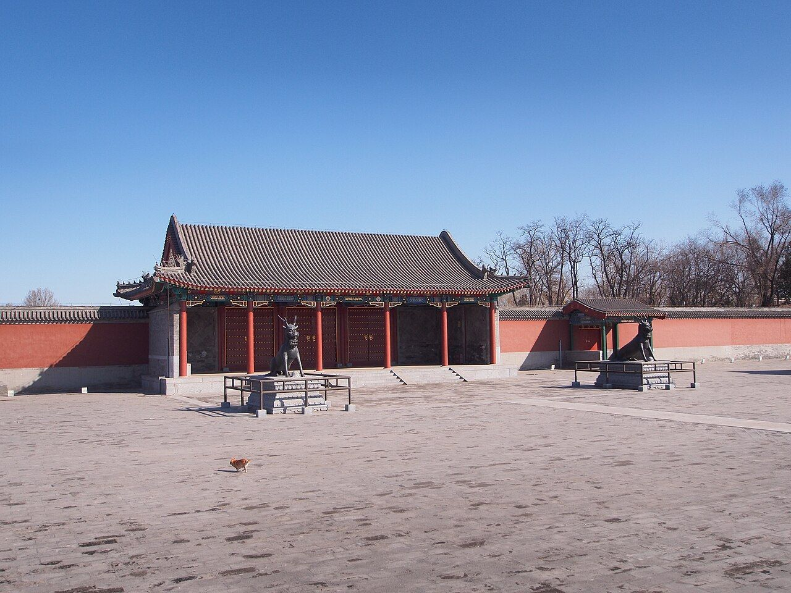

<!-- generated:start (scripts/building_pages.py): do not edit between these markers -->

# CC01-01: 长春园宫门 Changchun Yuan Gongmen

Changchun Yuan

**3D object:** 1 box. Open it: `/reconstruction/3d.html?b=CC01-01`

**Part of:** CC01 澹怀堂

## What we know

- **Name:** 长春园宫门 Changchun Yuan Gongmen (S05, S44, S57, S01, S112 · confidence B)
- **Written on the plan:** 长春园 (S01 · confidence B)
- **Garden:** Changchun Yuan (S05, S44, S57, S01, S112)
- **Type:** gate (S05, S44, S57, S01, S112 · confidence B)
- **Built:** 1747 (S44) (S05, S44, S57, S01, S112)
- **Destroyed:** 1860 (S05, S44, S57, S01, S112)
- **Position:** 40.00519, 116.30910. S01 sure (S01 · confidence B)
- **Bays:** 5 in the texts / 3x1 on the plan (S05, S44, S57, S01, S112)
- **Size in the inventory:** 16.7 × 9.4 m. S01 plan px / hall scale (S01)
- **Roof:** 卷棚歇山 (S05, S44, S57, S01, S112)
- **Tiles:** grey (S05, S44, S57, S01, S112)
- **Note:** Astride the south wall. 复建 2008-09 (S57). Bronze qilin moved here 1763, one survives at the Summer Palace (S44). (S05, S44, S57, S01, S112)
- **Plan reader's note:** Label 长春园 south of it (G21). Box covers the east part only; see fix. (S01) *(research copy, not public)*
- **How it was read:** sure (S01) *(research copy, not public)*
- **Plan pixels:** 11035, 4915 (S01) *(research copy, not public)*

## Our model now

On the block drawn on the Qing plan S01: position and frontage from the plan, heights and roof from the typology of its hall class, its form drawn by the hall kit. It will be updated as the research goes on.

- **Box:** 16.7 × 9.4 m, gate hall
- **Heights:** platform 0.77 m, eave 4.47 m, ridge 7.83 m above the ground
- **Roof:** hip-and-gable 歇山, rolled ridge 卷棚, grey tile
- **Faces:** 171.6° from north
- **Drawn:** by the hall kit: 5 bays, the middle widest, steps on the back, front, 歇山 hip-and-gable with a rolled ridge 卷棚, grey tile, bracket sets 斗拱 as a painted band. From its own figures and readings where the dossier gives them (roof read: buildings.csv B), the rest from the typology of its hall class.
- **Confidence:** B

## Pictures (1)

- **P0400** (sure): 长春园宫门 - Palace Gate of Changchunyuan Garden - 2013.03 - panoramio.jpg (Taken on 13 March 2013 (Commons DateTimeOriginal)). https://commons.wikimedia.org/wiki/File:%E9%95%BF%E6%98%A5%E5%9B%AD%E5%AE%AB%E9%97%A8_-_Palace_Gate_of_Changchunyuan_Garden_-_2013.03_-_panoramio.jpg

  

## Texts and drawings (7)

- **E0003** (text, sure): 日下舊聞考 澹怀堂、七空闸. 1780s (乾隆 敕撰) · j83:3a-3b · S05. https://github.com/kanripo/KR2k0036/blob/master/KR2k0036_083.txt
  > 長春園宫門五楹東西朝房各五楹正殿爲澹懷堂後爲衆樂亭亭後河北敞宇為雲容水態其西稍南為長橋（長春園册）臣等謹案澹懐堂内額曰樂在人和聯曰敷政協民心好惬箕風畢雨澄懐觀物理妙叅智水仁山與衆樂亭雲容水態諸額皆皇上御題又案園内諸河之水由圓明園東垣之一空閘五空閘流出環繞各所又東出七空閘灌溉稻田
  The gate is five bays with five-bay court rooms east and west; the main hall is 澹懷堂, then 衆樂亭 behind, 雲容水態 across the stream and 長橋 to the south-west. The second note: water comes from the 一空閘 and 五空閘 of 圓明園, circles the compounds and leaves by the 七空閘 to irrigate rice fields.
- **E0393** (text, sure): 长春园宫门. 1780s · j83:3a · S05. https://github.com/kanripo/KR2k0036/blob/master/KR2k0036_083.txt
  > 長春園宫門五楹東西朝房各五楹正殿爲澹懷堂
  S01 labels only 长春园 under this gate: it is the five-bay main gate of the garden with five-bay offices east and west.
- **E0009** (poem, likely): 长春园题句 有序. 乾隆三十五年 (1770) · v3 p.232, under 长春园; source ref 10-735 · S361. https://www.yuanmingyuanpark.cn/xs/yjbg/202008/P020200803382569071850.pdf#page=235
  > 山水符乐寿之征，兴随所遇。日月引壶洲之景，春与俱长。乃拓余地于御园，爰效嘉名于仙馆。顾当年之赐号，时切体元。筹他日之安居，兹惟卜始。波通福海东，壖旭丽扶桑。垣亘清河北，陌香浮华黍。列缥缃以娱志，堂启含经。抚翰墨以怡神，轩成淳化。思永励始终如一，式是斋乎。开襟而气象盈千，登斯楼也。他若某邱某壑，境足赏心；有榭有亭，胜堪寓目。每几暇朅来游憩，拟耄期恒此颐恬。以纪元六十载为衡，积愿笑惟奢望。从周甲廿五年而计，勖勤敢有倦心。俪以弁言，系之长律。
  Poem 长春园题句 有序 by the Qianlong Emperor, 1770, filed by the editors under 长春园.
- **E0010** (poem, likely): 长春园泛舟即景. 嘉庆九年 (1804) · v3 p.234, under 长春园; source ref 3-17 · S361. https://www.yuanmingyuanpark.cn/xs/yjbg/202008/P020200803382569071850.pdf#page=237
  > 园接长春御苑东，天然胜槩境相同。棹开柳渚鸭头绿，舟过荷亭雁齿红。山树浮波滴葱翠，楼台倒影印空蒙。澄晖朗映光清洁，鉴水观心表里融。
  Poem 长春园泛舟即景 by the Jiaqing Emperor, 1804, filed by the editors under 长春园.
- **E0006** (description, sure): 老北京的记忆(81): 长春园澹怀堂遗址, quoting report and 百景图志. blog · post 81 · S112. https://blog.sina.com.cn/s/blog_88741e0d0102w60j.html
  Built 1747, repaired 1769 and 1791. 澹怀堂 five bays, used for feasts of frontier princes (1760) and, in the 1830s, for empresses' rites. 众乐亭 was 锦香亭 until after 1761. Macartney's globes of 1793 stood here. Second-hand.
- **E0007** (archaeology, sure): 《圆明园长春园宫门区遗址发掘报告》, as quoted in 北平旧梦 老北京的记忆(81). excavated 2001-04 to 2004-10 · blog post, quoting the report and 《圆明园百景图志》 · S112. https://blog.sina.com.cn/s/blog_88741e0d0102w60j.html
  The dig of the 长春园 gate district found the layout still that of the Qianlong founding, with a strictly symmetrical axis of screen wall, 宫门, 牌楼门, 澹怀堂 Danhuai Tang and 众乐亭 Zhongle Ting, 220 m from screen wall to pavilion. It also found stone steps running into the lake north of 众乐亭, read as the imperial boat landing, and it corrects details of the 1930s Beiping survey map. Second-hand: a blog quoting the report.
- **E0008** (archaeology, sure): 长春园宫门首次开放, 京华时报 via 浙江在线. 2016-10-19 · news · S142. https://china.zjol.com.cn/gnxw/201610/t20161019_2006451.shtml
  Reports that the 长春园 gate, built 1747, was rebuilt on its old site and first opened to visitors in October 2016. One bronze 麒麟 survives and now stands at the Summer Palace. It also gives the park's figures: 86 surface remains registered, about 20% of underground remains excavated.

**On the plan:** Drawn on the plan of the gardens (S01), labelled 长春园, 3x1 cells. https://artmuseum.princeton.edu/collections/objects/138657

## Evidence for the set of buildings

- Evidence for the whole compound 澹怀堂: see CC01
- Reconstructions and comparables for the whole garden, 长春园 Changchun Yuan: see GARDEN-CC
- Standing buildings comparable to a gate hall (not this building): see CLASS-gate_hall

## Open questions

- Q25: Other dates
- Q196: The width of a paved way 甬道 is not known anywhere

<!-- generated:end -->

## Notes

<!-- Yours: regeneration never touches this part. It goes on the public site; what you write below a line holding only %% private %% stays in the research copy. -->
