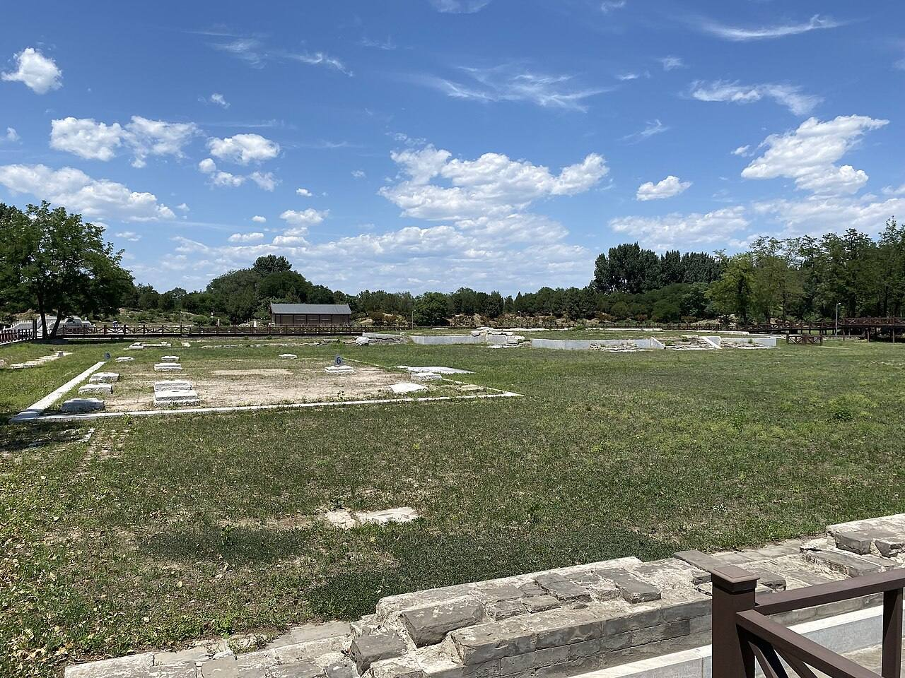
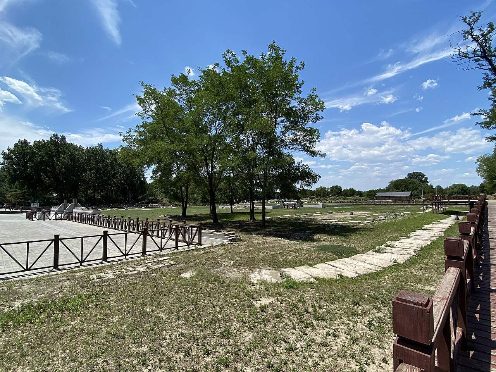

<!-- generated:start (scripts/building_pages.py): do not edit between these markers -->

# CC01-04: 澹怀堂殿 Danhuai Tang dian

Changchun Yuan

**3D object:** 1 box. Open it: `/reconstruction/3d.html?b=CC01-04`

**Part of:** CC01 澹怀堂

## What we know

- **Name:** 澹怀堂殿 Danhuai Tang dian (S05, S06, S44, S01, S112, S361 · confidence B)
- **Written on the plan:** 澹怀堂 (S01 · confidence B)
- **Garden:** Changchun Yuan (S05, S06, S44, S01, S112, S361)
- **Type:** audience hall (S05, S06, S44, S01, S112, S361 · confidence B)
- **Built:** 1747 (S05, S06, S44, S01, S112, S361)
- **Changed:** 1769 and 1791 repairs (S05, S06, S44, S01, S112, S361)
- **Destroyed:** 1860 (S05, S06, S44, S01, S112, S361)
- **Position:** 40.00594, 116.30896. S01 sure (S01 · confidence B)
- **Bays:** 9 in the texts / 5x3 on the plan (S05, S06, S44, S01, S112, S361)
- **Size in the inventory:** 30 × 25.7 m. stated in a source (S01)
- **Roof:** 卷棚歇山 (S06) (S05, S06, S44, S01, S112, S361)
- **Note:** 九楹 from S06, not S05. 前有月台丹陛, 东西配殿五楹 (S06). Empresses' coffins lay here 1833, 1840 (S44). bays: 5 (S112, post 81). roof: 卷棚歇山, with 单翘重昂 brackets (S112, post 81). (S05, S06, S44, S01, S112, S361)
- **Plan reader's note:** Label south. 5 cols x 3 rows on the plan vs 9 bays in the inventory. South porch x 11003-11070, y 4560-4610; stairs N (11038,4462) and S (11038,4628). (S01) *(research copy, not public)*
- **How it was read:** sure (S01) *(research copy, not public)*
- **Plan pixels:** 11038, 4517 (S01) *(research copy, not public)*

## Our model now

At a size stated in a source, on the block drawn on the Qing plan S01. Heights and roof from the typology where not stated; its form drawn by the hall kit.

- **Box:** 30 × 25.7 m, main hall
- **Heights:** platform 0.7 m, eave 4.4 m, ridge 7.34 m above the ground
- **Roof:** hip-and-gable 歇山, rolled ridge 卷棚, 3 parallel rolls 勾连搭, grey tile
- **Faces:** 172° from north
- **Drawn:** by the hall kit: 9 bays, the middle widest, a porch front and back, steps on the back, front, 歇山 hip-and-gable with a rolled ridge 卷棚, grey tile, a painted beam under the eave. From its own figures and readings where the dossier gives them (roof read: buildings.csv B), the rest from the typology of its hall class.
- **Confidence:** B

## Pictures (2)

- **P0398** (likely): 北京圆明园澹怀堂遗址 2021-06-20.jpg (2021-06-20 13:07:59 (Commons DateTimeOriginal)). https://commons.wikimedia.org/wiki/File:%E5%8C%97%E4%BA%AC%E5%9C%86%E6%98%8E%E5%9B%AD%E6%BE%B9%E6%80%80%E5%A0%82%E9%81%97%E5%9D%80_2021-06-20.jpg

  

- **P0399** (likely): 北京圆明园澹怀堂遗址 02 2021-06-20.jpg (2021-06-20 13:10:39 (Commons DateTimeOriginal)). https://commons.wikimedia.org/wiki/File:%E5%8C%97%E4%BA%AC%E5%9C%86%E6%98%8E%E5%9B%AD%E6%BE%B9%E6%80%80%E5%A0%82%E9%81%97%E5%9D%80_02_2021-06-20.jpg

  

## Texts and drawings (8)

- **E0001** (poem, sure): 御製秋日澹懐堂詩. 1749 (乾隆十四年) · j83:3b-4a · S05. https://github.com/kanripo/KR2k0036/blob/master/KR2k0036_083.txt
  > 乾隆十四年御製秋日澹懐堂詩　玉宇暢霽光松軒俯閬井山水既清佳結搆更寛整土階每覺慚繡柱無須逞神心適可達紛營於以屏斐然翰墨香謐爾希夷境豈惟容膝安寄懐斯良永
  Autumn poem on 澹懐堂, praising hill and water and the ample plan.
- **E0003** (text, sure): 日下舊聞考 澹怀堂、七空闸. 1780s (乾隆 敕撰) · j83:3a-3b · S05. https://github.com/kanripo/KR2k0036/blob/master/KR2k0036_083.txt
  > 長春園宫門五楹東西朝房各五楹正殿爲澹懷堂後爲衆樂亭亭後河北敞宇為雲容水態其西稍南為長橋（長春園册）臣等謹案澹懐堂内額曰樂在人和聯曰敷政協民心好惬箕風畢雨澄懐觀物理妙叅智水仁山與衆樂亭雲容水態諸額皆皇上御題又案園内諸河之水由圓明園東垣之一空閘五空閘流出環繞各所又東出七空閘灌溉稻田
  The gate is five bays with five-bay court rooms east and west; the main hall is 澹懷堂, then 衆樂亭 behind, 雲容水態 across the stream and 長橋 to the south-west. The second note: water comes from the 一空閘 and 五空閘 of 圓明園, circles the compounds and leaves by the 七空閘 to irrigate rice fields.
- **E0011** (poem, sure): 澹怀堂. 乾隆二十六年 (1761) · v3 p.241, under 澹怀堂; source ref 8-386 · S361. https://www.yuanmingyuanpark.cn/xs/yjbg/202008/P020200803382569071850.pdf#page=244
  > 闹致动无已，澹斯静有余。虽云互消息，可以悟忙徐。带水惟澄澈，襟林既朗虚。宁敎俗虑染，似与善人居。彦辅韵如彼，孔明语起予。明兹冲漠志，筹治企还初。
  Poem 澹怀堂 by the Qianlong Emperor, 1761, filed by the editors under 澹怀堂.
- **E0012** (poem, sure): 澹怀堂. 嘉庆九年 (1804) · v3 p.242, under 澹怀堂; source ref 2-402 · S361. https://www.yuanmingyuanpark.cn/xs/yjbg/202008/P020200803382569071850.pdf#page=245
  > 田盘澹怀乐碧山，御园澹怀俯渌水。仁者静兮智者动，性之所近各具理。天倪涵蓄察鸢鱼，因物付物终于是。心源澄浚气清明，洞烛群情辨正诡。
  Poem 澹怀堂 by the Jiaqing Emperor, 1804, filed by the editors under 澹怀堂.
- **E0013** (poem, likely): 澹怀堂有会. 嘉庆十九年 (1814) · v3 p.242, under 澹怀堂; source ref 6-034 · S361. https://www.yuanmingyuanpark.cn/xs/yjbg/202008/P020200803382569071850.pdf#page=245
  > 理明怀澹然，物我皆能觉。超出世俗情，识见自高卓。利欲惑性深，习染日污浊。就下益昏沉，身名嗟尽剒。淡泊志气明，灵台勤澣濯。圣狂一念分，及时修旧学。
  Poem 澹怀堂有会 by the Jiaqing Emperor, 1814, filed by the editors under 澹怀堂.
- **E0006** (description, sure): 老北京的记忆(81): 长春园澹怀堂遗址, quoting report and 百景图志. blog · post 81 · S112. https://blog.sina.com.cn/s/blog_88741e0d0102w60j.html
  Built 1747, repaired 1769 and 1791. 澹怀堂 five bays, used for feasts of frontier princes (1760) and, in the 1830s, for empresses' rites. 众乐亭 was 锦香亭 until after 1761. Macartney's globes of 1793 stood here. Second-hand.
- **E0005** (description, sure): 圆明园五朝御制诗文集注 v3, editors' note on 澹怀堂. 2020 edition · v3 p.241 · S361. https://www.yuanmingyuanpark.cn/xs/yjbg/202008/P020200803382569071850.pdf#page=244
  Finished 1747 inside the south gate, the garden's main hall and also called 勤政殿, used for government and for feasting frontier princes. Behind it is 众乐亭, across the river the five-bay 云容水态, and to the west the thirteen-arch 长桥, the longest of the gardens' bridges.
- **E0007** (archaeology, sure): 《圆明园长春园宫门区遗址发掘报告》, as quoted in 北平旧梦 老北京的记忆(81). excavated 2001-04 to 2004-10 · blog post, quoting the report and 《圆明园百景图志》 · S112. https://blog.sina.com.cn/s/blog_88741e0d0102w60j.html
  The dig of the 长春园 gate district found the layout still that of the Qianlong founding, with a strictly symmetrical axis of screen wall, 宫门, 牌楼门, 澹怀堂 Danhuai Tang and 众乐亭 Zhongle Ting, 220 m from screen wall to pavilion. It also found stone steps running into the lake north of 众乐亭, read as the imperial boat landing, and it corrects details of the 1930s Beiping survey map. Second-hand: a blog quoting the report.

**On the plan:** Drawn on the plan of the gardens (S01), labelled 澹怀堂, 5x3 cells. https://artmuseum.princeton.edu/collections/objects/138657

## Evidence for the set of buildings

- Evidence for the whole compound 澹怀堂: see CC01
- Reconstructions and comparables for the whole garden, 长春园 Changchun Yuan: see GARDEN-CC
- Standing buildings comparable to a main hall (not this building): see CLASS-main_hall

## Open questions

None that name it.

<!-- generated:end -->

## Notes

<!-- Yours: regeneration never touches this part. It goes on the public site; what you write below a line holding only %% private %% stays in the research copy. -->
