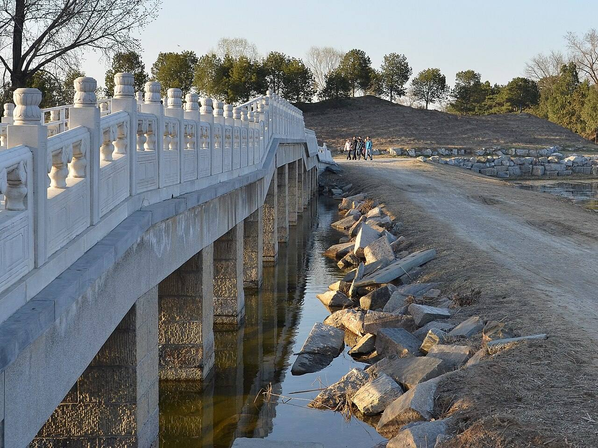

<!-- generated:start (scripts/building_pages.py): do not edit between these markers -->

# CC01-07: 长桥 Chang Qiao

Changchun Yuan

**3D object:** none yet.

**Part of:** CC01 澹怀堂

## What we know

- **Name:** 长桥 Chang Qiao (S05, S44, S06, S49, S01 · confidence B)
- **Garden:** Changchun Yuan (S05, S44, S06, S49, S01)
- **Type:** bridge (S05, S44, S06, S49, S01 · confidence B)
- **Destroyed:** 1860 (S05, S44, S06, S49, S01)
- **Position:** 40.00648, 116.30839. S01 likely (S01 · confidence B)
- **Note:** 13-span 板桥 (S44) vs 10 (S06; S49 40 m). (S05, S44, S06, S49, S01)
- **Plan reader's note:** Long straight N-S causeway x 10847-10871, y 4075-4335, west of and a bit south of 云容水态, as Rixia says. See features. (S01) *(research copy, not public)*
- **How it was read:** likely (S01) *(research copy, not public)*
- **Plan pixels:** 10860, 4200 (S01) *(research copy, not public)*

## Our model now

No box in the 3D view: the plan shows no building here, or a plot, water, a hill or a name only.

## Pictures (1)

- **P0401** (likely): Changchun Bridge Ruins 20130324.JPG (2013-03-24 17:17:46 (Commons DateTimeOriginal)). https://commons.wikimedia.org/wiki/File:Changchun_Bridge_Ruins_20130324.JPG

  

## Texts and drawings (2)

- **E0003** (text, sure): 日下舊聞考 澹怀堂、七空闸. 1780s (乾隆 敕撰) · j83:3a-3b · S05. https://github.com/kanripo/KR2k0036/blob/master/KR2k0036_083.txt
  > 長春園宫門五楹東西朝房各五楹正殿爲澹懷堂後爲衆樂亭亭後河北敞宇為雲容水態其西稍南為長橋（長春園册）臣等謹案澹懐堂内額曰樂在人和聯曰敷政協民心好惬箕風畢雨澄懐觀物理妙叅智水仁山與衆樂亭雲容水態諸額皆皇上御題又案園内諸河之水由圓明園東垣之一空閘五空閘流出環繞各所又東出七空閘灌溉稻田
  The gate is five bays with five-bay court rooms east and west; the main hall is 澹懷堂, then 衆樂亭 behind, 雲容水態 across the stream and 長橋 to the south-west. The second note: water comes from the 一空閘 and 五空閘 of 圓明園, circles the compounds and leaves by the 七空閘 to irrigate rice fields.
- **E0005** (description, sure): 圆明园五朝御制诗文集注 v3, editors' note on 澹怀堂. 2020 edition · v3 p.241 · S361. https://www.yuanmingyuanpark.cn/xs/yjbg/202008/P020200803382569071850.pdf#page=244
  Finished 1747 inside the south gate, the garden's main hall and also called 勤政殿, used for government and for feasting frontier princes. Behind it is 众乐亭, across the river the five-bay 云容水态, and to the west the thirteen-arch 长桥, the longest of the gardens' bridges.

**On the plan:** Drawn on the plan of the gardens (S01), labelled 长桥. https://artmuseum.princeton.edu/collections/objects/138657

## Evidence for the set of buildings

- Evidence for the whole compound 澹怀堂: see CC01
- Reconstructions and comparables for the whole garden, 长春园 Changchun Yuan: see GARDEN-CC

## Open questions

- Q26: Forms

<!-- generated:end -->

## Notes

<!-- Yours: regeneration never touches this part. It goes on the public site; what you write below a line holding only %% private %% stays in the research copy. -->
