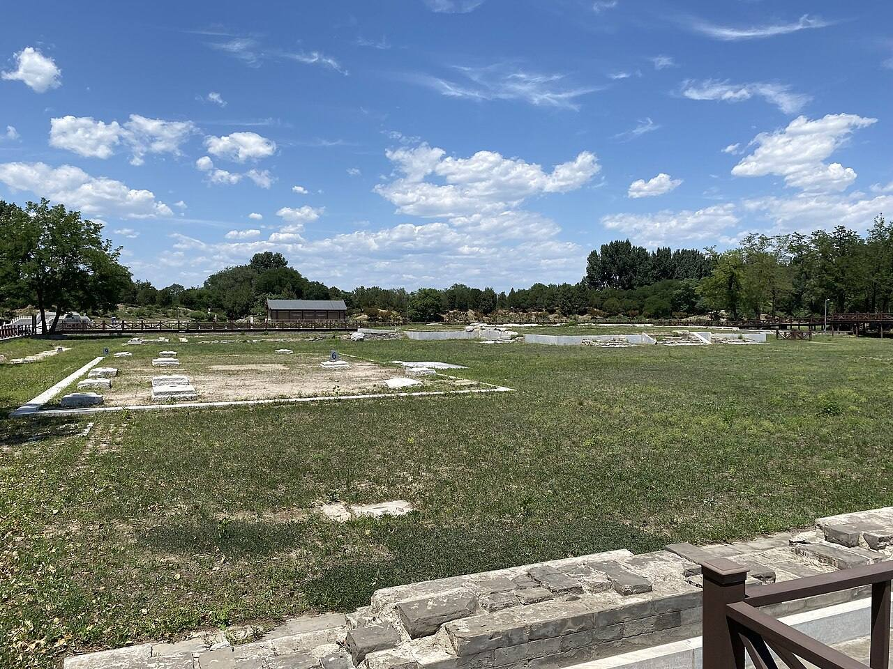
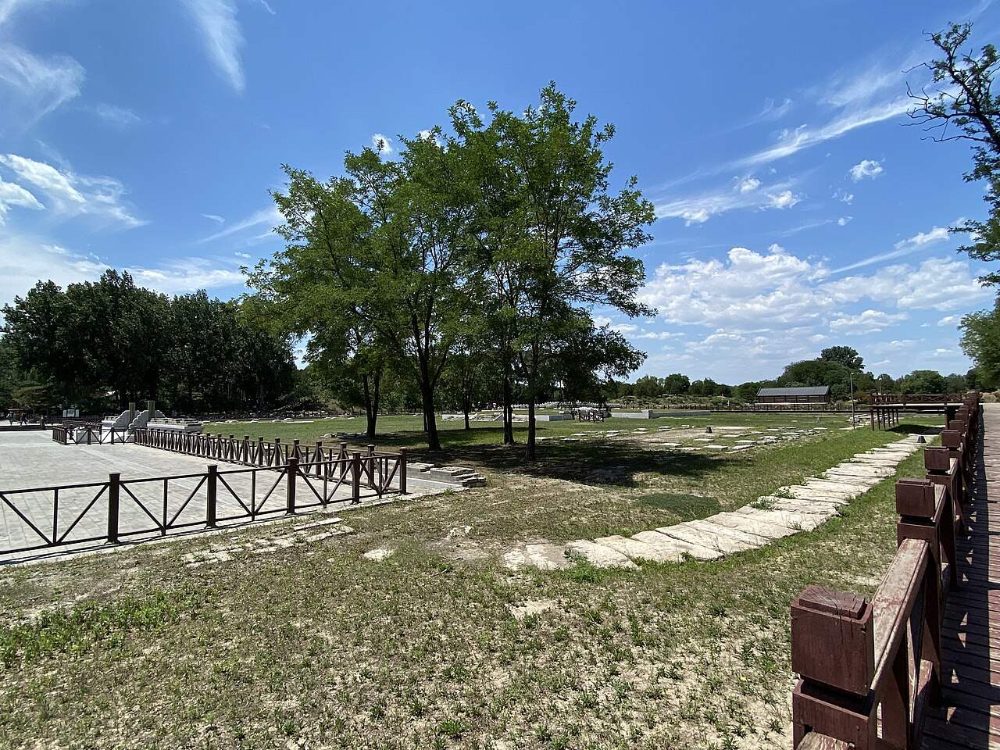
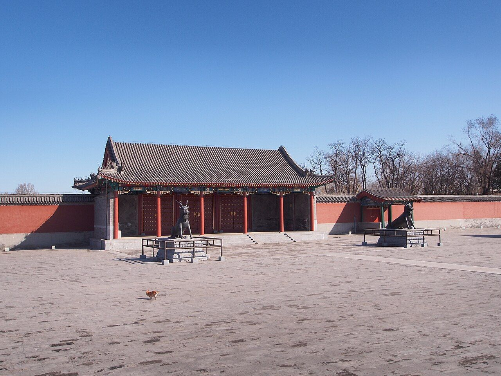
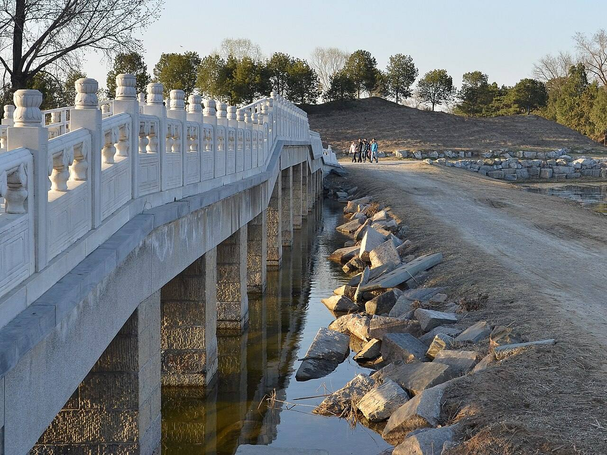
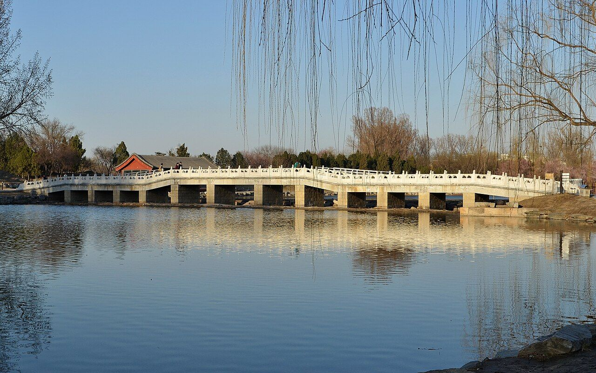

<!-- generated:start (scripts/building_pages.py): do not edit between these markers -->

# CC01: 澹怀堂 Danhuai Tang

Changchun Yuan

**3D object:** 11 boxes. Open it: `/reconstruction/3d.html?b=CC01`

## What we know

- **Name:** 澹怀堂 Danhuai Tang (S05, S44, S01 · confidence B)
- **Garden:** Changchun Yuan (S05, S44, S01)
- **Type:** compound (S05, S44, S01 · confidence B)
- **Built:** 乾隆十二年 1747 宫门 (S44); poem 1749 [j83:3b] (S05, S44, S01)
- **Destroyed:** 1860 (S05, S44, S01)
- **Position:** 40.00592, 116.30896. S01 sure (S01 · confidence B)
- **Note:** S44: 宫门区 南起影壁 北至众乐亭 220 x 95 m, 2.1万 m2, 建筑面积2650 m2. Also 勤政殿 (S44). S49 spells 淡怀堂. (S05, S44, S01)
- **Plan reader's note:** Label south of the hall, faded blue 1 at (11105,4670). South gate 长春园 (G21). 云容水态 (B0718) and 长桥 lie outside, north across the water. (S01) *(research copy, not public)*
- **How it was read:** sure (S01) *(research copy, not public)*
- **Plan pixels:** 11038, 4517 (S01) *(research copy, not public)*

## Our model now

11 boxes stand in this compound, 11 on blocks drawn on the plan, 0 assumed. Its halls are listed below.

## Inside it (12)

- CC01-01 长春园宫门
- CC01-02 朝房
- CC01-03 影壁
- CC01-04 澹怀堂殿
- CC01-05 众乐亭
- CC01-06 云容水态
- CC01-07 长桥
- CC01-B0939
- CC01-B0941
- CC01-N01
- CC01-N02
- CC01-N03

## Pictures (5)

- **P0398** (sure): 北京圆明园澹怀堂遗址 2021-06-20.jpg (2021-06-20 13:07:59 (Commons DateTimeOriginal)). https://commons.wikimedia.org/wiki/File:%E5%8C%97%E4%BA%AC%E5%9C%86%E6%98%8E%E5%9B%AD%E6%BE%B9%E6%80%80%E5%A0%82%E9%81%97%E5%9D%80_2021-06-20.jpg

  

- **P0399** (sure): 北京圆明园澹怀堂遗址 02 2021-06-20.jpg (2021-06-20 13:10:39 (Commons DateTimeOriginal)). https://commons.wikimedia.org/wiki/File:%E5%8C%97%E4%BA%AC%E5%9C%86%E6%98%8E%E5%9B%AD%E6%BE%B9%E6%80%80%E5%A0%82%E9%81%97%E5%9D%80_02_2021-06-20.jpg

  

- **P0400** (sure): 长春园宫门 - Palace Gate of Changchunyuan Garden - 2013.03 - panoramio.jpg (Taken on 13 March 2013 (Commons DateTimeOriginal)). https://commons.wikimedia.org/wiki/File:%E9%95%BF%E6%98%A5%E5%9B%AD%E5%AE%AB%E9%97%A8_-_Palace_Gate_of_Changchunyuan_Garden_-_2013.03_-_panoramio.jpg

  

- **P0401** (likely): Changchun Bridge Ruins 20130324.JPG (2013-03-24 17:17:46 (Commons DateTimeOriginal)). https://commons.wikimedia.org/wiki/File:Changchun_Bridge_Ruins_20130324.JPG

  

- **P0499** (likely): Changchun Bridge 20130324.JPG (2013-03-24 17:14:21 (Commons DateTimeOriginal)). https://commons.wikimedia.org/wiki/File:Changchun_Bridge_20130324.JPG

  

## Texts and drawings (16)

- **E0001** (poem, sure): 御製秋日澹懐堂詩. 1749 (乾隆十四年) · j83:3b-4a · S05. https://github.com/kanripo/KR2k0036/blob/master/KR2k0036_083.txt
  > 乾隆十四年御製秋日澹懐堂詩　玉宇暢霽光松軒俯閬井山水既清佳結搆更寛整土階每覺慚繡柱無須逞神心適可達紛營於以屏斐然翰墨香謐爾希夷境豈惟容膝安寄懐斯良永
  Autumn poem on 澹懐堂, praising hill and water and the ample plan.
- **E0003** (text, sure): 日下舊聞考 澹怀堂、七空闸. 1780s (乾隆 敕撰) · j83:3a-3b · S05. https://github.com/kanripo/KR2k0036/blob/master/KR2k0036_083.txt
  > 長春園宫門五楹東西朝房各五楹正殿爲澹懷堂後爲衆樂亭亭後河北敞宇為雲容水態其西稍南為長橋（長春園册）臣等謹案澹懐堂内額曰樂在人和聯曰敷政協民心好惬箕風畢雨澄懐觀物理妙叅智水仁山與衆樂亭雲容水態諸額皆皇上御題又案園内諸河之水由圓明園東垣之一空閘五空閘流出環繞各所又東出七空閘灌溉稻田
  The gate is five bays with five-bay court rooms east and west; the main hall is 澹懷堂, then 衆樂亭 behind, 雲容水態 across the stream and 長橋 to the south-west. The second note: water comes from the 一空閘 and 五空閘 of 圓明園, circles the compounds and leaves by the 七空閘 to irrigate rice fields.
- **E0004** (text, sure): 日下舊聞考: 澹怀堂. 1780s (乾隆 敕撰) · j83:3a · S05. https://github.com/kanripo/KR2k0036
  > 長春園宫門五楹 ... 正殿爲澹懷堂
- **E0002** (poem, sure): 御製 題澹懐堂. c. 1797, inferred from the last dated heading (御製詩餘集) · KR4f0005_507:6b-7a · S201. https://github.com/kanripo/KR4f0005/blob/master/KR4f0005_507.txt
  > 題澹懐堂 背嶺向空甸廓然薊野分一堂延理趣四壁泐前聞（向子）（所題詩懸壁間大都發揮理趣以著澹懐名額之義如丁未詩引仲尼訓顔淵以克已復禮已酉以諸葛澹泊）（明志為見道癸丑復申主静之㫖而曰四匆從頭觀皆意在尊聞並非流連景物也）自覺陳言緒奚如大塊文吾懐未能澹望逺正殷勤
  Written in retirement. The hall has hills behind and open plain before, and his earlier poems hang on the four walls.
- **E0011** (poem, sure): 澹怀堂. 乾隆二十六年 (1761) · v3 p.241, under 澹怀堂; source ref 8-386 · S361. https://www.yuanmingyuanpark.cn/xs/yjbg/202008/P020200803382569071850.pdf#page=244
  > 闹致动无已，澹斯静有余。虽云互消息，可以悟忙徐。带水惟澄澈，襟林既朗虚。宁敎俗虑染，似与善人居。彦辅韵如彼，孔明语起予。明兹冲漠志，筹治企还初。
  Poem 澹怀堂 by the Qianlong Emperor, 1761, filed by the editors under 澹怀堂.
- **E0009** (poem, sure): 长春园题句 有序. 乾隆三十五年 (1770) · v3 p.232, under 长春园; source ref 10-735 · S361. https://www.yuanmingyuanpark.cn/xs/yjbg/202008/P020200803382569071850.pdf#page=235
  > 山水符乐寿之征，兴随所遇。日月引壶洲之景，春与俱长。乃拓余地于御园，爰效嘉名于仙馆。顾当年之赐号，时切体元。筹他日之安居，兹惟卜始。波通福海东，壖旭丽扶桑。垣亘清河北，陌香浮华黍。列缥缃以娱志，堂启含经。抚翰墨以怡神，轩成淳化。思永励始终如一，式是斋乎。开襟而气象盈千，登斯楼也。他若某邱某壑，境足赏心；有榭有亭，胜堪寓目。每几暇朅来游憩，拟耄期恒此颐恬。以纪元六十载为衡，积愿笑惟奢望。从周甲廿五年而计，勖勤敢有倦心。俪以弁言，系之长律。
  Poem 长春园题句 有序 by the Qianlong Emperor, 1770, filed by the editors under 长春园.
- **E0010** (poem, sure): 长春园泛舟即景. 嘉庆九年 (1804) · v3 p.234, under 长春园; source ref 3-17 · S361. https://www.yuanmingyuanpark.cn/xs/yjbg/202008/P020200803382569071850.pdf#page=237
  > 园接长春御苑东，天然胜槩境相同。棹开柳渚鸭头绿，舟过荷亭雁齿红。山树浮波滴葱翠，楼台倒影印空蒙。澄晖朗映光清洁，鉴水观心表里融。
  Poem 长春园泛舟即景 by the Jiaqing Emperor, 1804, filed by the editors under 长春园.
- **E0012** (poem, sure): 澹怀堂. 嘉庆九年 (1804) · v3 p.242, under 澹怀堂; source ref 2-402 · S361. https://www.yuanmingyuanpark.cn/xs/yjbg/202008/P020200803382569071850.pdf#page=245
  > 田盘澹怀乐碧山，御园澹怀俯渌水。仁者静兮智者动，性之所近各具理。天倪涵蓄察鸢鱼，因物付物终于是。心源澄浚气清明，洞烛群情辨正诡。
  Poem 澹怀堂 by the Jiaqing Emperor, 1804, filed by the editors under 澹怀堂.
- **E0013** (poem, sure): 澹怀堂有会. 嘉庆十九年 (1814) · v3 p.242, under 澹怀堂; source ref 6-034 · S361. https://www.yuanmingyuanpark.cn/xs/yjbg/202008/P020200803382569071850.pdf#page=245
  > 理明怀澹然，物我皆能觉。超出世俗情，识见自高卓。利欲惑性深，习染日污浊。就下益昏沉，身名嗟尽剒。淡泊志气明，灵台勤澣濯。圣狂一念分，及时修旧学。
  Poem 澹怀堂有会 by the Jiaqing Emperor, 1814, filed by the editors under 澹怀堂.
- **E0494** (description, sure): 长春园 Changchun Yuan: eight chief groups. 1934 · p.98 · S02. https://archive.org/details/historyofpekings00malo
  > The new garden which the Emperor constructed in 1751 just east of the Yuan Ming Yuan he called the Ch'ang Ch'un Yuan, or Garden of Long Spring.
  From Rixia j83. Built 1751 by Malone's date, added to for years; about a third of the size of the Yuan Ming Yuan proper; islands and artificial hills with wider spaces and larger lakes. No.1 audience hall inside the south gate (澹怀堂); No.2 palace on the central island (含经堂); Nos.3, 6, 8 lakeside gardens; Nos.4, 5, 7 palace groups on islands. Mapping of numbers to ids is mine; only 6 and 8 are named by Malone.
- **E0006** (description, sure): 老北京的记忆(81): 长春园澹怀堂遗址, quoting report and 百景图志. blog · post 81 · S112. https://blog.sina.com.cn/s/blog_88741e0d0102w60j.html
  Built 1747, repaired 1769 and 1791. 澹怀堂 five bays, used for feasts of frontier princes (1760) and, in the 1830s, for empresses' rites. 众乐亭 was 锦香亭 until after 1761. Macartney's globes of 1793 stood here. Second-hand.
- **E1454** (description, likely): 圆明园漫记, 宋广波. n.d. · essay · S335. https://www.aisixiang.com/data/141347.html
  A walker's essay. It says the base of 万方安和 and the goldfish pond of 坦坦荡荡 were dug and repaired in 2004 and were basically intact. It lists 澹怀堂, 含经堂 and 养雀笼 as the digs of its time. Lead only, not a report.
- **E0005** (description, sure): 圆明园五朝御制诗文集注 v3, editors' note on 澹怀堂. 2020 edition · v3 p.241 · S361. https://www.yuanmingyuanpark.cn/xs/yjbg/202008/P020200803382569071850.pdf#page=244
  Finished 1747 inside the south gate, the garden's main hall and also called 勤政殿, used for government and for feasting frontier princes. Behind it is 众乐亭, across the river the five-bay 云容水态, and to the west the thirteen-arch 长桥, the longest of the gardens' bridges.
- **E0007** (archaeology, sure): 《圆明园长春园宫门区遗址发掘报告》, as quoted in 北平旧梦 老北京的记忆(81). excavated 2001-04 to 2004-10 · blog post, quoting the report and 《圆明园百景图志》 · S112. https://blog.sina.com.cn/s/blog_88741e0d0102w60j.html
  The dig of the 长春园 gate district found the layout still that of the Qianlong founding, with a strictly symmetrical axis of screen wall, 宫门, 牌楼门, 澹怀堂 Danhuai Tang and 众乐亭 Zhongle Ting, 220 m from screen wall to pavilion. It also found stone steps running into the lake north of 众乐亭, read as the imperial boat landing, and it corrects details of the 1930s Beiping survey map. Second-hand: a blog quoting the report.
- **E0008** (archaeology, sure): 长春园宫门首次开放, 京华时报 via 浙江在线. 2016-10-19 · news · S142. https://china.zjol.com.cn/gnxw/201610/t20161019_2006451.shtml
  Reports that the 长春园 gate, built 1747, was rebuilt on its old site and first opened to visitors in October 2016. One bronze 麒麟 survives and now stands at the Summer Palace. It also gives the park's figures: 86 surface remains registered, about 20% of underground remains excavated.
- **E0336** (archaeology, sure, search index only): 《圆明园长春园宫门区遗址发掘报告》. 2001-04 · S316. https://www.mhymy.com/xsjl/9970.html
  Report on the Changchun Yuan gate quarter and Danhuai Tang, finding the layout matches the original plan of the garden.

**On the plan:** Drawn on the plan of the gardens (S01), labelled 澹怀堂. https://artmuseum.princeton.edu/collections/objects/138657

## Open questions

- Q9: Bay counts, plan against text
- Q14: A label names which hall?
- Q20: Name variants

<!-- generated:end -->

## Notes

<!-- Yours: regeneration never touches this part. It goes on the public site; what you write below a line holding only %% private %% stays in the research copy. -->
