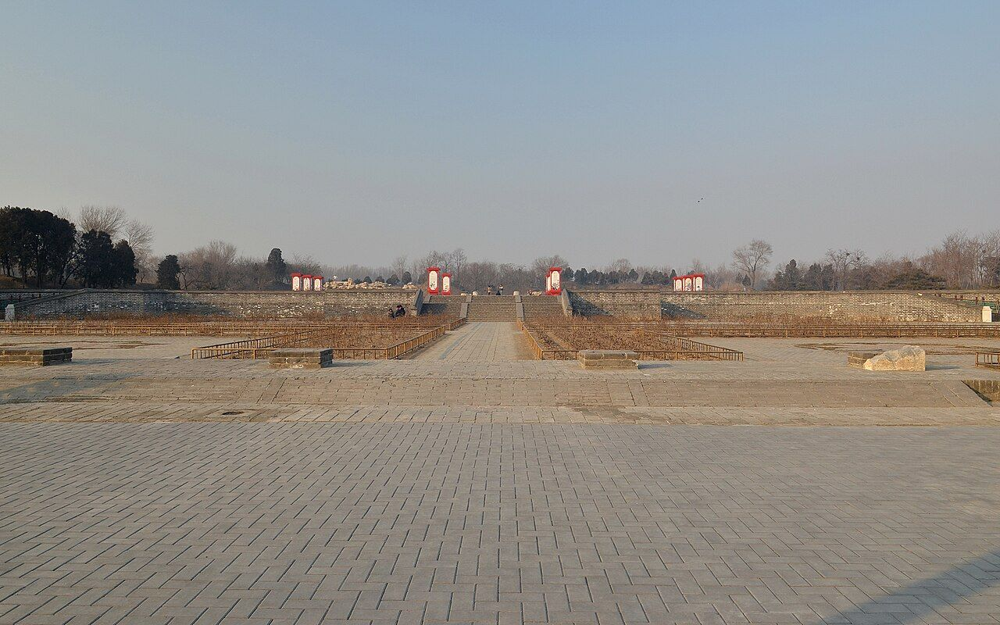

<!-- generated:start (scripts/building_pages.py): do not edit between these markers -->

# CC02-02: 宫门 Gongmen

Changchun Yuan

**3D object:** 1 box. Open it: `/reconstruction/3d.html?b=CC02-02`

**Part of:** CC02 含经堂

## What we know

- **Name:** 宫门 Gongmen (S05, S01 · confidence B)
- **Garden:** Changchun Yuan (S05, S01)
- **Type:** gate (S05, S01 · confidence B)
- **Destroyed:** 1860 (S05, S01)
- **Position:** 40.00773, 116.30740. S01 sure (S01 · confidence B)
- **Bays:** 5 in the texts / 5x1 on the plan (S05, S01)
- **Size in the inventory:** 19.1 × 7.6 m. S01 plan px / hall scale (S01)
- **Plan reader's note:** 5 bays: agrees. Label south of its stair (x 10561-10587, y 3510-3534). (S01) *(research copy, not public)*
- **How it was read:** sure (S01) *(research copy, not public)*
- **Plan pixels:** 10571, 3462 (S01) *(research copy, not public)*

## Our model now

A plain box on the block drawn on the Qing plan S01: position and frontage from the plan, heights and roof from the typology of its hall class. It will be updated as the research goes on.

- **Box:** 19.1 × 7.6 m, gate hall
- **Heights:** platform 0.77 m, eave 4.47 m, ridge 7.18 m above the ground
- **Roof:** hip-and-gable 歇山, rolled ridge 卷棚, grey tile
- **Faces:** 171.7° from north
- **Confidence:** B

## Pictures (1)

- **P0403** (sure): Hanjingtang 20130126.JPG (2013-01-26 15:41:50 (Commons DateTimeOriginal)). https://commons.wikimedia.org/wiki/File:Hanjingtang_20130126.JPG

  

## Texts and drawings (1)

- **E0052** (text, sure): 日下舊聞考 含经堂. 1780s (乾隆 敕撰) · j83:4a-4b · S05. https://github.com/kanripo/KR2k0036/blob/master/KR2k0036_083.txt
  > 雲容水態西北循山逕入建琉璃坊楔三其北宫門五楹南嚮内爲含經堂七楹後為淳化閣又後爲蘊真齋含經堂東為霞翥樓為淵映齋堂西為梵香樓為涵光室（長春園册）臣等謹案淳化軒内額曰奉三無私聨曰貞石麗延廊畧存古意淳風扇寰宇冀遂初心東西廊廡壁間嵌御定淳化閣帖石刻藴真齋内額曰禮園書圃霞翥樓内額曰味腴書屋
  Three glazed arches, a five-bay gate facing south, the seven-bay 含經堂, then 淳化軒 (printed 閣), 蘊真齋 behind, with 霞翥樓, 淵映齋, 梵香樓 and 涵光室. The rock-cut 淳化閣帖 stones lined the side galleries; 霞翥樓 holds the plaque 味腴書屋.

**On the plan:** Drawn on the plan of the gardens (S01), labelled 宫门, 5x1 cells. https://artmuseum.princeton.edu/collections/objects/138657

## Evidence for the set of buildings

- Evidence for the whole compound 含经堂: see CC02

## Open questions

- Q3: Which state does S01 draw?
- Q9: Bay counts, plan against text
- Q25: Other dates
- Q28: 1860 and after, for the site's text

<!-- generated:end -->

## Notes

<!-- Yours: regeneration never touches this part. It goes on the public site; what you write below a line holding only %% private %% stays in the research copy. -->
