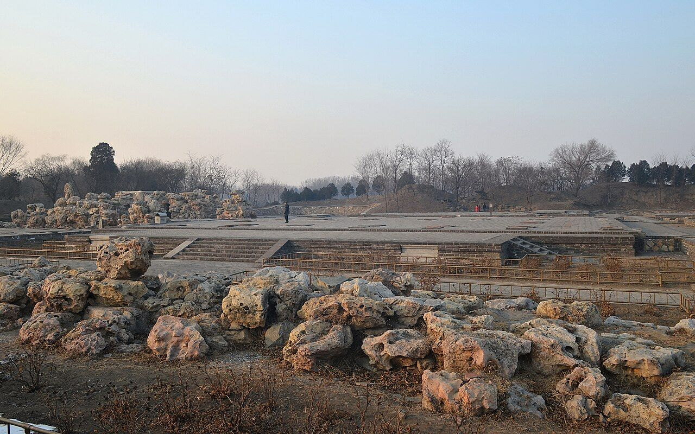

<!-- generated:start (scripts/building_pages.py): do not edit between these markers -->

# CC02-04: 淳化轩 Chunhua Xuan

Changchun Yuan

**3D object:** 2 boxes. Open it: `/reconstruction/3d.html?b=CC02-04`

**Part of:** CC02 含经堂

## What we know

- **Name:** 淳化轩 Chunhua Xuan (S05, S43, S48, S01, S212, S337, S361, S940 · confidence B)
- **Garden:** Changchun Yuan (S05, S43, S48, S01, S212, S337, S361, S940)
- **Type:** other (S05, S43, S48, S01, S212, S337, S361, S940 · confidence B)
- **Built:** 乾隆三十五年 1770 (S43; j83:6a) (S05, S43, S48, S01, S212, S337, S361, S940)
- **Changed:** Side galleries of 12 bays each, each with 6 stones of the 淳化閣帖 (S05, S43, S48, S01, S212, S337, S361, S940)
- **Destroyed:** 1860 (S05, S43, S48, S01, S212, S337, S361, S940)
- **Position:** 40.00855, 116.30726. S01 sure (S01 · confidence B)
- **Bays:** 7 in the texts / 4x7 on the plan (S05, S43, S48, S01, S212, S337, S361, S940)
- **Size in the inventory:** 32.1 × 30.2 m. S01 plan px / hall scale (S01)
- **Note:** Text has 淳化閣 in the description, 淳化軒 in the commentary and record: use 淳化轩. Corridors hold the re-cut 閣帖 stones, 144 (S48). bays: 7 bays, 3 bays deep; 卷棚歇山 with glazed tiles (S940, p.360, p.361). (S05, S43, S48, S01, S212, S337, S361, S940)
- **Plan reader's note:** Label in the court south of it. Hall x 10506-10640, y 2980-3080. B0541's box too tall; see fix. B0556 is its south porch. (S01) *(research copy, not public)*
- **How it was read:** sure (S01) *(research copy, not public)*
- **Plan pixels:** 10573, 3030 (S01) *(research copy, not public)*

## Our model now

A plain box on the block drawn on the Qing plan S01: position and frontage from the plan, heights and roof from the typology of its hall class. It will be updated as the research goes on.

- **1 ×:** grand hall: 29.21 × 21.04 m, eave 6.34 m, ridge 13.82 m
- **1 ×:** side hall: 13.13 × 6.98 m, eave 3.64 m, ridge 6.25 m
- **Confidence:** B

## Pictures (1)

- **P0404** (sure): 含经堂淳化轩遗址 20130126.jpg (2013-01-26 16:10:53 (Commons DateTimeOriginal)). https://commons.wikimedia.org/wiki/File:%E5%90%AB%E7%BB%8F%E5%A0%82%E6%B7%B3%E5%8C%96%E8%BD%A9%E9%81%97%E5%9D%80_20130126.jpg

  

## Texts and drawings (25)

- **E0023** (poem, sure): 御製題淳化軒詩. 1770 (乾隆三十五年) · j83:6a-6b · S05. https://github.com/kanripo/KR2k0036/blob/master/KR2k0036_083.txt
  > 乾隆三十五年御製題淳化軒詩　閣帖欣猶善本全㡬餘考訂為重鐫墨華輝映題軒扁石刻珍藏嵌壁磚閲古於焉閲嵗月賞心何異賞雲烟頤居倘得遂初願（内府藏有淳化閣帖初搨既為訂正重刻因於含經堂後廻廊分嵌石幅廊之中拓為是軒即以帖名名之若紀元得至六十則夀登八十五彼時當歸政居此果如所願得以翰墨静娛誠至樂也）陶冩端知勝管絃
  Poem on 淳化軒: he had the 淳化閣帖 re-cut from a first impression, set the stones into the rear galleries of 含經堂 and widened the central part into the hall, which he hoped to retire to.
- **E0051** (text, sure): 御製淳化軒記. 乾隆 (undated in S05; the stones set up by 1770) · j83:5a-5b · S05. https://github.com/kanripo/KR2k0036/blob/master/KR2k0036_083.txt
  > 御製淳化軒記淳化軒何為而作也以藏重刻淳化閣帖石而作也蓋自伏滔崆峒之銘石虹堯碑之文歴代相傳石刻尚焉然物有其成必有其壊世逺年湮真偽莫辨則漢唐且難得其全者無論周秦以上矣故言帖必以趙宋為猶近而宋帖必以淳化為最羙重刻之由考稽之故已見於帖前之頁册後之䟦兹不複記記所以藏石作軒之故云石刻既成凡若干頁使散置之慮其有失也爰於長春園中含經堂之後就舊有之廻廊每廊砌石若干頁恰得若干廊而帖石畢砌焉廊之中原有蘊真齋因稍移齋於其北即舊基而拓為軒事起藏帖則以帖名名之夫淳化宋太宗之紀年也為人君者即不能以唐虞為師亦當以夏甲周成為軌所謂取法乎上僅能得其中耳若宋太宗始終國家之間慙德多矣吾所不取而又有何慕於淳化而以之名軒為哉
  Why 淳化軒 exists: the re-cut 淳化閣帖 stones were set in the existing galleries behind 含經堂, and 蘊真齋 was moved north onto old foundations so that a hall could be built on the site.
- **E0052** (text, sure): 日下舊聞考 含经堂. 1780s (乾隆 敕撰) · j83:4a-4b · S05. https://github.com/kanripo/KR2k0036/blob/master/KR2k0036_083.txt
  > 雲容水態西北循山逕入建琉璃坊楔三其北宫門五楹南嚮内爲含經堂七楹後為淳化閣又後爲蘊真齋含經堂東為霞翥樓為淵映齋堂西為梵香樓為涵光室（長春園册）臣等謹案淳化軒内額曰奉三無私聨曰貞石麗延廊畧存古意淳風扇寰宇冀遂初心東西廊廡壁間嵌御定淳化閣帖石刻藴真齋内額曰禮園書圃霞翥樓内額曰味腴書屋
  Three glazed arches, a five-bay gate facing south, the seven-bay 含經堂, then 淳化軒 (printed 閣), 蘊真齋 behind, with 霞翥樓, 淵映齋, 梵香樓 and 涵光室. The rock-cut 淳化閣帖 stones lined the side galleries; 霞翥樓 holds the plaque 味腴書屋.
- **E0068** (poem, sure): 御製 詠淳化軒庭梅二首一韻. 1792 (御製詩五集) · KR4f0005_463:16a-16b · S201. https://github.com/kanripo/KR4f0005/blob/master/KR4f0005_463.txt
  > 詠淳化軒庭梅二首一韻 庭梅自與盆梅異謝却火攻何礙遲猶憶昔年言理趣顯仁蔵用㑹扵斯（顯諸仁即蔵諸用一闔一闢生生之所以不息也庭前植梅二株冬間圍）（以氊棚向陽開門春暖則徹棚花發即一梅而顯蔵之理可㑹丁未淳化軒對庭梅作識語中曽闡其義）今年春冷因通閏最早山桃亦放遲却是庭梅具深意送行㡬朶發英斯（向年庭梅至春仲已盛開今嵗以通閏花信俱遲日内将唘蹕西巡枝頭）（數朶舒英如有意然）
  Two plum trees in the court of 淳化軒 are wrapped in a felt shelter with a south door over winter and uncovered in spring.
- **E0069** (poem, sure): 御製 題淳化軒. 1795 (御製詩五集) · KR4f0005_486:12b-13a · S201. https://github.com/kanripo/KR4f0005/blob/master/KR4f0005_486.txt
  > 題淳化軒 宫寧夀御園淳化（是處之淳化軒亦猶大内之寧夀宫皆豫為歸政後娛老之所也）都為菟裘娛老居數嵗以前豫立者一年已近即真予天恩獨厚鑒由始衆意雖殷志踐初（予於踐阼之初焚香告天若得）（在位六十年即當歸政今已仰䝉之誠鑒佑幸符初願在天下臣民以及外藩䝉古愛戴以予精力康健）（猶昔無不望予未即倦勤者予亦未嘗不諒其悃忱顧予已上告昊蒼曷敢有渝初志耶）廿五竟符八六願（予即位時年已二十五嵗以百嵗計之已逾四分之一而當陳願之始實未計及在位六）（十年夀當耄耋也明嵗元日傳位嗣皇帝子則八十六嵗若如所願自三代而後未有聞者予之仰䝉天）（眷自非豈易篤愛所獨鍾臻此）豈容易得漫虚譽
  Written in the year before his abdication. His note compares 淳化軒 with 寧夀宫 in the palace: both were prepared as places for his old age.
- **E0070** (text, sure): 榆巢雜識. early 19th c. · line 1315 of the corpus file · S212. https://github.com/garychowcmu/daizhigev20/blob/master/史藏/志存记录/榆巢杂识.txt
  > ○淳化阁帖内府所刻帖，三希堂帖，嵌于阅古楼；墨妙轩帖，嵌于万寿山惠山园中。乾隆癸巳，重刻淳化阁帖成。适长春园中新构文轩落成，右、左廊各十二楹，每楹分嵌六石，即以淳化名轩。尝拓四百部，分赐群臣。内府拓帖，多用乌金拓，独此仿蝉翼拓，犹存古意。
  淳化軒 was finished as the stones were: galleries of twelve bays on each side, each bay holding six stones. Gives the year as 癸巳 (1773), against 1770 in S05.
- **E0024** (poem, sure): 淳化轩: 乾隆三十五年 poem of the Qianlong Emperor. 乾隆三十五年 (1770), date from the compilation · p.281 item (1), under 淳化轩 · S360. https://www.yuanmingyuanpark.cn/xs/yjbg/202007/P020200730387572832602.pdf#page=281
  > 阁帖欣犹善本全，几余考订为重镌。墨华辉暎题轩扁，石刻珍藏嵌壁砖。阅古于焉阅岁月，赏心何异赏云烟。頥居倘得遂初愿（内府藏有淳化阁帖，初搨既为订正重刻。因于含经堂后回廊分嵌石幅廊之中，拓为是轩，即以帖名名之，若纪元得至六十则，寿登八十五，彼时当归政居此，果如所愿，得以翰墨静娯，诚至乐也） ，陶写端知胜管弦。
  Qianlong, 1770: his note says the recut 淳化阁帖 was set in the gallery behind 含经堂, and the hall named after it, for his retirement at 85.
- **E0025** (poem, sure): 淳化轩: 乾隆三十六年 poem of the Qianlong Emperor. 乾隆三十六年 (1771), date from the compilation · p.281 item (2), under 淳化轩 · S360. https://www.yuanmingyuanpark.cn/xs/yjbg/202007/P020200730387572832602.pdf#page=281
  > 中矩折旋廊路循，略经修饰境如新。壁间帖版待精刻（轩廊将以重刻淳化阁帖，石版嵌壁縁摹镌，务在精审，今尚未讫工，而轩廊则早成矣。 ） ，座侧芸编已毕陈。鼎柏氤氲喷瑞雾，盆梅馥郁粲韶春。彩镫应节飘萧缀，无易由言化致淳。
  Poem of the Qianlong Emperor at 淳化轩, 1771. Year as given by the compilation.
- **E0026** (poem, sure): 淳化轩: 乾隆三十六年 poem of the Qianlong Emperor. 乾隆三十六年 (1771), date from the compilation · p.281 item (3), under 淳化轩 · S360. https://www.yuanmingyuanpark.cn/xs/yjbg/202007/P020200730387572832602.pdf#page=281
  > 如翼两廊砌帖版，苕华阅古作清供。讵希治世符黄帝，匪学纪年慕宋宗。屏展太湖得怪石，画栽台岭徙竒松。他时结愿斯娱老（拟于将来八十五岁归政时居此），此日铭心敢懈恭。
  Poem of the Qianlong Emperor at 淳化轩, 1771, on the view. Year as given by the compilation.
- **E0065** (poem, sure): 淳化轩. 乾隆三十六年 (1771) · v3 p.256, under 含经堂; source ref 10-839 · S361. https://www.yuanmingyuanpark.cn/xs/yjbg/202008/P020200803382569071850.pdf#page=259
  > 屏石叠玲珑，文轩有路通。建廊藏帖版，开户对薰风。烟月怡神表，古今想像中。设因验治理，亦得我心同。
  Poem 淳化轩 by the Qianlong Emperor, 1771, filed by the editors under 含经堂.
- **E0066** (poem, sure): 淳化轩. 乾隆三十六年 (1771) · v3 p.256, under 含经堂; source ref 10-857 · S361. https://www.yuanmingyuanpark.cn/xs/yjbg/202008/P020200803382569071850.pdf#page=259
  > 延清契道筦，却暑抚薰弦。此日忧勤励，他年颐养便
  Poem 淳化轩 by the Qianlong Emperor, 1771, filed by the editors under 含经堂.
- **E0067** (poem, sure): 淳化轩. 乾隆三十七年 (1772) · v3 p.258, under 含经堂; source ref 11-246 · S361. https://www.yuanmingyuanpark.cn/xs/yjbg/202008/P020200803382569071850.pdf#page=261
  > 若翼敞轩楹，明窗几席清。宁惟展古帖，藉以缮今情。庭树芳藏干，盆梅馥满英。华灯悬应节，所惭是循名。
  Poem 淳化轩 by the Qianlong Emperor, 1772, filed by the editors under 含经堂.
- **E0027** (poem, sure): 淳化轩: 乾隆三十八年 poem of the Qianlong Emperor. 乾隆三十八年 (1773), date from the compilation · p.281 item (5), under 淳化轩 · S360. https://www.yuanmingyuanpark.cn/xs/yjbg/202007/P020200730387572832602.pdf#page=281
  > 两廊石版壁安全。精核过于王氏编。嗜古因之频阅古，引年冀以待他年。分阴堪遣万几暇，尺宅恒惺方寸田。虽曰宋宗无可企，以言淳化亦应然（向作淳化轩记，以轩因帖命名，非慕宋太宗之年号意，木如此夫宋太宗始终家国之问，多惭德其人，固不足取，然化理欲淳，实为君者所当勉也）。
  Poem of the Qianlong Emperor at 淳化轩, 1773, on the view. Year as given by the compilation.
- **E0029** (poem, sure): 淳化轩: 乾隆三十九年 poem of the Qianlong Emperor. 乾隆三十九年 (1774), date from the compilation · p.281 item (6), under 淳化轩 · S360. https://www.yuanmingyuanpark.cn/xs/yjbg/202007/P020200730387572832602.pdf#page=281
  > 堂（含经）后斋（藴真）前步屧巡，两廊石刻早安匀（昨经三仿终还始，昨岁曾取刻帖，时双钩油条填墨对临。自五月中驻避暑山庄，至木兰行围，回跸凡四阅，月计临三 遍）。却鲜一如精与神，略省察都愧往古。少徘徊又是新春，即兹灯节宁能罢，无易由言欲化淳。
  Poem of the Qianlong Emperor at 淳化轩, 1774, on the view. Year as given by the compilation.
- **E0036** (poem, sure): 淳化轩: 乾隆四十八年 poem of the Qianlong Emperor. 乾隆四十八年 (1783), date from the compilation · p.282 item (7), under 淳化轩 · S360. https://www.yuanmingyuanpark.cn/xs/yjbg/202007/P020200730387572832602.pdf#page=282
  > 重摹淳化帖，石版砌厢廊。遂以颜轩额，寜云摹宋皇。亦经几岁月（壬辰年重刻淳化阁帖，成以石嵌轩壁，阅今巳十二年，计宋淳化初刻时几八百年矣。 ） ，时复赏烟光。望雪逢优雪，益増敬不遑。
  Poem of the Qianlong Emperor at 淳化轩, 1783, on the view. Year as given by the compilation.
- **E0039** (poem, sure): 淳化轩: 乾隆五十二年 poem of the Qianlong Emperor. 乾隆五十二年 (1787), date from the compilation · p.282 item (10), under 淳化轩 · S360. https://www.yuanmingyuanpark.cn/xs/yjbg/202007/P020200730387572832602.pdf#page=282
  > 淳化因蔵帖，循名未副名。岂真在墨宝，讵可忘民生。风俗漓惟甚，货财价匪轻。徒称滋户口（我朝顺治初年，民数不过一千六十三万，今休养生息百数十年，民数已至二万七八千万之多，较国初增二十倍，户口多则用物多，物价安得不贵，此保泰所以难也），惭愧在持盈。
  Poem of the Qianlong Emperor at 淳化轩, 1787. Year as given by the compilation.
- **E0042** (poem, sure): 淳化轩: 乾隆五十六年 poem of the Qianlong Emperor. 乾隆五十六年 (1791), date from the compilation · p.282 item (11), under 淳化轩 · S360. https://www.yuanmingyuanpark.cn/xs/yjbg/202007/P020200730387572832602.pdf#page=282
  > 春寒今岁勒花荣，淳化庭梅却发英。讶看舒风迎玉砌，悟因护暖罩毡棚。笑嬴盆树枯和菀（屋中盆梅却烂漫矣），幻结山桃弟与兄（近日山桃始开）。芳谱何须分次第，傥来七字偶摅情。
  Poem of the Qianlong Emperor at 淳化轩, 1791, on the view. Year as given by the compilation.
- **E0044** (poem, sure): 淳化轩: 乾隆五十七年 poem of the Qianlong Emperor. 乾隆五十七年 (1792), date from the compilation · p.282 item (12), under 淳化轩 · S360. https://www.yuanmingyuanpark.cn/xs/yjbg/202007/P020200730387572832602.pdf#page=282
  > 庭梅自与盆梅异，谢却火攻何碍迟。犹忆昔年言理趣，显仁蔵用会于斯。” “今年春冷因通闰，最早山桃亦放迟。却是庭梅具深意，送行几朵发英斯（向年，庭梅至春仲已盛开，今岁以通闰，花信俱迟，日内将启跸西巡，枝头数朵舒英如有意然。）。
  Poem of the Qianlong Emperor at 淳化轩, 1792, on the view. Year as given by the compilation.
- **E0050** (poem, sure): 淳化轩: 道光四年 poem of the Daoguang Emperor. 道光四年 (1824), date from the compilation · p.284 item (21), under 淳化轩 · S360. https://www.yuanmingyuanpark.cn/xs/yjbg/202007/P020200730387572832602.pdf#page=284
  > 世俗叹浇薄，天恩感渥深。永思不忍政，常廑化淳心。恭俭身应率，真诚道可寻。兢兢瞻宝翰，绍衣凛微忱。
  Poem of the Daoguang Emperor at 淳化轩, 1824. Year as given by the compilation.
- **E2497** (description, sure): 紫禁城宁寿宫区与长春园含经堂区建筑关系探讨 (王文涛, 故宫学刊 2015): the 含经堂 layout from the dig. 2015 · pp.358-367 (PDF pp.6-15) · S672. https://www.dpm.org.cn/Uploads/File/2020/03/27/u5e7db6f5d6c90.pdf
  From the dig and the archives: the compound is about 300 m north-south by 200 m east-west. Forecourt with three glazed pailou (east, south, west) and four lawns where yurts stood; five-bay gate with a 垂花门 each side; 含经堂 a seven-bay double-eaved hip-and-gable hall with side halls and the towers 霞翥楼 and 梵香楼; 淳化轩 seven by three bays, the largest single building of Changchun Yuan, hip-and-gable (rolled ridge on p.360, glazed on p.361); 蕴真斋 seven bays with front and back porches; 渊映斋 and 涵光室 five-bay hip-and-gable; 三友轩 three bays, measured about 11.1 x 7.2 m on a platform 11.9 x 8.3 m; 静莲斋 five bays; 理心楼 five bays; 待月楼 a three-bay two-storey hip-and-gable tower facing east; 澄波夕照 and 得胜概 three-bay open halls; a two-storey stage 乐奏钧天 with a five-bay viewing hall 神心妙达 rebuilt in mid-Jiaqing. Floor heating survives in five halls. The remains are Qianlong work with some of the 1814 rebuilding, nothing later. 淳化轩 was the model for 乐寿堂 in the 宁寿宫.
- **E0059** (description, sure): 嘉庆帝所题圆明园淳化轩诗考析 (尤李). 2023-08-16 post · jzys · S337. http://iqh.ruc.edu.cn/old/qdhjylyjzx/xszl/jzys/0bc9dd46ac1b4792b33bab6f8a9eb883.htm
  Through Jiaqing's poems. It dates the addition of 淳化轩, 蕴真斋, 三友轩, 静莲斋, 待月楼 and 理心楼 behind 含经堂 to 1770, when the compound reached full size. The 重刻淳化阁帖 stones were set in the galleries in front of 淳化轩.
- **E0055** (description, sure): 圆明园百景史事分景汇编: 淳化轩. 1770-1824 · from p.281, under 含经堂 · S360. https://www.yuanmingyuanpark.cn/xs/yjbg/202007/P020200730387572832602.pdf#page=281
  In 1770 Qianlong had a good rubbing of the 淳化阁帖 recut, set the slabs into the gallery walls behind 含经堂 and widened the gallery into this hall, meaning to retire here at 85. A note of 1771 says the galleries were done and the carving was not. 淳化轩: 21 dated items, 1770-1824, of which 21 poems (Qianlong, Jiaqing, Daoguang); recurring themes: the view. First dated 1770, last dated 1824.
- **E0057** (description, sure): 圆明园五朝御制诗文集注 v3, editors' note on 含经堂. 2020 edition · v3 p.244 · S361. https://www.yuanmingyuanpark.cn/xs/yjbg/202008/P020200803382569071850.pdf#page=247
  The largest group in this garden, finished 1747, rebuilt 1770 with 淳化轩, 蕴真斋, 三友轩, 静莲斋, 待月楼 and 理心楼. 含经堂 is a seven-bay double-eaved glazed hall; 霞翥楼 mirrors 梵香楼 and, with the inner plaque 味腴书室, held the 四库全书荟要, which identifies our 味腴书屋. A stage was added east of 淳化轩 in 1814. Guards were still posted after 1860.
- **E2496** (archaeology, sure): 圆明园长春园含经堂遗址发掘报告: table of contents. 2006 · 目录, 第三章 遗迹 · S990. https://ebook.artron.net/book.php?bookid=61437
  The full report of the 2001-2003 seasons lists every excavated unit: in the south the three-arch pailou, walls, paths, carved-brick paving and yurt (毡帐) foundations and tree pits in the forecourt, the gate, the 含经堂 court with screen gate, main hall, east and west side halls, 霞翥楼, 梵香楼, galleries and a 垂花门; in the north 淳化轩 with a Taihu rockery before its terrace, 蕴真斋, the north gate and the open hall 得胜概; east 渊映斋, the dressing room and 乐奏钧天 stage, the viewing hall 神心妙达 and the shop street outside; west 涵光室, 三友轩 with its rockery, 静莲斋, 理心楼, 待月楼 and the open hall 澄波夕照 outside; round about duty rooms, stores, a well pavilion, a timber bridge, 明漪潇照, 云容水态 and the octagonal 静缘亭.
- **E2491** (archaeology, sure): 紫禁城宁寿宫区与长春园含经堂区建筑关系探讨 (王文涛, 故宫学刊 2015). 2015 · pp.358-367 (PDF pp.6-15), figs 4-9, 30-34 · S940. https://www.dpm.org.cn/Uploads/File/2020/03/27/u5e7db6f5d6c90.pdf
  Compares the Ningshou Gong in the Forbidden City with the Hanjing Tang compound, which Qianlong built in phases from 1745 to 1771 for his retirement. It lists each hall's bays and roof, measures 三友轩 on the ruin, and describes some twenty underfloor heating systems found in the 2001-03 dig, with flue sizes. Figures include Yangshi Lei sheets of 淳化轩 (Qianlong and Jiaqing) at the NLC and the late plan from 金勋's collection.

**On the plan:** Drawn on the plan of the gardens (S01), labelled 淳化轩, 4x7 cells. https://artmuseum.princeton.edu/collections/objects/138657

## Evidence for the set of buildings

- Evidence for the whole compound 含经堂: see CC02
- Reconstructions and comparables for the whole garden, 长春园 Changchun Yuan: see GARDEN-CC
- Standing buildings comparable to a grand hall (not this building): see CLASS-grand_hall

## Open questions

- Q7: Accuracy of the georeference, honestly
- Q20: Name variants
- Q151: CC02-04 淳化轩 roof
- Q156: Twin lead for the coordinator
- Q173: CC02-04 淳化轩

<!-- generated:end -->

## Notes

<!-- Yours: regeneration never touches this part. It goes on the public site; what you write below a line holding only %% private %% stays in the research copy. -->
