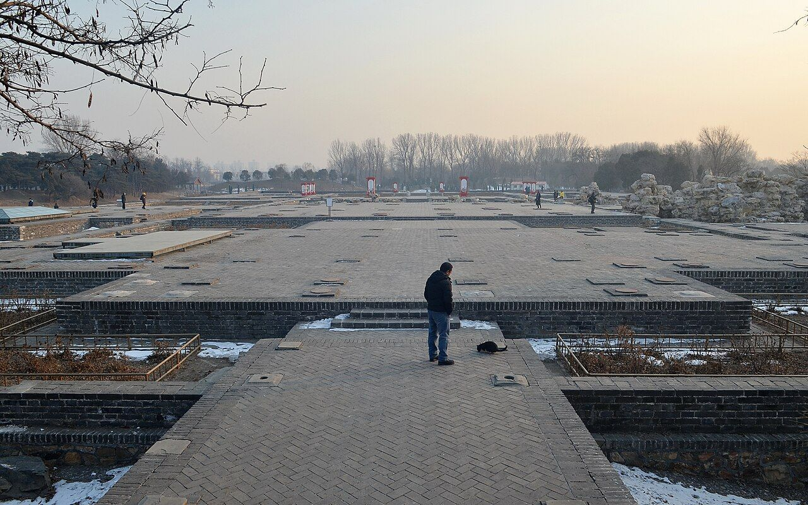

<!-- generated:start (scripts/building_pages.py): do not edit between these markers -->

# CC02-05: 蕴真斋 Yunzhen Zhai

Changchun Yuan

**3D object:** 1 box. Open it: `/reconstruction/3d.html?b=CC02-05`

**Part of:** CC02 含经堂

## What we know

- **Name:** 蕴真斋 Yunzhen Zhai (S05, S01, S940 · confidence B)
- **Garden:** Changchun Yuan (S05, S01, S940)
- **Type:** other (S05, S01, S940 · confidence B)
- **Changed:** moved north 1770 for 淳化轩 [j83:5b] (S05, S01, S940)
- **Destroyed:** 1860 (S05, S01, S940)
- **Position:** 40.00885, 116.30716. S01 sure (S01 · confidence B)
- **Bays:** 7 bays with front and back 抱厦 porches in the texts / 8x3 on the plan (S05, S01, S940)
- **Size in the inventory:** 34.7 × 26.9 m. S01 plan px / hall scale (S01)
- **Plan reader's note:** Label in the court south of the cross-shaped hall x 10490-10630, y 2820-2910. (S01) *(research copy, not public)*
- **How it was read:** sure (S01) *(research copy, not public)*
- **Plan pixels:** 10557, 2867 (S01) *(research copy, not public)*

## Our model now

On the block drawn on the Qing plan S01: position and frontage from the plan, heights and roof from the typology of its hall class, its form drawn by the hall kit. It will be updated as the research goes on.

- **Box:** 31.57 × 18.81 m, grand hall
- **Heights:** platform 0.59 m, eave 4.76 m, ridge 11.41 m above the ground
- **Roof:** hip-and-gable 歇山, rolled ridge 卷棚, grey tile
- **Faces:** 172.4° from north
- **Fit:** reduced towards the size drawn on the plan, to stand clear of its neighbours or the water; moved 0.4 m
- **Drawn:** by the hall kit: 7 bays, the middle widest, a porch all round, steps on the back, front, 歇山 hip-and-gable with a rolled ridge 卷棚, grey tile, bracket sets 斗拱 as a painted band. Drawn from the typology of its hall class, not from a picture of this hall (assumed, C).
- **Confidence:** B

## Pictures (1)

- **P0405** (sure): 含经堂蕴真斋遗址 20130126.JPG (2013-01-26 16:18:37 (Commons DateTimeOriginal)). https://commons.wikimedia.org/wiki/File:%E5%90%AB%E7%BB%8F%E5%A0%82%E8%95%B4%E7%9C%9F%E6%96%8B%E9%81%97%E5%9D%80_20130126.JPG

  

## Texts and drawings (10)

- **E0051** (text, sure): 御製淳化軒記. 乾隆 (undated in S05; the stones set up by 1770) · j83:5a-5b · S05. https://github.com/kanripo/KR2k0036/blob/master/KR2k0036_083.txt
  > 御製淳化軒記淳化軒何為而作也以藏重刻淳化閣帖石而作也蓋自伏滔崆峒之銘石虹堯碑之文歴代相傳石刻尚焉然物有其成必有其壊世逺年湮真偽莫辨則漢唐且難得其全者無論周秦以上矣故言帖必以趙宋為猶近而宋帖必以淳化為最羙重刻之由考稽之故已見於帖前之頁册後之䟦兹不複記記所以藏石作軒之故云石刻既成凡若干頁使散置之慮其有失也爰於長春園中含經堂之後就舊有之廻廊每廊砌石若干頁恰得若干廊而帖石畢砌焉廊之中原有蘊真齋因稍移齋於其北即舊基而拓為軒事起藏帖則以帖名名之夫淳化宋太宗之紀年也為人君者即不能以唐虞為師亦當以夏甲周成為軌所謂取法乎上僅能得其中耳若宋太宗始終國家之間慙德多矣吾所不取而又有何慕於淳化而以之名軒為哉
  Why 淳化軒 exists: the re-cut 淳化閣帖 stones were set in the existing galleries behind 含經堂, and 蘊真齋 was moved north onto old foundations so that a hall could be built on the site.
- **E0052** (text, sure): 日下舊聞考 含经堂. 1780s (乾隆 敕撰) · j83:4a-4b · S05. https://github.com/kanripo/KR2k0036/blob/master/KR2k0036_083.txt
  > 雲容水態西北循山逕入建琉璃坊楔三其北宫門五楹南嚮内爲含經堂七楹後為淳化閣又後爲蘊真齋含經堂東為霞翥樓為淵映齋堂西為梵香樓為涵光室（長春園册）臣等謹案淳化軒内額曰奉三無私聨曰貞石麗延廊畧存古意淳風扇寰宇冀遂初心東西廊廡壁間嵌御定淳化閣帖石刻藴真齋内額曰禮園書圃霞翥樓内額曰味腴書屋
  Three glazed arches, a five-bay gate facing south, the seven-bay 含經堂, then 淳化軒 (printed 閣), 蘊真齋 behind, with 霞翥樓, 淵映齋, 梵香樓 and 涵光室. The rock-cut 淳化閣帖 stones lined the side galleries; 霞翥樓 holds the plaque 味腴書屋.
- **E0071** (poem, sure): 蕴真斋. 乾隆二十年 (1755) · v3 p.246, under 含经堂; source ref 5-324 · S361. https://www.yuanmingyuanpark.cn/xs/yjbg/202008/P020200803382569071850.pdf#page=249
  > 游览未可亟，宴息贵有时。澹宁斯亦佳，藻缋徒尔为。远愧尧代阶，近取谢氏诗。葆光味妙理，养粹协化机。宁独尚清静，治理从此施。
  Poem 蕴真斋 by the Qianlong Emperor, 1755, filed by the editors under 含经堂.
- **E0072** (poem, sure): 蕴真斋. 乾隆三十三年 (1768) · v3 p.251, under 含经堂; source ref 9-396 · S361. https://www.yuanmingyuanpark.cn/xs/yjbg/202008/P020200803382569071850.pdf#page=254
  > 道筦天倪自有端，书斋触目入澄观。恰如万物含韶际，真意应从蕴处看。
  Poem 蕴真斋 by the Qianlong Emperor, 1768, filed by the editors under 含经堂.
- **E0073** (poem, sure): 蕴真斋. 乾隆三十九年 (1774) · v3 p.261, under 含经堂; source ref 12-526 · S361. https://www.yuanmingyuanpark.cn/xs/yjbg/202008/P020200803382569071850.pdf#page=264
  > 蕴为发之始，真则假之对。真以蕴乃佳，假以发斯味。真诚而假私，返身必由内。然与斋何涉，循名实可背。愿言勉克己，如临师保诲。
  Poem 蕴真斋 by the Qianlong Emperor, 1774, filed by the editors under 含经堂.
- **E2497** (description, sure): 紫禁城宁寿宫区与长春园含经堂区建筑关系探讨 (王文涛, 故宫学刊 2015): the 含经堂 layout from the dig. 2015 · pp.358-367 (PDF pp.6-15) · S672. https://www.dpm.org.cn/Uploads/File/2020/03/27/u5e7db6f5d6c90.pdf
  From the dig and the archives: the compound is about 300 m north-south by 200 m east-west. Forecourt with three glazed pailou (east, south, west) and four lawns where yurts stood; five-bay gate with a 垂花门 each side; 含经堂 a seven-bay double-eaved hip-and-gable hall with side halls and the towers 霞翥楼 and 梵香楼; 淳化轩 seven by three bays, the largest single building of Changchun Yuan, hip-and-gable (rolled ridge on p.360, glazed on p.361); 蕴真斋 seven bays with front and back porches; 渊映斋 and 涵光室 five-bay hip-and-gable; 三友轩 three bays, measured about 11.1 x 7.2 m on a platform 11.9 x 8.3 m; 静莲斋 five bays; 理心楼 five bays; 待月楼 a three-bay two-storey hip-and-gable tower facing east; 澄波夕照 and 得胜概 three-bay open halls; a two-storey stage 乐奏钧天 with a five-bay viewing hall 神心妙达 rebuilt in mid-Jiaqing. Floor heating survives in five halls. The remains are Qianlong work with some of the 1814 rebuilding, nothing later. 淳化轩 was the model for 乐寿堂 in the 宁寿宫.
- **E0059** (description, likely): 嘉庆帝所题圆明园淳化轩诗考析 (尤李). 2023-08-16 post · jzys · S337. http://iqh.ruc.edu.cn/old/qdhjylyjzx/xszl/jzys/0bc9dd46ac1b4792b33bab6f8a9eb883.htm
  Through Jiaqing's poems. It dates the addition of 淳化轩, 蕴真斋, 三友轩, 静莲斋, 待月楼 and 理心楼 behind 含经堂 to 1770, when the compound reached full size. The 重刻淳化阁帖 stones were set in the galleries in front of 淳化轩.
- **E0057** (description, sure): 圆明园五朝御制诗文集注 v3, editors' note on 含经堂. 2020 edition · v3 p.244 · S361. https://www.yuanmingyuanpark.cn/xs/yjbg/202008/P020200803382569071850.pdf#page=247
  The largest group in this garden, finished 1747, rebuilt 1770 with 淳化轩, 蕴真斋, 三友轩, 静莲斋, 待月楼 and 理心楼. 含经堂 is a seven-bay double-eaved glazed hall; 霞翥楼 mirrors 梵香楼 and, with the inner plaque 味腴书室, held the 四库全书荟要, which identifies our 味腴书屋. A stage was added east of 淳化轩 in 1814. Guards were still posted after 1860.
- **E2496** (archaeology, sure): 圆明园长春园含经堂遗址发掘报告: table of contents. 2006 · 目录, 第三章 遗迹 · S990. https://ebook.artron.net/book.php?bookid=61437
  The full report of the 2001-2003 seasons lists every excavated unit: in the south the three-arch pailou, walls, paths, carved-brick paving and yurt (毡帐) foundations and tree pits in the forecourt, the gate, the 含经堂 court with screen gate, main hall, east and west side halls, 霞翥楼, 梵香楼, galleries and a 垂花门; in the north 淳化轩 with a Taihu rockery before its terrace, 蕴真斋, the north gate and the open hall 得胜概; east 渊映斋, the dressing room and 乐奏钧天 stage, the viewing hall 神心妙达 and the shop street outside; west 涵光室, 三友轩 with its rockery, 静莲斋, 理心楼, 待月楼 and the open hall 澄波夕照 outside; round about duty rooms, stores, a well pavilion, a timber bridge, 明漪潇照, 云容水态 and the octagonal 静缘亭.
- **E2491** (archaeology, sure): 紫禁城宁寿宫区与长春园含经堂区建筑关系探讨 (王文涛, 故宫学刊 2015). 2015 · pp.358-367 (PDF pp.6-15), figs 4-9, 30-34 · S940. https://www.dpm.org.cn/Uploads/File/2020/03/27/u5e7db6f5d6c90.pdf
  Compares the Ningshou Gong in the Forbidden City with the Hanjing Tang compound, which Qianlong built in phases from 1745 to 1771 for his retirement. It lists each hall's bays and roof, measures 三友轩 on the ruin, and describes some twenty underfloor heating systems found in the 2001-03 dig, with flue sizes. Figures include Yangshi Lei sheets of 淳化轩 (Qianlong and Jiaqing) at the NLC and the late plan from 金勋's collection.

**On the plan:** Drawn on the plan of the gardens (S01), labelled 蕴真斋, 8x3 cells. https://artmuseum.princeton.edu/collections/objects/138657

## Evidence for the set of buildings

- Evidence for the whole compound 含经堂: see CC02
- Reconstructions and comparables for the whole garden, 长春园 Changchun Yuan: see GARDEN-CC
- Standing buildings comparable to a grand hall (not this building): see CLASS-grand_hall

## Open questions

None that name it.

<!-- generated:end -->

## Notes

<!-- Yours: regeneration never touches this part. It goes on the public site; what you write below a line holding only %% private %% stays in the research copy. -->
