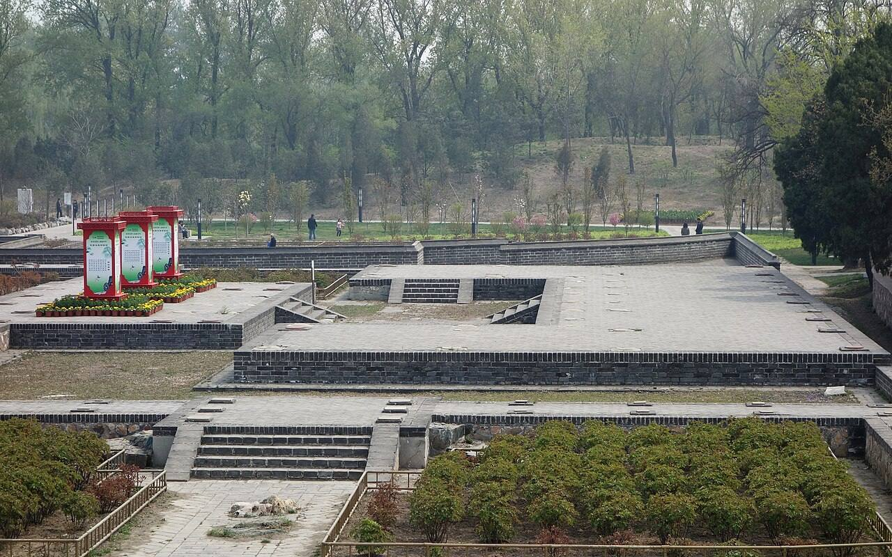

<!-- generated:start (scripts/building_pages.py): do not edit between these markers -->

# CC02-08: 梵香楼 Fanxiang Lou

Changchun Yuan

**3D object:** 1 box. Open it: `/reconstruction/3d.html?b=CC02-08`

**Part of:** CC02 含经堂

## What we know

- **Name:** 梵香楼 Fanxiang Lou (S05, S47, S01 · confidence B)
- **Garden:** Changchun Yuan (S05, S47, S01)
- **Type:** temple (S05, S47, S01 · confidence B)
- **Destroyed:** 1860 (S05, S47, S01)
- **Position:** 40.00792, 116.30695. S01 likely (S01 · confidence B)
- **Bays:** 9x3 on the plan (S05, S47, S01)
- **Size in the inventory:** 42.8 × 20.8 m. S01 plan px / hall scale (S01)
- **Plan reader's note:** West U-shaped range, mirror. '堂西'. (S01) *(research copy, not public)*
- **How it was read:** likely (S01) *(research copy, not public)*
- **Plan pixels:** 10409, 3356 (S01) *(research copy, not public)*

## Our model now

On the block drawn on the Qing plan S01: position and frontage from the plan, heights and roof from the typology of its hall class, its form drawn by the hall kit. It will be updated as the research goes on.

- **Box:** 42.8 × 20.8 m, storeyed hall
- **Heights:** platform 0.45 m, eave 5.95 m, ridge 9.17 m above the ground
- **Roof:** hip-and-gable 歇山, rolled ridge 卷棚, grey tile
- **Faces:** 83.9° from north
- **Drawn:** by the hall kit: 9 bays, the middle widest, a porch front and back, steps on the front, left, 歇山 hip-and-gable with a rolled ridge 卷棚, grey tile, a painted beam under the eave. Drawn from the typology of its hall class, not from a picture of this hall (assumed, C).
- **Confidence:** B

## Pictures (1)

- **P0408** (sure): 含经堂梵香楼遗址 20130421.JPG (2013-04-21 14:06:31 (Commons DateTimeOriginal)). https://commons.wikimedia.org/wiki/File:%E5%90%AB%E7%BB%8F%E5%A0%82%E6%A2%B5%E9%A6%99%E6%A5%BC%E9%81%97%E5%9D%80_20130421.JPG

  

## Texts and drawings (4)

- **E0052** (text, sure): 日下舊聞考 含经堂. 1780s (乾隆 敕撰) · j83:4a-4b · S05. https://github.com/kanripo/KR2k0036/blob/master/KR2k0036_083.txt
  > 雲容水態西北循山逕入建琉璃坊楔三其北宫門五楹南嚮内爲含經堂七楹後為淳化閣又後爲蘊真齋含經堂東為霞翥樓為淵映齋堂西為梵香樓為涵光室（長春園册）臣等謹案淳化軒内額曰奉三無私聨曰貞石麗延廊畧存古意淳風扇寰宇冀遂初心東西廊廡壁間嵌御定淳化閣帖石刻藴真齋内額曰禮園書圃霞翥樓内額曰味腴書屋
  Three glazed arches, a five-bay gate facing south, the seven-bay 含經堂, then 淳化軒 (printed 閣), 蘊真齋 behind, with 霞翥樓, 淵映齋, 梵香樓 and 涵光室. The rock-cut 淳化閣帖 stones lined the side galleries; 霞翥樓 holds the plaque 味腴書屋.
- **E0057** (description, sure): 圆明园五朝御制诗文集注 v3, editors' note on 含经堂. 2020 edition · v3 p.244 · S361. https://www.yuanmingyuanpark.cn/xs/yjbg/202008/P020200803382569071850.pdf#page=247
  The largest group in this garden, finished 1747, rebuilt 1770 with 淳化轩, 蕴真斋, 三友轩, 静莲斋, 待月楼 and 理心楼. 含经堂 is a seven-bay double-eaved glazed hall; 霞翥楼 mirrors 梵香楼 and, with the inner plaque 味腴书室, held the 四库全书荟要, which identifies our 味腴书屋. A stage was added east of 淳化轩 in 1814. Guards were still posted after 1860.
- **E2496** (archaeology, sure): 圆明园长春园含经堂遗址发掘报告: table of contents. 2006 · 目录, 第三章 遗迹 · S990. https://ebook.artron.net/book.php?bookid=61437
  The full report of the 2001-2003 seasons lists every excavated unit: in the south the three-arch pailou, walls, paths, carved-brick paving and yurt (毡帐) foundations and tree pits in the forecourt, the gate, the 含经堂 court with screen gate, main hall, east and west side halls, 霞翥楼, 梵香楼, galleries and a 垂花门; in the north 淳化轩 with a Taihu rockery before its terrace, 蕴真斋, the north gate and the open hall 得胜概; east 渊映斋, the dressing room and 乐奏钧天 stage, the viewing hall 神心妙达 and the shop street outside; west 涵光室, 三友轩 with its rockery, 静莲斋, 理心楼, 待月楼 and the open hall 澄波夕照 outside; round about duty rooms, stores, a well pavilion, a timber bridge, 明漪潇照, 云容水态 and the octagonal 静缘亭.
- **E0061** (archaeology, likely): 含经堂 dig: 地天母 bronze from 梵香楼. 2001-2003 · section on 陈辉 · S333. https://www.visitbeijing.com.cn/article/49Nly85Lvzb
  Approval to survey and dig 长春园宫门 and 含经堂 came in March 2001, and the cleared site was presented by December 2003. A small bronze Buddha inscribed 地天母 was found; the park's archaeologist identifies it as the only known survivor of the 700-odd images of 梵香楼 Fanxiang Lou.

**On the plan:** Drawn on the plan of the gardens (S01), labelled 梵香楼, 9x3 cells. https://artmuseum.princeton.edu/collections/objects/138657

## Evidence for the set of buildings

- Evidence for the whole compound 含经堂: see CC02
- Reconstructions and comparables for the whole garden, 长春园 Changchun Yuan: see GARDEN-CC
- Standing buildings comparable to a storeyed hall (not this building): see CLASS-storeyed_hall

## Open questions

None that name it.

<!-- generated:end -->

## Notes

<!-- Yours: regeneration never touches this part. It goes on the public site; what you write below a line holding only %% private %% stays in the research copy. -->
