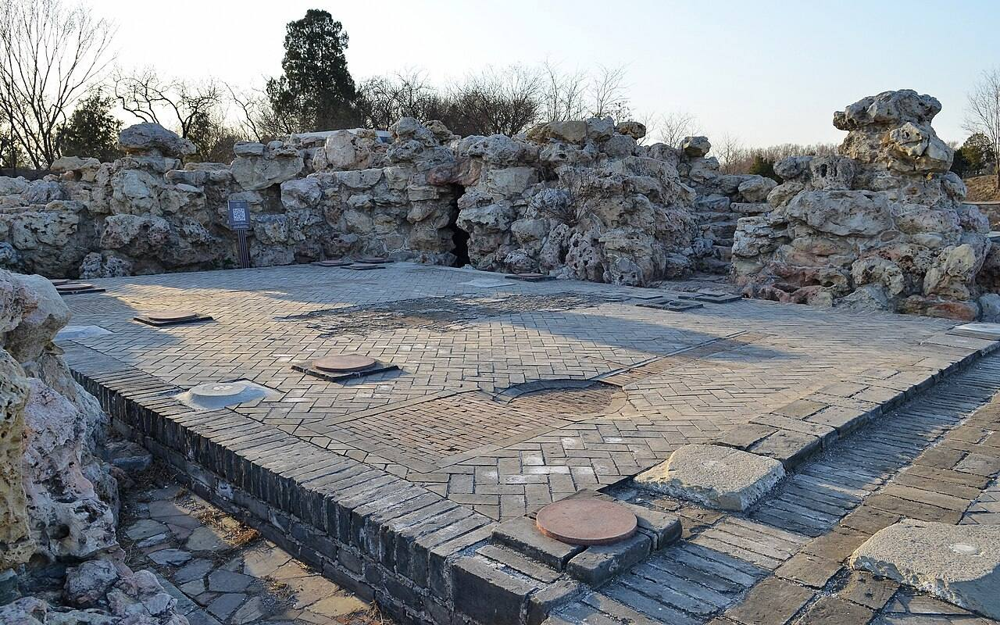

<!-- generated:start (scripts/building_pages.py): do not edit between these markers -->

# CC02-10: 三友轩 Sanyou Xuan

Changchun Yuan

**3D object:** 1 box. Open it: `/reconstruction/3d.html?b=CC02-10`

**Part of:** CC02 含经堂

## What we know

- **Name:** 三友轩 Sanyou Xuan (S48, S01 · confidence B)
- **Written on the plan:** 三?轩 (S01 · confidence B)
- **Garden:** Changchun Yuan (S48, S01)
- **Type:** other (S48, S01 · confidence B)
- **Built:** 1770-72 (S48) (S48, S01)
- **Destroyed:** 1860 (S48, S01)
- **Position:** 40.00850, 116.30700. S01 likely (S01 · confidence B)
- **Bays:** 3x1 on the plan (S48, S01)
- **Size in the inventory:** 14.8 × 14.2 m. S01 plan px / hall scale (S01)
- **Where the text puts it:** (S48) (S48, S01) *(research copy, not public)*
- **Plan reader's note:** rect=62,47,0. Label written INSIDE the small hall x 10440-10502, y 3011-3058, second char looks like 有 (text 三友轩). Rockery north-west of it. (S01) *(research copy, not public)*
- **How it was read:** likely (S01) *(research copy, not public)*
- **Plan pixels:** 10470, 3035 (S01) *(research copy, not public)*

## Our model now

A plain box on the block drawn on the Qing plan S01: position and frontage from the plan, heights and roof from the typology of its hall class. It will be updated as the research goes on.

- **Box:** 14.54 × 13.35 m, side hall
- **Heights:** platform 0.54 m, eave 3.64 m, ridge 6.14 m above the ground
- **Roof:** gable 硬山 or 悬山, rolled ridge 卷棚, 2 parallel rolls 勾连搭, grey tile
- **Faces:** 172.2° from north
- **Fit:** reduced towards the size drawn on the plan, to stand clear of its neighbours or the water
- **Confidence:** B

## Pictures (1)

- **P0406** (sure): 含经堂三友轩遗址 20130324.JPG (2013-03-24 17:29:20 (Commons DateTimeOriginal)). https://commons.wikimedia.org/wiki/File:%E5%90%AB%E7%BB%8F%E5%A0%82%E4%B8%89%E5%8F%8B%E8%BD%A9%E9%81%97%E5%9D%80_20130324.JPG

  

## Texts and drawings (6)

- **E0081** (poem, likely): 御製 三友軒. 1770 (御製詩三集) · KR4f0005_255:4a · S201. https://github.com/kanripo/KR4f0005/blob/master/KR4f0005_255.txt
  > 三友軒 禁中三友軒額為（去聲）藏名蹟園中三友軒窓外真培植名實雖不同要以取有益寓意非玩物向曽詠其徳（舊題）（三友軒詩以松喻直梅喻諒竹喻多聞並就其徳性推言之）益常願居前損則應離側三者正相反求友可不擇於恒總宜謹況在躬為辟
  He separates the 三友軒 in the palace, named for paintings it holds, from the one in the garden, named for the pine, plum and bamboo planted outside its window.
- **E0080** (poem, sure): 三友轩. 乾隆三十五年 (1770) · v3 p.254, under 含经堂; source ref 10-736 · S361. https://www.yuanmingyuanpark.cn/xs/yjbg/202008/P020200803382569071850.pdf#page=257
  > 禁中三友轩，额为藏名迹。园中三友轩，窗外真培植。名实虽不同，要以取有益。寓意非玩物，向曾咏其德
  Poem 三友轩 by the Qianlong Emperor, 1770, filed by the editors under 含经堂.
- **E0082** (poem, likely): 三友轩歌. 嘉庆六年 (1801) · v3 p.284, under 含经堂; source ref 2-90 · S361. https://www.yuanmingyuanpark.cn/xs/yjbg/202008/P020200803382569071850.pdf#page=287
  > 松高荫翠招长风，飒然拂竹摇玲珑。迎冬梅蕊机已动，素心相印形神通。品尊卉木推三友，浮筠劲节岁寒守。肯因冰雪易贞坚，夭桃秾李皆厮走。
  Poem 三友轩歌 by the Jiaqing Emperor, 1801, filed by the editors under 含经堂.
- **E0083** (poem, likely): 题三友轩. 嘉庆十四年 (1809) · v3 p.296, under 含经堂; source ref 4-180 · S361. https://www.yuanmingyuanpark.cn/xs/yjbg/202008/P020200803382569071850.pdf#page=299
  > 严飙卷冻云，暖旭映朱牗。蜃窗朗西轩，坐对三益友。苍颜欣不凋，夭矫岁寒后。筼筜枝茂蕃，碧筠劲节守。梅占百花先，冷艳屏尘垢。神契物外交，忘年乐悠久。
  Poem 题三友轩 by the Jiaqing Emperor, 1809, filed by the editors under 含经堂.
- **E0059** (description, likely): 嘉庆帝所题圆明园淳化轩诗考析 (尤李). 2023-08-16 post · jzys · S337. http://iqh.ruc.edu.cn/old/qdhjylyjzx/xszl/jzys/0bc9dd46ac1b4792b33bab6f8a9eb883.htm
  Through Jiaqing's poems. It dates the addition of 淳化轩, 蕴真斋, 三友轩, 静莲斋, 待月楼 and 理心楼 behind 含经堂 to 1770, when the compound reached full size. The 重刻淳化阁帖 stones were set in the galleries in front of 淳化轩.
- **E0057** (description, sure): 圆明园五朝御制诗文集注 v3, editors' note on 含经堂. 2020 edition · v3 p.244 · S361. https://www.yuanmingyuanpark.cn/xs/yjbg/202008/P020200803382569071850.pdf#page=247
  The largest group in this garden, finished 1747, rebuilt 1770 with 淳化轩, 蕴真斋, 三友轩, 静莲斋, 待月楼 and 理心楼. 含经堂 is a seven-bay double-eaved glazed hall; 霞翥楼 mirrors 梵香楼 and, with the inner plaque 味腴书室, held the 四库全书荟要, which identifies our 味腴书屋. A stage was added east of 淳化轩 in 1814. Guards were still posted after 1860.

**On the plan:** Drawn on the plan of the gardens (S01), labelled 三?轩 (? marks an unread character), 3x1 cells. https://artmuseum.princeton.edu/collections/objects/138657

## Evidence for the set of buildings

- Evidence for the whole compound 含经堂: see CC02
- Reconstructions and comparables for the whole garden, 长春园 Changchun Yuan: see GARDEN-CC
- Standing buildings comparable to a side hall (not this building): see CLASS-side_hall

## Open questions

None that name it.

<!-- generated:end -->

## Notes

<!-- Yours: regeneration never touches this part. It goes on the public site; what you write below a line holding only %% private %% stays in the research copy. -->
