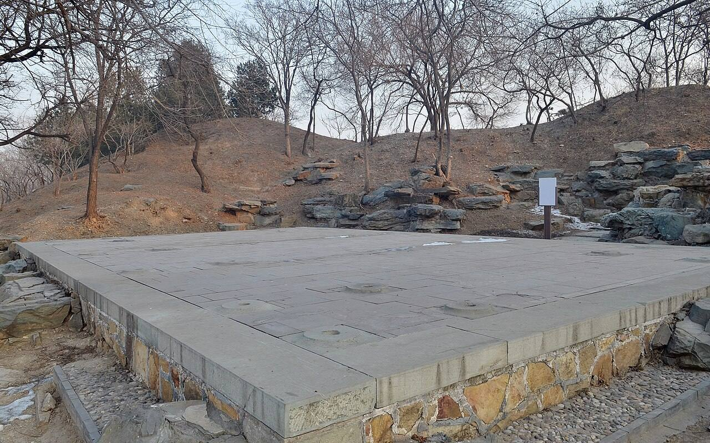

<!-- generated:start (scripts/building_pages.py): do not edit between these markers -->

# CC02-12: 得胜盖 Desheng Gai

Changchun Yuan

**3D object:** 1 box. Open it: `/reconstruction/3d.html?b=CC02-12`

**Part of:** CC02 含经堂

## What we know

- **Name:** 得胜盖 Desheng Gai (S06, S01 · confidence B)
- **Written on the plan:** 得胜? (S01 · confidence B)
- **Garden:** Changchun Yuan (S06, S01)
- **Type:** other (S06, S01 · confidence B)
- **Built:** 乾隆二十四年 1759 (S06) (S06, S01)
- **Destroyed:** 1860 (S06, S01)
- **Position:** 40.00930, 116.30710. S01 likely (S01 · confidence B)
- **Bays:** 3x1 on the plan (S06, S01)
- **Size in the inventory:** 12.2 × 6.3 m. S01 plan px / hall scale (S01)
- **Where the text puts it:** 出后门 敞厅 (S06) (S06, S01) *(research copy, not public)*
- **Plan reader's note:** Label below the hall reads 得勝槩 or similar (3rd char 木 base). S06: open hall outside the back gate. On a rockery. (S01) *(research copy, not public)*
- **How it was read:** likely (S01) *(research copy, not public)*
- **Plan pixels:** 10567, 2617 (S01) *(research copy, not public)*

## Our model now

A plain box on the block drawn on the Qing plan S01: position and frontage from the plan, heights and roof from the typology of its hall class. It will be updated as the research goes on.

- **Box:** 12.2 × 6.3 m, side hall
- **Heights:** platform 0.54 m, eave 3.64 m, ridge 6 m above the ground
- **Roof:** gable 硬山 or 悬山, rolled ridge 卷棚, grey tile
- **Faces:** 172.6° from north
- **Confidence:** B

## Pictures (1)

- **P0409** (sure): 得胜概敞厅遗址 20130126.JPG (2013-01-26 16:20:05 (Commons DateTimeOriginal)). https://commons.wikimedia.org/wiki/File:%E5%BE%97%E8%83%9C%E6%A6%82%E6%95%9E%E5%8E%85%E9%81%97%E5%9D%80_20130126.JPG

  

## Texts and drawings (3)

- **E2497** (description, sure): 紫禁城宁寿宫区与长春园含经堂区建筑关系探讨 (王文涛, 故宫学刊 2015): the 含经堂 layout from the dig. 2015 · pp.358-367 (PDF pp.6-15) · S672. https://www.dpm.org.cn/Uploads/File/2020/03/27/u5e7db6f5d6c90.pdf
  From the dig and the archives: the compound is about 300 m north-south by 200 m east-west. Forecourt with three glazed pailou (east, south, west) and four lawns where yurts stood; five-bay gate with a 垂花门 each side; 含经堂 a seven-bay double-eaved hip-and-gable hall with side halls and the towers 霞翥楼 and 梵香楼; 淳化轩 seven by three bays, the largest single building of Changchun Yuan, hip-and-gable (rolled ridge on p.360, glazed on p.361); 蕴真斋 seven bays with front and back porches; 渊映斋 and 涵光室 five-bay hip-and-gable; 三友轩 three bays, measured about 11.1 x 7.2 m on a platform 11.9 x 8.3 m; 静莲斋 five bays; 理心楼 five bays; 待月楼 a three-bay two-storey hip-and-gable tower facing east; 澄波夕照 and 得胜概 three-bay open halls; a two-storey stage 乐奏钧天 with a five-bay viewing hall 神心妙达 rebuilt in mid-Jiaqing. Floor heating survives in five halls. The remains are Qianlong work with some of the 1814 rebuilding, nothing later. 淳化轩 was the model for 乐寿堂 in the 宁寿宫.
- **E2496** (archaeology, sure): 圆明园长春园含经堂遗址发掘报告: table of contents. 2006 · 目录, 第三章 遗迹 · S990. https://ebook.artron.net/book.php?bookid=61437
  The full report of the 2001-2003 seasons lists every excavated unit: in the south the three-arch pailou, walls, paths, carved-brick paving and yurt (毡帐) foundations and tree pits in the forecourt, the gate, the 含经堂 court with screen gate, main hall, east and west side halls, 霞翥楼, 梵香楼, galleries and a 垂花门; in the north 淳化轩 with a Taihu rockery before its terrace, 蕴真斋, the north gate and the open hall 得胜概; east 渊映斋, the dressing room and 乐奏钧天 stage, the viewing hall 神心妙达 and the shop street outside; west 涵光室, 三友轩 with its rockery, 静莲斋, 理心楼, 待月楼 and the open hall 澄波夕照 outside; round about duty rooms, stores, a well pavilion, a timber bridge, 明漪潇照, 云容水态 and the octagonal 静缘亭.
- **E0063** (archaeology, sure): 澄波夕照 at 含经堂. c. 2011 blog, on the dig of 2001-03 · 系列15 · S356. https://blog.sina.com.cn/s/blog_65fec3ab0100sxa7.html
  After the dig of 2001-03 at 含经堂, the foundations of 澄波夕照, 得胜概 and a rock pavilion were restored in part. So the label on S01 has a site on the ground.

**On the plan:** Drawn on the plan of the gardens (S01), labelled 得胜? (? marks an unread character), 3x1 cells. https://artmuseum.princeton.edu/collections/objects/138657

## Evidence for the set of buildings

- Evidence for the whole compound 含经堂: see CC02
- Reconstructions and comparables for the whole garden, 长春园 Changchun Yuan: see GARDEN-CC
- Standing buildings comparable to a side hall (not this building): see CLASS-side_hall

## Open questions

None that name it.

<!-- generated:end -->

## Notes

<!-- Yours: regeneration never touches this part. It goes on the public site; what you write below a line holding only %% private %% stays in the research copy. -->
