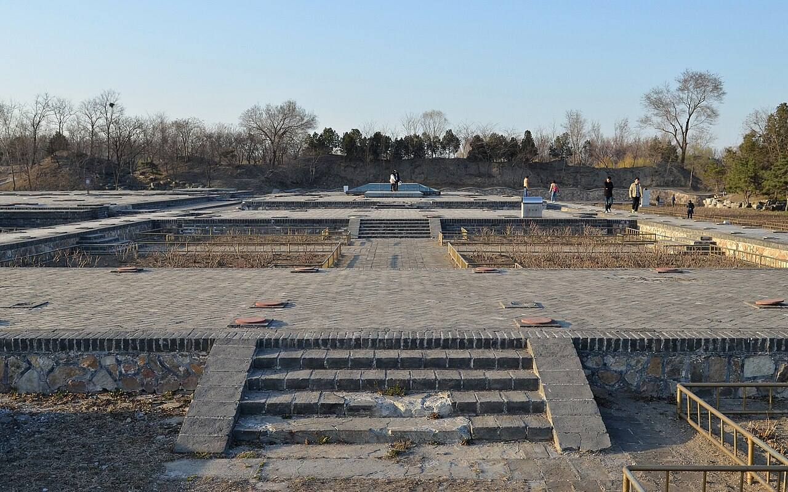

<!-- generated:start (scripts/building_pages.py): do not edit between these markers -->

# CC02-13: 乐奏钧天戏台 Yuezou Juntian xitai

Changchun Yuan

**3D object:** 1 box. Open it: `/reconstruction/3d.html?b=CC02-13`

**Part of:** CC02 含经堂

## What we know

- **Name:** 乐奏钧天戏台 Yuezou Juntian xitai (S43, S48, S01 · confidence B)
- **Written on the plan:** 樂奏?天 (S01 · confidence B)
- **Garden:** Changchun Yuan (S43, S48, S01)
- **Type:** theatre (S43, S48, S01 · confidence B)
- **Built:** 嘉庆十九年 1814 (S43) (S43, S48, S01)
- **Destroyed:** 1860 (S43, S48, S01)
- **Position:** 40.00870, 116.30757. S01 likely (S01 · confidence B)
- **Bays:** 1x1 on the plan (S43, S48, S01)
- **Size in the inventory:** 16 × 16 m. text (see notes) (S01)
- **Roof:** 重檐 double (S43) (S43, S48, S01)
- **Where the text puts it:** 淳化轩东侧 (S43) (S43, S48, S01) *(research copy, not public)*
- **Note:** S43: 16米见方, 檐柱4.48 m; 下层 乐奏钧天 上层 阆苑仙音; basement 2.47 m. (S43, S48, S01)
- **Plan reader's note:** rect=40,38,0. Square stage in the court x 10666-10760, y 2890-2979; label above it reads right to left, third char like 鈞 or 場. (S01) *(research copy, not public)*
- **How it was read:** likely (S01) *(research copy, not public)*
- **Plan pixels:** 10707, 2960 (S01) *(research copy, not public)*

## Our model now

A plain box on the block drawn on the Qing plan S01: position and frontage from the plan, heights and roof from the typology of its hall class. It will be updated as the research goes on.

- **Box:** 8.72 × 7.91 m, small house
- **Heights:** platform 0.45 m, eave 3.2 m, ridge 5.91 m above the ground
- **Roof:** gable 硬山 or 悬山, double eaves 重檐, grey tile
- **Faces:** 352.2° from north
- **Fit:** reduced towards the size drawn on the plan, to stand clear of its neighbours or the water
- **Confidence:** B

## Pictures (1)

- **P0410** (sure): Ruins of Hanjingtang 20130324.JPG (2013-03-24 17:27:07 (Commons DateTimeOriginal)). https://commons.wikimedia.org/wiki/File:Ruins_of_Hanjingtang_20130324.JPG

  

## Texts and drawings (3)

- **E0058** (description, sure): 神心妙达 at 淳化轩. 2021 · section 2.2 · S43. https://www.yuanmingyuanpark.cn/xs/yjbg/202108/t20210831_4483509.html
  In 1814 the 乐奏钧天 stage and dressing rooms went up on the east of 淳化轩, and 神心妙达 was rebuilt as the hall to watch from. The same words in S05 j81:35b are a quotation in the 水木明瑟 preface and have nothing to do with this hall.
- **E0057** (description, sure): 圆明园五朝御制诗文集注 v3, editors' note on 含经堂. 2020 edition · v3 p.244 · S361. https://www.yuanmingyuanpark.cn/xs/yjbg/202008/P020200803382569071850.pdf#page=247
  The largest group in this garden, finished 1747, rebuilt 1770 with 淳化轩, 蕴真斋, 三友轩, 静莲斋, 待月楼 and 理心楼. 含经堂 is a seven-bay double-eaved glazed hall; 霞翥楼 mirrors 梵香楼 and, with the inner plaque 味腴书室, held the 四库全书荟要, which identifies our 味腴书屋. A stage was added east of 淳化轩 in 1814. Guards were still posted after 1860.
- **E0064** (archaeology, sure): 含经堂 乐奏钧天 stage as cited in 圆明园戏场探微. 2021 · citing 考古 2004(2) · S144. https://www.yuanmingyuanpark.cn/xs/yjbg/202108/t20210831_4483509.html
  The park's theatre paper reports the excavated 乐奏钧天 Yuezou Juntian stage of 含经堂 as about 16 m square, built over a granite cellar with a clear height of 2.47 m.

**On the plan:** Drawn on the plan of the gardens (S01), labelled 樂奏?天 (? marks an unread character), 1x1 cells. https://artmuseum.princeton.edu/collections/objects/138657

## Evidence for the set of buildings

- Evidence for the whole compound 含经堂: see CC02
- Reconstructions and comparables for the whole garden, 长春园 Changchun Yuan: see GARDEN-CC
- Standing buildings comparable to a main hall (not this building): see CLASS-main_hall

## Open questions

None that name it.

<!-- generated:end -->

## Notes

<!-- Yours: regeneration never touches this part. It goes on the public site; what you write below a line holding only %% private %% stays in the research copy. -->
