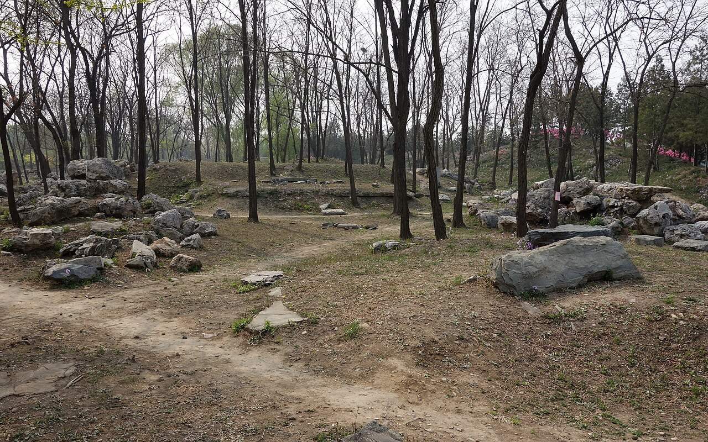

<!-- generated:start (scripts/building_pages.py): do not edit between these markers -->

# CC04-03: 小有天园 Xiaoyoutian Yuan

Changchun Yuan

**3D object:** 2 boxes. Open it: `/reconstruction/3d.html?b=CC04-03`

**Part of:** CC04 思永斋

## What we know

- **Name:** 小有天园 Xiaoyoutian Yuan (S05, S02, S01 · confidence B)
- **Written on the plan:** 佳处领其要 (S01 · confidence B)
- **Garden:** Changchun Yuan (S05, S02, S01)
- **Type:** other (S05, S02, S01 · confidence B)
- **Built:** 乾隆二十三年 1758 record 去嵗丁丑 [j83:9b] (S05, S02, S01)
- **Destroyed:** 1860 (S05, S02, S01)
- **Position:** 40.00733, 116.30507. S01 likely (S01 · confidence B)
- **Bays:** 2x3 on the plan (S05, S02, S01)
- **Size in the inventory:** 12.7 × 14.8 m. S01 plan px / hall scale (S01)
- **Note:** After 汪氏 garden, West Lake (S02 p.98). (S05, S02, S01)
- **Plan reader's note:** Label 佳處領其要 in the walled east court x 9570-9705, y 3510-3635. Text says 小有天园 is the east side-court; the plan names it differently. B0666/667 are its west hall group. (S01) *(research copy, not public)*
- **How it was read:** likely (S01) *(research copy, not public)*
- **Plan pixels:** 9640, 3575 (S01) *(research copy, not public)*

## Our model now

A plain box on the block drawn on the Qing plan S01: position and frontage from the plan, heights and roof from the typology of its hall class. It will be updated as the research goes on.

- **1 ×:** side hall: 11.44 × 10.97 m, eave 3.64 m, ridge 7.57 m
- **1 ×:** small house: 9.53 × 8.65 m, eave 3.2 m, ridge 6.16 m
- **Confidence:** B

## Pictures (1)

- **P0412** (sure): 思永斋小有天园遗址 20130421.JPG (2013-04-21 14:39:29 (Commons DateTimeOriginal)). https://commons.wikimedia.org/wiki/File:%E6%80%9D%E6%B0%B8%E6%96%8B%E5%B0%8F%E6%9C%89%E5%A4%A9%E5%9B%AD%E9%81%97%E5%9D%80_20130421.JPG

  

## Texts and drawings (5)

- **E0134** (text, sure): 御製小有天園記. 1758 (去嵗丁丑, in the text) · j83:9b-10b · S05. https://github.com/kanripo/KR2k0036/blob/master/KR2k0036_083.txt
  > 御製小有天園記　左净慈面明聖兼挹湖山之秀為南屏最佳處者莫過於汪氏之小有天園盖辛未南廵所命名也去嵗丁丑復至其地為之流連為之倚吟歸而思畫家所為收千里於咫尺者適得思永齋東林屋一區室則十笏窗乃半之窗之外隙地方廣亦十笏命匠氏叠石成峯則居然慧日也範錫為宇又依然壑庵也（汪氏别業舊名）激水作瀑泠泠琤琤不殊幽居洞之所聞而黄山松樹子雖盈尺有凌雲之概夭矯盤拏髙下雜出於石笋峭蒨間復與琴臺之古木蒼巖玲瓏秀削不可言同何况云異吾於是知天地間之景無窮而人之心亦無窮境有異而人之心無有異夫此為軒為亭為磴為池為林泉為崖壑固不可歴歴手攀而足陟之者使目擊道存㑹心不逺則此為軒為亭為磴為池為林泉為崖壑又何不可歴歴手攀而足陟之乎昔新豐雞犬各識其戸固已侈矣李徳裕平泉之像巴峽冩洞庭則又務窮逺盡態極妍而不必師所可師者其意而已然吾之意不在千里外之湖光山色應接目前而在兩浙間之吏治民依來徃胸中矣是為記
  The courtyard east of 思永齋 copies 小有天園, the 汪 family garden on the 南屏 hill at Hangzhou: rockwork as 慧日峰, a tin-roofed room, a cascade and small Huangshan pines. He says his mind is on the governance of Zhejiang.
- **E0135** (text, sure): 日下舊聞考 思永斋. 1780s (乾隆 敕撰) · j83:9a-9b · S05. https://github.com/kanripo/KR2k0036/blob/master/KR2k0036_083.txt
  > 蒨園後河北岸為思永齋七楹齋北樓宇臨池為山色湖光共一樓齋東别院為小有天園（長春園册）臣等謹案思永齋門額曰静便趣齋内額曰萬横香玉
  North of the stream behind 蒨園: 思永齋, seven bays, with the tower 山色湖光共一樓 and the side court 小有天園.
- **E0120** (poem, likely): 御製 題小有天園. 1764 (御製詩三集) · KR4f0005_201:24a-24b · S201. https://github.com/kanripo/KR4f0005/blob/master/KR4f0005_201.txt
  > 題小有天園 疊石肖慧峯範錫寫壑庵（西湖小有天園舊名壑庵）分眀虛窓北宛似聖湖南縮逺以近取收大於小含既非仙術幻亦豈佛偈拈屧歩丹崖側撫掌琴臺尖逰神無不可騁目還須兼過去成陳迹未来猶豫探奚如現前對前三與後三
  The side court of 思永齋: rockwork copying 慧日峰 and a tin-roofed room after 壑庵 at Hangzhou, seen through a window to the north.
- **E0137** (description, likely): 长春园 No.4, 思永斋 Siyong Zhai, copied from a southern garden. 1934 · p.98 · S02. https://archive.org/details/historyofpekings00malo
  > In 1757 when Ch'ien Lung first visited one of these, Number Four, he said it was as though he could see a thousand li, for it seemed as though he were again in the garden of the Wang Family at Nan P'ing, which he had seen in 1751.
  Modelled on the Wang family garden at Nanping, Hangzhou, seen in 1751 and visited here in 1757. Malone gives no Chinese name; 小有天园 at 思永斋 fits.
- **E0138** (description, sure): 圆明园五朝御制诗文集注 v3, editors' note on 思永斋. 2020 edition · v3 p.302 · S361. https://www.yuanmingyuanpark.cn/xs/yjbg/202008/P020200803382569071850.pdf#page=305
  Begun 1747 on a ringed island: a seven-bay hall, gate plaque 静便趣, with copies of the recut 淳化阁帖 and of the 西洋楼 engravings kept inside. 山色湖光共一楼 stands north with an octagonal gallery; 小有天园, after a Hangzhou garden, is the east court.

**On the plan:** Drawn on the plan of the gardens (S01), labelled 佳处领其要, 2x3 cells. https://artmuseum.princeton.edu/collections/objects/138657

## Evidence for the set of buildings

- Evidence for the whole compound 思永斋: see CC04
- Reconstructions and comparables for the whole garden, 长春园 Changchun Yuan: see GARDEN-CC
- Standing buildings comparable to a side hall (not this building): see CLASS-side_hall

## Open questions

None that name it.

<!-- generated:end -->

## Notes

<!-- Yours: regeneration never touches this part. It goes on the public site; what you write below a line holding only %% private %% stays in the research copy. -->
