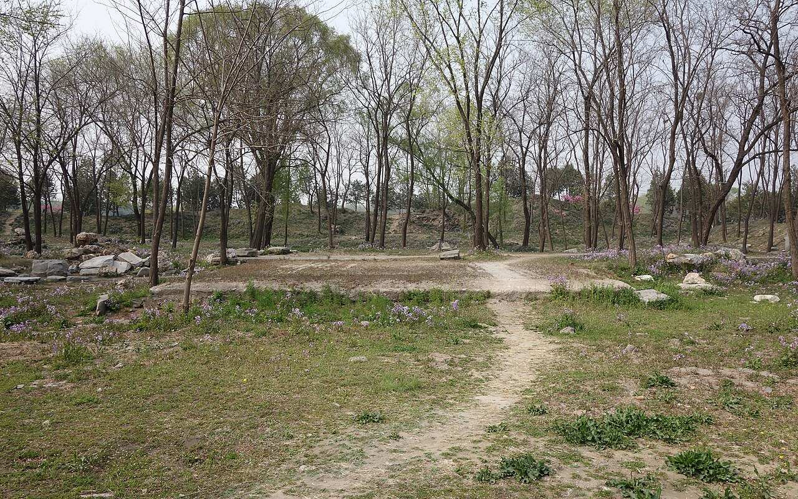
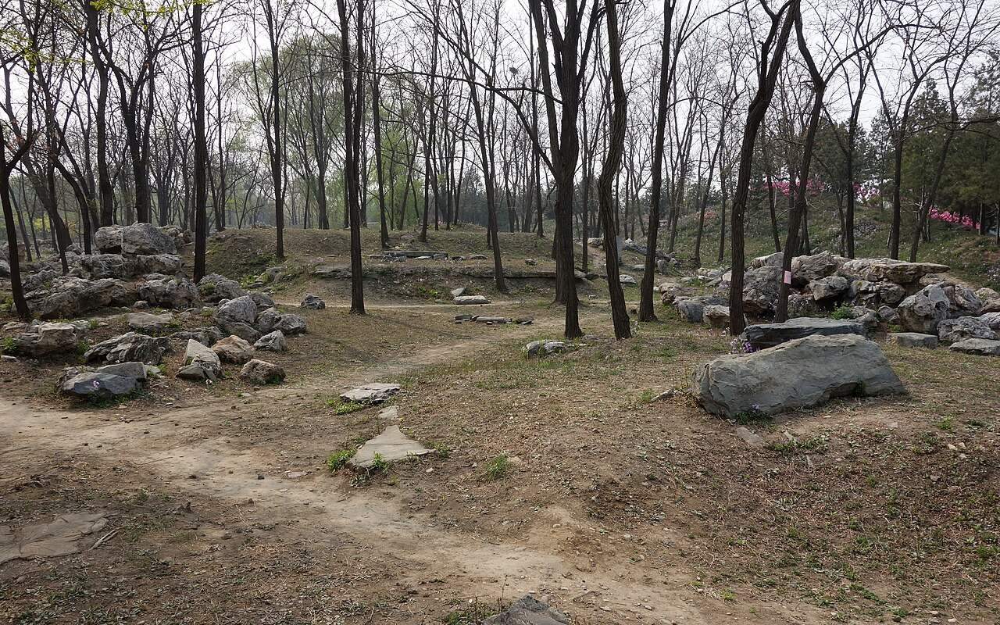
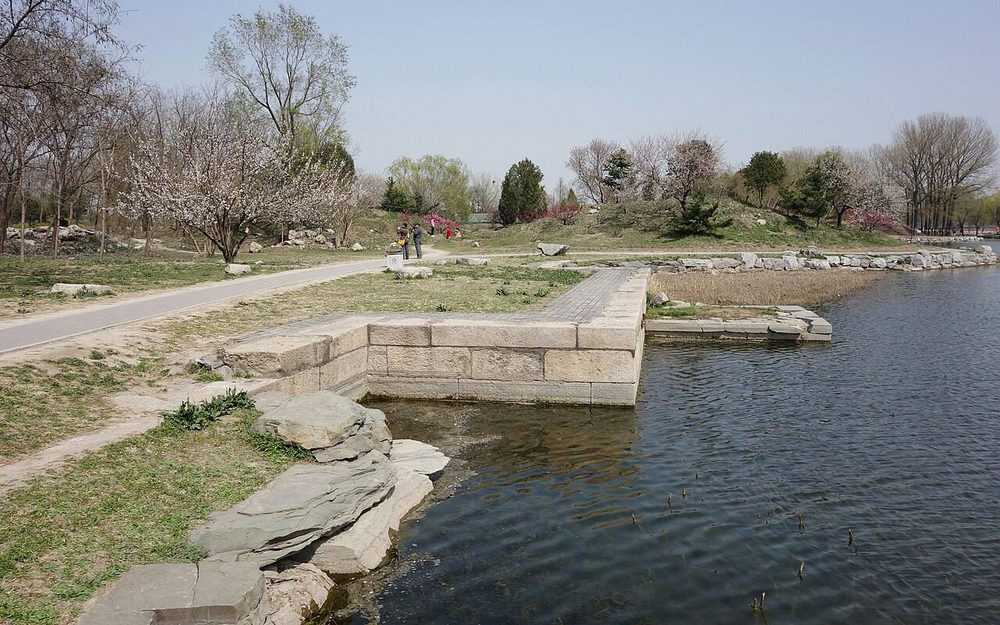
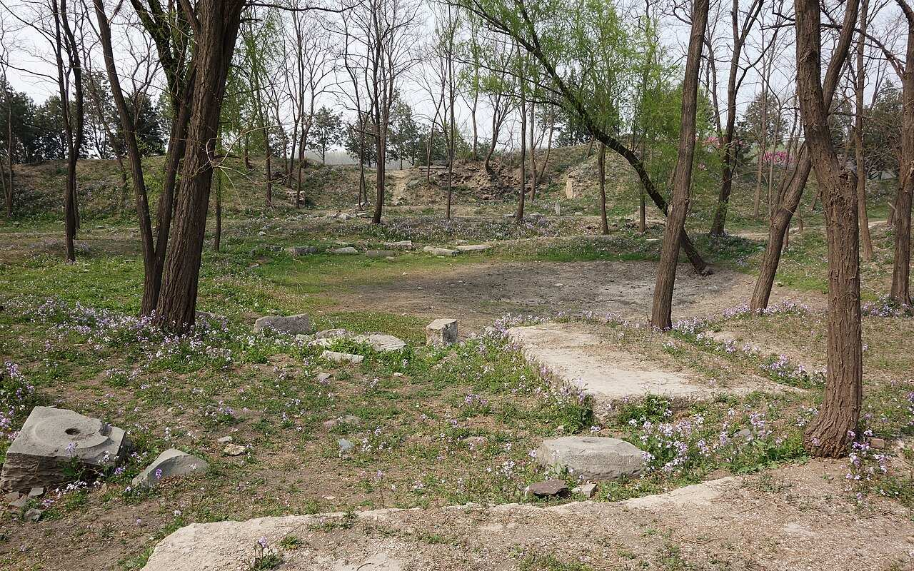
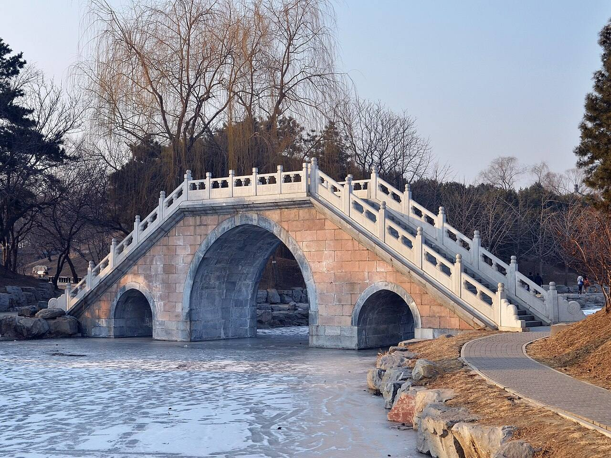

<!-- generated:start (scripts/building_pages.py): do not edit between these markers -->

# CC04: 思永斋 Siyong Zhai

Changchun Yuan

**3D object:** 19 boxes. Open it: `/reconstruction/3d.html?b=CC04`

## What we know

- **Name:** 思永斋 Siyong Zhai (S05, S43, S01, S201, S361 · confidence A)
- **Garden:** Changchun Yuan (S05, S43, S01, S201, S361)
- **Type:** compound (S05, S43, S01, S201, S361 · confidence A)
- **Built:** 乾隆十二年 1747 基本建成 (S43); by 1758; had stood 'over twenty years' by 1785; 小有天園 court: after 丁丑 1757 (記) (S05, S43, S01, S201, S361)
- **Destroyed:** 1860 (S05, S43, S01, S201, S361)
- **Position:** 40.00695, 116.30471. S01 sure (S01 · confidence B)
- **Note:** Malone p.98 Numbers Four, Five, Seven are palace groups on islands. (S05, S43, S01, S201, S361)
- **Plan reader's note:** Label in the court south of the hall B0706, blue 4. Labels read: 思永斋, 山色湖光共?, 佳处领其要, 迎月亭, 静便趣; ?亭 at the east. (S01) *(research copy, not public)*
- **How it was read:** sure (S01) *(research copy, not public)*
- **Plan pixels:** 9472, 3765 (S01) *(research copy, not public)*

## Our model now

19 boxes stand in this compound, 19 on blocks drawn on the plan, 0 assumed. Its halls are listed below.

## Inside it (18)

- CC04-01 思永斋殿
- CC04-02 山色湖光共一楼
- CC04-03 小有天园
- CC04-AX009
- CC04-AX010
- CC04-B0647
- CC04-B0648
- CC04-B0685
- CC04-B0686
- CC04-B0688
- CC04-B0692
- CC04-B0693
- CC04-B0704
- CC04-B0705
- CC04-B0707
- CC04-N01 ?亭
- CC04-N02 迎月亭
- CC04-N03 静便趣

## Pictures (5)

- **P0411** (sure): 思永斋遗址 20130421.JPG (2013-04-21 14:45:09 (Commons DateTimeOriginal)). https://commons.wikimedia.org/wiki/File:%E6%80%9D%E6%B0%B8%E6%96%8B%E9%81%97%E5%9D%80_20130421.JPG

  

- **P0412** (sure): 思永斋小有天园遗址 20130421.JPG (2013-04-21 14:39:29 (Commons DateTimeOriginal)). https://commons.wikimedia.org/wiki/File:%E6%80%9D%E6%B0%B8%E6%96%8B%E5%B0%8F%E6%9C%89%E5%A4%A9%E5%9B%AD%E9%81%97%E5%9D%80_20130421.JPG

  

- **P0445** (sure): Ruins of Siyongzhai 20130414.JPG (2013-04-14 13:48:43 (Commons DateTimeOriginal)). https://commons.wikimedia.org/wiki/File:Ruins_of_Siyongzhai_20130414.JPG

  

- **P0446** (sure): 思永斋鱼池遗址 20130421.JPG (2013-04-21 14:42:55 (Commons DateTimeOriginal)). https://commons.wikimedia.org/wiki/File:%E6%80%9D%E6%B0%B8%E6%96%8B%E9%B1%BC%E6%B1%A0%E9%81%97%E5%9D%80_20130421.JPG

  

- **P0444** (likely): Kingfisher Bridge 20130126.JPG (2013-01-26 15:32:10 (Commons DateTimeOriginal)). https://commons.wikimedia.org/wiki/File:Kingfisher_Bridge_20130126.JPG

  

## Texts and drawings (26)

- **E0134** (text, sure): 御製小有天園記. 1758 (去嵗丁丑, in the text) · j83:9b-10b · S05. https://github.com/kanripo/KR2k0036/blob/master/KR2k0036_083.txt
  > 御製小有天園記　左净慈面明聖兼挹湖山之秀為南屏最佳處者莫過於汪氏之小有天園盖辛未南廵所命名也去嵗丁丑復至其地為之流連為之倚吟歸而思畫家所為收千里於咫尺者適得思永齋東林屋一區室則十笏窗乃半之窗之外隙地方廣亦十笏命匠氏叠石成峯則居然慧日也範錫為宇又依然壑庵也（汪氏别業舊名）激水作瀑泠泠琤琤不殊幽居洞之所聞而黄山松樹子雖盈尺有凌雲之概夭矯盤拏髙下雜出於石笋峭蒨間復與琴臺之古木蒼巖玲瓏秀削不可言同何况云異吾於是知天地間之景無窮而人之心亦無窮境有異而人之心無有異夫此為軒為亭為磴為池為林泉為崖壑固不可歴歴手攀而足陟之者使目擊道存㑹心不逺則此為軒為亭為磴為池為林泉為崖壑又何不可歴歴手攀而足陟之乎昔新豐雞犬各識其戸固已侈矣李徳裕平泉之像巴峽冩洞庭則又務窮逺盡態極妍而不必師所可師者其意而已然吾之意不在千里外之湖光山色應接目前而在兩浙間之吏治民依來徃胸中矣是為記
  The courtyard east of 思永齋 copies 小有天園, the 汪 family garden on the 南屏 hill at Hangzhou: rockwork as 慧日峰, a tin-roofed room, a cascade and small Huangshan pines. He says his mind is on the governance of Zhejiang.
- **E0401** (poem, sure): 御製長春園題句（有序）. 1770 (乾隆三十五年) · j83:1b-2b · S05. https://github.com/kanripo/KR2k0036/blob/master/KR2k0036_083.txt
  > 乾隆三十五年御製長春園題句（有序）　山水無樂夀之徵興隨所遇日月引壺洲之景春與俱長廼拓餘地於御園爰效嘉名於仙館顧當年之賜號時□體元籌他日之安居兹惟卜始波通福海東壖旭麗扶桑垣亘清河北陌香浮華黍列縹緗以娛志堂啟含經撫翰墨以怡神軒成淳化思永勵始終如一式是齋乎開襟而氣象盈千登斯樓也他若某邱某壑境足賞心有榭有亭勝堪寓目每㡬暇朅來遊憇擬耄期恒此頤恬以紀元六十載為衡積願笑惟奢望從周甲廿五年而計朂勤敢有倦心儷以弁言系之長律長春非敢暢春侔（祖暢春園在圓明園之南居之皇所建今奉皇太后）即景名園亦有由賜號當年例仙館（長春仙館為圓明園四十景之一雍正年間賜居也即以當年賜號名之）倦勤他日擬菟裘（予有夙願若至乾隆六十年夀登八十有五時亦應歸政故鄰圓明園之東豫脩此園為他日優游之地雖屬侈望然果得如此亦國家景運之隆天下臣民之慶也）培松拱把冀鱗老留石平心待句酬廿五春秋仍劼毖（今嵗六旬屈指果得歸政尚當二十五年然一日臨蒞矢不敢少懈此敬勤之志必居此園時然後可息肩娛老耳）耄期嵗月合優游
  Dated 1770 and his sixtieth year: he says he built this garden east of 圓明園 as a retirement home for the sixtieth year of his reign, when he would be 85. It names 含經堂, 淳化軒, 思永齋 and the 'open breast' tower 海嶽開襟.
- **E0135** (text, sure): 日下舊聞考 思永斋. 1780s (乾隆 敕撰) · j83:9a-9b · S05. https://github.com/kanripo/KR2k0036/blob/master/KR2k0036_083.txt
  > 蒨園後河北岸為思永齋七楹齋北樓宇臨池為山色湖光共一樓齋東别院為小有天園（長春園册）臣等謹案思永齋門額曰静便趣齋内額曰萬横香玉
  North of the stream behind 蒨園: 思永齋, seven bays, with the tower 山色湖光共一樓 and the side court 小有天園.
- **E0118** (poem, sure): 御製 思永齋. 1758 (御製詩二集) · KR4f0005_134:19b · S201. https://github.com/kanripo/KR4f0005/blob/master/KR4f0005_134.txt
  > 思永齋 樸斵含經畔（是處在含經堂西）徃來亦憩留澄觀非藻繢託志在清幽上下鳶魚若居稽今古求言經如展讀切已慎身修
  His note says 思永齋 lies west of 含經堂. A plain study where he stops and reads.
- **E0120** (poem, sure): 御製 題小有天園. 1764 (御製詩三集) · KR4f0005_201:24a-24b · S201. https://github.com/kanripo/KR4f0005/blob/master/KR4f0005_201.txt
  > 題小有天園 疊石肖慧峯範錫寫壑庵（西湖小有天園舊名壑庵）分眀虛窓北宛似聖湖南縮逺以近取收大於小含既非仙術幻亦豈佛偈拈屧歩丹崖側撫掌琴臺尖逰神無不可騁目還須兼過去成陳迹未来猶豫探奚如現前對前三與後三
  The side court of 思永齋: rockwork copying 慧日峰 and a tin-roofed room after 壑庵 at Hangzhou, seen through a window to the north.
- **E0125** (poem, sure): 御製 思永齋有詠. 1785 (御製詩五集) · KR4f0005_404:24a-24b · S201. https://github.com/kanripo/KR4f0005/blob/master/KR4f0005_404.txt
  > 思永齋有詠 壬寅詠思永申言有二義（壬寅思永齋詩云一曰永修身一曰永後世五帝官天下）（修身一已備三王家天下後世應並計）其義已暢眀兹不復辭贅兹之詠思永用為娱老備建立廿餘年兹近十年計（思永齋在長春園内）（建立二十餘年在寧夀宫落成之先均以備歸政後頤養所居兹自乙巳春至乙夘歸政屈指十年惟期仰承）（庶克天貺得如初願協思永之義耳）永者日以近足知老將至設果得如願額手欽天賜
  His note says 思永齋 had stood over twenty years by 1785, built before 寧夀宫 as a retirement place, with ten years then left to his planned abdication.
- **E0139** (poem, sure): 赋得山色湖光共一楼. 乾隆二十三年 (1758) · v3 p.302, under 思永斋; source ref 6-603 · S361. https://www.yuanmingyuanpark.cn/xs/yjbg/202008/P020200803382569071850.pdf#page=305
  > 渭竹环临水，岩楼出竹梢。漪澜常映带，罨黛亦兼包。了识智仁乐，宛成仲叔交。契神疑画舫，悦志即书巢。已足供吟眺，奚烦事豁庨。羲经设观象，育德圣功爻。
  Poem 赋得山色湖光共一楼 by the Qianlong Emperor, 1758, filed by the editors under 思永斋.
- **E0119** (poem, sure): 思永斋: 乾隆二十六年 poem of the Qianlong Emperor. 乾隆二十六年 (1761), date from the compilation · p.285 item (1), under 思永斋 · S360. https://www.yuanmingyuanpark.cn/xs/yjbg/202007/P020200730387572832602.pdf#page=285
  > 佳处堪永日，因题思永名。絜矩在虞书，讵惟怡六情。政靡不有初，道益谦亏盈。肯构期于万，亦云观所行。即景识心官，慎修励以诚。
  Poem of the Qianlong Emperor at 思永斋, 1761, on the view. Year as given by the compilation.
- **E0121** (poem, sure): 思永斋. 乾隆二十九年 (1764) · v3 p.307, under 思永斋; source ref 8-788 · S361. https://www.yuanmingyuanpark.cn/xs/yjbg/202008/P020200803382569071850.pdf#page=310
  > 韶春煦润锦花舒，为抚时和惕有余。卑室更因思禹拜，倚衡拟欲学师书。修身敬奉三无本，叙族宁忘一脉初。绨几蛎窗增愧处，圣人见说贵鹑居。
  Poem 思永斋 by the Qianlong Emperor, 1764, filed by the editors under 思永斋.
- **E0122** (poem, sure): 思永斋: 乾隆二十九年 poem of the Qianlong Emperor. 乾隆二十九年 (1764), date from the compilation · p.285 item (2), under 思永斋 · S360. https://www.yuanmingyuanpark.cn/xs/yjbg/202007/P020200730387572832602.pdf#page=285
  > 含经思永近比邻，题额称名实欲循。枕葄礼园希复性，沉濳义府愼修身。底须银烛怜过节，耐可华编娱早春。德业进修宁二道，箕畴愿福万方民。
  Poem of the Qianlong Emperor at 思永斋, 1764, on the view. Year as given by the compilation.
- **E0123** (poem, sure): 思永斋. 乾隆三十一年 (1766) · v3 p.308, under 思永斋; source ref 9-150 · S361. https://www.yuanmingyuanpark.cn/xs/yjbg/202008/P020200803382569071850.pdf#page=311
  > 斋堂一溪隔，其实近尺咫。含经既临诸，思永爰憩只。檐檠亦流苏，屏胜亦叠绮。灯宵稔冉过，顿置风景美。循名如责实，忸怩犹惭此。讵惟慎身修，絜矩治平理。
  Poem 思永斋 by the Qianlong Emperor, 1766, filed by the editors under 思永斋.
- **E0124** (poem, sure): 题思永斋. 乾隆三十二年 (1767) · v3 p.310, under 思永斋; source ref 9-276 · S361. https://www.yuanmingyuanpark.cn/xs/yjbg/202008/P020200803382569071850.pdf#page=313
  > 思永非惟身慎修，心思永处说从头。敬天益励旦明凜，法祖常怀艰大投。勤政宁无间宵旰，亲贤何有尽登收。至于祈岁更殷若，安得屡绥遍九州。
  Poem 题思永斋 by the Qianlong Emperor, 1767, filed by the editors under 思永斋.
- **E0126** (poem, sure): 思永斋: 乾隆五十年 poem of the Qianlong Emperor. 乾隆五十年 (1785), date from the compilation · p.285 item (3), under 思永斋 · S360. https://www.yuanmingyuanpark.cn/xs/yjbg/202007/P020200730387572832602.pdf#page=285
  > 壬寅咏思永，申言有二义（壬寅，思永斋诗云：一曰永修身，一曰永后世。五帝官天下，修身一已备。三王家天下，后世应并计。 ） 。其义已畅明，兹不复辞赘。兹之咏思永，用为娱老备。建立廿余年，兹近十年计（思永斋在长春园内，建立二十余年，在宁寿宫落成之先，均以备归政后颐养所居，兹自乙巳春至乙夘归政屈指十年，惟期仰承天贶，得如初愿，庶克协思永之义耳） 。永者日以近，足知老将至。设果得如愿，额手钦天赐。
  Qianlong, 1785: his note dates the hall over twenty years back, before 宁寿宫, both prepared for his retirement.
- **E0127** (poem, sure): 思永斋: 嘉庆元年 poem of the Jiaqing Emperor. 嘉庆元年 (1796), date from the compilation · p.285 item (4), under 思永斋 · S360. https://www.yuanmingyuanpark.cn/xs/yjbg/202007/P020200730387572832602.pdf#page=285
  > 开奁对澄波，春潭明百顷。悦目净纎尘，碧浸晴云影。宿雾敛平林，晃耀阳乌炳。轩窗延景光，片时欣引领。斋名义深长，修齐务思永。应物虽万殊，返观必三省。克已胜治人，虚怀戒放逞。无我斯明通，外诱尽绝屏。顾名偶拈吟，中心存自警。
  Poem of the Jiaqing Emperor at 思永斋, 1796, on the view. Year as given by the compilation.
- **E0128** (poem, sure): 思永斋: 嘉庆三年 poem of the Jiaqing Emperor. 嘉庆三年 (1798), date from the compilation · p.285 item (5), under 思永斋 · S360. https://www.yuanmingyuanpark.cn/xs/yjbg/202007/P020200730387572832602.pdf#page=285
  > 修身有要惟思永，恒性常存绥厥猷。三字君难勤保泰，四方民隐务推求。治非好异贵平坦，政必守经听论谋。翼翼小心望淳化，漫图后乐凛先忧。
  Poem of the Jiaqing Emperor at 思永斋, 1798, on state papers. Year as given by the compilation.
- **E0129** (poem, sure): 思永斋: 嘉庆七年 poem of the Jiaqing Emperor. 嘉庆七年 (1802), date from the compilation · p.285 item (6), under 思永斋 · S360. https://www.yuanmingyuanpark.cn/xs/yjbg/202007/P020200730387572832602.pdf#page=285
  > 斋额义诚永，随时慎厥思。 风融春恰仲，日丽晷徐移。残雪还皴岭，宿冰已泮池。韶华渐繁富，庶汇拓根基。西苑寻芳早，东郊举趾宜。虽蒙三白洽，仍冀一犂滋。兆稔抒民愿，除氛溥昊慈。息戈转泰运，露布即飞驰。
  Poem of the Jiaqing Emperor at 思永斋, 1802, on the view. Year as given by the compilation.
- **E0130** (poem, sure): 思永斋: 嘉庆九年 poem of the Jiaqing Emperor. 嘉庆九年 (1804), date from the compilation · p.286 item (7), under 思永斋 · S360. https://www.yuanmingyuanpark.cn/xs/yjbg/202007/P020200730387572832602.pdf#page=286
  > 始勤终怠世俗常，莅事修身务思永。良法善政总率由，遵守旧章寸田静。敬循成宪恐未能，毋作聪明私意逞。喜新好奇必乖张，尺宅湛然物欲屏。
  Poem of the Jiaqing Emperor at 思永斋, 1804, on state papers. Year as given by the compilation.
- **E0131** (poem, sure): 思永斋: 嘉庆九年 poem of the Jiaqing Emperor. 嘉庆九年 (1804), date from the compilation · p.286 item (8), under 思永斋 · S360. https://www.yuanmingyuanpark.cn/xs/yjbg/202007/P020200730387572832602.pdf#page=286
  > 临轩治庶民，勉此寸诚真。正巳风从偃，持躬德日新。保身皆俗吏，无欲始贤臣。思永流方洁，惟恒世渐淳。慰心逢稔岁，惬意息征尘。尤喜燕齐获，西成救馁贫（三辅屡岁告丰，本年亦称大有，而山东省各属所报秋成，竟有至十分以上者，洵为罕觏之上稔，民食充裕，气象安恬，差慰省岁劭农之意）。
  Poem of the Jiaqing Emperor at 思永斋, 1804, on the harvest. Year as given by the compilation.
- **E0132** (poem, sure): 思永斋: 道光四年 poem of the Daoguang Emperor. 道光四年 (1824), date from the compilation · p.286 item (9), under 思永斋 · S360. https://www.yuanmingyuanpark.cn/xs/yjbg/202007/P020200730387572832602.pdf#page=286
  > 承先抚寰宇，兢业凛深思。言动参于是，修齐念在兹。临民惕饥溺，虚巳达猷为。永保钦天眷，诚求慎自欺。
  Poem of the Daoguang Emperor at 思永斋, 1824. Year as given by the compilation.
- **E0133** (poem, sure): 思永斋: 道光十一年 poem of the Daoguang Emperor. 道光十一年 (1831), date from the compilation · p.286 item (10), under 思永斋 · S360. https://www.yuanmingyuanpark.cn/xs/yjbg/202007/P020200730387572832602.pdf#page=286
  > 蛎窗迎暖旭，春盎一斋中。拨火茶初熟，看冰棹未通。修身期有永，学古念无穷。卉木含生意，敷荣识化工。
  Poem of the Daoguang Emperor at 思永斋, 1831, on the view. Year as given by the compilation.
- **E0137** (description, likely): 长春园 No.4, 思永斋 Siyong Zhai, copied from a southern garden. 1934 · p.98 · S02. https://archive.org/details/historyofpekings00malo
  > In 1757 when Ch'ien Lung first visited one of these, Number Four, he said it was as though he could see a thousand li, for it seemed as though he were again in the garden of the Wang Family at Nan P'ing, which he had seen in 1751.
  Modelled on the Wang family garden at Nanping, Hangzhou, seen in 1751 and visited here in 1757. Malone gives no Chinese name; 小有天园 at 思永斋 fits.
- **E0494** (description, likely): 长春园 Changchun Yuan: eight chief groups. 1934 · p.98 · S02. https://archive.org/details/historyofpekings00malo
  > The new garden which the Emperor constructed in 1751 just east of the Yuan Ming Yuan he called the Ch'ang Ch'un Yuan, or Garden of Long Spring.
  From Rixia j83. Built 1751 by Malone's date, added to for years; about a third of the size of the Yuan Ming Yuan proper; islands and artificial hills with wider spaces and larger lakes. No.1 audience hall inside the south gate (澹怀堂); No.2 palace on the central island (含经堂); Nos.3, 6, 8 lakeside gardens; Nos.4, 5, 7 palace groups on islands. Mapping of numbers to ids is mine; only 6 and 8 are named by Malone.
- **E2000** (description, sure): Site status table, about 2011: scattered remains only. c. 2011 · 系列06 repost, status table · S356. https://blog.sina.com.cn/s/blog_c27029650101itzz.html
  Scenes with only scattered, incomplete building remains in the same table. 方壶胜境 is listed separately as the one with fairly complete remains not yet tidied up. 紫碧山房, 舍卫城 and 如园 have been dug since.
- **E0136** (description, sure): 圆明园百景史事分景汇编: 思永斋. 1761-1831 · from p.285, under 思永斋 · S360. https://www.yuanmingyuanpark.cn/xs/yjbg/202007/P020200730387572832602.pdf#page=285
  A Qianlong note of 1785 says the hall had stood over twenty years, older than 宁寿宫, and like it was meant for his retirement. 思永斋: 10 dated items, 1761-1831, of which 10 poems (Qianlong, Jiaqing, Daoguang); recurring themes: the view, state papers, the harvest. First dated 1761, last dated 1831.
- **E0138** (description, sure): 圆明园五朝御制诗文集注 v3, editors' note on 思永斋. 2020 edition · v3 p.302 · S361. https://www.yuanmingyuanpark.cn/xs/yjbg/202008/P020200803382569071850.pdf#page=305
  Begun 1747 on a ringed island: a seven-bay hall, gate plaque 静便趣, with copies of the recut 淳化阁帖 and of the 西洋楼 engravings kept inside. 山色湖光共一楼 stands north with an octagonal gallery; 小有天园, after a Hangzhou garden, is the east court.
- **E1339** (archaeology, sure): 修复1860: 坦坦荡荡 绣墩, 思永斋 tiles. 2019 · news, 陈辉 · S334. https://news.ifeng.com/c/7ma60W4GZjB
  The restoration project for excavated sherds (about 100,000 pieces of porcelain) chose objects with known find spots: a blue-and-white porcelain stool from 坦坦荡荡 Tantan Dangdang, known locally as 金鱼池 the goldfish pond, and blue-and-white tiles from 思永斋 Siyong Zhai.

**On the plan:** Drawn on the plan of the gardens (S01), labelled 思永斋. https://artmuseum.princeton.edu/collections/objects/138657

## Reconstructions by others (1)

Modern interpretation, not evidence.
- **R0320** (drawing, sure): 张宝诚绘思永斋复原图. 张宝诚. https://blog.sina.com.cn/s/blog_6ff8be850100nobj.html Research-only: link card.

## Surviving comparable buildings, not this building (2)

- **T068** 小有天园 (汪氏) Xiaoyoutian Yuan of the Wang family, 南屏山 杭州 Hangzhou. Ours was copied from it, confidence A, standing: partly. Scale: a 袖珍 miniature on 10 笏 of ground, with painted West Lake walls; not a garden in size Basis: S05 j.83 f.9b-10b: 御制小有天园记: after the tour of 1757 he has a small plot east of 思永斋 built with piled rock like 慧日峰 and a tin cast hall like 壑庵, water falling as at 幽居洞. S400 (梁雪 2022): the copy has been confirmed by Qing records and is a tiny court with painted walls. https://github.com/kanripo/KR2k0036
- **T067** 小有天 (颐和园 万寿山西麓) Xiaoyoutian group on Longevity Hill, 颐和园 Summer Palace, Beijing. Comparable: same court, era or type, confidence C, standing: partly. Standing group of the same court on a real slope: 延清赏楼, a pavilion, 穿堂殿; compare for how a small court was treated Basis: S400: built soon after the first southern tour, near in date to our copy; the author presents its link to Hangzhou as his own inference (推演), not a stated copy. https://www.aisixiang.com/data/133010.html
  - P0648: 乾隆三十年乙酉（1765）御題南屏山小有天園詩. https://commons.wikimedia.org/wiki/File:%E4%B9%BE%E9%9A%86%E4%B8%89%E5%8D%81%E5%B9%B4%E4%B9%99%E9%85%89%EF%BC%881765%EF%BC%89%E5%BE%A1%E9%A1%8C%E5%8D%97%E5%B1%8F%E5%B1%B1%E5%B0%8F%E6%9C%89%E5%A4%A9%E5%9C%92%E8%A9%A9.jpg

## Evidence for the set of buildings

- Reconstructions and comparables for the whole garden, 长春园 Changchun Yuan: see GARDEN-CC

## Open questions

- Q26: Forms
- Q119: Digs

<!-- generated:end -->

## Notes

<!-- Yours: regeneration never touches this part. It goes on the public site; what you write below a line holding only %% private %% stays in the research copy. -->
