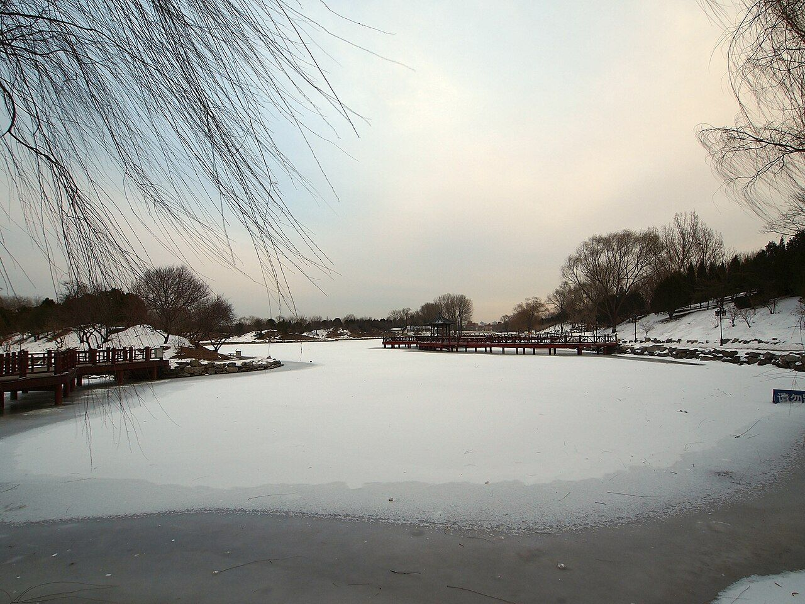
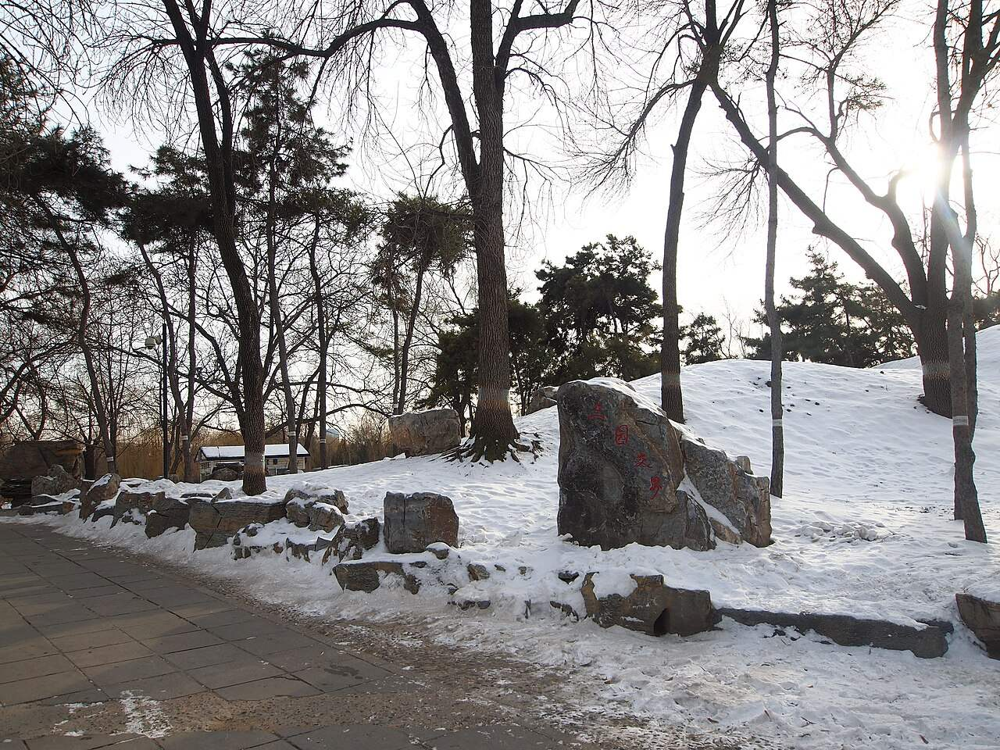

<!-- generated:start (scripts/building_pages.py): do not edit between these markers -->

# CC05: 得全阁 Dequan Ge

Changchun Yuan

**3D object:** 1 box. Open it: `/reconstruction/3d.html?b=CC05`

## What we know

- **Name:** 得全阁 Dequan Ge (S05, S01, S361 · confidence B)
- **Garden:** Changchun Yuan (S05, S01, S361)
- **Type:** compound (S05, S01, S361 · confidence B)
- **Built:** 1747 (S05, S01, S361)
- **Destroyed:** 1860 (S05, S01, S361)
- **Position:** 40.00570, 116.30338. S01 guess (S01 · confidence C)
- **Bays:** 7x1 on the plan (S05, S01, S361)
- **Size in the inventory:** 31.8 × 6.0 m. S01 plan px / hall scale (S01)
- **Note:** 額曰天心水面 [j83:11a]. S48 merges it with the middle floor of 海岳开襟. towers, main hall double-eaved (S361, v3 p.340). (S05, S01, S361)
- **Plan reader's note:** Rixia: west and a little south of 思永斋 across the river; halls south and north. Only compound in that direction with such halls. No label. Nothing labelled 得全阁 anywhere in the box. | plan: 7-bay N-S range on the west side. (S01) *(research copy, not public)*
- **How it was read:** guess (S01) *(research copy, not public)*
- **Plan pixels:** 8850, 4395 (S01) *(research copy, not public)*

## Our model now

A plain box on the block drawn on the Qing plan S01: position and frontage from the plan, heights and roof from the typology of its hall class. It will be updated as the research goes on.

- **Box:** 31.8 × 6 m, storeyed hall
- **Heights:** platform 0.45 m, eave 5.95 m, ridge 8.19 m above the ground
- **Roof:** hip-and-gable 歇山, rolled ridge 卷棚, grey tile
- **Faces:** 86.3° from north
- **Confidence:** C

## Inside it (3)

- CC05-01 宝云楼
- CC05-02 远风楼
- CC05-B0787

## Pictures (2)

- **P0472** (guess): 长春园 - Changchun Garden - 2012.12 - panoramio.jpg (Taken on 21 December 2012 (Commons DateTimeOriginal)). https://commons.wikimedia.org/wiki/File:%E9%95%BF%E6%98%A5%E5%9B%AD_-_Changchun_Garden_-_2012.12_-_panoramio.jpg

  

- **P0473** (guess): 三园交界 - Intersection of Three Gardens - 2012.12 - panoramio.jpg (Taken on 21 December 2012 (Commons DateTimeOriginal)). https://commons.wikimedia.org/wiki/File:%E4%B8%89%E5%9B%AD%E4%BA%A4%E7%95%8C_-_Intersection_of_Three_Gardens_-_2012.12_-_panoramio.jpg

  

## Texts and drawings (9)

- **E0145** (text, sure): 日下舊聞考 得全阁、海岳开襟. 1780s (乾隆 敕撰) · j83:10b-11a · S05. https://github.com/kanripo/KR2k0036/blob/master/KR2k0036_083.txt
  > 思永齋西稍南河外為得全閣南為寳雲樓北為逺風樓齋北河池潨滙中有圓式崇基其上樓宇三層為海嶽開襟四旁枋楔各一（長春園册）臣等謹案得全閣額曰天心水面海嶽開襟為下層樓内額其南簷額曰青瑶嶼最上層額曰乗六龍
  South-west of 思永齋: 得全閣 with 寳雲樓 and 逺風樓. North of 思永齋 in the pool: 海嶽開襟, a three-storey building on a round platform, with an arch on each side. The note gives the plaque for each storey.
- **E0394** (text, guess): 蒨园门. 1780s · j83:7a · S05. https://github.com/kanripo/KR2k0036/blob/master/KR2k0036_083.txt
  > 澹懐堂迤西濵河水石之間為蒨園門西嚮内為朗潤齋三楹
  West of 澹怀堂, among stream and rocks: 蒨园门 faces west. S57's 茜园门 between 绮春园 and 长春园 seems the same gate; S01's label stands on that line.
- **E0140** (poem, sure): 御製 得全閣. c. 1758, inferred from the last dated heading (御製詩二集) · KR4f0005_143:11b · S201. https://github.com/kanripo/KR4f0005/blob/master/KR4f0005_143.txt
  > 得全閣 髙樓碧沼湄萬景攬無遺水面風來際天心月到時文章假大塊圖畫得神姿益賛通為政吾猶戒在兹
  A tall building on the edge of green water with a full view around. Its words 水面 and 天心 echo the plaque 天心水面 recorded at S05 j83:11a.
- **E0144** (poem, sure): 御製 得全閣. 1764 (御製詩三集) · KR4f0005_199:28b · S201. https://github.com/kanripo/KR4f0005/blob/master/KR4f0005_199.txt
  > 得全閣 牓題逐處選名言責實循名意每存不取沈家傳八詠端思枚叟有佳論
  Short poem on the plaque's meaning.
- **E0141** (poem, sure): 得全阁. 乾隆二十四年 (1759) · v3 p.340, under 得全阁; source ref 6-710 · S361. https://www.yuanmingyuanpark.cn/xs/yjbg/202008/P020200803382569071850.pdf#page=343
  > 髙楼碧沼湄，万景揽无遗。水面风来际，天心月到时。文章假大块，图画得神姿。益赞通为政，吾犹戒在兹。
  Poem 得全阁 by the Qianlong Emperor, 1759, filed by the editors under 得全阁.
- **E0142** (poem, sure): 得全阁. 乾隆二十六年 (1761) · v3 p.341, under 得全阁; source ref 8-457 · S361. https://www.yuanmingyuanpark.cn/xs/yjbg/202008/P020200803382569071850.pdf#page=344
  > 飞阁流丹碧水涯，遥奇近概览无遗。微言偶忆淳于氏，君道何妨絜矩思。
  Poem 得全阁 by the Qianlong Emperor, 1761, filed by the editors under 得全阁.
- **E0143** (poem, sure): 得全阁. 乾隆二十九年 (1764) · v3 p.341, under 得全阁; source ref 8-763 · S361. https://www.yuanmingyuanpark.cn/xs/yjbg/202008/P020200803382569071850.pdf#page=344
  > 榜题逐处选名言，责实循名意每存。不取沈家传八咏，端思枚叟有佳论。
  Poem 得全阁 by the Qianlong Emperor, 1764, filed by the editors under 得全阁.
- **E1011** (description, sure): Site status table, about 2011: nothing visible, or built over. c. 2011 · 系列06 repost, status table · S356. https://blog.sina.com.cn/s/blog_c27029650101itzz.html
  Same table. In it the first group shows no visible remains; 得全阁, 流香渚, 凤麟洲, 涵秋馆, 蔚藻堂, 中和堂, 敷春堂 and 心镜轩 have service buildings on them, and 含晖楼, 澄心堂, 延寿寺, 清夏堂 and 喜雨山房 are occupied by other institutions. 澹泊宁静 and several others have been dug since, so this is out of date for them.
- **E0146** (description, sure): 圆明园五朝御制诗文集注 v3, editors' note on 得全阁. 2020 edition · v3 p.340 · S361. https://www.yuanmingyuanpark.cn/xs/yjbg/202008/P020200803382569071850.pdf#page=343
  Finished 1747 in the south-west: three waterside towers facing east, the main one double-eaved of three bays, plaque 天心水面, with two nine-arch bent wooden bridges; 宝云楼 south and 远风楼 north. Note the same plaque name as the 绮春园 hall QC26.

**On the plan:** Drawn on the plan of the gardens (S01), labelled 得全阁, 7x1 cells. https://artmuseum.princeton.edu/collections/objects/138657

## Evidence for the set of buildings

- Reconstructions and comparables for the whole garden, 长春园 Changchun Yuan: see GARDEN-CC

## Open questions

- Q13: Weak identifications
- Q26: Forms
- Q44: Places in Qichun Yuan

<!-- generated:end -->

## Notes

<!-- Yours: regeneration never touches this part. It goes on the public site; what you write below a line holding only %% private %% stays in the research copy. -->
