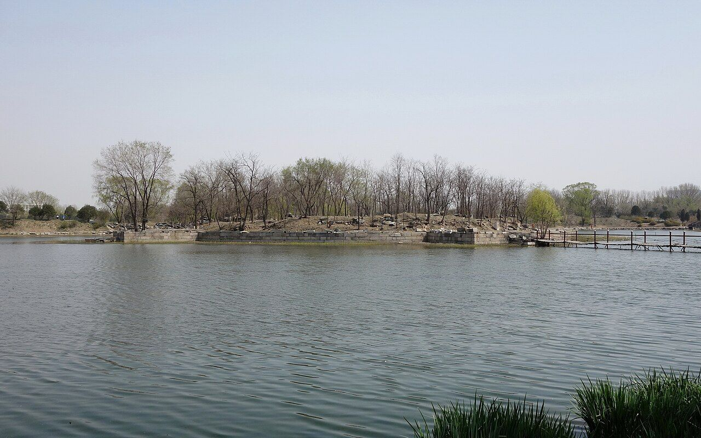
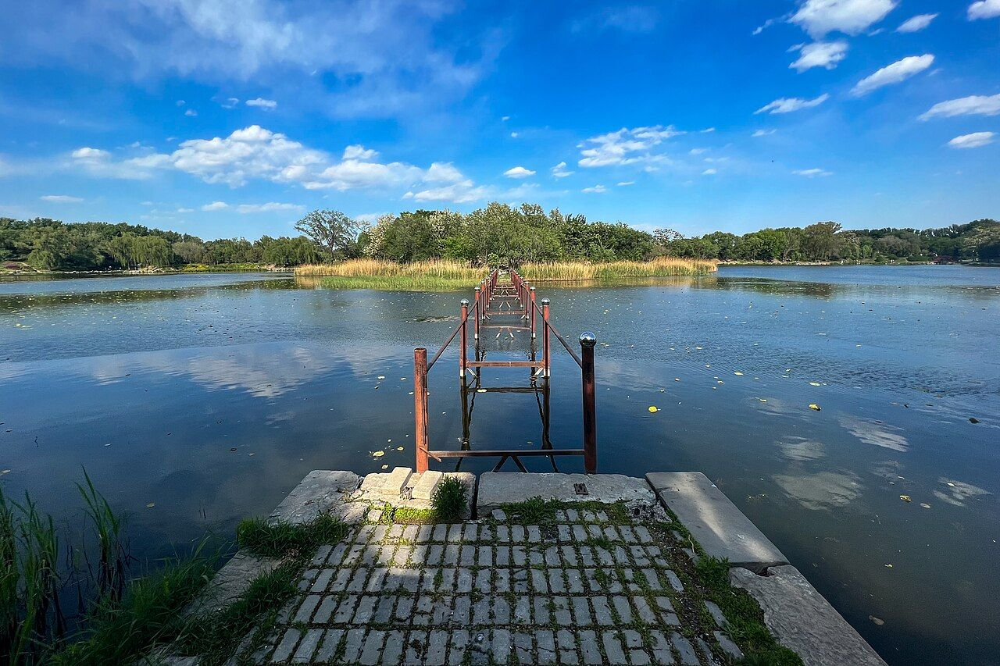
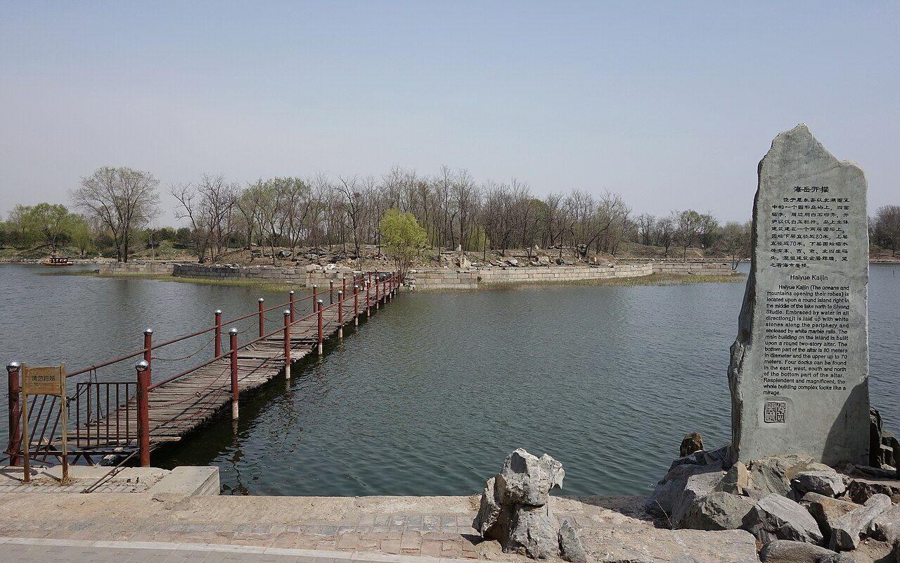
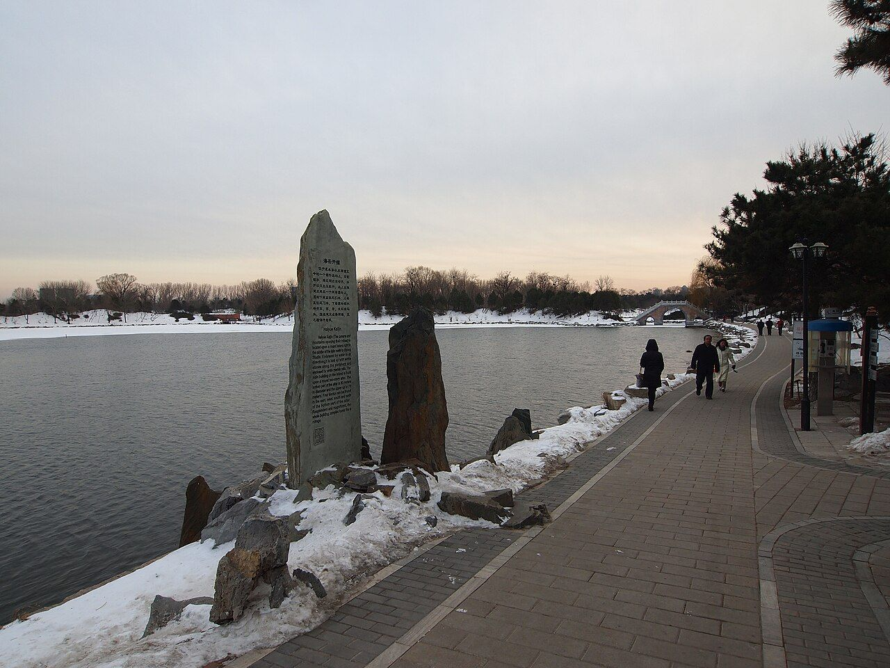

<!-- generated:start (scripts/building_pages.py): do not edit between these markers -->

# CC06: 海岳开襟 Haiyue Kaijin

Changchun Yuan

**3D object:** 6 boxes. Open it: `/reconstruction/3d.html?b=CC06`

## What we know

- **Name:** 海岳开襟 Haiyue Kaijin (S05, S02, S06, S01, S337, S361 · confidence B)
- **Garden:** Changchun Yuan (S05, S02, S06, S01, S337, S361)
- **Type:** compound (S05, S02, S06, S01, S337, S361 · confidence B)
- **Built:** by 1759 poem [j83:11a-b]; 1747 (S05, S02, S06, S01, S337, S361)
- **Destroyed:** 1860; on the 1873 survival list (S06); survived 1860; later loss; survived 1860; lost around 1900 (S05, S02, S06, S01, S337, S361)
- **Position:** 40.00894, 116.30433. S01 sure (S01 · confidence B)
- **Storeys:** 3 (S05, S02, S06, S01, S337, S361)
- **Note:** Round terrace, boat access only (S02 p.98). 下層 海嶽開襟, 南簷 青瑶嶼, 上 乘六龍. Blog S48 diameter near 100 m (lead). (S05, S02, S06, S01, S337, S361)
- **Plan reader's note:** Label 海?開襟 with pencil 嶽 next to the second char, blue 5. Round terrace, outer radius ~155 px, four arms. (S01) *(research copy, not public)*
- **How it was read:** sure (S01) *(research copy, not public)*
- **Plan pixels:** 9472, 2688 (S01) *(research copy, not public)*

## Our model now

6 boxes stand in this compound, 5 on blocks drawn on the plan, 1 assumed. Its halls are listed below.

## Inside it (6)

- CC06-01 枋楔
- CC06-N01
- CC06-N02
- CC06-N03
- CC06-N04
- CC06-N05

## Pictures (4)

- **P0413** (sure): Ruins of Haiyue Kaijin 20130414.JPG (2013-04-14 13:19:02 (Commons DateTimeOriginal)). https://commons.wikimedia.org/wiki/File:Ruins_of_Haiyue_Kaijin_20130414.JPG

  

- **P0414** (sure): Haiyuekaijin in Old Summer Palace.jpg (2022-04-30 16:18:00 (Commons DateTimeOriginal)). https://commons.wikimedia.org/wiki/File:Haiyuekaijin_in_Old_Summer_Palace.jpg

  

- **P0503** (sure): 海岳开襟遗址 20130414.JPG (2013-04-14 13:21:48 (Commons DateTimeOriginal)). https://commons.wikimedia.org/wiki/File:%E6%B5%B7%E5%B2%B3%E5%BC%80%E8%A5%9F%E9%81%97%E5%9D%80_20130414.JPG

  

- **P0474** (likely): 海岳开襟 - Ice Free Lake - 2012.12 - panoramio.jpg (Taken on 21 December 2012 (Commons DateTimeOriginal)). https://commons.wikimedia.org/wiki/File:%E6%B5%B7%E5%B2%B3%E5%BC%80%E8%A5%9F_-_Ice_Free_Lake_-_2012.12_-_panoramio.jpg

  

## Texts and drawings (26)

- **E0147** (poem, sure): 御製海嶽開襟歌（樓名上有扁曰乗六龍）. 1759 (乾隆二十四年) · j83:11a-11b · S05. https://github.com/kanripo/KR2k0036/blob/master/KR2k0036_083.txt
  > 乾隆二十四年御製海嶽開襟歌（樓名上有扁曰乗六龍）　滄池漾瀁蛟龍窟中聳玉臺規寳月祖州之草琪樹枝襲芳籠影水精闕周禆瀛海誠曠哉崑嶠方壺縮地來八琅雲璈底湏奏松風朅聽塵襟開芥舟祇需抝堂水溟渤何勞千萬里得其環中游物外棗葉須彌皆一理我之所戒在求仙海嶽寄興屬偶然保合太和勵體乾時乗六龍以御天
  Song on 海嶽開襟, the three-storey building in the pool, which names the top plaque 乗六龍 and says he has no wish for immortality.
- **E0401** (poem, sure): 御製長春園題句（有序）. 1770 (乾隆三十五年) · j83:1b-2b · S05. https://github.com/kanripo/KR2k0036/blob/master/KR2k0036_083.txt
  > 乾隆三十五年御製長春園題句（有序）　山水無樂夀之徵興隨所遇日月引壺洲之景春與俱長廼拓餘地於御園爰效嘉名於仙館顧當年之賜號時□體元籌他日之安居兹惟卜始波通福海東壖旭麗扶桑垣亘清河北陌香浮華黍列縹緗以娛志堂啟含經撫翰墨以怡神軒成淳化思永勵始終如一式是齋乎開襟而氣象盈千登斯樓也他若某邱某壑境足賞心有榭有亭勝堪寓目每㡬暇朅來遊憇擬耄期恒此頤恬以紀元六十載為衡積願笑惟奢望從周甲廿五年而計朂勤敢有倦心儷以弁言系之長律長春非敢暢春侔（祖暢春園在圓明園之南居之皇所建今奉皇太后）即景名園亦有由賜號當年例仙館（長春仙館為圓明園四十景之一雍正年間賜居也即以當年賜號名之）倦勤他日擬菟裘（予有夙願若至乾隆六十年夀登八十有五時亦應歸政故鄰圓明園之東豫脩此園為他日優游之地雖屬侈望然果得如此亦國家景運之隆天下臣民之慶也）培松拱把冀鱗老留石平心待句酬廿五春秋仍劼毖（今嵗六旬屈指果得歸政尚當二十五年然一日臨蒞矢不敢少懈此敬勤之志必居此園時然後可息肩娛老耳）耄期嵗月合優游
  Dated 1770 and his sixtieth year: he says he built this garden east of 圓明園 as a retirement home for the sixtieth year of his reign, when he would be 85. It names 含經堂, 淳化軒, 思永齋 and the 'open breast' tower 海嶽開襟.
- **E0145** (text, sure): 日下舊聞考 得全阁、海岳开襟. 1780s (乾隆 敕撰) · j83:10b-11a · S05. https://github.com/kanripo/KR2k0036/blob/master/KR2k0036_083.txt
  > 思永齋西稍南河外為得全閣南為寳雲樓北為逺風樓齋北河池潨滙中有圓式崇基其上樓宇三層為海嶽開襟四旁枋楔各一（長春園册）臣等謹案得全閣額曰天心水面海嶽開襟為下層樓内額其南簷額曰青瑶嶼最上層額曰乗六龍
  South-west of 思永齋: 得全閣 with 寳雲樓 and 逺風樓. North of 思永齋 in the pool: 海嶽開襟, a three-storey building on a round platform, with an arch on each side. The note gives the plaque for each storey.
- **E0387** (text, likely): 明春门 from the 长春园 side. 1780s · j83:12a · S05. https://github.com/kanripo/KR2k0036/blob/master/KR2k0036_083.txt
  > 流香渚之西循山逕行即逹圓明園之明春門
  West of 流香渚 a hill path comes to 明春门 of 圆明园.
- **E0451** (text, sure): 圆明园遗址的遗产价值与申遗构想: the buildings left after 1860, citing 刘敦桢 1933. post n.d. · ylfj, note 34: 刘敦桢, 同治重修圆明园史料, 营造学社汇刊 1933(2) · S337. http://iqh.ruc.edu.cn/old/qdhjylyjzx/xszl/ylfj/9a322b5384ab4c17af0dd577d4f96ca6.htm
  Lists 17 buildings left after the burning of 1860, after 刘敦桢: 紫碧山房, 顺木天, 鱼跃鸢飞, 课农轩, 藏舟坞, 慎修思永, 知过堂, 双鹤斋, 蓬岛瑶台, 魁星楼, 文昌阁, 林渊锦镜, 春雨轩; 海岳开襟; 庄严法界, 正觉寺 and a 大宫门 in 万春园. The paper's aim is to hold any new display to this 1860 state.
- **E0148** (poem, sure): 海岳开襟: 乾隆二十四年 poem of the Qianlong Emperor. 乾隆二十四年 (1759), date from the compilation · p.286 item (1), under 海岳开襟 · S360. https://www.yuanmingyuanpark.cn/xs/yjbg/202007/P020200730387572832602.pdf#page=286
  > 池瀁瀁蛟龙窟中，耸玉台规宝月祖。洲之草琪树枝袭，芳笼影水精阙周，禆瀛海诚旷哉昆，峤方壶缩地来八。琅云璈底须奏松，风朅听尘襟开芥。舟祗需坳堂水溟，渤何劳千万里得。其环中游物外，枣叶须弥皆一理。我之所戒在求仙，海岳寄兴属偶然。保合太和励体乾，时乘六龙以御天。
  Poem of the Qianlong Emperor at 海岳开襟, 1759, on the view. Year as given by the compilation.
- **E0149** (poem, sure): 海岳开襟: 嘉庆元年 poem of the Jiaqing Emperor. 嘉庆元年 (1796), date from the compilation · p.286 item (2), under 海岳开襟 · S360. https://www.yuanmingyuanpark.cn/xs/yjbg/202007/P020200730387572832602.pdf#page=286
  > 层阁凌波出，周回百顷涛。珠宫拔地迥，贝阙接云高。春陌目千里，神山驾六鳌。开襟一延眺，揽胜纪宣毫。
  Poem of the Jiaqing Emperor at 海岳开襟, 1796, on the view. Year as given by the compilation.
- **E0150** (poem, sure): 海岳开襟: 嘉庆元年 poem of the Jiaqing Emperor. 嘉庆元年 (1796), date from the compilation · p.286 item (3), under 海岳开襟 · S360. https://www.yuanmingyuanpark.cn/xs/yjbg/202007/P020200730387572832602.pdf#page=286
  > 登高畅好开襟抱，千顷晴波漾锦澜。远岭几重林外列，长天一色镜中看。最宜令节临仙境，直上高楼作大观。海岳晏安诚不易，顾名知儆凛君难。
  Poem of the Jiaqing Emperor at 海岳开襟, 1796, on the view. Year as given by the compilation.
- **E0151** (poem, sure): 海岳开襟: 嘉庆二年 poem of the Jiaqing Emperor. 嘉庆二年 (1797), date from the compilation · p.286 item (4), under 海岳开襟 · S360. https://www.yuanmingyuanpark.cn/xs/yjbg/202007/P020200730387572832602.pdf#page=286
  > 重阳令节合登高，漫拟叅 军落帽豪。皎日澄辉鸟驻景，明霞衬字雁长翱。心期海岳全清晏，目极田畴被泽膏。黔宼虽平余楚贼，告功早慰圣衷劳。
  Poem of the Jiaqing Emperor at 海岳开襟, 1797. Year as given by the compilation.
- **E0153** (poem, sure): 海岳开襟: 嘉庆十一年 poem of the Jiaqing Emperor. 嘉庆十一年 (1806), date from the compilation · p.287 item (5), under 海岳开襟 · S360. https://www.yuanmingyuanpark.cn/xs/yjbg/202007/P020200730387572832602.pdf#page=287
  > 流香渚畔泛轻航，弭棹石栏俯锦塘。佳荫遍含松百尺，奥区宛在水中央。惟期海岳敷文命，不羡蓬莱鄙武皇。食德饮和难普被，开襟茂对幸年康。
  Poem of the Jiaqing Emperor at 海岳开襟, 1806, on the view. Year as given by the compilation.
- **E0154** (poem, sure): 海岳开襟: 嘉庆十一年 poem, naming 流香渚. 嘉庆十一年 (1806), date from the compilation · p.287 item (5), under 海岳开襟 · S360. https://www.yuanmingyuanpark.cn/xs/yjbg/202007/P020200730387572832602.pdf#page=287
  > 流香渚畔泛轻航，弭棹石栏俯锦塘。佳荫遍含松百尺，奥区宛在水中央。惟期海岳敷文命，不羡蓬莱鄙武皇。食德饮和难普被，开襟茂对幸年康。
  Jiaqing, 1806: rowing along 流香渚 to the stone railing of 海岳开襟, set in the middle of the water, with tall pines.
- **E0155** (poem, sure): 海岳开襟. 嘉庆十二年 (1807) · v3 p.346, under 海岳开襟; source ref 3-356 · S361. https://www.yuanmingyuanpark.cn/xs/yjbg/202008/P020200803382569071850.pdf#page=349
  > 御园万景备，到此益开襟。蓊郁围乔木，连延列远岑。霞明青嶂外，云起碧溪浔。超出川岩秀，绝无尘暑侵。临窗波静挹，凭槛句重寻。遣兴偶探奥，境烟不系心。
  Poem 海岳开襟 by the Jiaqing Emperor, 1807, filed by the editors under 海岳开襟.
- **E0156** (poem, sure): 海岳开襟: 嘉庆十二年 poem of the Jiaqing Emperor. 嘉庆十二年 (1807), date from the compilation · p.287 item (6), under 海岳开襟 · S360. https://www.yuanmingyuanpark.cn/xs/yjbg/202007/P020200730387572832602.pdf#page=287
  > 岛环溶漾绕清浔，一抹岚光四面林。栏静风微入帘细，松高日煦印窗深。如观雅绘欣宜目，时读古编偶会心。海宇安恬民饱暖，几余游览始开襟。
  Poem of the Jiaqing Emperor at 海岳开襟, 1807, on the view. Year as given by the compilation.
- **E0157** (poem, sure): 海岳开襟: 嘉庆十二年 poem of the Jiaqing Emperor. 嘉庆十二年 (1807), date from the compilation · p.287 item (7), under 海岳开襟 · S360. https://www.yuanmingyuanpark.cn/xs/yjbg/202007/P020200730387572832602.pdf#page=287
  > 御园万景偹，到此益开襟。蓊郁围乔木，连延列远岑。霞明青嶂外，云起碧溪浔。超出川岩秀，绝无尘暑侵。临窗波静挹，凭槛句重寻。遣兴偶探奥，镜烟不系心。
  Poem of the Jiaqing Emperor at 海岳开襟, 1807, on the view. Year as given by the compilation.
- **E0159** (poem, sure): 海岳开襟: 嘉庆十四年 poem of the Jiaqing Emperor. 嘉庆十四年 (1809), date from the compilation · p.287 item (8), under 海岳开襟 · S360. https://www.yuanmingyuanpark.cn/xs/yjbg/202007/P020200730387572832602.pdf#page=287
  > 假山数仞出林表，清波百顷回栏绕。眼界因心八极周，须弥非大芥非小。君临端拱居丹宸，山陬海澨皆吾民。一人知力及兆庶，俗浇吏懈难化淳。世态纷纭万千状，正已御下慎趋向。治理何时臻大同，几闲游览襟始畅。
  Poem of the Jiaqing Emperor at 海岳开襟, 1809, on the view. Year as given by the compilation.
- **E0160** (poem, sure): 海岳开襟: 嘉庆十四年 poem of the Jiaqing Emperor. 嘉庆十四年 (1809), date from the compilation · p.287 item (8), under 海岳开襟 · S360. https://www.yuanmingyuanpark.cn/xs/yjbg/202007/P020200730387572832602.pdf#page=287
  > 芳溆拏舟泛，碧塘亭台在。水中央栏环，白石浮尘凈，砌倚苍松密。荫长五教未，能敷海岳寸。心乘暇味缣，缃开函探讨。襟怀畅化泽，均覃愿少偿。
  Poem of the Jiaqing Emperor at 海岳开襟, 1809, on boating. Year as given by the compilation.
- **E0161** (poem, sure): 海岳开襟: 嘉庆二十四年 poem of the Jiaqing Emperor. 嘉庆二十四年 (1819), date from the compilation · p.287 item (12), under 海岳开襟 · S360. https://www.yuanmingyuanpark.cn/xs/yjbg/202007/P020200730387572832602.pdf#page=287
  > 圆岛水中央，问景扁舟渡。四围白石栏，八面苍松树。宛如阆风台，游仙心岂慕。即境足开襟，怡情随所遇。岱岳曾雨登，沧溟阅三度。巡典有重轻，恩膏及时布。
  Poem of the Jiaqing Emperor at 海岳开襟, 1819, on boating and the view. Year as given by the compilation.
- **E0152** (poem, likely): 重阳日登海岳开襟楼即景成什. 嘉庆二年 (1797) · v3 p.345, under 海岳开襟; source ref 1-277 · S361. https://www.yuanmingyuanpark.cn/xs/yjbg/202008/P020200803382569071850.pdf#page=348
  > 重阳令节合登高，漫拟参军落帽豪。皎日澄辉乌驻景，明霞衬字雁长翶。心期海岳全清晏，目极田畴被泽膏。黔寇虽平余楚贼，告功早慰圣衷劳。狆苗滋事，经勒保等焚剿擒渠，业已蕆绩。惟教匪分股披猖，东西窜逸。虽屡经官兵歼戮，而路径丛杂，出没靡常，辄以牵制官兵，行其诡窜。皇父特发东省劲旅，并调各省兵前往协剿，此时计可陆续抵营。所冀领兵诸臣，各励公忠，同心协力，速剪幺麽，以安靖吾民。纾我皇父宵旰筹几之勚。登高望远，倍缱殷怀。
  Poem 重阳日登海岳开襟楼即景成什 by the Jiaqing Emperor, 1797, filed by the editors under 海岳开襟.
- **E0158** (poem, likely): 海岳开襟放歌. 嘉庆十二年 (1807) · v3 p.347, under 海岳开襟; source ref 3-376 · S361. https://www.yuanmingyuanpark.cn/xs/yjbg/202008/P020200803382569071850.pdf#page=350
  > 洪荒开辟乾坤凿，日昼月夜明两作。乔岳基于土一抔，沧海始于水一勺。人为物灵合三才，圣王治理调六幕。中和位育赞枢机，九有群生大君讬。年康物阜襟抱开，忧其忧而乐其乐。殿额标题意在兹，岂耽豫游爱溪壑。
  Poem 海岳开襟放歌 by the Jiaqing Emperor, 1807, filed by the editors under 海岳开襟.
- **E0163** (description, sure): 长春园 No.5, 海岳开襟 Haiyue Kaijin: the round island. 1934 · p.98 · S02. https://archive.org/details/historyofpekings00malo
  > one of which was on a round terraced island ascended by four flights of steps, surrounded by a white marble balustrade and approached only by boat.
  Round terraced island, four flights of steps, white marble balustrade, reached only by boat. Number follows p.101, which places the pagoda on the shore north of "the round island, Number Five".
- **E0494** (description, likely): 长春园 Changchun Yuan: eight chief groups. 1934 · p.98 · S02. https://archive.org/details/historyofpekings00malo
  > The new garden which the Emperor constructed in 1751 just east of the Yuan Ming Yuan he called the Ch'ang Ch'un Yuan, or Garden of Long Spring.
  From Rixia j83. Built 1751 by Malone's date, added to for years; about a third of the size of the Yuan Ming Yuan proper; islands and artificial hills with wider spaces and larger lakes. No.1 audience hall inside the south gate (澹怀堂); No.2 palace on the central island (含经堂); Nos.3, 6, 8 lakeside gardens; Nos.4, 5, 7 palace groups on islands. Mapping of numbers to ids is mine; only 6 and 8 are named by Malone.
- **E2000** (description, sure): Site status table, about 2011: scattered remains only. c. 2011 · 系列06 repost, status table · S356. https://blog.sina.com.cn/s/blog_c27029650101itzz.html
  Scenes with only scattered, incomplete building remains in the same table. 方壶胜境 is listed separately as the one with fairly complete remains not yet tidied up. 紫碧山房, 舍卫城 and 如园 have been dug since.
- **E0376** (description, likely): 长春园 花神庙 (S47 section 2.17). 2012, citing archive and Qing texts · p.117; table row 29 · S47. https://www.dpm.org.cn/Uploads/File/2018/06/15/u5b23730ae0e5a.pdf
  South-west across the water from 海岳开襟: by Yangshi Lei plans three bays with a surrounding gallery. Date unknown. The only such shrine in Changchun Yuan.
- **E0162** (description, sure): 圆明园百景史事分景汇编: 海岳开襟. 1759-1819 · from p.286, under 海岳开襟 · S360. https://www.yuanmingyuanpark.cn/xs/yjbg/202007/P020200730387572832602.pdf#page=286
  Poems of 1759-1819: a tower climbed for the view (1796, the Double Ninth of 1797, 1816) and an island approached by boat (1809, 1819). 海岳开襟: 13 dated items, 1759-1819, of which 13 poems (Qianlong, Jiaqing); recurring themes: the view, boating. First dated 1759, last dated 1819.
- **E0164** (description, sure): 圆明园五朝御制诗文集注 v3, editors' note on 海岳开襟. 2020 edition · v3 p.342 · S361. https://www.yuanmingyuanpark.cn/xs/yjbg/202008/P020200803382569071850.pdf#page=345
  Finished 1747 on an island about 90 m across: a three-storey tower on a round terrace with an archway on each side, each storey with its own plaque. 流香渚 and 罨画溪 lie west, the moon terrace 半月 east. It survived 1860, Cixi visited under Guangxu, and it was lost around 1900, say the editors.
- **E0165** (description, sure, search index only): 海岳开襟; 映清斋; 蒨园; 鉴园; 狮子林 (search-index text). n.d. · mhymy dasl 2278, tag 361, others · S340. https://www.mhymy.com/dasl/2278.html
  海岳开襟: lake islet about 90 m across, about 1,000 m2 of buildings, by 1747, repaired 1778 and 1791; a totem park stood here 1995-2007. 映清斋: added 1766 as a new palace of 玉玲珑馆. 蒨园: 6,600 m2, 2,300 m2 of buildings, 1752. 鉴园: repaired 1810. 狮子林: west part with 丛芳榭 by 1747, the east in imitation of Suzhou finished 1772.

**On the plan:** Drawn on the plan of the gardens (S01), labelled 海岳开襟. https://artmuseum.princeton.edu/collections/objects/138657

## Reconstructions by others (2)

Modern interpretation, not evidence.
- **R0019** (physical model, sure): 20240112 Haiyuekaijin, Hengdian Yingshicheng. Hengdian World Studios (replica); Yumeto (photograph), Hengdian World Studios (per the Commons category). https://commons.wikimedia.org/wiki/File:20240112_Haiyuekaijin,_Hengdian_Yingshicheng.jpg
- **R0285** (drawing, likely): 重现圆明园之海岳开襟. 星垂野阔大江流, 2025. https://www.bilibili.com/video/BV1pE7hzpE28 Research-only: link card.

## Evidence for the set of buildings

- Reconstructions and comparables for the whole garden, 长春园 Changchun Yuan: see GARDEN-CC

## Open questions

- Q47: How much burned, and when

<!-- generated:end -->

## Notes

<!-- Yours: regeneration never touches this part. It goes on the public site; what you write below a line holding only %% private %% stays in the research copy. -->
