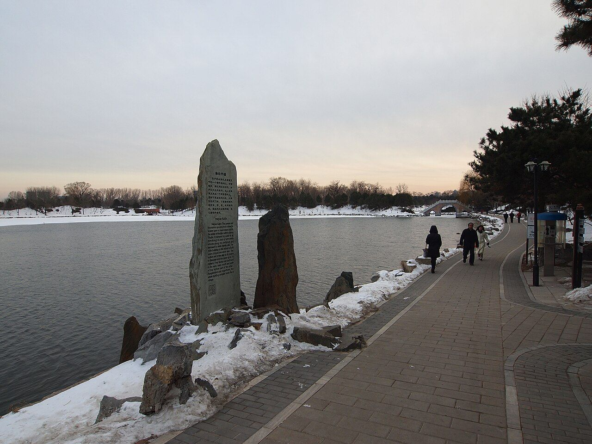

<!-- generated:start (scripts/building_pages.py): do not edit between these markers -->

# CC07: 流香渚 Liuxiang Zhu

Changchun Yuan

**3D object:** 1 box. Open it: `/reconstruction/3d.html?b=CC07`

## What we know

- **Name:** 流香渚 Liuxiang Zhu (S05, S01 · confidence B)
- **Garden:** Changchun Yuan (S05, S01)
- **Type:** compound (S05, S01 · confidence B)
- **Destroyed:** 1860 (S05, S01)
- **Position:** 40.00886, 116.30307. S01 sure (S01 · confidence B)
- **Note:** 西循山逕行即逹圓明園之明春門 [j83:12a] (S05, S01)
- **Plan reader's note:** Label on the water to the east at (9070,2700). Square terrace with stairs on all four sides. (S01) *(research copy, not public)*
- **How it was read:** sure (S01) *(research copy, not public)*
- **Plan pixels:** 8964, 2694 (S01) *(research copy, not public)*

## Our model now

1 boxes stand in this compound, 1 on blocks drawn on the plan, 0 assumed. Its halls are listed below.

## Inside it (2)

- CC07-01 流香渚亭
- CC07-02 罨画溪

## Pictures (1)

- **P0474** (guess): 海岳开襟 - Ice Free Lake - 2012.12 - panoramio.jpg (Taken on 21 December 2012 (Commons DateTimeOriginal)). https://commons.wikimedia.org/wiki/File:%E6%B5%B7%E5%B2%B3%E5%BC%80%E8%A5%9F_-_Ice_Free_Lake_-_2012.12_-_panoramio.jpg

  

## Texts and drawings (5)

- **E0166** (text, sure): 日下舊聞考 流香渚. 1780s (乾隆 敕撰) · j83:11b-12a · S05. https://github.com/kanripo/KR2k0036/blob/master/KR2k0036_083.txt
  > 海嶽開襟之西河池外有亭為流香渚亭北為罨畫溪（長春園册）臣等謹案流香渚之西循山逕行即逹圓明園之明春門
  West of 海嶽開襟: the pavilion 流香渚, with 罨畫溪 to the north; from here a path west reaches 明春門 of 圓明園.
- **E0154** (poem, sure): 海岳开襟: 嘉庆十一年 poem, naming 流香渚. 嘉庆十一年 (1806), date from the compilation · p.287 item (5), under 海岳开襟 · S360. https://www.yuanmingyuanpark.cn/xs/yjbg/202007/P020200730387572832602.pdf#page=287
  > 流香渚畔泛轻航，弭棹石栏俯锦塘。佳荫遍含松百尺，奥区宛在水中央。惟期海岳敷文命，不羡蓬莱鄙武皇。食德饮和难普被，开襟茂对幸年康。
  Jiaqing, 1806: rowing along 流香渚 to the stone railing of 海岳开襟, set in the middle of the water, with tall pines.
- **E0353** (poem, sure): 如园: 咸丰六年 poem, naming 流香渚. 咸丰六年 (1856), date from the compilation · p.291 item (24), under 如园 · S360. https://www.yuanmingyuanpark.cn/xs/yjbg/202007/P020200730387572832602.pdf#page=291
  > 解缆流香渚，名园景重寻。催诗荐新爽，点浪杂繁音。好雨占三日，浓烟锁一林。先期蒙泽渥，铭感为拈吟。
  Xianfeng, 1856: casting off from 流香渚 for 如园 in rain, so the boat route ran from there.
- **E1011** (description, sure): Site status table, about 2011: nothing visible, or built over. c. 2011 · 系列06 repost, status table · S356. https://blog.sina.com.cn/s/blog_c27029650101itzz.html
  Same table. In it the first group shows no visible remains; 得全阁, 流香渚, 凤麟洲, 涵秋馆, 蔚藻堂, 中和堂, 敷春堂 and 心镜轩 have service buildings on them, and 含晖楼, 澄心堂, 延寿寺, 清夏堂 and 喜雨山房 are occupied by other institutions. 澹泊宁静 and several others have been dug since, so this is out of date for them.
- **E0164** (description, sure): 圆明园五朝御制诗文集注 v3, editors' note on 海岳开襟. 2020 edition · v3 p.342 · S361. https://www.yuanmingyuanpark.cn/xs/yjbg/202008/P020200803382569071850.pdf#page=345
  Finished 1747 on an island about 90 m across: a three-storey tower on a round terrace with an archway on each side, each storey with its own plaque. 流香渚 and 罨画溪 lie west, the moon terrace 半月 east. It survived 1860, Cixi visited under Guangxu, and it was lost around 1900, say the editors.

**On the plan:** Drawn on the plan of the gardens (S01), labelled 流香渚. https://artmuseum.princeton.edu/collections/objects/138657

## Reconstructions by others (1)

Modern interpretation, not evidence.
- **R0100** (paper figure, sure): Figs 2 and 3, previous and current 3D model of 流香渚 Liuxiang Zhu pavilion. Jindan C., Junsong Z., Jiujun Z., Beijing Re-Yuanmingyuan Company Limited, 2015. https://isprs-annals.copernicus.org/articles/II-5-W3/131/2015/

## Evidence for the set of buildings

- Reconstructions and comparables for the whole garden, 长春园 Changchun Yuan: see GARDEN-CC

## Open questions

None that name it.

<!-- generated:end -->

## Notes

<!-- Yours: regeneration never touches this part. It goes on the public site; what you write below a line holding only %% private %% stays in the research copy. -->
