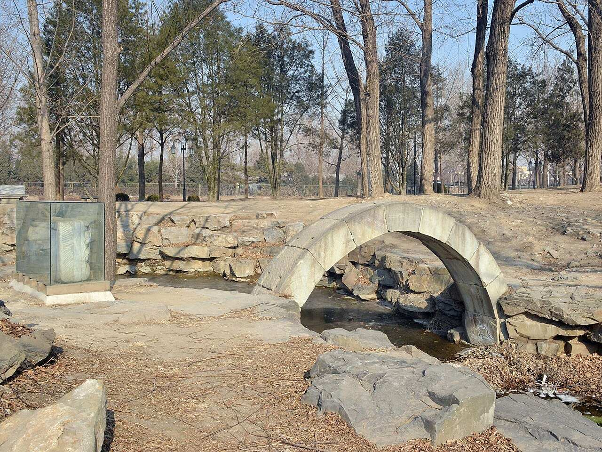
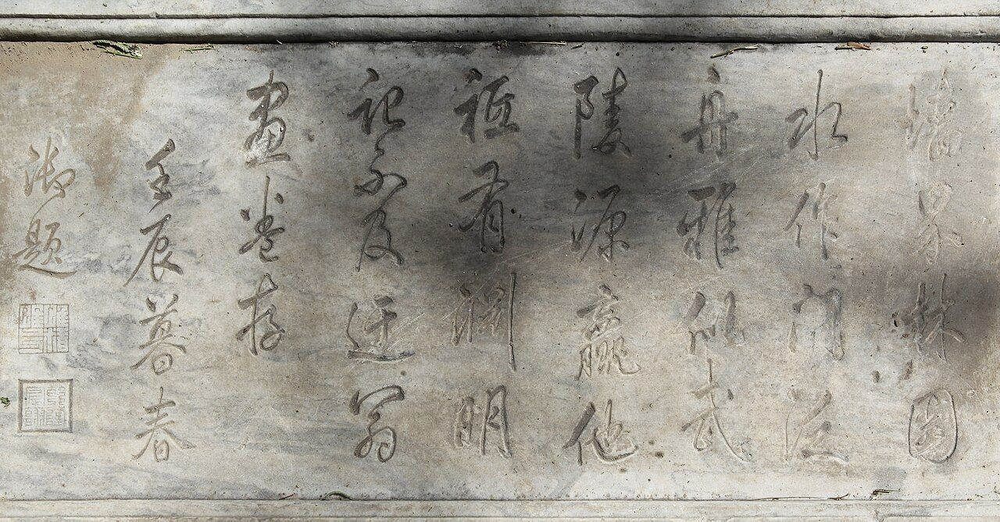

<!-- generated:start (scripts/building_pages.py): do not edit between these markers -->

# CC13-14: 水门 Shuimen

Changchun Yuan

**3D object:** 1 box. Open it: `/reconstruction/3d.html?b=CC13-14`

**Part of:** CC13 狮子林

## What we know

- **Name:** 水门 Shuimen (S05, S01 · confidence C)
- **Garden:** Changchun Yuan (S05, S01)
- **Type:** gate (S05, S01 · confidence C)
- **Destroyed:** 1860 (S05, S01)
- **Position:** 40.01138, 116.31061. S01 guess (S01 · confidence C)
- **Size in the inventory:** 7.2 × 7.6 m. S01 plan px / hall scale (S01)
- **Plan reader's note:** rect=25,30,0. Half-round figure at the south edge of the wall, where the wall meets the lake. (S01) *(research copy, not public)*
- **How it was read:** guess (S01) *(research copy, not public)*
- **Plan pixels:** 12052, 1672 (S01) *(research copy, not public)*

## Our model now

On the block drawn on the Qing plan S01: position and frontage from the plan, heights and roof from the typology of its hall class, its form drawn by the hall kit. It will be updated as the research goes on.

- **Box:** 6.09 × 5.66 m, gate hall
- **Heights:** platform 0.77 m, eave 4.47 m, ridge 6.49 m above the ground
- **Roof:** hip-and-gable 歇山, rolled ridge 卷棚, grey tile
- **Faces:** 83.6° from north
- **Fit:** reduced towards the size drawn on the plan, to stand clear of its neighbours or the water; moved 1.5 m
- **Drawn:** by the hall kit: 1 bay, steps on the back, front, 歇山 hip-and-gable with a rolled ridge 卷棚, grey tile, bracket sets 斗拱 as a painted band. Drawn from the typology of its hall class, not from a picture of this hall (assumed, C).
- **Confidence:** C

## Pictures (2)

- **P0416** (sure): Shizilin Restored Watergate on its original site 20130126.JPG (2013-01-26 12:45:07 (Commons DateTimeOriginal)). https://commons.wikimedia.org/wiki/File:Shizilin_Restored_Watergate_on_its_original_site_20130126.JPG

  

- **P0442** (likely): Qianlong writing in the Lion Forest, Old Summer Palace, Beijing.jpg (2009-09-12 (Commons DateTimeOriginal)). https://commons.wikimedia.org/wiki/File:Qianlong_writing_in_the_Lion_Forest,_Old_Summer_Palace,_Beijing.jpg

  

## Texts and drawings (5)

- **E0220** (text, sure): 日下舊聞考 狮子林. 1780s (乾隆 敕撰) · j83:13b · S05. https://github.com/kanripo/KR2k0036/blob/master/KR2k0036_083.txt
  > 叢芳榭之東為獅子林為虹橋為假山為納景堂為清閟閣為藤架為磴道為占峯亭為清淑齋為小香幢為探真書屋為延景樓為雲林石室為横碧軒為水門（長春園册）
  A bare list of what stands at 獅子林: 虹橋, the rockwork, 納景堂, 清閟閣, a wisteria frame, stone steps, 占峯亭, 清淑齋, 小香幢, 探真書屋, 延景樓, 雲林石室, 横碧軒 and the water gate.
- **E0205** (poem, sure): 御製 再題獅子林十六景曡舊韻. 1773 (御製詩四集) · KR4f0005_289:2a-5b · S201. https://github.com/kanripo/KR4f0005/blob/master/KR4f0005_289.txt
  > 再題獅子林十六景曡舊韻 獅子林　獅林圖蹪剏雲林一巻精神直注今却以墨繩為肖築宛如粉本此重（平聲）臨烟容水態萬古調楚尾呉頭千里心瞻就爾時民意切不忘方寸託清吟 虹橋　跨水飲垂虹浮空路可通祗疑縹渺處吹斷慮罡風 假山　白業當年㕘所能至今樹若語迦陵興來欲問倪髙士吐出幾多邱壑曽 納景堂　靜具動之理動形靜者情即如春孟際已藴物華呈盆裏梅英馥庭前松籟聲問他涉園客（呉中獅子林今屬黄氏為涉園）可識本天成 清閟閣　呉工肖堆塑燕匠營位置難移古樹古頗似翠峰翠發帑非累民愛林因寫意髙閣實已搆真圖斯未弆（叶圖真）（已入石渠寶笈不可移置前南巡過涉國自為臨本留貯其中今此間所弆則再臨本也）新正值幾暇延攬偶一至春氷待融池春氣早酥地怡此清閟心觀厥發生遂 藤架　卧波置平橋折旋循□迆綴架藤尚枯那擬步障紫漫訾鮮麗色却免惹纎滓然看寂寞中已覺懐春喜乍欲傲黄筌而弗嫌倪子 磴道　突起那論逕庭羊腸盤上峰嵤豈惜略勞步履端知大愜性靈 占峰亭　平則為嶺側則峰峰亭實勝嶺亭趣於平易工側艱工例論詩文頗有據偶攀絶頂得笠覆便憶巡方斯冕露欲言欲罷而不能是我結習未忘處 清淑齋　前砌帶溪水後簷屏石林却華意猶愜既靜望偏深春稚蕪茵淺風過竹籟沈平心迎淑氣觸目適清襟 小香幢　石磴玲瓏倚翠幢上為佛室朗蓮釭偶然别學倪家調（去聲）若論塵心實未降 探真書屋　試問獅林境孰為幻孰真涉園猶假借（此間結搆是藍本呉中涉園質）（之原圖反有不能盡合者矣）寶笈實源津（原本以藏石渠寶笈已成書不可移弆此）志澹因怡性景清足謐神睪然詩畫表仿彿見其人 延景樓　當石危梯訝不通攀過奇境得壺中似兹結搆安措想宛彼樓軒若倚空俯暢物華皆入望春和吾意與俱融稿摹倪也還黄也莫漫區區辨異同 畫舫　岸傍常待那須呼歐米髙情總不殊何必風帆誇直㨗烟溪幾曲耐縈迂 雲林石室　石作夏雲石作林其中有室費幽尋三間十笏惟容膝却稱（去聲）開忩望逺岑 横碧軒　有橋如弓彎有溪若鏡横過橋坐敞軒不期意與清古帙亦陳几春鐙亦綴楹但識氷即水奚殊碧波呈 水門　跨水為牆下置門此由溯委此探源藝林夫豈外道義我亦因之成性存
  The sixteen scenes of 獅子林 named together, one short poem each. Its notes say the Suzhou garden is now the 涉園 of the 黄 family, and that the 倪瓚 scroll stays in the imperial collection: he left a copy he painted at the 涉園, and the 清閟閣 here holds a second copy.
- **E0264** (poem, sure): 水门. 乾隆三十七年 (1772) · v3 p.378, under 狮子林 · S361. https://www.yuanmingyuanpark.cn/xs/yjbg/202008/P020200803382569071850.pdf#page=381
  > 墙界林园水作门，泛舟雅似武陵源。赢他只有渊明记，不及迂翁画卷存。
  Poem 水门 by the Qianlong Emperor, 1772, filed by the editors under 狮子林.
- **E0265** (poem, sure): 水门. 乾隆三十八年 (1773) · v3 p.382, under 狮子林 · S361. https://www.yuanmingyuanpark.cn/xs/yjbg/202008/P020200803382569071850.pdf#page=385
  > 跨水为墙下置门，此由溯委此探源。艺林夫岂外道义，我亦因之成性存。
  Poem 水门 by the Qianlong Emperor, 1773, filed by the editors under 狮子林.
- **E0266** (poem, sure): 水门. 乾隆四十年 (1775) · v3 p.386, under 狮子林 · S361. https://www.yuanmingyuanpark.cn/xs/yjbg/202008/P020200803382569071850.pdf#page=389
  > 跨波门径上骑墙，历历人行来往航。设使桃源拟洞口，不教迷路误渔郎。
  Poem 水门 by the Qianlong Emperor, 1775, filed by the editors under 狮子林.

**On the plan:** Drawn on the plan of the gardens (S01), labelled 水门. https://artmuseum.princeton.edu/collections/objects/138657

## Evidence for the set of buildings

- Evidence for the whole compound 狮子林: see CC13
- Reconstructions and comparables for the whole garden, 长春园 Changchun Yuan: see GARDEN-CC
- Standing buildings comparable to a gate hall (not this building): see CLASS-gate_hall

## Open questions

None that name it.

<!-- generated:end -->

## Notes

<!-- Yours: regeneration never touches this part. It goes on the public site; what you write below a line holding only %% private %% stays in the research copy. -->
