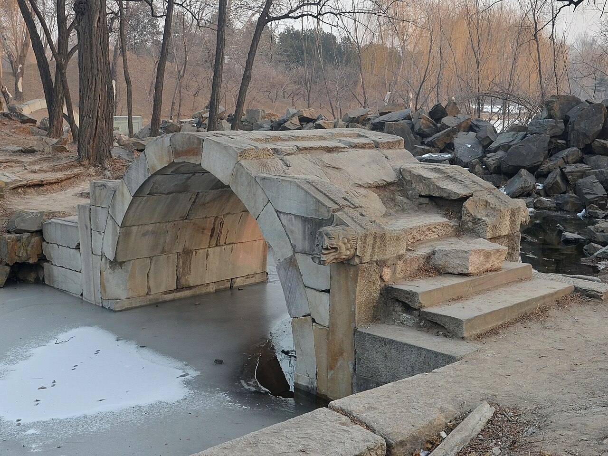
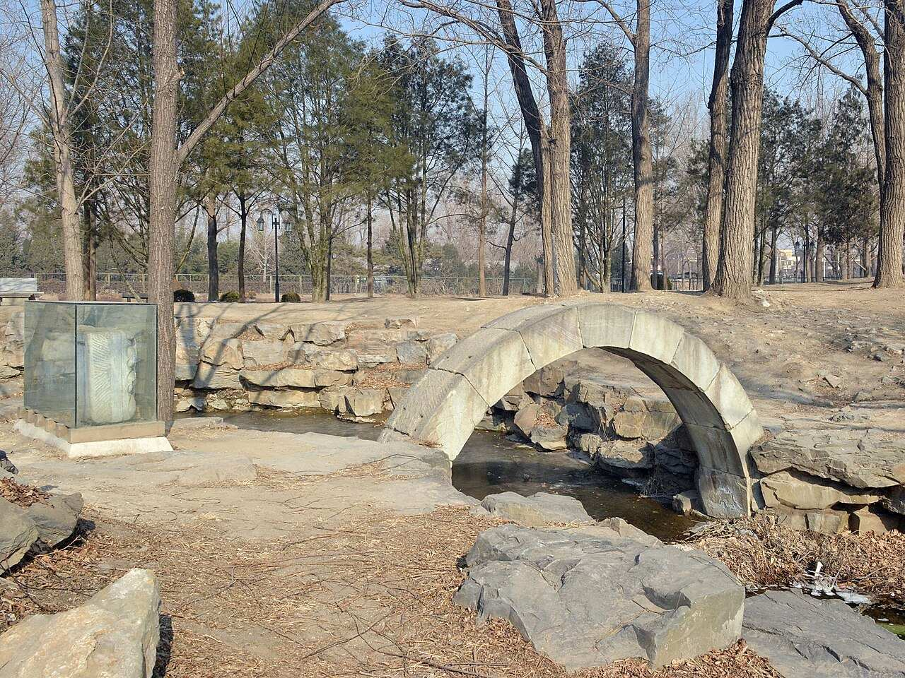
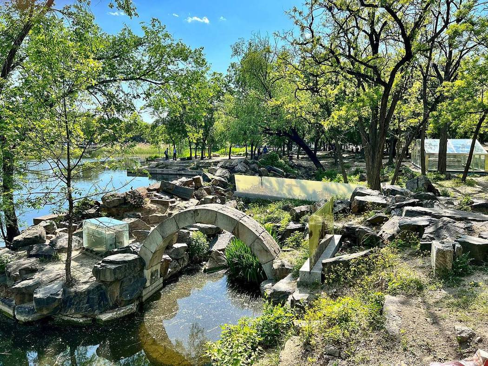
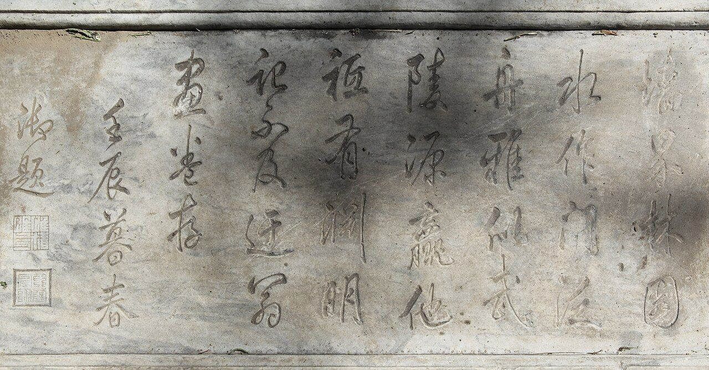
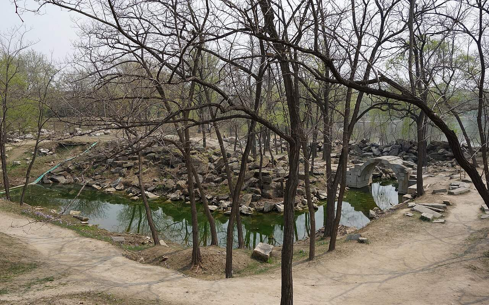
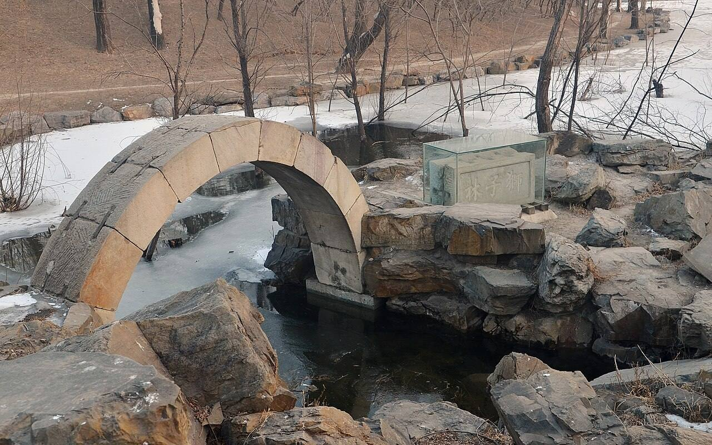

<!-- generated:start (scripts/building_pages.py): do not edit between these markers -->

# CC13: 狮子林 Shizi Lin

Lion Grove (Malone p.98) · Changchun Yuan

**3D object:** 9 boxes. Open it: `/reconstruction/3d.html?b=CC13`

## What we know

- **Name:** 狮子林 Shizi Lin (S05, S02, S48, S01, S361 · confidence B)
- **English:** Lion Grove (Malone p.98) (S05, S02, S48, S01, S361)
- **Written on the plan:** 清閟阁 / 探真书屋 / 小香幢 (S01 · confidence B)
- **Garden:** Changchun Yuan (S05, S02, S48, S01, S361)
- **Type:** compound (S05, S02, S48, S01, S361 · confidence B)
- **Built:** 乾隆三十七年 1772 [j83:13b] (S05, S02, S48, S01, S361)
- **Destroyed:** 1860 (S05, S02, S48, S01, S361)
- **Position:** 40.01148, 116.31040. S01 sure (S01 · confidence B)
- **Note:** After 苏州 黄氏涉园. 16 scenes in 2 sets of poems. Listed in Rixia order. (S05, S02, S48, S01, S361)
- **Plan reader's note:** Malone's blue 6 at (12115,1645). Inventory names read on the plan: 清閟阁, 探真书屋, 小香幢. Rockery around B0276/B0277 and a second rockery garden east of B0278. (S01) *(research copy, not public)*
- **How it was read:** sure (S01) *(research copy, not public)*
- **Plan pixels:** 11980, 1612 (S01) *(research copy, not public)*

## Our model now

9 boxes stand in this compound, 8 on blocks drawn on the plan, 1 assumed. Its halls are listed below.

## Inside it (18)

- CC13-01 虹桥
- CC13-02 假山
- CC13-03 纳景堂
- CC13-04 清閟阁
- CC13-05 藤架
- CC13-06 磴道
- CC13-07 占峰亭
- CC13-08 清淑斋
- CC13-09 小香幢
- CC13-10 探真书屋
- CC13-11 延景楼
- CC13-12 云林石室
- CC13-13 横碧轩
- CC13-14 水门
- CC13-N01
- CC13-N02
- CC13-N03
- CC13-N04

## Pictures (7)

- **P0415** (sure): Shizilin Rainbow Bridge restored in its original site 01 20130126.JPG (2013-01-26 16:45:40 (Commons DateTimeOriginal)). https://commons.wikimedia.org/wiki/File:Shizilin_Rainbow_Bridge_restored_in_its_original_site_01_20130126.JPG

  

- **P0416** (sure): Shizilin Restored Watergate on its original site 20130126.JPG (2013-01-26 12:45:07 (Commons DateTimeOriginal)). https://commons.wikimedia.org/wiki/File:Shizilin_Restored_Watergate_on_its_original_site_20130126.JPG

  

- **P0417** (sure): Shizilin in Old Summer Palace 2022.jpg (2022-04-30 15:25:58 (Commons DateTimeOriginal)). https://commons.wikimedia.org/wiki/File:Shizilin_in_Old_Summer_Palace_2022.jpg

  

- **P0442** (sure): Qianlong writing in the Lion Forest, Old Summer Palace, Beijing.jpg (2009-09-12 (Commons DateTimeOriginal)). https://commons.wikimedia.org/wiki/File:Qianlong_writing_in_the_Lion_Forest,_Old_Summer_Palace,_Beijing.jpg

  

- **P0443** (sure): Ruins of Shizilin East 20130421.JPG (2013-04-21 13:01:49 (Commons DateTimeOriginal)). https://commons.wikimedia.org/wiki/File:Ruins_of_Shizilin_East_20130421.JPG

  

- **P0500** (sure): Shizilin Restored Waterlock on its original site 20130126.JPG (2013-01-26 16:52:04 (Commons DateTimeOriginal)). https://commons.wikimedia.org/wiki/File:Shizilin_Restored_Waterlock_on_its_original_site_20130126.JPG

  

- **P0802** (sure): Ruins of Shizilin 20130323.JPG (2013-03-23 13:30:06 (Commons file page)). https://commons.wikimedia.org/wiki/File:Ruins_of_Shizilin_20130323.JPG

## Texts and drawings (67)

- **E0203** (poem, sure): 御製獅子林八景詩. 1772 (乾隆三十七年) · j83:13b-15b · S05. https://github.com/kanripo/KR2k0036/blob/master/KR2k0036_083.txt
  > 乾隆三十七年御製獅子林八景詩　獅子林之名頼倪迂圖卷以傳此間竹石邱壑皆肖其景為之冠以舊名志數典也最憶倪家獅子林渉園黄氏幻為今（吳中獅子林故址雖存已屢易為黄氏渉園丁丑南巡曽訪其勝因郵倪卷證之壬午乙酉復再至前後並有詩題卷中）因教規冩閶城趣為（去聲）便尋常御苑臨不可移來惟古樹遄由飛去是遐心峯之池影都無二呼出艱逄懶瓚吟（右獅子林）　跨水為小橋垂虹宛在片雲帆影何必更羡呉江　駕溪宛若虹其下可舟通設使幔亭張（去聲）吾當問順風（右虹橋）獅林以石勝相傳為瓚自位置者兹令吳下髙手堆塑小景曲折盡肖驛此展拓成林奚啻武賁之於中郎妙手吳中堆塑能絶勝道子冩嘉陵一邱一壑都神肖憶我春廵展歩曾（右假山）　鏡水冩形遇以無心而景自為納斯堂所得迨乎近之　花木四時趣風雲朝暮情一堂無意納萬景自為呈色是空中色聲皆静裏聲摐然聲色表五字亦因成（右納景堂）　臨曲池面假山景清境閟雲林小閣何不可作如是觀　武夷一曲中清閟小閣置近臨活水澄平挹假山翠遐想創作圖自詡荆關意王䝉那夢見因公宜寳弆（叶倪以上三句櫽括瓚自識語）豈期屬黄氏又復御園至今古實一瞬蘇燕非二地當年閣中人未必首肯遂（右清閟閣）　紫藤引架垂隂縵縈可十數武於石橋宛轉尤宜　石橋既曲折藤架復邐迤春時都作花步障垂茸紫瑣月多風流蘸波鮮塵滓施松援覺艱附木平可喜載咏頍弁章庶幾見君子（右藤架）　循巖陟磴詩人比之丹梯此雖叠石而成亦自覺風雲可生足底　房山石似洞庭刻削一例岭嵤拾級試登磴道丹臺咫尺通靈（右磴道）　峯頂一笠清曠絶塵元鎮畫徃徃如是印證故在不即離間　雖是假山亦有峯㠎嶫吸哦轉饒趣歴艱涉頂得稍平四柱小亭翼然據一步一竒極變幻眼底神情乃畢露俗手石工那得窺粉本倪迂精絶處（右占峯亭）
  Eight poems on the 獅子林 copied from 倪瓚's scroll and the Suzhou garden then owned by the 黄 family, with prefaces on the rockwork by Suzhou craftsmen and on each place: 虹橋, 假山, 納景堂, 清閟閣, 藤架, 磴道, 占峯亭.
- **E0218** (poem, sure): 御製續題獅子林八景詩. 乾隆 (undated in S05) · j83:15b-17a · S05. https://github.com/kanripo/KR2k0036/blob/master/KR2k0036_083.txt
  > 御製續題獅子林八景詩　倪瓚原卷中自識與趙善長商㩁作獅子林圖且屬如海因公宜寳弆云云是則為圖本自倪而叠石築室已在疑似何况歴嵗四百餘年室主不知凡幾更而今又屬黄氏矣則今之亭臺峯沼但能同吳中之獅子林而不能盡同迂翁之獅子林圖固其宜也雖然予之詠髙山而企慕藺寔在倪而不在黄言之不足長言之因復取其可詠者凡八景為續題云　就樹得佳隂境原獅子林假山亦嵒齬曲逕致幽深花色淑非艷溪聲清以沉如云晤倪老恐未契髙襟（右清淑齋）　一間樓湧小香幢調御琉璃朗慧釭珍重迂翁囑如海（倪瓉獅子林自識卷有如海因公宜寳弆之語）由來者箇未全降（右小香幢）雲廊拾級上書屋號探真詎在逰文苑所希識道津精硏足縆嵗深造貴濳神欲問枕葄者誰誠自得人（右探真書屋）　詭石玲瓏棧徑通入來渾似萬山中近峯逺渚攬次苐秋月春風觀色空拾級望遙目容與焚檀習静意冲融雖然延得江南景罷露臺慙未昔同（右延景樓）　有溪有岸有舟呼活景沿缘面面殊欲傲清河書畫舫收來真蹟是倪迂（右畫舫）　灑然石室額雲林元鎮流風若可尋却與田盤開别面（盤山静寄山莊中向有雲林石室）古松都隠剰嶔岑（假山雖肖吳中稚松皆新種固不如田盤古松林立也右雲林石室）　文軒築溪上溪水如帶横一條拖碧玉朗映心目清有時漾輕漪閃影翻檐楹奚必藉鳶魚天然道趣呈（右横碧軒）　牆界林園水作門泛舟雅似武陵源贏他祗有淵明記不及迂翁畫卷存（右水畫）
  Eight more poems, on 清淑齋, 小香幢, 探真書屋, 延景樓, 畫舫, 雲林石室, 横碧軒 and the water gate 水門. He admits the pines are young, and that the Suzhou garden no longer matches 倪瓚's picture.
- **E0220** (text, sure): 日下舊聞考 狮子林. 1780s (乾隆 敕撰) · j83:13b · S05. https://github.com/kanripo/KR2k0036/blob/master/KR2k0036_083.txt
  > 叢芳榭之東為獅子林為虹橋為假山為納景堂為清閟閣為藤架為磴道為占峯亭為清淑齋為小香幢為探真書屋為延景樓為雲林石室為横碧軒為水門（長春園册）
  A bare list of what stands at 獅子林: 虹橋, the rockwork, 納景堂, 清閟閣, a wisteria frame, stone steps, 占峯亭, 清淑齋, 小香幢, 探真書屋, 延景樓, 雲林石室, 横碧軒 and the water gate.
- **E0205** (poem, sure): 御製 再題獅子林十六景曡舊韻. 1773 (御製詩四集) · KR4f0005_289:2a-5b · S201. https://github.com/kanripo/KR4f0005/blob/master/KR4f0005_289.txt
  > 再題獅子林十六景曡舊韻 獅子林　獅林圖蹪剏雲林一巻精神直注今却以墨繩為肖築宛如粉本此重（平聲）臨烟容水態萬古調楚尾呉頭千里心瞻就爾時民意切不忘方寸託清吟 虹橋　跨水飲垂虹浮空路可通祗疑縹渺處吹斷慮罡風 假山　白業當年㕘所能至今樹若語迦陵興來欲問倪髙士吐出幾多邱壑曽 納景堂　靜具動之理動形靜者情即如春孟際已藴物華呈盆裏梅英馥庭前松籟聲問他涉園客（呉中獅子林今屬黄氏為涉園）可識本天成 清閟閣　呉工肖堆塑燕匠營位置難移古樹古頗似翠峰翠發帑非累民愛林因寫意髙閣實已搆真圖斯未弆（叶圖真）（已入石渠寶笈不可移置前南巡過涉國自為臨本留貯其中今此間所弆則再臨本也）新正值幾暇延攬偶一至春氷待融池春氣早酥地怡此清閟心觀厥發生遂 藤架　卧波置平橋折旋循□迆綴架藤尚枯那擬步障紫漫訾鮮麗色却免惹纎滓然看寂寞中已覺懐春喜乍欲傲黄筌而弗嫌倪子 磴道　突起那論逕庭羊腸盤上峰嵤豈惜略勞步履端知大愜性靈 占峰亭　平則為嶺側則峰峰亭實勝嶺亭趣於平易工側艱工例論詩文頗有據偶攀絶頂得笠覆便憶巡方斯冕露欲言欲罷而不能是我結習未忘處 清淑齋　前砌帶溪水後簷屏石林却華意猶愜既靜望偏深春稚蕪茵淺風過竹籟沈平心迎淑氣觸目適清襟 小香幢　石磴玲瓏倚翠幢上為佛室朗蓮釭偶然别學倪家調（去聲）若論塵心實未降 探真書屋　試問獅林境孰為幻孰真涉園猶假借（此間結搆是藍本呉中涉園質）（之原圖反有不能盡合者矣）寶笈實源津（原本以藏石渠寶笈已成書不可移弆此）志澹因怡性景清足謐神睪然詩畫表仿彿見其人 延景樓　當石危梯訝不通攀過奇境得壺中似兹結搆安措想宛彼樓軒若倚空俯暢物華皆入望春和吾意與俱融稿摹倪也還黄也莫漫區區辨異同 畫舫　岸傍常待那須呼歐米髙情總不殊何必風帆誇直㨗烟溪幾曲耐縈迂 雲林石室　石作夏雲石作林其中有室費幽尋三間十笏惟容膝却稱（去聲）開忩望逺岑 横碧軒　有橋如弓彎有溪若鏡横過橋坐敞軒不期意與清古帙亦陳几春鐙亦綴楹但識氷即水奚殊碧波呈 水門　跨水為牆下置門此由溯委此探源藝林夫豈外道義我亦因之成性存
  The sixteen scenes of 獅子林 named together, one short poem each. Its notes say the Suzhou garden is now the 涉園 of the 黄 family, and that the 倪瓚 scroll stays in the imperial collection: he left a copy he painted at the 涉園, and the 清閟閣 here holds a second copy.
- **E0219** (text, sure): 御製 題文園獅子林十六景 序 (excerpt). 1774 (御製詩四集) · KR4f0005_301:31b-32a · S201. https://github.com/kanripo/KR4f0005/blob/master/KR4f0005_301.txt
  > 向愛倪瓚獅子林圖南巡時擕巻再至其地摹跡題詩昨於長春園東北隙地規倣為之即仍獅林之名初得景八續得景亦如之皆系以句然其亭臺峯沼但能同呉中之獅子林而不能盡同迂翁之獅子林圖兹於避暑山荘清舒山館之前度地復規倣之其景一如御園之名則又同御園之獅子林而非吳中之獅子林且塞苑山水天然因其勢以位置並有非御園所能同者若一經數典則仍不外雲林數尺巻中所謂言同不可何况云異知此則二亦非多一亦非少不必更存分別見嬾
  Preface to the Chengde copy. It says that the Changchun Yuan 獅子林 was built on spare ground in the north-east of the garden and earned eight scenes then eight more, and that the Chengde copy has the same names. The other poems titled 文園獅子林 are about Chengde, not this compound.
- **E0204** (poem, sure): 狮子林. 乾隆三十七年 (1772) · v3 p.373, under 狮子林 · S361. https://www.yuanmingyuanpark.cn/xs/yjbg/202008/P020200803382569071850.pdf#page=376
  > 狮子林之名，赖倪迂图卷以传。此间竹石邱壑，皆肖其景为之，冠以旧名，志数典也。最忆倪家狮子林，涉园黄氏幻为今
  Poem 狮子林 by the Qianlong Emperor, 1772, filed by the editors under 狮子林.
- **E0228** (poem, sure): 假山. 乾隆三十七年 (1772) · v3 p.374, under 狮子林 · S361. https://www.yuanmingyuanpark.cn/xs/yjbg/202008/P020200803382569071850.pdf#page=377
  > 狮子以石胜，相传为瓒自位置者。兹令吴下高手堆塑小景，曲折尽肖，驿此展拓成林，奚啻武贲之于中郎。妙手吴中堆塑能，绝胜道子写嘉陵。一邱一壑都神肖，忆我春巡展步曾。
  Poem 假山 by the Qianlong Emperor, 1772, filed by the editors under 狮子林.
- **E0240** (poem, sure): 磴道. 乾隆三十七年 (1772) · v3 p.375, under 狮子林 · S361. https://www.yuanmingyuanpark.cn/xs/yjbg/202008/P020200803382569071850.pdf#page=378
  > 循岩陟磴，诗人比之丹梯。此虽叠石而成，亦自觉风云可生足底。房山石似洞庭，刻峭一例岭嵘。拾级试登磴道，丹台咫尺通灵。
  Poem 磴道 by the Qianlong Emperor, 1772, filed by the editors under 狮子林.
- **E0243** (poem, sure): 占峰亭. 乾隆三十七年 (1772) · v3 p.376, under 狮子林 · S361. https://www.yuanmingyuanpark.cn/xs/yjbg/202008/P020200803382569071850.pdf#page=379
  > 峰顶一笠，清旷绝尘。元镇画往往如是，印证故在不即离间。虽是假山亦有峰，㠎嶫砐硪转饶趣。历艰陟顶得稍平，四柱小亭翼然据。一步一奇极变幻，眼底神情乃毕露。俗手石工那得窥，粉本倪迂精绝处。
  Poem 占峰亭 by the Qianlong Emperor, 1772, filed by the editors under 狮子林.
- **E0246** (poem, sure): 清淑斋. 乾隆三十七年 (1772) · v3 p.376, under 狮子林 · S361. https://www.yuanmingyuanpark.cn/xs/yjbg/202008/P020200803382569071850.pdf#page=379
  > 就树得佳阴，境原狮子林。假山亦岩龉，曲径致幽深。花色淑非艳，溪声清以沉。如云晤倪老，恐未契高襟。
  Poem 清淑斋 by the Qianlong Emperor, 1772, filed by the editors under 狮子林.
- **E0252** (poem, sure): 探真书屋. 乾隆三十七年 (1772) · v3 p.377, under 狮子林 · S361. https://www.yuanmingyuanpark.cn/xs/yjbg/202008/P020200803382569071850.pdf#page=380
  > 云廊拾级上，书屋号探真。讵在游文苑，所希识道津。精研足縆岁，深造贵潜神。欲问枕葄者，谁诚自得人。
  Poem 探真书屋 by the Qianlong Emperor, 1772, filed by the editors under 狮子林.
- **E0255** (poem, sure): 延景楼. 乾隆三十七年 (1772) · v3 p.377, under 狮子林 · S361. https://www.yuanmingyuanpark.cn/xs/yjbg/202008/P020200803382569071850.pdf#page=380
  > 诡石玲珑栈径通，入来浑似半山中。近峰远渚揽次第，秋月春风观色空。拾级望遥目容与，焚檀习静意冲融。虽然延得江南景，罢露台惭未昔同。
  Poem 延景楼 by the Qianlong Emperor, 1772, filed by the editors under 狮子林.
- **E0261** (poem, sure): 横碧轩. 乾隆三十七年 (1772) · v3 p.378, under 狮子林 · S361. https://www.yuanmingyuanpark.cn/xs/yjbg/202008/P020200803382569071850.pdf#page=381
  > 文轩筑溪上，溪水如带横。一条拖碧玉，朗映心目清。有时漾轻漪，闪影翻檐楹。奚必借鸢鱼，天然道趣呈。
  Poem 横碧轩 by the Qianlong Emperor, 1772, filed by the editors under 狮子林.
- **E0264** (poem, sure): 水门. 乾隆三十七年 (1772) · v3 p.378, under 狮子林 · S361. https://www.yuanmingyuanpark.cn/xs/yjbg/202008/P020200803382569071850.pdf#page=381
  > 墙界林园水作门，泛舟雅似武陵源。赢他只有渊明记，不及迂翁画卷存。
  Poem 水门 by the Qianlong Emperor, 1772, filed by the editors under 狮子林.
- **E0225** (poem, sure): 虹桥. 乾隆三十八年 (1773) · v3 p.379, under 狮子林 · S361. https://www.yuanmingyuanpark.cn/xs/yjbg/202008/P020200803382569071850.pdf#page=382
  > 跨水饮垂虹，浮空路可通。只疑縹渺处，吹断虑罡风。
  Poem 虹桥 by the Qianlong Emperor, 1773, filed by the editors under 狮子林.
- **E0229** (poem, sure): 假山. 乾隆三十八年 (1773) · v3 p.379, under 狮子林 · S361. https://www.yuanmingyuanpark.cn/xs/yjbg/202008/P020200803382569071850.pdf#page=382
  > 白业当年参所能，至今树若语迦陵。兴来欲问倪高士，吐出几多邱壑曾。
  Poem 假山 by the Qianlong Emperor, 1773, filed by the editors under 狮子林.
- **E0231** (poem, sure): 纳景堂. 乾隆三十八年 (1773) · v3 p.379, under 狮子林 · S361. https://www.yuanmingyuanpark.cn/xs/yjbg/202008/P020200803382569071850.pdf#page=382
  > 静具动之理，动形静者情。即如春孟际，已蕴物华呈。盆里梅英馥，庭前松籁声。
  Poem 纳景堂 by the Qianlong Emperor, 1773, filed by the editors under 狮子林.
- **E0234** (poem, sure): 清閟阁. 乾隆三十八年 (1773) · v3 p.379, under 狮子林 · S361. https://www.yuanmingyuanpark.cn/xs/yjbg/202008/P020200803382569071850.pdf#page=382
  > 吴工肖堆塑，燕匠营位置。难移古树古，颇似翠峰翠。发帑非累民，爱林因写意。高阁实已构，真图斯未弆
  Poem 清閟阁 by the Qianlong Emperor, 1773, filed by the editors under 狮子林.
- **E0241** (poem, sure): 磴道. 乾隆三十八年 (1773) · v3 p.380, under 狮子林 · S361. https://www.yuanmingyuanpark.cn/xs/yjbg/202008/P020200803382569071850.pdf#page=383
  > 突起那论迳庭，羊肠盘上峰嵘。岂惜略劳步履，端知大惬性灵。
  Poem 磴道 by the Qianlong Emperor, 1773, filed by the editors under 狮子林.
- **E0244** (poem, sure): 占峰亭. 乾隆三十八年 (1773) · v3 p.380, under 狮子林 · S361. https://www.yuanmingyuanpark.cn/xs/yjbg/202008/P020200803382569071850.pdf#page=383
  > 平则为岭侧则峰，峰亭实胜岭亭趣。于平易工侧艰工，例论诗文颇有据。偶攀绝顶得笠覆，便忆巡方斯冕露。欲言欲罢而不能，是我结习未忘处。
  Poem 占峰亭 by the Qianlong Emperor, 1773, filed by the editors under 狮子林.
- **E0247** (poem, sure): 清淑斋. 乾隆三十八年 (1773) · v3 p.381, under 狮子林 · S361. https://www.yuanmingyuanpark.cn/xs/yjbg/202008/P020200803382569071850.pdf#page=384
  > 前砌带溪水，后檐屏石林。却华意犹惬，既静望偏深。春稚芜茵浅，风过竹籁沉。平心迎淑气，触目适清襟。
  Poem 清淑斋 by the Qianlong Emperor, 1773, filed by the editors under 狮子林.
- **E0249** (poem, sure): 小香幢. 乾隆三十八年 (1773) · v3 p.381, under 狮子林 · S361. https://www.yuanmingyuanpark.cn/xs/yjbg/202008/P020200803382569071850.pdf#page=384
  > 石磴玲珑倚翠幢，上为佛室朗莲釭。偶然别学倪家调，若论尘心实未降。
  Poem 小香幢 by the Qianlong Emperor, 1773, filed by the editors under 狮子林.
- **E0256** (poem, sure): 延景楼. 乾隆三十八年 (1773) · v3 p.381, under 狮子林 · S361. https://www.yuanmingyuanpark.cn/xs/yjbg/202008/P020200803382569071850.pdf#page=384
  > 当石危梯讶不通，攀过奇境得壶中。似兹结构安措想，宛彼楼轩若倚空。俯畅物华皆入望，春和吾意与俱融。稿摹倪也还黄也，莫漫区区辨异同。
  Poem 延景楼 by the Qianlong Emperor, 1773, filed by the editors under 狮子林.
- **E0258** (poem, sure): 云林石室. 乾隆三十八年 (1773) · v3 p.382, under 狮子林 · S361. https://www.yuanmingyuanpark.cn/xs/yjbg/202008/P020200803382569071850.pdf#page=385
  > 石作夏云石作林，其中有室费幽寻。三间十笏惟容膝，却称开窗望远岑。
  Poem 云林石室 by the Qianlong Emperor, 1773, filed by the editors under 狮子林.
- **E0262** (poem, sure): 横碧轩. 乾隆三十八年 (1773) · v3 p.382, under 狮子林 · S361. https://www.yuanmingyuanpark.cn/xs/yjbg/202008/P020200803382569071850.pdf#page=385
  > 有桥如弓弯，有溪若镜横。过桥坐敞轩，不期意与清。古帙亦陈几，春灯亦缀楹。但识冰即水，奚殊碧波呈。
  Poem 横碧轩 by the Qianlong Emperor, 1773, filed by the editors under 狮子林.
- **E0265** (poem, sure): 水门. 乾隆三十八年 (1773) · v3 p.382, under 狮子林 · S361. https://www.yuanmingyuanpark.cn/xs/yjbg/202008/P020200803382569071850.pdf#page=385
  > 跨水为墙下置门，此由溯委此探源。艺林夫岂外道义，我亦因之成性存。
  Poem 水门 by the Qianlong Emperor, 1773, filed by the editors under 狮子林.
- **E0206** (poem, sure): 狮子林: 乾隆四十年 poem of the Qianlong Emperor. 乾隆四十年 (1775), date from the compilation · p.293 item (1), under 狮子林 · S360. https://www.yuanmingyuanpark.cn/xs/yjbg/202007/P020200730387572832602.pdf#page=293
  > 上元前颇有余闲，况后园中咫尺间。未可泛舟沿冻浦，已欣入画对春山。盆梅几朵吐芳意，檐雀一声叩静闗。雅是云林习禅处，却予缱念在民艰。
  Poem of the Qianlong Emperor at 狮子林, 1775. Year as given by the compilation.
- **E0226** (poem, sure): 虹桥. 乾隆四十年 (1775) · v3 p.383, under 狮子林 · S361. https://www.yuanmingyuanpark.cn/xs/yjbg/202008/P020200803382569071850.pdf#page=386
  > 饮虹跨两岸，冰渚步堪通。因之生别解，半实半犹空。
  Poem 虹桥 by the Qianlong Emperor, 1775, filed by the editors under 狮子林.
- **E0230** (poem, sure): 假山. 乾隆四十年 (1775) · v3 p.383, under 狮子林 · S361. https://www.yuanmingyuanpark.cn/xs/yjbg/202008/P020200803382569071850.pdf#page=386
  > 吴中狮子林，结构云倪者。即今肖御园，岂异粉本把。又思石渠藏，颇多斯翁写。展观皆似真，何独此云假。历历况可步，谓胜一筹也。然而久暂间，其理悟者寡。
  Poem 假山 by the Qianlong Emperor, 1775, filed by the editors under 狮子林.
- **E0232** (poem, sure): 纳景堂. 乾隆四十年 (1775) · v3 p.384, under 狮子林 · S361. https://www.yuanmingyuanpark.cn/xs/yjbg/202008/P020200803382569071850.pdf#page=387
  > 一时偶涉惟偷暇，七字成吟又隔年。似此忽忙问景者，安能高逸学迂仙。
  Poem 纳景堂 by the Qianlong Emperor, 1775, filed by the editors under 狮子林.
- **E0235** (poem, sure): 清閟阁. 乾隆四十年 (1775) · v3 p.384, under 狮子林 · S361. https://www.yuanmingyuanpark.cn/xs/yjbg/202008/P020200803382569071850.pdf#page=387
  > 画屏围石嶂，奁镜俯冰池。弗诩饶佳致，所欣契静思。和风轻幕拂，旭日朗窗移。清閟真清閟，春光未冶时。
  Poem 清閟阁 by the Qianlong Emperor, 1775, filed by the editors under 狮子林.
- **E0237** (poem, sure): 藤架. 乾隆四十年 (1775) · v3 p.384, under 狮子林 · S361. https://www.yuanmingyuanpark.cn/xs/yjbg/202008/P020200803382569071850.pdf#page=387
  > 石桥上置藤萝架，不必施松引蔓通。谩诮忽收紫步障，几多花意在其中。
  Poem 藤架 by the Qianlong Emperor, 1775, filed by the editors under 狮子林.
- **E0242** (poem, sure): 磴道. 乾隆四十年 (1775) · v3 p.384, under 狮子林 · S361. https://www.yuanmingyuanpark.cn/xs/yjbg/202008/P020200803382569071850.pdf#page=387
  > 假山颇致崔巍，几梯磴道盘回。弗劳步履陟顶，骋怀游目能哉。
  Poem 磴道 by the Qianlong Emperor, 1775, filed by the editors under 狮子林.
- **E0245** (poem, sure): 占峰亭. 乾隆四十年 (1775) · v3 p.384, under 狮子林 · S361. https://www.yuanmingyuanpark.cn/xs/yjbg/202008/P020200803382569071850.pdf#page=387
  > 峰顶构亭号占峰，不知亭亦被峰占。譬之持竿以钓鱼，却成鱼钓率可验。贪夫狥财，烈士狥名。此善于彼，仍属有营。
  Poem 占峰亭 by the Qianlong Emperor, 1775, filed by the editors under 狮子林.
- **E0248** (poem, sure): 清淑斋. 乾隆四十年 (1775) · v3 p.385, under 狮子林 · S361. https://www.yuanmingyuanpark.cn/xs/yjbg/202008/P020200803382569071850.pdf#page=388
  > 斋不设窗牖，旷观惬倚凭。齐簷叠石诡，入座俯冰澄。图史自娱暇，松篁可作朋。略言弗称者，应节缀华灯。
  Poem 清淑斋 by the Qianlong Emperor, 1775, filed by the editors under 狮子林.
- **E0250** (poem, sure): 小香幢. 乾隆四十年 (1775) · v3 p.385, under 狮子林 · S361. https://www.yuanmingyuanpark.cn/xs/yjbg/202008/P020200803382569071850.pdf#page=388
  > 芙蓉擎出小楼孤，调御当中坐丈夫。供养香幢实余事，若论佛法本来无。
  Poem 小香幢 by the Qianlong Emperor, 1775, filed by the editors under 狮子林.
- **E0253** (poem, sure): 探真书屋. 乾隆四十年 (1775) · v3 p.385, under 狮子林 · S361. https://www.yuanmingyuanpark.cn/xs/yjbg/202008/P020200803382569071850.pdf#page=388
  > 楼廊曼转处，书屋得清幽。长物心期屏，古香鼻观谋。三余信可乐，四库近方搜。咨尔穷经者，应于真际求。
  Poem 探真书屋 by the Qianlong Emperor, 1775, filed by the editors under 狮子林.
- **E0257** (poem, sure): 延景楼. 乾隆四十年 (1775) · v3 p.385, under 狮子林 · S361. https://www.yuanmingyuanpark.cn/xs/yjbg/202008/P020200803382569071850.pdf#page=388
  > 四时之景无尽，延来及节为嘉。最喜韶年春孟，况对冰天月华。梅香细细玉晕，柳色旋旋金加。何必苏台忆古，倪黄本是一家
  Poem 延景楼 by the Qianlong Emperor, 1775, filed by the editors under 狮子林.
- **E0259** (poem, sure): 云林石室. 乾隆四十年 (1775) · v3 p.386, under 狮子林 · S361. https://www.yuanmingyuanpark.cn/xs/yjbg/202008/P020200803382569071850.pdf#page=389
  > 盘山精舍名，置此实相称。刻削荦嶨间，一线通云径。幽宅才三楹，纳景乃无罄。虽乏肤寸功，亦有气求应。设诚为甘霖，于耜恰春令。
  Poem 云林石室 by the Qianlong Emperor, 1775, filed by the editors under 狮子林.
- **E0263** (poem, sure): 横碧轩. 乾隆四十年 (1775) · v3 p.386, under 狮子林 · S361. https://www.yuanmingyuanpark.cn/xs/yjbg/202008/P020200803382569071850.pdf#page=389
  > 水碧冰亦碧，一例轩前横。虚实象中孚，会理因循名。
  Poem 横碧轩 by the Qianlong Emperor, 1775, filed by the editors under 狮子林.
- **E0266** (poem, sure): 水门. 乾隆四十年 (1775) · v3 p.386, under 狮子林 · S361. https://www.yuanmingyuanpark.cn/xs/yjbg/202008/P020200803382569071850.pdf#page=389
  > 跨波门径上骑墙，历历人行来往航。设使桃源拟洞口，不教迷路误渔郎。
  Poem 水门 by the Qianlong Emperor, 1775, filed by the editors under 狮子林.
- **E0207** (poem, sure): 狮子林: 乾隆四十四年 poem of the Qianlong Emperor. 乾隆四十四年 (1779), date from the compilation · p.293 item (2), under 狮子林 · S360. https://www.yuanmingyuanpark.cn/xs/yjbg/202007/P020200730387572832602.pdf#page=293
  > 狮林数典自倪迂，一再肖之景不殊。明岁金阊问真者，是同是异荅能乎。
  Poem of the Qianlong Emperor at 狮子林, 1779. Year as given by the compilation.
- **E0227** (poem, sure): 虹桥. 乾隆四十四年 (1779) · v3 p.387, under 狮子林 · S361. https://www.yuanmingyuanpark.cn/xs/yjbg/202008/P020200803382569071850.pdf#page=390
  > 卧波上者形如半，印水观来体忽圆。名曰虹桥真副实，试看雨后影拖天。
  Poem 虹桥 by the Qianlong Emperor, 1779, filed by the editors under 狮子林.
- **E0233** (poem, sure): 纳景堂. 乾隆四十四年 (1779) · v3 p.387, under 狮子林 · S361. https://www.yuanmingyuanpark.cn/xs/yjbg/202008/P020200803382569071850.pdf#page=390
  > 春风秋月应依旧，白发苍颜略觉殊。似是虚堂有相谓，纳来景已两年孤。
  Poem 纳景堂 by the Qianlong Emperor, 1779, filed by the editors under 狮子林.
- **E0236** (poem, sure): 清閟阁. 乾隆四十四年 (1779) · v3 p.387, under 狮子林 · S361. https://www.yuanmingyuanpark.cn/xs/yjbg/202008/P020200803382569071850.pdf#page=390
  > 何曾清閟收奇品，雅似江南绝点埃。一石一松胥入画，可知粉本所由来。
  Poem 清閟阁 by the Qianlong Emperor, 1779, filed by the editors under 狮子林.
- **E0238** (poem, sure): 藤架. 乾隆四十四年 (1779) · v3 p.387, under 狮子林 · S361. https://www.yuanmingyuanpark.cn/xs/yjbg/202008/P020200803382569071850.pdf#page=390
  > 石桥曲折俯波明，岁久藤枝布架盈。已过花时绿阴蔚，宁须重忆紫云棚。
  Poem 藤架 by the Qianlong Emperor, 1779, filed by the editors under 狮子林.
- **E0251** (poem, sure): 小香幢. 乾隆四十四年 (1779) · v3 p.388, under 狮子林 · S361. https://www.yuanmingyuanpark.cn/xs/yjbg/202008/P020200803382569071850.pdf#page=391
  > 一间小阁供金仙，竖石为幢静不妍。设以普贤功德论，个中饶是净因缘。
  Poem 小香幢 by the Qianlong Emperor, 1779, filed by the editors under 狮子林.
- **E0254** (poem, sure): 探真书屋. 乾隆四十四年 (1779) · v3 p.388, under 狮子林 · S361. https://www.yuanmingyuanpark.cn/xs/yjbg/202008/P020200803382569071850.pdf#page=391
  > 底须虎帐设皋比，偶坐常欣芸简披。学者都知探真也，践斯言却鲜逢之。
  Poem 探真书屋 by the Qianlong Emperor, 1779, filed by the editors under 狮子林.
- **E0260** (poem, sure): 云林石室. 乾隆四十四年 (1779) · v3 p.389, under 狮子林 · S361. https://www.yuanmingyuanpark.cn/xs/yjbg/202008/P020200803382569071850.pdf#page=392
  > 容容润欲逼嶙嶙，粉本倪家貌得真。可识云林原未古，俨如石室接其人。
  Poem 云林石室 by the Qianlong Emperor, 1779, filed by the editors under 狮子林.
- **E0239** (poem, sure): 藤架. 乾隆四十六年 (1781) · v3 p.390, under 狮子林 · S361. https://www.yuanmingyuanpark.cn/xs/yjbg/202008/P020200803382569071850.pdf#page=393
  > 石桥宛转俯冰池，架上藤萝枯蔓披。吐叶开花虽有待，迅于驹隙者惟时。
  Poem 藤架 by the Qianlong Emperor, 1781, filed by the editors under 狮子林.
- **E0208** (poem, sure): 狮子林. 乾隆四十八年 (1783) · v3 p.392, under 狮子林 · S361. https://www.yuanmingyuanpark.cn/xs/yjbg/202008/P020200803382569071850.pdf#page=395
  > 一之为甚岂容三，得莫其风渐自南。欲问狮林结趺者，是龛异也抑同龛。
  Poem 狮子林 by the Qianlong Emperor, 1783, filed by the editors under 狮子林.
- **E0210** (poem, sure): 狮子林: 嘉庆元年 poem of the Jiaqing Emperor. 嘉庆元年 (1796), date from the compilation · p.294 item (5), under 狮子林 · S360. https://www.yuanmingyuanpark.cn/xs/yjbg/202007/P020200730387572832602.pdf#page=294
  > 名园建置寓茅茨，境异三吴偶仿为。诡石奇松皆入画，假山曲水总宜诗。静聆竹韵穿篱角，欲探泉源过涧湄。我亦无心来问景，早祈甘泽徧繁滋。
  Poem of the Jiaqing Emperor at 狮子林, 1796, on the view. Year as given by the compilation.
- **E0211** (poem, sure): 狮子林: 嘉庆元年 poem of the Jiaqing Emperor. 嘉庆元年 (1796), date from the compilation · p.294 item (6), under 狮子林 · S360. https://www.yuanmingyuanpark.cn/xs/yjbg/202007/P020200730387572832602.pdf#page=294
  > 姑苏旧游地，境界易倪黄（吴中狮子林为元维则僧庵，后倪瓒常道咏其地，并曾为维别第三辈弟子如海尽狮子林图，后人遂传为云林别业，今归黄氏） 。漫说尘踪远，真如粉本张。假山环杰阁，曲沼遶书堂。怪石蟠龙虎，高梧引凤凰。洞幽纡达户，径窄巧通廊。清閟思佳士，香幢礼梵王。临窗霏素菊，周砌遍修篁。天上异人世，云林烟水茫。
  Poem of the Jiaqing Emperor at 狮子林, 1796, on the view. Year as given by the compilation.
- **E0212** (poem, sure): 狮子林: 嘉庆二年 poem of the Jiaqing Emperor. 嘉庆二年 (1797), date from the compilation · p.294 item (7), under 狮子林 · S360. https://www.yuanmingyuanpark.cn/xs/yjbg/202007/P020200730387572832602.pdf#page=294
  > 狮林名胜仿姑苏，御苑山庄境不殊。澄洁曲池波荡漾，玲珑文石径萦纡。傍阶籊籊碧筠袅，绕砌离离黄菊敷。抚序又过授衣候，速祈孚愿靖萑苻。
  Poem of the Jiaqing Emperor at 狮子林, 1797, on the view. Year as given by the compilation.
- **E0213** (poem, sure): 狮子林: 嘉庆八年 poem of the Jiaqing Emperor. 嘉庆八年 (1803), date from the compilation · p.294 item (8), under 狮子林 · S360. https://www.yuanmingyuanpark.cn/xs/yjbg/202007/P020200730387572832602.pdf#page=294
  > 甲辰随驾莅苏城，狮林遗迹同游行。弹指星霜二十载，尘埃野马嗟纷更。御园仿建远胜彼，山明树茂溪水清。御笔摹图屡题咏，辉腾奎壁常晶莹。赏心悦目适可止，帝京吴郡孰实名。南巡事大曷敢举，敬守记语安民生。
  Poem of the Jiaqing Emperor at 狮子林, 1803, on the view. Year as given by the compilation.
- **E0214** (poem, sure): 狮子林: 嘉庆十年 poem of the Jiaqing Emperor. 嘉庆十年 (1805), date from the compilation · p.294 item (9), under 狮子林 · S360. https://www.yuanmingyuanpark.cn/xs/yjbg/202007/P020200730387572832602.pdf#page=294
  > 云林留胜境，甲岁莅姑苏。乌兔环何速，溪山致不殊。天章瞻十叠，尘迹在三吴。肯构怀前训，永言念典谟。
  Poem of the Jiaqing Emperor at 狮子林, 1805, on the view. Year as given by the compilation.
- **E0215** (poem, sure): 狮子林: 嘉庆十二年 poem of the Jiaqing Emperor. 嘉庆十二年 (1807), date from the compilation · p.294 item (10), under 狮子林 · S360. https://www.yuanmingyuanpark.cn/xs/yjbg/202007/P020200730387572832602.pdf#page=294
  > 茂苑名园入品题，披图印证境欣稽。方池溶漾平临槛，仄磴嵚崎转曲蹊。几折竹桥相映带，三间石洞互高低。天成佳胜远尘俗，粉本云林妙取携。
  Poem of the Jiaqing Emperor at 狮子林, 1807, on the view. Year as given by the compilation.
- **E0216** (poem, sure): 狮子林: 嘉庆十九年 poem of the Jiaqing Emperor. 嘉庆十九年 (1814), date from the compilation · p.294 item (11), under 狮子林 · S360. https://www.yuanmingyuanpark.cn/xs/yjbg/202007/P020200730387572832602.pdf#page=294
  > 结构仿姑苏，额同境迥异。粉本始倪迂，摹写御园置。文石堆玲珑，奇峭径幽邃。曲池环水厅，古松拂檐翠。吴郡昔曾游，三十年前事。勤政几务繁，何暇重临莅。
  Poem of the Jiaqing Emperor at 狮子林, 1814, on the view. Year as given by the compilation.
- **E0217** (poem, sure): 狮子林: 咸丰八年 poem of the Xianfeng Emperor. 咸丰八年 (1858), date from the compilation · p.295 item (21), under 狮子林 · S360. https://www.yuanmingyuanpark.cn/xs/yjbg/202007/P020200730387572832602.pdf#page=295
  > 名园风景四时饶，湛渌溪光映小桥。试陟占峯亭子望，层层烟树豁清寥。每因几暇来游豫，争奈年华烂漫何。池馆憩留慰岑寂，祇余勤政志无磨。
  Poem of the Xianfeng Emperor at 狮子林, 1858, on the view. Year as given by the compilation.
- **E0209** (poem, likely): 题狮子林十六景. 乾隆五十一年 (1786) · v3 p.397, under 狮子林; source ref 16-547 · S361. https://www.yuanmingyuanpark.cn/xs/yjbg/202008/P020200803382569071850.pdf#page=400
  > 初谓狮林始自倪，谁知维则早拈题。怜他不忘本师处，者个犹存方寸兮。吴中狮子林，世俱传为倪瓒别业。甲辰南巡，得徐贲画狮林景十二帧。姚广孝跋云：
  Poem 题狮子林十六景 by the Qianlong Emperor, 1786, filed by the editors under 狮子林.
- **E1524** (description, sure): 玉明 侍游御園記 (in 蕉軒隨錄). 1856 (咸豐六年七月二十一日) · 蕉軒隨錄, 御園侍游 (line 336 of the corpus file) · S210. https://github.com/garychowcmu/daizhigev20/blob/master/史藏/志存记录/蕉轩随录.txt
  > ◎御园侍游玉将军（明）有《侍游御园记》，成竹坪同年（林）曾属予代作跋语，恭书于后。按，《记》云：“咸丰六年秋七月二十一日，奉旨：本日散朝后，著玉明、肃顺自备鞍马，午初一刻进西南门，在山高水长伺候。有顷，上从内乘船，至山高水长后阁扇下船，出前门，谕玉明、肃顺暨珠勒亨、西拉布、托云、德勒格尔、伊勒东阿等脱去外褂。上乘马，命七臣随行。自山高水长游藻园，至厂地，过汇芳书院，复由紫碧山房至鱼跃鸢飞少坐。过蕊珠宫门，至黄花磴进茶毕，往西洋楼海宴堂，至转马台，过小角门，至狮子林清淑斋赏饭。左右四卓，命七臣坐，并奉温谕可饱食，非外边筵宴比也。上命膳房先给七臣面各一器，上进面，复进饭，颁赏御用菜蔬，七臣叩头谢。上进粥，复赏粥毕。随驾起行，由宝相寺、法慧寺、谐奇趣过明春门，至雷峰夕照马头，坐如在天上船，游福海。上命笔砚作诗毕，至渊氵亭镜澈马头下船。进丽春门骑马，由旧园东墙根过敷春堂，游西大堤汉城关，至含辉楼下马，命七臣散归。玉明自道光十一年由侍卫擢厕御前二十余年，仰邀优渥，得遍瞻御园盛景。欣感之余，谨作记以纪荣遇。”
  A rare first-hand record of a day in the garden four years before its destruction. The emperor takes seven officials by a named route from 山高水長 through 藻園, 彚芳書院, 紫碧山房 and 魚躍鳶飛, past 蕊珠宫門, on to 海宴堂 in the 西洋樓, a meal at 清淑齋 in 獅子林, 寳相寺, 法慧寺, 諧奇趣, by boat on 福海, then 敷春堂 and 含暉楼. All were standing then.
- **E0222** (description, sure): 长春园 No.6, 狮子林 Shizi Lin, and No.8, 如园 Ru Yuan. 1934 · p.98 · S02. https://archive.org/details/historyofpekings00malo
  > The Lion Grove, Number Six, was patterned from a garden of that name in Che-kiang, and the Ju Yuan, or Garden of Likeness, Number Eight, and its pools, bamboos, rockeries, and flower beds arranged like those of the provincial treasurer's yamen in Nanking.
  狮子林 after a garden of that name (Malone says Zhejiang; it is usually placed at Suzhou, in Jiangsu) and 如园 after the provincial treasurer's yamen garden in Nanjing.
- **E0494** (description, sure): 长春园 Changchun Yuan: eight chief groups. 1934 · p.98 · S02. https://archive.org/details/historyofpekings00malo
  > The new garden which the Emperor constructed in 1751 just east of the Yuan Ming Yuan he called the Ch'ang Ch'un Yuan, or Garden of Long Spring.
  From Rixia j83. Built 1751 by Malone's date, added to for years; about a third of the size of the Yuan Ming Yuan proper; islands and artificial hills with wider spaces and larger lakes. No.1 audience hall inside the south gate (澹怀堂); No.2 palace on the central island (含经堂); Nos.3, 6, 8 lakeside gardens; Nos.4, 5, 7 palace groups on islands. Mapping of numbers to ids is mine; only 6 and 8 are named by Malone.
- **E2000** (description, sure): Site status table, about 2011: scattered remains only. c. 2011 · 系列06 repost, status table · S356. https://blog.sina.com.cn/s/blog_c27029650101itzz.html
  Scenes with only scattered, incomplete building remains in the same table. 方壶胜境 is listed separately as the one with fairly complete remains not yet tidied up. 紫碧山房, 舍卫城 and 如园 have been dug since.
- **E0221** (description, sure): 圆明园百景史事分景汇编: 狮子林. 1775-1858 · from p.293, under 狮子林 · S360. https://www.yuanmingyuanpark.cn/xs/yjbg/202007/P020200730387572832602.pdf#page=293
  Qianlong named sixteen scenes in 1775 and wrote the set again in 1779, 1781, 1786 and 1793; Jiaqing in 1796 and Daoguang in 1828 did the same. The dowager dined here in 1828-1829, Daoguang arrived by ice sled in 1829, and the last entries are of 1858. 狮子林: 22 dated items, 1775-1858, of which 17 poems and 5 court records (Qianlong, Jiaqing, Daoguang, Xianfeng); recurring themes: the view, visits to the dowager, boating. First dated 1775, last dated 1858.
- **E0223** (description, sure): 圆明园五朝御制诗文集注 v3, editors' note on 狮子林. 2020 edition · v3 p.372 · S361. https://www.yuanmingyuanpark.cn/xs/yjbg/202008/P020200803382569071850.pdf#page=375
  Two gardens: 丛芳榭 of 1747 (five-bay hall on the lake, 琴清斋 behind, 漾月 and 集虚 pavilions), and from 1772 the Suzhou copy to its north-east. It lists the sixteen scenes, and says Qianlong's copy of Ni Zan's painting was kept in 清閟阁. Partly rebuilt 1828.
- **E0165** (description, sure, search index only): 海岳开襟; 映清斋; 蒨园; 鉴园; 狮子林 (search-index text). n.d. · mhymy dasl 2278, tag 361, others · S340. https://www.mhymy.com/dasl/2278.html
  海岳开襟: lake islet about 90 m across, about 1,000 m2 of buildings, by 1747, repaired 1778 and 1791; a totem park stood here 1995-2007. 映清斋: added 1766 as a new palace of 玉玲珑馆. 蒨园: 6,600 m2, 2,300 m2 of buildings, 1752. 鉴园: repaired 1810. 狮子林: west part with 丛芳榭 by 1747, the east in imitation of Suzhou finished 1772.

**On the plan:** Drawn on the plan of the gardens (S01), labelled 清閟阁 / 探真书屋 / 小香幢. https://artmuseum.princeton.edu/collections/objects/138657

## Reconstructions by others (2)

Modern interpretation, not evidence.
- **R0122** (drawing, sure): Abb. 28, 狮子林 Shizi Lin (Szene 216), Lageplan und Grundriss. Shuang Zhang, TU Berlin, 2004. https://doi.org/10.14279/depositonce-566 Research-only: link card.
- **R0028** (video, sure, search index only): 狮子林视频. . https://www.mhymy.com/szfy/fysp/10213.html Research-only: link card.

## Surviving comparable buildings, not this building (2)

- **T073** 狮子林 Shizi Lin (Lion Grove), 苏州 Suzhou. Ours was copied from it, confidence A, standing: yes. rockery plan, winding ways, pool, 16 named scenes Basis: S05 j.83 f.13b-14a: 乾隆三十七年 poems 「此间竹石邱壑皆肖其景」 after the Ni Zan scroll; 「吴下高手堆塑小景，曲折尽肖」: rock pile modelled by Suzhou masters from the Suzhou garden, then enlarged here. f.16a: the rocks can match the Suzhou garden but not fully the scroll; f.17a: 「假山虽肖吴中」. S411 agrees. https://github.com/kanripo/KR2k0036
- **T072** 文园狮子林 Wenyuan Shizilin (Lion Grove in the Literary Garden), 避暑山庄 东南隅 Chengde Mountain Resort. Sister: built together, same design, confidence B, standing: partly. The other imperial copy of the same garden; closest court comparison for rockery Basis: S401 abstract: 1771 at Changchun Yuan, then 1774 at Chengde, both after the same visit to Suzhou of 1757; same ruler, same model, three years apart. https://tdr.lib.ntu.edu.tw/handle/123456789/96963
  - P0557: Lion Grove Garden Suzhou November 2017 009. https://commons.wikimedia.org/wiki/File:Lion_Grove_Garden_Suzhou_November_2017_009.jpg
  - P0558: Lion Grove Garden Suzhou November 2017 012. https://commons.wikimedia.org/wiki/File:Lion_Grove_Garden_Suzhou_November_2017_012.jpg
  - P0559: Lion Grove Garden Suzhou November 2017 001. https://commons.wikimedia.org/wiki/File:Lion_Grove_Garden_Suzhou_November_2017_001.jpg
  - P0560: Chengde Mountain Resort 4. https://commons.wikimedia.org/wiki/File:Chengde_Mountain_Resort_4.jpg
  - P0561: Chengde Mountain Resort 5. https://commons.wikimedia.org/wiki/File:Chengde_Mountain_Resort_5.jpg
  - P0649: Jardin de la Forêt du Lion à Suzhou (16997597428). https://commons.wikimedia.org/wiki/File:Jardin_de_la_For%C3%AAt_du_Lion_%C3%A0_Suzhou_(16997597428).jpg
  - P0650: Lion garden 9 lion peak. https://commons.wikimedia.org/wiki/File:Lion_garden_9_lion_peak.jpg

## Evidence for the set of buildings

- Reconstructions and comparables for the whole garden, 长春园 Changchun Yuan: see GARDEN-CC

## Open questions

- Q119: Digs
- Q214: The age of the pines

<!-- generated:end -->

## Notes

<!-- Yours: regeneration never touches this part. It goes on the public site; what you write below a line holding only %% private %% stays in the research copy. -->
