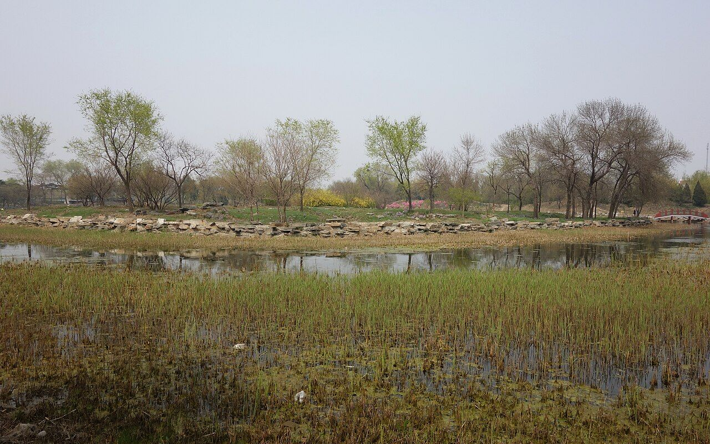

<!-- generated:start (scripts/building_pages.py): do not edit between these markers -->

# CC14: 玉玲珑馆 Yulinglong Guan

Changchun Yuan

**3D object:** 15 boxes. Open it: `/reconstruction/3d.html?b=CC14`

## What we know

- **Name:** 玉玲珑馆 Yulinglong Guan (S05, S48, S01, S361 · confidence B)
- **Garden:** Changchun Yuan (S05, S48, S01, S361)
- **Type:** compound (S05, S48, S01, S361 · confidence B)
- **Built:** by 1755 poem [j83:17b]; 1747; added to c. 1764 (S05, S48, S01, S361)
- **Destroyed:** 1860 (S05, S48, S01, S361)
- **Position:** 40.00787, 116.30958. S01 sure (S01 · confidence B)
- **Plan reader's note:** Label 玉玲瓏館 at (11380,3800) beside the zig-zag bridge, blue 7. Labels inside: 林光澹碧, 正谊明道, 鹤安斋, 狎?亭; 芥舟 and 朝暉亭 at the edge. (S01) *(research copy, not public)*
- **How it was read:** sure (S01) *(research copy, not public)*
- **Plan pixels:** 11413, 3527 (S01) *(research copy, not public)*

## Our model now

15 boxes stand in this compound, 15 on blocks drawn on the plan, 0 assumed. Its halls are listed below.

## Inside it (14)

- CC14-01 正谊明道
- CC14-02 林光澹碧
- CC14-03 鹤安斋
- CC14-04 蹈和堂
- CC14-B0635
- CC14-B0636
- CC14-B0638
- CC14-B0652
- CC14-B0670
- CC14-B0694
- CC14-B0695
- CC14-N01 狎鸥亭
- CC14-N02 芥舟
- CC14-N03 朝暉亭

## Pictures (1)

- **P0457** (sure): 玉玲珑馆遗址 20130421.JPG (2013-04-21 14:22:39 (Commons DateTimeOriginal)). https://commons.wikimedia.org/wiki/File:%E7%8E%89%E7%8E%B2%E7%8F%91%E9%A6%86%E9%81%97%E5%9D%80_20130421.JPG

  

## Texts and drawings (37)

- **E0267** (poem, sure): 御製玉玲瓏舘詩. 1755 (乾隆二十年) · j83:17b · S05. https://github.com/kanripo/KR2k0036/blob/master/KR2k0036_083.txt
  > 乾隆二十年御製玉玲瓏舘詩　湖石三四峯湘筠五六箇月下詭狀獰風前清影簸詩渾白濁吟畫是倪迂作發興在宣毫澄懐當筍座而我每少閒隔月纔一過（叶）
  Short poem on 玉玲瓏館: three or four lake rocks and a few bamboos, visited about once a month.
- **E0288** (text, sure): 日下舊聞考 玉玲珑馆. 1780s (乾隆 敕撰) · j83:17a-17b · S05. https://github.com/kanripo/KR2k0036/blob/master/KR2k0036_083.txt
  > 獅子林之南為玉玲瓏館正宇為正誼明道五楹北為林光澹碧東為鶴安齋西南為蹈和堂（長春園册）臣等謹案林光澹碧宇内額曰逰心於淡
  South of 獅子林: 玉玲瓏館, main range 正誼明道 of five bays, with 林光澹碧, 鶴安齋 and 蹈和堂.
- **E0271** (poem, sure): 御製 題玉玲瓏館. 1764 (御製詩三集) · KR4f0005_201:18b-19a · S201. https://github.com/kanripo/KR4f0005/blob/master/KR4f0005_201.txt
  > 題玉玲瓏館 緑瓊繞砌戛玲瓏真玉應勞追琢工光透一輪寜礙月聲敲六律雅宜風桃詩還為（去聲）思韓愈笛賦何須詠馬融静對恰如㕘半偈是無色色不空空
  Green stone around the steps at 玉玲瓏館, with moonlight showing through the holes.
- **E0276** (poem, sure): 御製 題玉玲瓏館. 1766 (御製詩三集) · KR4f0005_217:3a-3b · S201. https://github.com/kanripo/KR4f0005/blob/master/KR4f0005_217.txt
  > 題玉玲瓏館 假山堆作玉玲瓏羣玉中間有路通不效未央誇間（去聲）璧尚慙大禹是卑宫碧璈聲出竹敲砌古鑑光呈月隠櫳翰墨林非資博雅時因粥粥省吾躬
  Rockwork called a jade mass with a path through it, bamboo tapping the steps, and an old mirror-like moon at the lattice.
- **E0270** (poem, likely): 狎鷗亭. 1761, 1764, 1793 · KR4f0005_176:4b; 200:23b; 472:21a · S201. https://github.com/kanripo/KR4f0005
  > 臨水孤亭名狎鷗煙波無盡任飛浮
  Reads the plan label 狎?亭 at 玉玲珑馆: the small pavilion by the water "in the imperial garden", 1764. The poems do not name its compound. 狎鷗舫 of 1782-96 is another name and not tied here.
- **E0278** (poem, likely): 芥舟. 1766-1785, 8 poems · KR4f0005_219:8a; 254:8a (1770); 261:30b; 405:23a (1785) · S201. https://github.com/kanripo/KR4f0005
  > 水中亭子小而幽喻物名之曰芥舟舟已非舟芥豈芥兩㤀離即幻隨流
  A very small pavilion in the water named for the boat of the Zhuangzi. The poems sit in runs on garden halls and do not name 玉玲珑馆; only the S01 label places it. The phrase 芥舟 in the 海岳开襟 poem (S05 j83:11b) is a figure of speech, not this pavilion.
- **E0268** (poem, sure): 玉玲珑馆. 乾隆二十年 (1755) · v4 p.1, under 玉玲珑馆; source ref 5-366 · S361. https://www.yuanmingyuanpark.cn/xs/yjbg/202008/P020200803382796786124.pdf#page=4
  > 湖石三四峰，湘筠五六个。月下诡状狞，风前清影簸。诗浑白浊吟，画是倪迂作。发兴在宣毫，澄怀当筍座。而我每少闲，隔月才一过。
  Poem 玉玲珑馆 by the Qianlong Emperor, 1755, filed by the editors under 玉玲珑馆.
- **E0269** (poem, sure): 鹤安斋: 乾隆二十五年 poem of the Qianlong Emperor. 乾隆二十五年 (1760), date from the compilation · p.288 item (1), under 鹤安斋 · S360. https://www.yuanmingyuanpark.cn/xs/yjbg/202007/P020200730387572832602.pdf#page=288
  > 朴室水之裔，嘉树为其屏。方蓬岂必楼，心疑即斯境。幽禽翩然翔，彳亍步顾影。斋前性所安，露下韵愈警。我来惟片时，难值静以永。明月与清风，合付胎仙领。
  Poem of the Qianlong Emperor at 鹤安斋, 1760. Year as given by the compilation.
- **E0272** (poem, sure): 玉玲珑馆: 乾隆二十九年 poem of the Qianlong Emperor. 乾隆二十九年 (1764), date from the compilation · p.288 item (1), under 玉玲珑馆 · S360. https://www.yuanmingyuanpark.cn/xs/yjbg/202007/P020200730387572832602.pdf#page=288
  > 绿琼绕砌戛玲珑，真玉应劳追琢工。光透一轮寜碍月，声敲六律雅宜风。桃诗还为思韩愈，笛赋何须咏马融。静对恰如参半偈，是无色色不空空。
  Poem of the Qianlong Emperor at 玉玲珑馆, 1764, on the view. Year as given by the compilation.
- **E0273** (poem, sure): 鹤安斋: 乾隆二十九年 poem of the Qianlong Emperor. 乾隆二十九年 (1764), date from the compilation · p.288 item (2), under 鹤安斋 · S360. https://www.yuanmingyuanpark.cn/xs/yjbg/202007/P020200730387572832602.pdf#page=288
  > 园林率飬鹤，以其调弗俗。素羽与朗音，足清人耳目。不无资稻粱，斯有所拘束。闲庭松石佳，鹤安名我屋。其然岂其然，胎仙意如恧。
  Poem of the Qianlong Emperor at 鹤安斋, 1764. Year as given by the compilation.
- **E0274** (poem, sure): 鹤安斋: 乾隆二十九年 poem of the Qianlong Emperor. 乾隆二十九年 (1764), date from the compilation · p.288 item (3), under 鹤安斋 · S360. https://www.yuanmingyuanpark.cn/xs/yjbg/202007/P020200730387572832602.pdf#page=288
  > 壬午剏放鹤，自此每推挍。静宜例避暑，业已从其好（去岁驻香山静宜园，曾视避暑山荘，例放 鹤，并迭旧韵作诗纪事）。御园亦蓄鹤，隔林偶闻呌。翦羽常怀苦，充腹且谋乐。意虽不肯住，焉能巢父掉。因命概放之，往事胥堪效。既无絷体虞，仍有清音报。林监乃窃叹，官粟何由调。胎仙饱与饥，彼固弗能告。是谓免禽食（用孟子意），而实减人稻（饲鹤者，或窃馈，今放之，则不支鹤粮，无由窃矣，故戏及之） 。鹤安信鹤安，大遂凌霞操。
  Poem of the Qianlong Emperor at 鹤安斋, 1764. Year as given by the compilation.
- **E0293** (poem, sure): 戏题鹤安斋. 乾隆二十九年 (1764) · v4 p.2, under 玉玲珑馆; source ref 8-754 · S361. https://www.yuanmingyuanpark.cn/xs/yjbg/202008/P020200803382796786124.pdf#page=5
  > 园林率养鹤，以其调弗俗。素羽与朗音，足清人耳目。不无资稻粱，斯有所拘束。闲庭松石佳，鹤安名我屋。其然岂其然，胎仙意如恧。
  Poem 戏题鹤安斋 by the Qianlong Emperor, 1764, filed by the editors under 玉玲珑馆.
- **E0294** (poem, sure): 鹤安斋放鹤再叠避暑山庄放鹤亭韵. 乾隆二十九年 (1764) · v4 p.3, under 玉玲珑馆; source ref 8-792 · S361. https://www.yuanmingyuanpark.cn/xs/yjbg/202008/P020200803382796786124.pdf#page=6
  > 壬午创放鹤，自此每推挍。静宜例避暑，业已从其好
  Poem 鹤安斋放鹤再叠避暑山庄放鹤亭韵 by the Qianlong Emperor, 1764, filed by the editors under 玉玲珑馆.
- **E0296** (poem, sure): 蹈和堂. 乾隆二十九年 (1764) · v4 p.4, under 玉玲珑馆; source ref 8-853 · S361. https://www.yuanmingyuanpark.cn/xs/yjbg/202008/P020200803382796786124.pdf#page=7
  > 元气化工氲，醇风万物欣。王褒讲德论，曹植事神文。静挹筦倪趣，闲披翰墨芬。四情皆中节，不敏愿尊闻。
  Poem 蹈和堂 by the Qianlong Emperor, 1764, filed by the editors under 玉玲珑馆.
- **E0297** (poem, sure): 题蹈和堂. 乾隆三十年 (1765) · v4 p.4, under 玉玲珑馆; source ref 9-102 · S361. https://www.yuanmingyuanpark.cn/xs/yjbg/202008/P020200803382796786124.pdf#page=7
  > 座有古芸披，甄陶左右宜。履贞兼纳顺，率礼复敦诗。省岁调元气，祈年协四时。与民同保合，念释总于兹。
  Poem 题蹈和堂 by the Qianlong Emperor, 1765, filed by the editors under 玉玲珑馆.
- **E0277** (poem, sure): 玉玲珑馆: 乾隆三十一年 poem of the Qianlong Emperor. 乾隆三十一年 (1766), date from the compilation · p.288 item (2), under 玉玲珑馆 · S360. https://www.yuanmingyuanpark.cn/xs/yjbg/202007/P020200730387572832602.pdf#page=288
  > 假山堆作玉玲珑，群玉中间有路通。不效未央夸间璧，尚惭大禹是卑宫。碧璈声出竹敲砌，古鉴光呈月隐栊。翰墨林非资博雅，时因粥粥省吾躬。
  Poem of the Qianlong Emperor at 玉玲珑馆, 1766, on the view. Year as given by the compilation.
- **E0299** (poem, sure): 芥舟. 乾隆三十一年 (1766) · v4 p.7, under 玉玲珑馆; source ref 9-179 · S361. https://www.yuanmingyuanpark.cn/xs/yjbg/202008/P020200803382796786124.pdf#page=10
  > 杯水无殊覆坳堂，堂如舟亦芥堪方。蒙庄原谓胶舟者，安识须弥个里藏。
  Poem 芥舟 by the Qianlong Emperor, 1766, filed by the editors under 玉玲珑馆.
- **E0279** (poem, sure): 玉玲珑馆: 乾隆三十二年 poem of the Qianlong Emperor. 乾隆三十二年 (1767), date from the compilation · p.288 item (3), under 玉玲珑馆 · S360. https://www.yuanmingyuanpark.cn/xs/yjbg/202007/P020200730387572832602.pdf#page=288
  > 绿水回环中有居，坐来悦可适几余。松间飒飒风含爽，竹际泠泠月入虚。纵目恰宜遇寥朗，托怀又喜得清舒。优沾时雨逢秋霁，为此欣予亦惕予。
  Poem of the Qianlong Emperor at 玉玲珑馆, 1767, on escaping the heat. Year as given by the compilation.
- **E0298** (poem, sure): 蹈和堂. 乾隆三十三年 (1768) · v4 p.10, under 玉玲珑馆; source ref 9-454 · S361. https://www.yuanmingyuanpark.cn/xs/yjbg/202008/P020200803382796786124.pdf#page=13
  > 履贞济徽懿，率礼守安详。永念儿宽对，非循支父方。殷勤树禽语，自在砌花芳。协序惟旸雨，消闲有缥缃。
  Poem 蹈和堂 by the Qianlong Emperor, 1768, filed by the editors under 玉玲珑馆.
- **E0280** (poem, sure): 鹤安斋: 乾隆三十五年 poem of the Qianlong Emperor. 乾隆三十五年 (1770), date from the compilation · p.289 item (4), under 鹤安斋 · S360. https://www.yuanmingyuanpark.cn/xs/yjbg/202007/P020200730387572832602.pdf#page=289
  > 夙有胎仙伴，无过缀景看。非闗稻粱省，欲使翥翔欢。仍此空庭下，由他碧宇寛。开笼放去者，真觉性相安。
  Poem of the Qianlong Emperor at 鹤安斋, 1770. Year as given by the compilation.
- **E0300** (poem, sure): 芥舟. 乾隆三十五年 (1770) · v4 p.12, under 玉玲珑馆; source ref 10-639 · S361. https://www.yuanmingyuanpark.cn/xs/yjbg/202008/P020200803382796786124.pdf#page=15
  > 冻合池冰近砌坳，置舟杯芥总须胶。何如悟取华严旨，极大须弥个里包。
  Poem 芥舟 by the Qianlong Emperor, 1770, filed by the editors under 玉玲珑馆.
- **E0301** (poem, sure): 芥舟. 乾隆三十六年 (1771) · v4 p.13, under 玉玲珑馆; source ref 10-770 · S361. https://www.yuanmingyuanpark.cn/xs/yjbg/202008/P020200803382796786124.pdf#page=16
  > 杯水坳堂芥作舟，问谁能以此乘浮。今来冰凝芥亦胶，可复于杯相傲不。
  Poem 芥舟 by the Qianlong Emperor, 1771, filed by the editors under 玉玲珑馆.
- **E0281** (poem, sure): 鹤安斋: 乾隆四十年 poem of the Qianlong Emperor. 乾隆四十年 (1775), date from the compilation · p.289 item (5), under 鹤安斋 · S360. https://www.yuanmingyuanpark.cn/xs/yjbg/202007/P020200730387572832602.pdf#page=289
  > 放鹤从来屡咏诗（屡作放鹤诗，向皆书泐此斋中），鹤安复不免拈辞。任他长羽无拘束，即是好生有顺宜。时亦庭前呈舞态，欣于松畔具仙姿。惟余一节难调处，苑吏禽粮怨减支。
  Poem of the Qianlong Emperor at 鹤安斋, 1775. Year as given by the compilation.
- **E0295** (poem, sure): 鹤安斋戏题. 乾隆四十二年 (1777) · v4 p.16, under 玉玲珑馆; source ref 12-962 · S361. https://www.yuanmingyuanpark.cn/xs/yjbg/202008/P020200803382796786124.pdf#page=19
  > 昔原赋之粮，即而放于野。赋粮拘束兮，放野逍遥也。非缘省粮为，乃图鹤安者。继因去渐多，栖松或致寡。铩羽仍饲之，园吏喜跃冶。饲鹤即饲人，鹤瘦欲言哑。
  Poem 鹤安斋戏题 by the Qianlong Emperor, 1777, filed by the editors under 玉玲珑馆.
- **E0282** (poem, sure): 鹤安斋: 乾隆四十七年 poem of the Qianlong Emperor. 乾隆四十七年 (1782), date from the compilation · p.289 item (6), under 鹤安斋 · S360. https://www.yuanmingyuanpark.cn/xs/yjbg/202007/P020200730387572832602.pdf#page=289
  > 始作鹤安斋，谓宜适其性。既不翦羽翼，亦省梁稻供。侵寻数十载，翼长去无剩。青松朋若失，白鸥鸣鲜应。斋安鹤未安，名实似庭径。既而静思之，胎仙本清净。戞然返青田，得所夫何病。鹤安斋亦安，辞多此为咏。
  Poem of the Qianlong Emperor at 鹤安斋, 1782. Year as given by the compilation.
- **E0283** (poem, sure): 鹤安斋: 乾隆五十年 poem of the Qianlong Emperor. 乾隆五十年 (1785), date from the compilation · p.289 item (7), under 鹤安斋 · S360. https://www.yuanmingyuanpark.cn/xs/yjbg/202007/P020200730387572832602.pdf#page=289
  > 借问鹤之安，应在山林杳。亭台及湖石，胎仙岂所晓。有如王仲宣，信美故土藐。因命弗翦翮，任其翱云表。初去转翔仍，既久弗来了。快㢤得其安，漫议庭禽少。
  Poem of the Qianlong Emperor at 鹤安斋, 1785. Year as given by the compilation.
- **E0284** (poem, sure): 鹤安斋: 乾隆五十六年 poem of the Qianlong Emperor. 乾隆五十六年 (1791), date from the compilation · p.289 item (8), under 鹤安斋 · S360. https://www.yuanmingyuanpark.cn/xs/yjbg/202007/P020200730387572832602.pdf#page=289
  > 昔罢翦鹤翎，翱翔任其性。既而减鹤粮，园伇以为病（自壬午年剏放鹤之例，鹤既得遂其性，而罢支鹤粮。虽云不蹈孟子禽食之讥，然园丁自此无由侵克余粮，未免失其利縁矣。）。乃悟鹤安伇弗安，昔诗得半非全称（利于鹤乃弗利于园，伇是以戊中诗有一利有一弊两得鲜兼全之句）。大都一利有一弊，吾将通此于施政。
  Poem of the Qianlong Emperor at 鹤安斋, 1791. Year as given by the compilation.
- **E0285** (poem, sure): 玉玲珑馆: 嘉庆七年 poem of the Jiaqing Emperor. 嘉庆七年 (1802), date from the compilation · p.288 item (4), under 玉玲珑馆 · S360. https://www.yuanmingyuanpark.cn/xs/yjbg/202007/P020200730387572832602.pdf#page=288
  > 试放兰桡碧沼东，天光澹淡午烟笼。云容层叠欣将雨，林影婆娑又舞风。远岸染霞高岭绘，回溪问景曲廊通。麦秋候届未蒙泽，时切苍穹锡岁丰。
  Poem of the Jiaqing Emperor at 玉玲珑馆, 1802, on boating. Year as given by the compilation.
- **E0286** (poem, sure): 玉玲珑馆: 嘉庆七年 poem of the Jiaqing Emperor. 嘉庆七年 (1802), date from the compilation · p.288 item (5), under 玉玲珑馆 · S360. https://www.yuanmingyuanpark.cn/xs/yjbg/202007/P020200730387572832602.pdf#page=288
  > 庭前叠石致玲珑，略彴相连别馆通。崇朴敬承继大宝，晏安时戒处深宫。傅心常仰诗题壁，克俭宁教玉琢栊。肯构寸忱祈赐佑，戢戎和众厪予躬。
  Poem of the Jiaqing Emperor at 玉玲珑馆, 1802, on the view. Year as given by the compilation.
- **E0287** (poem, sure): 玉玲珑馆: 嘉庆十二年 poem of the Jiaqing Emperor. 嘉庆十二年 (1807), date from the compilation · p.288 item (6), under 玉玲珑馆 · S360. https://www.yuanmingyuanpark.cn/xs/yjbg/202007/P020200730387572832602.pdf#page=288
  > 清溪右转径玲珑，弭棹寻幽文馆通。竹坞禽栖枝上下，荷池鱼戏叶西东。闲阶寂静敷疏荫，广厦虚明纳远风。到此顿忘伏暑候，市廛狭隘悯难同。
  Poem of the Jiaqing Emperor at 玉玲珑馆, 1807, on escaping the heat and the view. Year as given by the compilation.
- **E0275** (poem, likely): 再题玉玲珑馆. 乾隆三十一年 (1766) · v4 p.7, under 玉玲珑馆; source ref 9-156 · S361. https://www.yuanmingyuanpark.cn/xs/yjbg/202008/P020200803382796786124.pdf#page=10
  > 竹石此间佳，而皆宜雪物。今朝问景来，积素犹蓊郁。磊磊与虚笼，猗猗与轻拂。通体一玲珑，怡神在穆沕。试问孙兴公，于何觅充诎。
  Poem 再题玉玲珑馆 by the Qianlong Emperor, 1766, filed by the editors under 玉玲珑馆.
- **E0494** (description, guess): 长春园 Changchun Yuan: eight chief groups. 1934 · p.98 · S02. https://archive.org/details/historyofpekings00malo
  > The new garden which the Emperor constructed in 1751 just east of the Yuan Ming Yuan he called the Ch'ang Ch'un Yuan, or Garden of Long Spring.
  From Rixia j83. Built 1751 by Malone's date, added to for years; about a third of the size of the Yuan Ming Yuan proper; islands and artificial hills with wider spaces and larger lakes. No.1 audience hall inside the south gate (澹怀堂); No.2 palace on the central island (含经堂); Nos.3, 6, 8 lakeside gardens; Nos.4, 5, 7 palace groups on islands. Mapping of numbers to ids is mine; only 6 and 8 are named by Malone.
- **E2000** (description, sure): Site status table, about 2011: scattered remains only. c. 2011 · 系列06 repost, status table · S356. https://blog.sina.com.cn/s/blog_c27029650101itzz.html
  Scenes with only scattered, incomplete building remains in the same table. 方壶胜境 is listed separately as the one with fairly complete remains not yet tidied up. 紫碧山房, 舍卫城 and 如园 have been dug since.
- **E0289** (description, sure): 圆明园百景史事分景汇编: 鹤安斋. 1760-1791 · from p.288, under 玉玲珑馆 · S360. https://www.yuanmingyuanpark.cn/xs/yjbg/202007/P020200730387572832602.pdf#page=288
  Eight Qianlong poems, 1760-1791: cranes kept here, released in 1764 and 1775, one returning in 1770, and the freed birds remembered in 1785 and 1791. 鹤安斋: 8 dated items, 1760-1791, of which 8 poems (Qianlong). First dated 1760, last dated 1791.
- **E0290** (description, sure): 圆明园百景史事分景汇编: 玉玲珑馆. 1764-1807 · from p.288, under 玉玲珑馆 · S360. https://www.yuanmingyuanpark.cn/xs/yjbg/202007/P020200730387572832602.pdf#page=288
  Poems of 1764-1807 on its rockery of Taihu stone and its summer use; in 1802 Jiaqing came here by boat from 狮子林. 玉玲珑馆: 6 dated items, 1764-1807, of which 6 poems (Qianlong, Jiaqing); recurring themes: the view, escaping the heat, boating. First dated 1764, last dated 1807.
- **E0291** (description, sure): 圆明园五朝御制诗文集注 v4, editors' note on 玉玲珑馆. 2020 edition · v4 p.1 · S361. https://www.yuanmingyuanpark.cn/xs/yjbg/202008/P020200803382796786124.pdf#page=4
  Built 1747, added to about 1764, on an island south of 狮子林. Gate five bays; main hall of seven (plaque 正谊明道), rear of nine (林光澹碧). West court has 撷景室, 蹈和堂 and the square 朝晖亭 on the water; the east has five-bay 鹤安斋, the double-eaved 狎鸥亭, 随安室, a greenhouse, a fountain, 澹然书屋 and 芥舟 at the shore.
- **E0292** (drawing, sure, search index only): 玉玲珑馆平面图. 乾隆后期至道光年间 · 国家图书馆善本部 样式雷排架070-1号 · S310. https://www.mhymy.com/dasl/ysltd/5247.html
  Base plan of Yulinglong Guan in colour and ink with yellow slips, 1170x848 mm, late Qianlong to Daoguang, showing its two groups of buildings. No image here; the site may ask a small payment for the full record.

**On the plan:** Drawn on the plan of the gardens (S01), labelled 玉玲珑馆. https://artmuseum.princeton.edu/collections/objects/138657

## Open questions

None that name it.

<!-- generated:end -->

## Notes

<!-- Yours: regeneration never touches this part. It goes on the public site; what you write below a line holding only %% private %% stays in the research copy. -->
