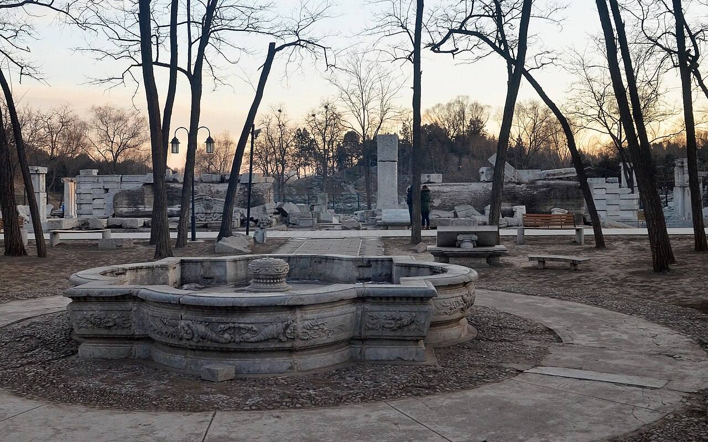
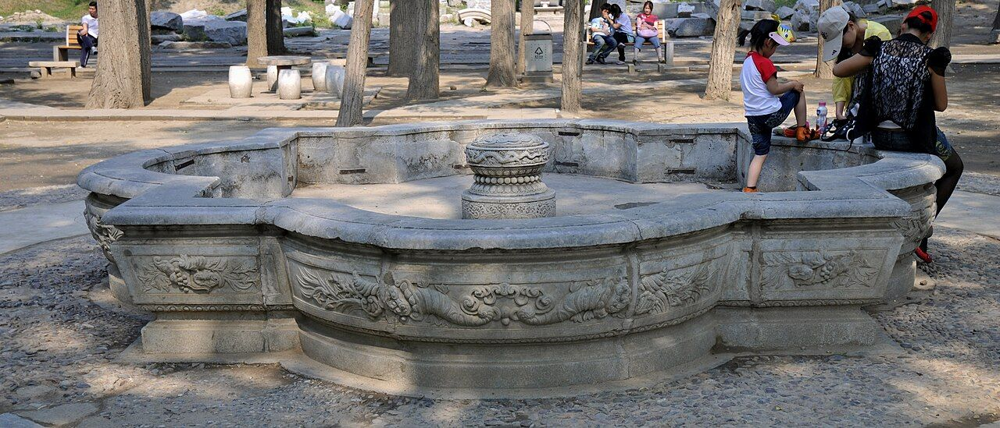
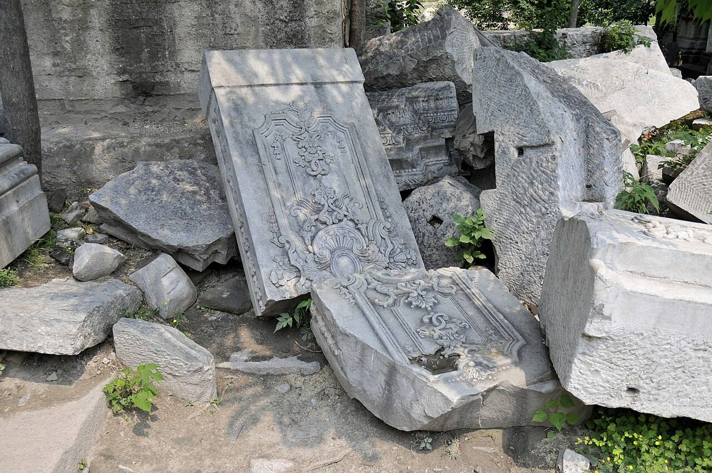
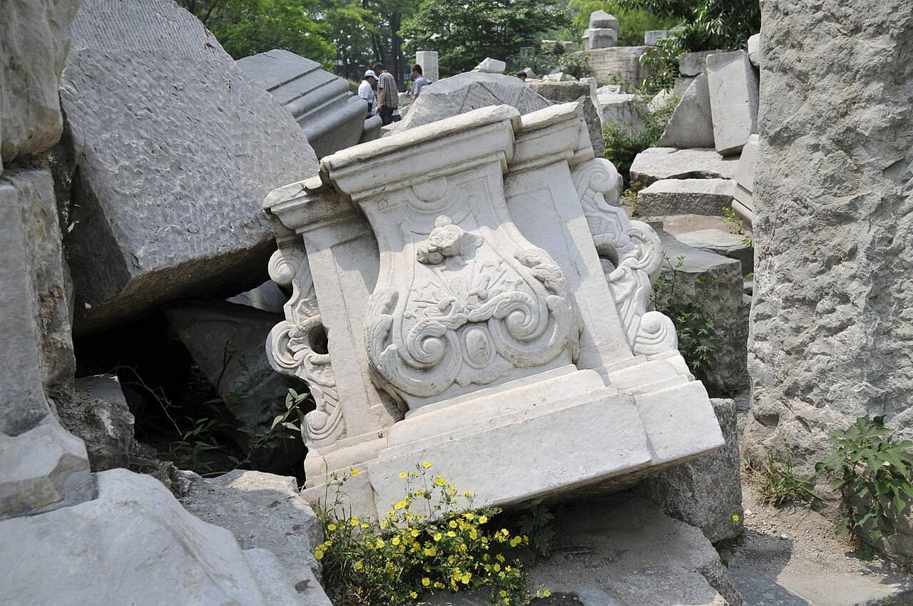
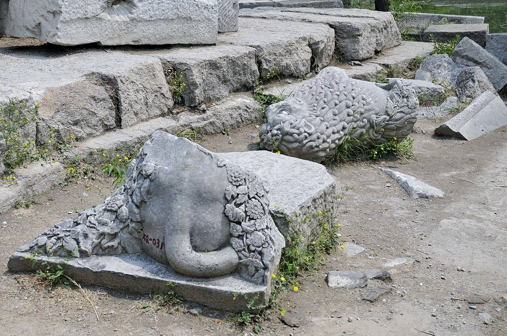
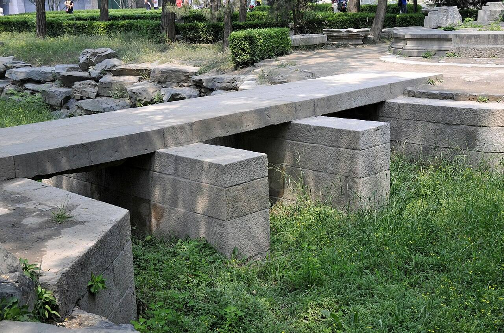
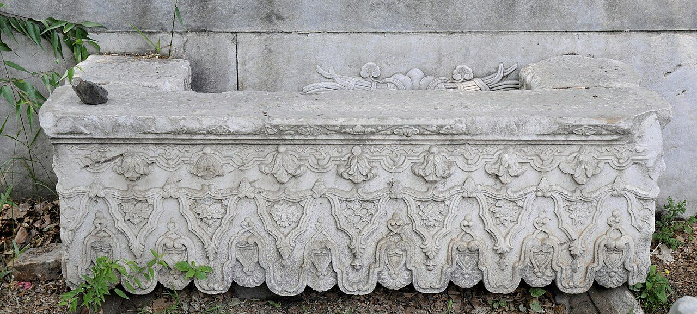

<!-- generated:start (scripts/building_pages.py): do not edit between these markers -->

# CC28: court north of 谐奇趣

Changchun Yuan

**3D object:** 1 box. Open it: `/reconstruction/3d.html?b=CC28`

## What we know

- **Name:** court north of 谐奇趣 (S01 · confidence B)
- **Garden:** Changchun Yuan (S01)
- **Type:** compound (S01 · confidence B)
- **Destroyed:** 1860 (S01)
- **Position:** 40.01184, 116.30249. S01 likely (S01 · confidence B)
- **Plan reader's note:** Open court between the maze gate and the north front, with the fountain figure. Malone: fantastically paved courtyard. (S01) *(research copy, not public)*
- **How it was read:** likely (S01) *(research copy, not public)*
- **Plan pixels:** 8876, 1094 (S01) *(research copy, not public)*

## Our model now

1 boxes stand in this compound, 1 on blocks drawn on the plan, 0 assumed. Its halls are listed below.

## Inside it (1)

- CC28-N01

## Pictures (7)

- **P0348** (likely): Fountain in north of Xieqiqu 20130201.JPG (2013-02-01 17:19:59 (Commons DateTimeOriginal)). https://commons.wikimedia.org/wiki/File:Fountain_in_north_of_Xieqiqu_20130201.JPG

  

- **P0475** (likely): 雕刻精美的喷水池 - panoramio.jpg (Taken on 27 May 2011 (Commons DateTimeOriginal)). https://commons.wikimedia.org/wiki/File:%E9%9B%95%E5%88%BB%E7%B2%BE%E7%BE%8E%E7%9A%84%E5%96%B7%E6%B0%B4%E6%B1%A0_-_panoramio.jpg

  

- **P0476** (guess): 断成两段的精美的石雕部件 - panoramio.jpg (Taken on 27 May 2011 (Commons DateTimeOriginal)). https://commons.wikimedia.org/wiki/File:%E6%96%AD%E6%88%90%E4%B8%A4%E6%AE%B5%E7%9A%84%E7%B2%BE%E7%BE%8E%E7%9A%84%E7%9F%B3%E9%9B%95%E9%83%A8%E4%BB%B6_-_panoramio.jpg

  

- **P0477** (guess): 精美的石雕部件 - panoramio.jpg (Taken on 27 May 2011 (Commons DateTimeOriginal)). https://commons.wikimedia.org/wiki/File:%E7%B2%BE%E7%BE%8E%E7%9A%84%E7%9F%B3%E9%9B%95%E9%83%A8%E4%BB%B6_-_panoramio.jpg

  

- **P0478** (guess): 谐奇趣 身首异处的石狮 - panoramio.jpg (Taken on 27 May 2011 (Commons DateTimeOriginal)). https://commons.wikimedia.org/wiki/File:%E8%B0%90%E5%A5%87%E8%B6%A3_%E8%BA%AB%E9%A6%96%E5%BC%82%E5%A4%84%E7%9A%84%E7%9F%B3%E7%8B%AE_-_panoramio.jpg

  

- **P0479** (guess): 石板桥 - panoramio.jpg (Taken on 27 May 2011 (Commons DateTimeOriginal)). https://commons.wikimedia.org/wiki/File:%E7%9F%B3%E6%9D%BF%E6%A1%A5_-_panoramio.jpg

  

- **P0480** (guess): 制作精美的石雕水槽 - panoramio.jpg (Taken on 27 May 2011 (Commons DateTimeOriginal)). https://commons.wikimedia.org/wiki/File:%E5%88%B6%E4%BD%9C%E7%B2%BE%E7%BE%8E%E7%9A%84%E7%9F%B3%E9%9B%95%E6%B0%B4%E6%A7%BD_-_panoramio.jpg

  

## Texts and drawings (2)

- **E0930** (description, likely): Plate I: 谐奇趣 Xieqiqu, north front (by content). 1786-1803 · pp.173-175, Plate I · S258. https://archive.org/details/BIUSante_40644
  > Trois arcades au rez-de-chaussée; trois fenêtres à l'étage supérieur.
  Palace of two orders flanked by two isolated octagonal pavilions; the middle arch a niche with a throne; two-basin fountain with four dolphins and candelabra in a railed basin; lawns with shrubs and vases. Delatour's Plate I matches Malone's Engraving 2.
- **E0933** (description, likely): Engraving 2: 谐奇趣 Xieqiqu, north front. 1934 · p.143 · S02. https://archive.org/details/historyofpekings00malo
  > The north front of the Hsieh Ch'i Ch'u faced on a fantastically paved courtyard containing conventionally trimmed trees.
  North front on a patterned paved court with clipped trees. Plates p.142-143 show the ruin after 1860 (from Favier) and after further damage in 1900 and later.

**On the plan:** Drawn on the plan of the gardens (S01), labelled court north of 谐奇趣. https://artmuseum.princeton.edu/collections/objects/138657

## Evidence for the set of buildings

- Reconstructions and comparables for the whole garden, 长春园 Changchun Yuan: see GARDEN-CC

## Open questions

None that name it.

<!-- generated:end -->

## Notes

<!-- Yours: regeneration never touches this part. It goes on the public site; what you write below a line holding only %% private %% stays in the research copy. -->
