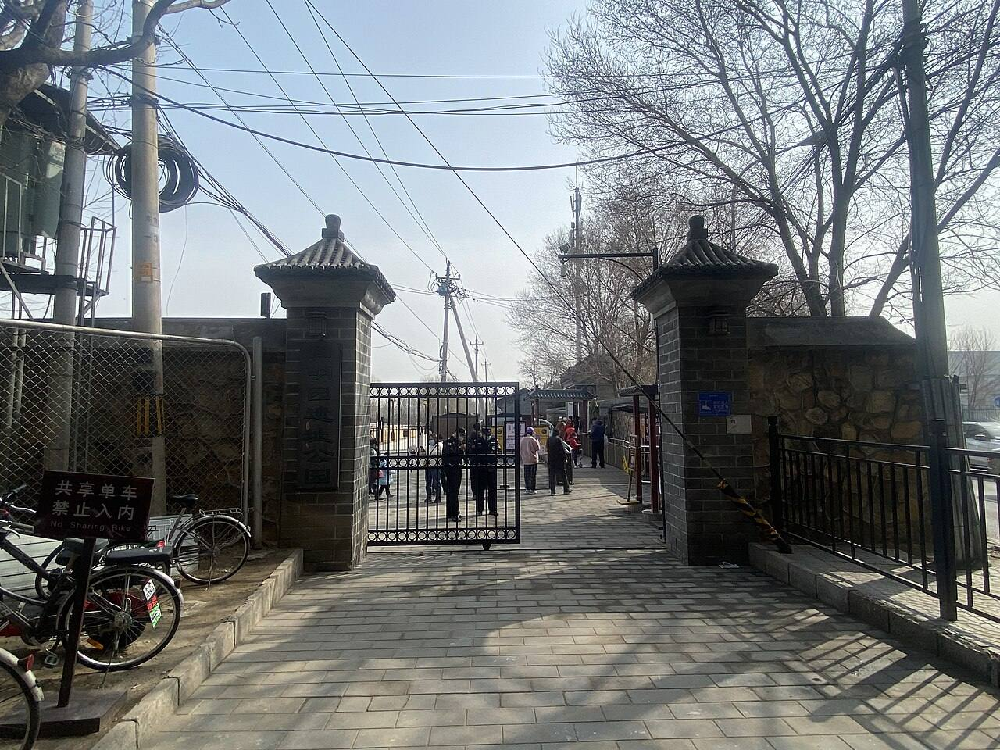
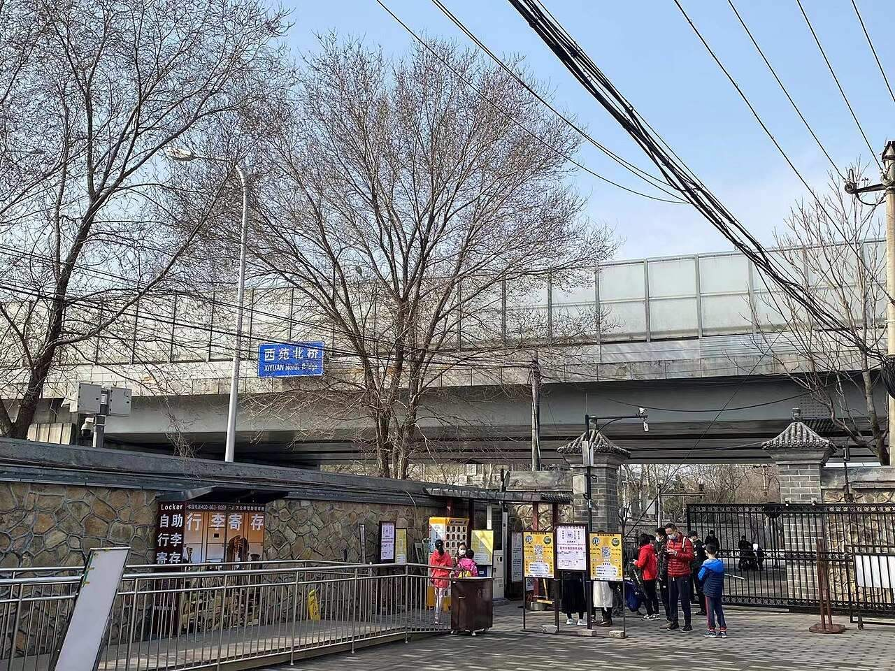

<!-- generated:start (scripts/building_pages.py): do not edit between these markers -->

# G07: 藻园门 Zao Yuan Men

Gate in the garden walls

**3D object:** none yet.

## What we know

- **Name:** 藻园门 Zao Yuan Men (S01 · confidence B)
- **Type:** gate in the walls (S01 · confidence B)
- **Note:** South wall, west end. Yuanming Yuan. (S01)
- **How it was read:** sure (S01) *(research copy, not public)*

## Our model now

No box of its own: the hall drawn at this point stands for the gate in the 3D view.

## Pictures (2)

- **P0469** (likely): 圆明园藻园门.jpeg (2022-03-13 (Commons DateTimeOriginal)). https://commons.wikimedia.org/wiki/File:%E5%9C%86%E6%98%8E%E5%9B%AD%E8%97%BB%E5%9B%AD%E9%97%A8.jpeg

  

- **P0470** (likely): 圆明园藻园门位于西苑北桥下方.jpeg (2022-03-13 (Commons DateTimeOriginal)). https://commons.wikimedia.org/wiki/File:%E5%9C%86%E6%98%8E%E5%9B%AD%E8%97%BB%E5%9B%AD%E9%97%A8%E4%BD%8D%E4%BA%8E%E8%A5%BF%E8%8B%91%E5%8C%97%E6%A1%A5%E4%B8%8B%E6%96%B9.jpeg

  

## Texts and drawings (3)

- **E0379** (text, sure): 日下舊聞考: the eighteen gates. 1780s · j80:6b-7a · S05. https://github.com/kanripo/KR2k0036/blob/master/KR2k0036_080.txt
  > 園内為門十八南曰大宫門曰左右門曰東西夾道門曰東西如意門曰福園門曰西南門曰水閘門曰藻園門東曰東樓門曰鐡門曰明春門曰隨墻門曰蘂珠宫門西曰隨墻門正北曰北樓門為閘三西南為一空進水閘東北為五空出水閘為一空出水閘
  The Qing list of the gates of 圆明园 and of its three sluices, to set against the labels of S01.
- **E0380** (description, sure): Malone: gates of the south side, 大宫门 and second gate. 1934 · pp.50-54, 68-70 · S02. https://archive.org/details/historyofpekings00malo
  The present 出入贤良门 lies on the line of the south wall, while the Great Palace Gate opens through a shorter wall like a bay: Malone reads it as a later addition. He notes 藻园门 lies west of 西南门, which makes the name 西南门 a misnomer, and supposes 藻园门 was added later.
- **E0389** (description, likely): 围墙 and gates between the three gardens (S57 = S116). 2021, on Yangshi Lei wall plans · section 1.2, 3.3 · S57. https://www.yuanmingyuanpark.cn/xs/yjbg/202108/t20210831_4483376.html
  Between 圆明园 and 长春园: 明春门, 绿油门, 蕊珠门. Between 绮春园 and 长春园: 茜园门. Between 绮春园 and 圆明园: 秀清村门. Today's wall file names 藻园门, 西爽村门, 运料门, 绿油门, 福缘门 and 东楼门 as sites of wall gates, 西北门 and 大北门 by their walls. 绿油门 is not labelled on S01.

**On the plan:** Drawn as a gate on the plan of the gardens (S01). https://artmuseum.princeton.edu/collections/objects/138657

## Evidence for the set of buildings

- Evidence for the whole garden, 圆明园 Yuanming Yuan: see GARDEN-YM

## Open questions

None that name it.

<!-- generated:end -->

## Notes

<!-- Yours: regeneration never touches this part. It goes on the public site; what you write below a line holding only %% private %% stays in the research copy. -->
