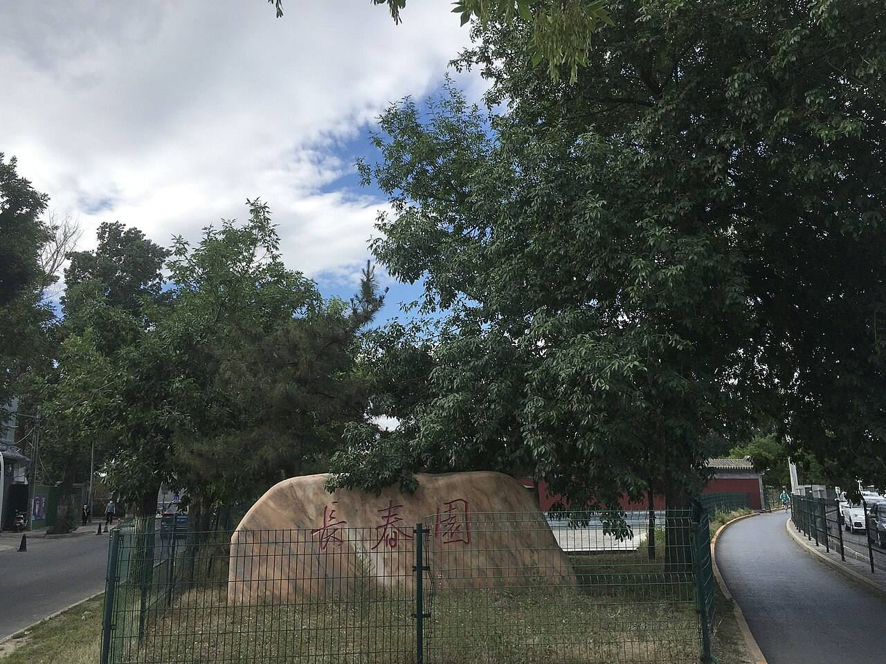

<!-- generated:start (scripts/building_pages.py): do not edit between these markers -->

# G21: 长春园 Chang Chun Yuan

Gate in the garden walls

**3D object:** none yet.

## What we know

- **Name:** 长春园 Chang Chun Yuan (S01 · confidence B)
- **Type:** gate in the walls (S01 · confidence B)
- **Note:** South gate of Changchun Yuan: bays with the label 长春园 below; the word for gate is not written beside it. (S01)
- **How it was read:** sure (S01) *(research copy, not public)*

## Our model now

No box of its own: the hall drawn at this point stands for the gate in the 3D view.

## Pictures (1)

- **P0488** (guess): 長春園.jpg (2021-05-28 15:44:56 (Commons DateTimeOriginal)). https://commons.wikimedia.org/wiki/File:%E9%95%B7%E6%98%A5%E5%9C%92.jpg

  

## Texts and drawings (1)

- **E0393** (text, sure): 长春园宫门. 1780s · j83:3a · S05. https://github.com/kanripo/KR2k0036/blob/master/KR2k0036_083.txt
  > 長春園宫門五楹東西朝房各五楹正殿爲澹懷堂
  S01 labels only 长春园 under this gate: it is the five-bay main gate of the garden with five-bay offices east and west.

**On the plan:** Drawn as a gate on the plan of the gardens (S01). https://artmuseum.princeton.edu/collections/objects/138657

## Evidence for the set of buildings

- Evidence for the whole garden, 长春园 Changchun Yuan: see GARDEN-CC

## Open questions

- Q25: Other dates
- Q52: Smaller conflicts
- Q156: Twin lead for the coordinator
- Q159: Commons files the bronze qilin before 仁寿殿 at 颐和园 (Category:Statue of Qilin (Hall of Benevo
- Q196: The width of a paved way 甬道 is not known anywhere
- Q197: Which way did the water fall?
- Q202: Hills the plan's outlines miss
- Q203: Water layer and shores

<!-- generated:end -->

## Notes

<!-- Yours: regeneration never touches this part. It goes on the public site; what you write below a line holding only %% private %% stays in the research copy. -->
