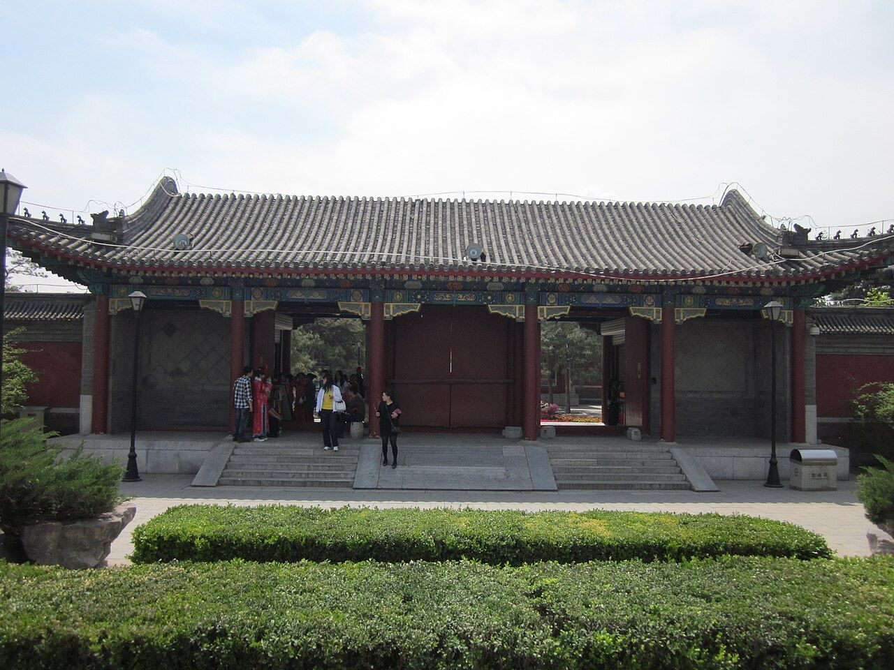
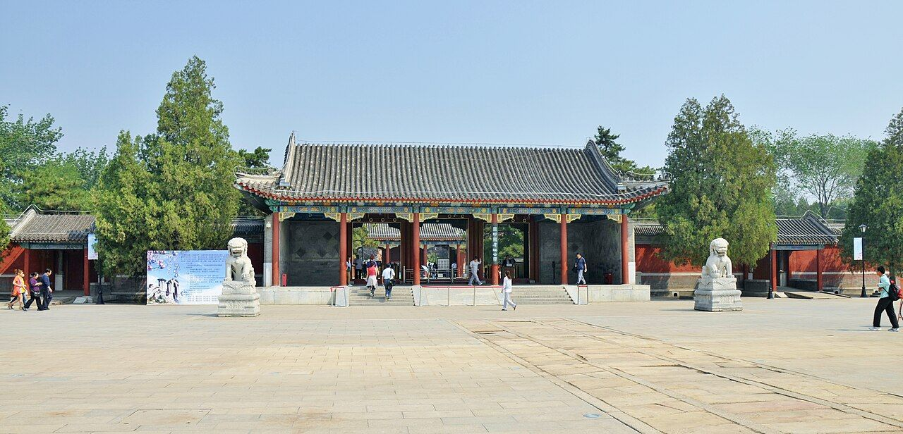
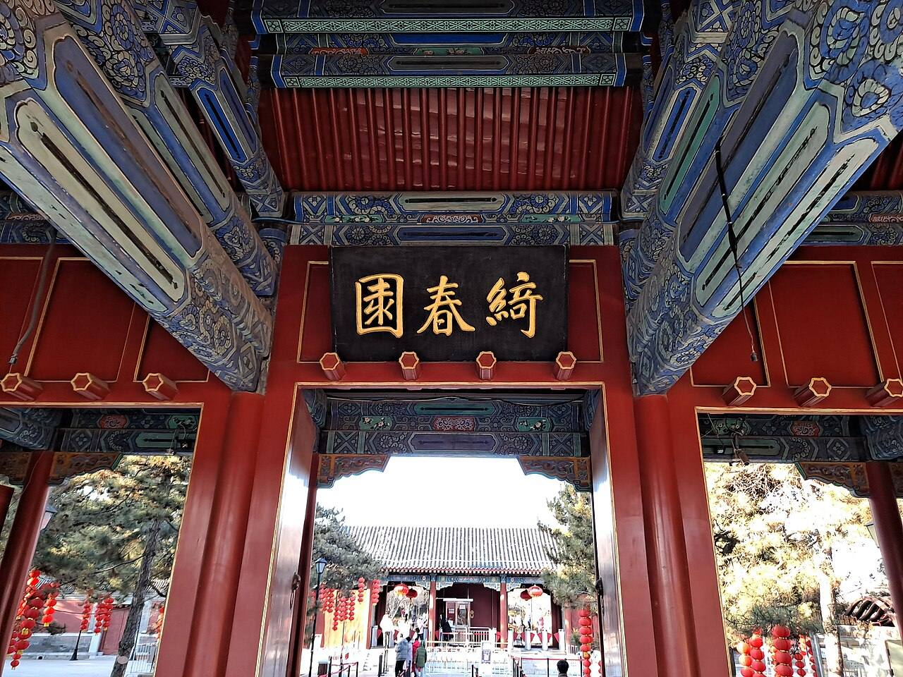

<!-- generated:start (scripts/building_pages.py): do not edit between these markers -->

# G25: 大宫门 Da Gong Men

Gate in the garden walls

**3D object:** none yet.

## What we know

- **Name:** 大宫门 Da Gong Men (S01 · confidence C)
- **Type:** gate in the walls (S01 · confidence C)
- **Note:** Main gate of Qichun Yuan. Label seen as 大宫, the rest beyond the crop edge. Stone bridge 石桥 inside it; 影壁 screen wall at about (9570,8185). (S01)
- **How it was read:** partial (S01) *(research copy, not public)*

## Our model now

No box of its own: the hall drawn at this point stands for the gate in the 3D view.

## Pictures (3)

- **P0466** (likely): Entrance of the Old Summer Palace.jpg (2011-04-21 23:27:49 (Commons DateTimeOriginal)). https://commons.wikimedia.org/wiki/File:Entrance_of_the_Old_Summer_Palace.jpg

  

- **P0467** (likely): 绮春园大门 - panoramio.jpg (Taken on 27 May 2011 (Commons DateTimeOriginal)). https://commons.wikimedia.org/wiki/File:%E7%BB%AE%E6%98%A5%E5%9B%AD%E5%A4%A7%E9%97%A8_-_panoramio.jpg

  

- **P0468** (likely): Palace Gate of the old Summer Palace 2.jpg (2021-02-17 16:16:21 (Commons DateTimeOriginal)). https://commons.wikimedia.org/wiki/File:Palace_Gate_of_the_old_Summer_Palace_2.jpg

  

## Texts and drawings (1)

- **E0397** (text, sure): 文宗實錄: 绮春园大宫门 and 福园门, 1850. 道光三十年二月 (after the Dowager's death) · 道光三十年二月戊辰 (corpus copy) · S207. https://github.com/garychowcmu/daizhigev20/blob/master/史藏/别史/清实录咸丰朝实录.txt
  > 大行皇太后梓宫、奉移昌陵隆恩殿暂安。届期。朕于绮春园大宫门跪送后。仍步行恭送至红桥。用申哀悃。俟梓宫渐远。朕进福园门。还飞云轩倚庐。
  The Emperor sees the coffin off at the great gate of Qichun Yuan, walks on to 红桥, and comes back in through 福园门 to his mourning place in 飞云轩.

**On the plan:** Drawn as a gate on the plan of the gardens (S01). https://artmuseum.princeton.edu/collections/objects/138657

## Evidence for the set of buildings

- Evidence for the whole garden, 绮春园 Qichun Yuan: see GARDEN-QC

## Open questions

- Q3: Which state does S01 draw?
- Q28: 1860 and after, for the site's text
- Q80: YM41-01 / YM03-01
- Q116: YM41 大宫门 and YM17 安佑宫
- Q125: Geotagged Commons coverage is thin
- Q150: QC01
- Q186: Which line on the plan is the garden wall on the north and west of Yuanming Yuan?
- Q196: The width of a paved way 甬道 is not known anywhere
- Q256: S01 draws 正大光明殿 and its terrace small
- Q259: The garden wall round the gate court
- Q260: The lions of 大宫门
- Q262: The east range of the inner court

<!-- generated:end -->

## Notes

<!-- Yours: regeneration never touches this part. It goes on the public site; what you write below a line holding only %% private %% stays in the research copy. -->
