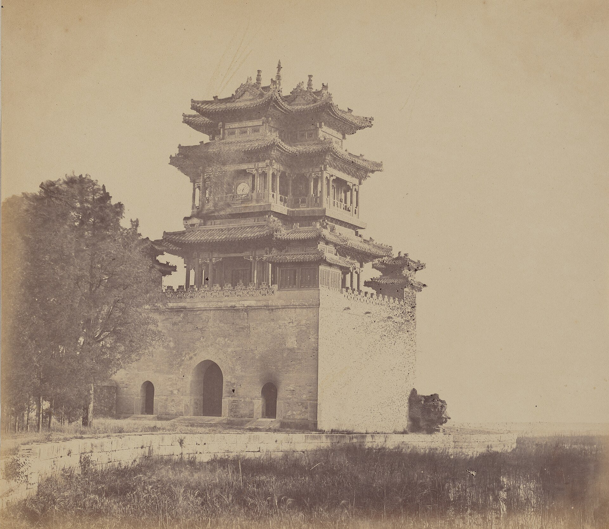
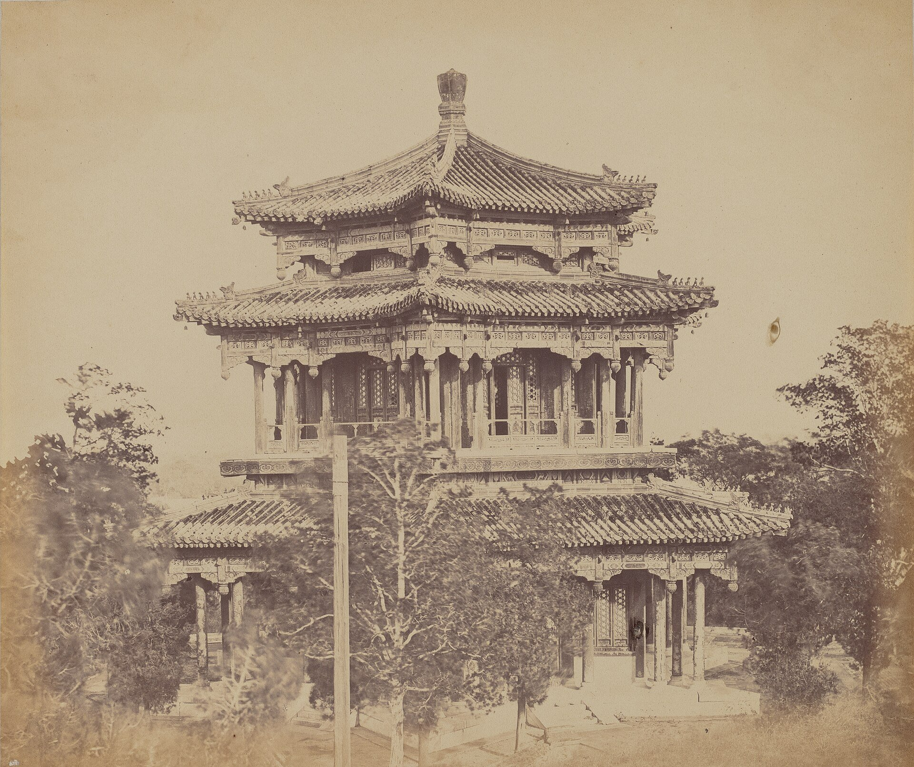
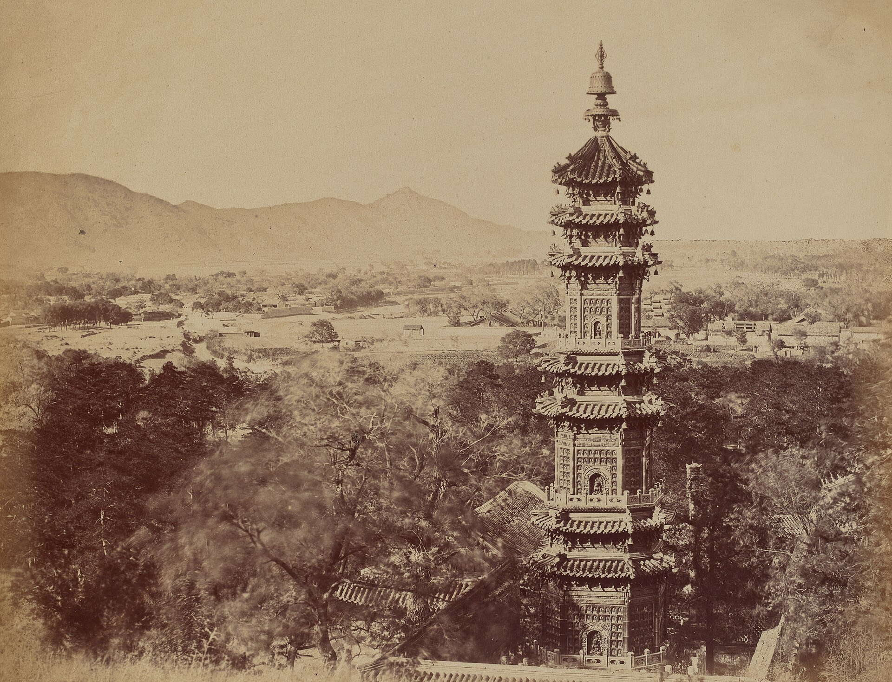
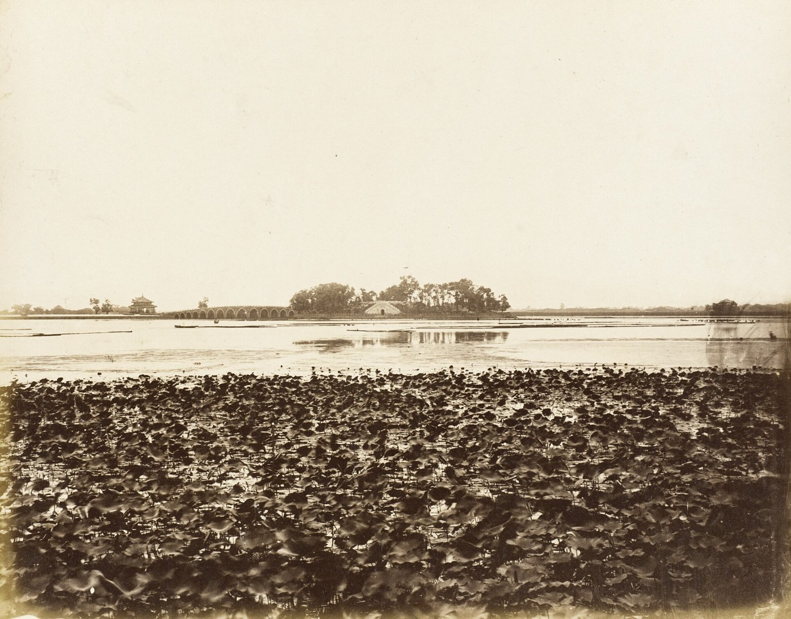

<!-- generated:start (scripts/building_pages.py): do not edit between these markers -->

# OW001: 清漪园 Qingyi Yuan

a neighbouring imperial or princely garden · outside the walls · confidence A

**3D object:** none yet.

## What we know

- **Name:** 清漪园 Qingyi Yuan (S05, S02, S422, S03, S1207, S1209, S1210, S1211, S281, S1213, S20, S27 · confidence A)
- **In English:** Garden of Clear Ripples (颐和园 Yihe Yuan from 1888) (S05, S02, S422, S03, S1207, S1209, S1210, S1211, S281, S1213, S20, S27)
- **What it was:** a neighbouring imperial or princely garden outside the garden walls (S05, S02, S422, S03, S1207, S1209, S1210, S1211, S281, S1213, S20, S27 · confidence A)
- **In 1860:** looted 6-16 Oct 1860, burned 18-19 Oct by British troops under Michel (S02 pp.188-189; memorials of 宝鋆 16 Oct and 瑞常 26 Oct via S1207); rebuilt 1886-1895 as 颐和园 (S422, lead) (S05, S02, S422, S03, S1207, S1209, S1210, S1211, S281, S1213, S20, S27)
- **Size:** area 301.2 ha (run on osm way 29228773; zh.wiki 297 ha, S422) (S05, S02, S422, S03, S1207, S1209, S1210, S1211, S281, S1213, S20, S27)
- **Where:** osm way 29228773 centroid (颐和园 heritage boundary) (S05, S02, S422, S03, S1207, S1209, S1210, S1211, S281, S1213, S20, S27 · confidence A)
- **Note:** S05 j84: 建于万寿山之麓, 在圆明园西二里许, 前为昆明湖; main gate five bays facing east, 勤政殿 seven bays. Built 1750-64. Today's outline follows the 1880s-90s wall: in 1860 only the hill part was walled and the lake shores were open (S02 p.199: the Guangxu work 'complete[d] a wall around the whole garden and lake'), so the outline is a C stand-in for the 1860 extent. Massing: 大报恩延寿寺 / the tower site on the hill's south axis (延寿塔 pulled down at the 8th storey, replaced by 佛香阁, S422 lead), the long gallery, 宝云阁 (bronze, 1755) and 智慧海 (glazed brick) which survived the fire (lead). Free pictures: Beato Oct 1860 (S643, S282: 文昌阁) and see the sources file.; Pictures before the burning: Beato 智慧海 (S1209), 多宝琉璃塔 (S1209), a pavilion (S1209), 文昌阁 (S643), 十七孔桥 and 南湖岛 (S1210); after it: the empty 佛香阁 terrace and a lake panorama (S1211); ruins 1868-89 by Thomson and Child (S281, S1213). Also: AMS 1944 sheet read at px 1735,450, fit rms 95 m (Wanshowshan (Yihoyüan)), 356 m from the point used. Also: LoC Beijing cheng jiao tu c.1886 read at px 6987,3316, fit rms 226 m (萬壽山), 811 m from the point used. (S05, S02, S422, S03, S1207, S1209, S1210, S1211, S281, S1213, S20, S27)

## Our model now

Massing only, not a reconstruction: 3 plain blocks (walls, houses, halls), a tinted patch of ground. Its houses, rows and halls are generated to the kind of place, not drawn from a plan of it: assumed (C). The switch `around=0` hides everything outside the walls.

## Pictures (4)

- **P0180** (likely): Imperial Summer Palace Yuen Min Yuen, Pekin, Before the Burning (1860 (National Gallery of Art)). https://commons.wikimedia.org/wiki/File%3AFelice_Beato%2C_Imperial_Summer_Palace_Yuen_Min_Yuen%2C_Pekin%2C_Before_the_Burning%2C_October_18%2C_1860%2C_1860%2C_NGA_163388.jpg

  

- **P0181** (likely): The Great Imperial Palace Yuen Min Yuen, Pekin, Before the Burning (1860 (National Gallery of Art)). https://commons.wikimedia.org/wiki/File%3AFelice_Beato%2C_The_Great_Imperial_Palace_Yuen_Min_Yuen%2C_Pekin%2C_Before_the_Burning%2C_October_18%2C_1860%2C_1860%2C_NGA_163386.jpg

  

- **P0182** (likely): View of the Summer Palace Yuen Min Yuen, Pekin, Showing the Porcelain Tower (1860 (National Gallery of Art)). https://commons.wikimedia.org/wiki/File%3AFelice_Beato%2C_View_of_the_Summer_Palace_Yuen_Min_Yuen%2C_Pekin%2C_Showing_the_Pagoda_Before_the_Burning%2C_October_1860%2C_1860%2C_NGA_163385.jpg

  

- **P0823** (likely): River View with Seventeen Arch Bridge, Yuan Ming Yuan, Peking (十七孔桥 and 南湖岛 of 清漪园) (1860 (LACMA)). https://commons.wikimedia.org/wiki/File:River_View_with_Seventeen_Arch_Bridge,_Yuan_Ming_Yuan,_Peking_LACMA_M.83.302.34.jpg

  

## Texts and drawings (0)

None of its own.

## Open questions

- Q53: Unplaced witnesses
- Q96: Hérisson (S246 pp.320-324) describes a yellow-tiled 'Bibliothèque impériale' 40 x 10 x 12 
- Q126: Commons hits for 'Yuen Ming Yuen' outside the Xiyang Lou are mostly not 圆明园
- Q153: Brief
- Q264: The lake of 清漪园 in 1860

<!-- generated:end -->

## Notes

<!-- Yours: regeneration never touches this part. It goes on the public site; what you write below a line holding only %% private %% stays in the research copy. -->
