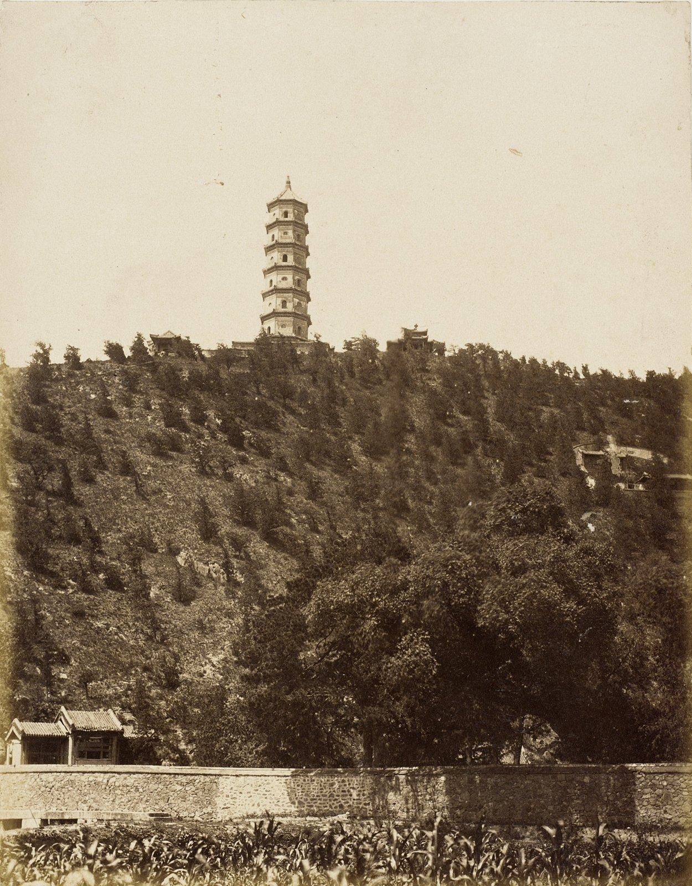

<!-- generated:start (scripts/building_pages.py): do not edit between these markers -->

# OW002: 静明园 Jingming Yuan

a neighbouring imperial or princely garden · outside the walls · confidence A

**3D object:** none yet.

## What we know

- **Name:** 静明园 Jingming Yuan (S05, S02, S03, S1207, S1212, S1201, S20, S27 · confidence A)
- **In English:** Garden of Tranquil Brightness (玉泉山 Yuquan Shan) (S05, S02, S03, S1207, S1212, S1201, S20, S27)
- **What it was:** a neighbouring imperial or princely garden outside the garden walls (S05, S02, S03, S1207, S1212, S1201, S20, S27 · confidence A)
- **In 1860:** looted before 18 Oct, burned 18-19 Oct 1860 by British troops (S02 p.189; 瑞常's memorial 26 Oct via S1207); again damaged 1900 (S1201 lead); c.1930 'kept without much change as it was after the fires' (S02 p.218) (S05, S02, S03, S1207, S1212, S1201, S20, S27)
- **Size:** the OSM wood on the hill, way 989069291, 39.6 ha (run): not the garden's wall (S05, S02, S03, S1207, S1212, S1201, S20, S27)
- **Where:** osm node 8725437667 (玉泉山 peak) (S05, S02, S03, S1207, S1212, S1201, S20, S27 · confidence A)
- **Note:** S05 j85: 在玉泉山之阳, Kangxi-era, 16 views; gate five bays facing south, the 高水湖 before it. Pagodas on the hill (玉峰塔) are the skyline mark from our gardens. Closed today (lead).; Built 1680 as 澄心园, renamed 静明园 1692 (S1201 lead). Picture: Beato's 玉峰塔 with the rubble wall (S1212), and the pagoda on the skyline of S1211. Also: AMS 1944 sheet read at px 1389,470, fit rms 95 m (Yütsüanshan (Tsingmingyüan)), 98 m from the point used. Also: LoC Beijing cheng jiao tu c.1886 read at px 6822,3363, fit rms 226 m (玉泉山), 270 m from the point used. (S05, S02, S03, S1207, S1212, S1201, S20, S27)

## Our model now

Massing only, not a reconstruction: 188 plain blocks (walls, houses, halls), a tinted patch of ground. Its houses, rows and halls are generated to the kind of place, not drawn from a plan of it: assumed (C). The switch `around=0` hides everything outside the walls.

## Pictures (1)

- **P0824** (likely): Pagoda at Old Summer Palace, Yu-chuan Shan, Jade Spring Hill (玉峰塔 of 静明园) (1860 (LACMA)). https://commons.wikimedia.org/wiki/File:Pagoda_at_Old_Summer_Palace,_Yu-chuan_Shan,_Jade_Spring_Hill_LACMA_M.83.302.36.jpg

  

## Texts and drawings (0)

None of its own.

## Open questions

- Q53: Unplaced witnesses

<!-- generated:end -->

## Notes

<!-- Yours: regeneration never touches this part. It goes on the public site; what you write below a line holding only %% private %% stays in the research copy. -->
