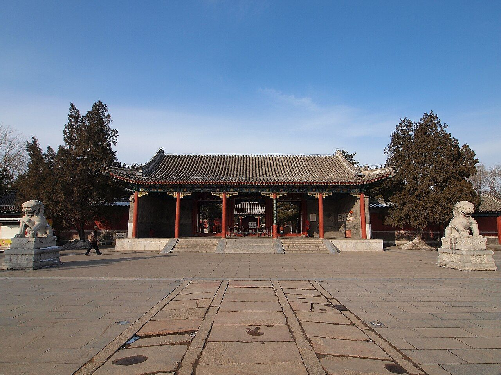
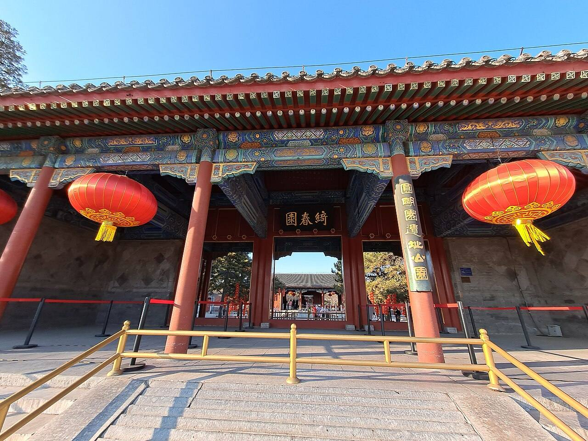
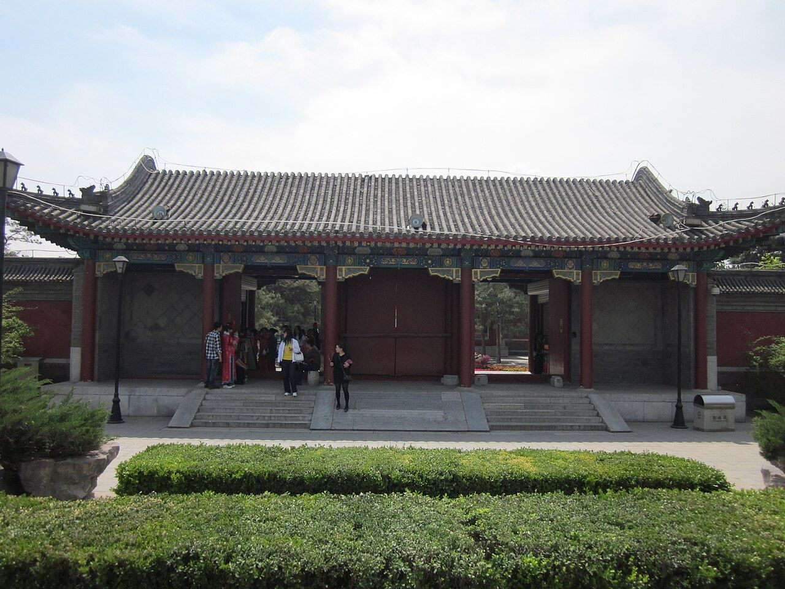
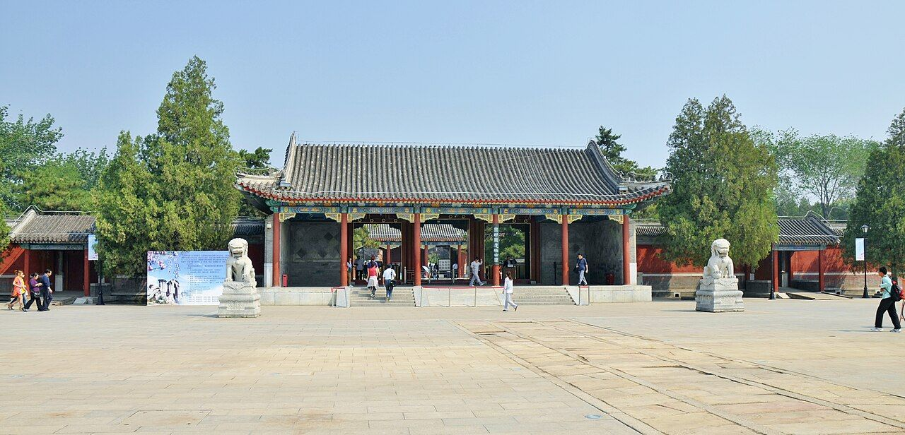

<!-- generated:start (scripts/building_pages.py): do not edit between these markers -->

# QC01: 绮春园宫门 Qichun Yuan Gongmen

Qichun Yuan

**3D object:** 1 box. Open it: `/reconstruction/3d.html?b=QC01`

## What we know

- **Name:** 绮春园宫门 Qichun Yuan Gongmen (S49, S02, S06, S57, S01, S220 · confidence B)
- **Written on the plan:** 大宫门 (S01 · confidence B)
- **Garden:** Qichun Yuan (S49, S02, S06, S57, S01, S220)
- **Type:** gate (S49, S02, S06, S57, S01, S220 · confidence B)
- **Built:** 嘉庆十四年 1809, 新宫门 (S49 lead); 嘉庆十四年 1809 (with 勤政殿 = QC02's predecessor name, to be checked) (S49, S02, S06, S57, S01, S220)
- **Destroyed:** survived 1860 (S06;S49); 同治 repairs; ruined later; rebuilt 1988 (S57) (S49, S02, S06, S57, S01, S220)
- **Position:** 39.99930, 116.30635. S01 sure (S01 · confidence B)
- **Bays:** 5x1 on the plan (S49, S02, S06, S57, S01, S220)
- **Size in the inventory:** 21.3 × 8.8 m. S01 plan px / hall scale (S01)
- **Where the text puts it:** 东南 宫廷区 (S06) (S49, S02, S06, S57, S01, S220) *(research copy, not public)*
- **Note:** Malone p.97 photographs the gate: "Rebuilt after 1860 by the Empress Dowager and renamed Wan Ch'un Yuan". (S49, S02, S06, S57, S01, S220)
- **Plan reader's note:** Forecourt with 影壁 at the south end and two side halls B1415 B1416. Hall B1390 is the gate, label 大宫门 south of it on the axis. | plan: Main gate. G25. (S01) *(research copy, not public)*
- **How it was read:** sure (S01) *(research copy, not public)*
- **Plan pixels:** 9577, 7737 (S01) *(research copy, not public)*

## Our model now

A plain box on the block drawn on the Qing plan S01: position and frontage from the plan, heights and roof from the typology of its hall class. It will be updated as the research goes on.

- **Box:** 21.3 × 8.8 m, gate hall
- **Heights:** platform 0.77 m, eave 4.47 m, ridge 7.61 m above the ground
- **Roof:** hip-and-gable 歇山, rolled ridge 卷棚, grey tile
- **Faces:** 173.4° from north
- **Confidence:** B

## Inside it (2)

- QC01-N01
- QC01-N02 影壁

## Pictures (4)

- **P0418** (sure): 绮春园宫门 - Palace Gate of Qichun Garden - 2012.12 - panoramio.jpg (Taken on 21 December 2012 (Commons DateTimeOriginal)). https://commons.wikimedia.org/wiki/File:%E7%BB%AE%E6%98%A5%E5%9B%AD%E5%AE%AB%E9%97%A8_-_Palace_Gate_of_Qichun_Garden_-_2012.12_-_panoramio.jpg

  

- **P0419** (sure): Palace Gate of the old Summer Palace.jpg (2021-02-17 16:15:57 (Commons DateTimeOriginal)). https://commons.wikimedia.org/wiki/File:Palace_Gate_of_the_old_Summer_Palace.jpg

  

- **P0466** (likely): Entrance of the Old Summer Palace.jpg (2011-04-21 23:27:49 (Commons DateTimeOriginal)). https://commons.wikimedia.org/wiki/File:Entrance_of_the_Old_Summer_Palace.jpg

  

- **P0467** (likely): 绮春园大门 - panoramio.jpg (Taken on 27 May 2011 (Commons DateTimeOriginal)). https://commons.wikimedia.org/wiki/File:%E7%BB%AE%E6%98%A5%E5%9B%AD%E5%A4%A7%E9%97%A8_-_panoramio.jpg

  

## Texts and drawings (12)

- **E0566** (text, sure): 嘉庆十三年 谕旨 to 苏楞额 on the new palace block (as quoted in S220). 嘉庆十三年七月 1808 · S220 section 三; archive not seen · S220. http://iqh.ruc.edu.cn/old/qdhjylyjzx/xszl/ylfj/00baad8cc3da4c6a901378da7919d9a8.htm
  > 该园墙北，敷春堂之南，开随墙门一座。……并着苏楞额、常福将此园第何处可以建盖大殿，何处可以不必更张，建立坐落处所，即为查明。再，园内不拘定原有园门方向，酌量东西宽阔处所，可建立南向宫门、朝房、照壁、鹿角，均从缓查明贴签具奏，仿照长春园宫门前式样。
  After Prince Qing (永璘) forfeits his garden, the emperor orders a wall gate north of it, south of 敷春堂, a survey for a main hall, and a south-facing gate with offices, screen wall and barriers on the model of the Changchun Yuan gate. So the palace front QC01-QC03 stands on the prince's former garden, south of an existing 敷春堂.
- **E0567** (text, sure): 奉派查工 内务府 呈堂稿 (as quoted in S220). 嘉庆十五年五月二十七日 1810 · S220 section 三; archive not seen · S220. http://iqh.ruc.edu.cn/old/qdhjylyjzx/xszl/ylfj/00baad8cc3da4c6a901378da7919d9a8.htm
  > 绮春园添建宫门、勤政殿、烟雨楼、涵秋馆、茂悦精舍
  Works of 1809-10. 勤政殿 is the hall later called 迎晖殿 (S224). 烟雨楼 and 茂悦精舍 have no object: a search summary of 《圆明园研究》96 places 烟雨楼 in the 喜雨山房 area (not seen).
- **E0451** (text, likely): 圆明园遗址的遗产价值与申遗构想: the buildings left after 1860, citing 刘敦桢 1933. post n.d. · ylfj, note 34: 刘敦桢, 同治重修圆明园史料, 营造学社汇刊 1933(2) · S337. http://iqh.ruc.edu.cn/old/qdhjylyjzx/xszl/ylfj/9a322b5384ab4c17af0dd577d4f96ca6.htm
  Lists 17 buildings left after the burning of 1860, after 刘敦桢: 紫碧山房, 顺木天, 鱼跃鸢飞, 课农轩, 藏舟坞, 慎修思永, 知过堂, 双鹤斋, 蓬岛瑶台, 魁星楼, 文昌阁, 林渊锦镜, 春雨轩; 海岳开襟; 庄严法界, 正觉寺 and a 大宫门 in 万春园. The paper's aim is to hold any new display to this 1860 state.
- **E0492** (description, sure): 绮春园 Qichun Yuan, what Malone could find. 1934 · pp.96-97 · S02. https://archive.org/details/historyofpekings00malo
  > The writer has found neither pictures nor descriptions for the gardens and buildings in the Ch'i Ch'un Yuan, which probably became an imperial garden in 1774,
  Next to the Yuan Ming Yuan on the south-east, separated by double walls. Malone knew it only from the Official Map and the ruins: much like the others, its western half cut into small gardens by walls, likely from acquired princely gardens. Probably imperial from 1774 (Da Qing Huidian). Plates: gate, rebuilt after 1860 by the Empress Dowager and renamed 万春园, and a water gate in a dividing wall.
- **E0497** (description, sure): 绮春园 after 1860, yaffin 系列15. c. 2011 · blog, lead only · S356. https://blog.sina.com.cn/s/blog_65fec3ab0100sxa7.html
  Lead: says the gate district, 庄严法界, 惠济祠, 湛清轩 and 绿满轩 survived in 1860, the garden was renamed 万春园 under Tongzhi, and was destroyed in 1900, with only 正觉寺 standing. The south gate dates from 1809 and 新宫门 is its later name. Unverified compilation.
- **E0569** (description, sure): Site status table, about 2011: rebuilt. c. 2011 · 系列06 repost, status table · S356. https://blog.sina.com.cn/s/blog_c27029650101itzz.html
  绮春园 gate, 迎晖殿 and 鉴碧亭 rebuilt on their sites; 正觉寺 under repair at that time.
- **E0524** (description, sure): 张宝章: Qichun Yuan under Jiaqing and Daoguang. 《圆明园研究》第32期 · sections 三, 四 · S224. https://www.yuanmingyuanpark.cn/ymyyj/yj032/201504/t20150420_693218.html
  Axis from the great gate in the south-east: 勤政殿, 中和堂, 敷春堂, up to 问月楼 on the lake shore. In the north a large water split by a causeway, with 凤麟洲 on an island in the east part; south of the small western lake 展诗应律, 庄严法界, 生冬室, 春泽斋, 四宜书屋. On two southern islands 畅和堂 and 绿满轩, with 澄心堂 between 畅和堂 and 正觉寺. This also gives QC09 庄严法界 a rough position (Q11).
- **E0568** (description, sure, search index only): Palace front of Qichun Yuan. 2011 post · t20110105_231486 (search summary) · S227. https://www.yuanmingyuanpark.cn/cgll/zyjd/qcy/201101/t20110105_231486.html
  From the screen wall to the hill behind 中和堂: about 200 by 120 m. Built 1809 and called the new gate. Great and second gates are gate halls with rolled-ridge hip-and-gable roofs. 迎晖殿 is the main hall where the dowager took birthday homage. In 1986 the gates and walls were rebuilt on the site; the 迎晖殿 terrace remains.
- **E0590** (description, likely, search index only): 敷春堂; 澄心堂; 迎晖殿 and 中和堂 labels; 绮春 四宜书屋 (search-index text). n.d. · mhymy ysltd 12232, 7496, 13985 · S340. https://www.mhymy.com/dasl/ysltd/7496.html
  敷春堂: the dowagers' residence from Daoguang, inside the south gate, with a stage per the archives. 澄心堂: island, five-bay hall with side halls. A plan labels 中和堂新宫门 and 迎辉殿. 四宜书屋 built 1805, west of 生冬室.
- **E0570** (drawing, sure, search index only): 绮春园宫门区平面图. not seen · mhymy dasl/ysltd/7496; title and tags only · S42. https://www.mhymy.com/dasl/ysltd/7496.html
  Title and tags only. The site writes 迎辉殿.
- **E0571** (drawing, sure, search index only): 绮春园宫门区平面图. S310. https://www.mhymy.com/tag/538
  Plan of Qichun Yuan's gate quarter; own page URL, shelf number and date not seen. No image here; the site may ask a small payment for the full record.
- **E1086** (plan, sure, search index only): Yangshi Lei plan cards on 梦回圆明园: 勤政殿平面图, 西峰秀色总平面图, 安佑宫室内布置图, 映清斋平面图, 绮春园宫门区平面图, 敷春堂殿平面图, 敷春堂东南所平面图, 涵秋馆地盘图, 四宜书屋(绮春园)平面图, 河道泊岸总平面图, 长春园样式雷河道图, 西洋楼水法图, 御制廓然大公八景诗图. Qing · dasl/ysltd: 11009, 11099, 7659, 9716, 7496, 12232, 9879, 7704, 13985, 9509, 6902, 7643; dasl 11675 · S340. https://www.mhymy.com/dasl/ysltd/11009.html
  Titles seen in the index, drawings not opened. Pattern: https://www.mhymy.com/dasl/ysltd/<id>.html.

**On the plan:** Drawn on the plan of the gardens (S01), labelled 大宫门, 5x1 cells. https://artmuseum.princeton.edu/collections/objects/138657

## Open questions

- Q25: Other dates

<!-- generated:end -->

## Notes

<!-- Yours: regeneration never touches this part. It goes on the public site; what you write below a line holding only %% private %% stays in the research copy. -->
