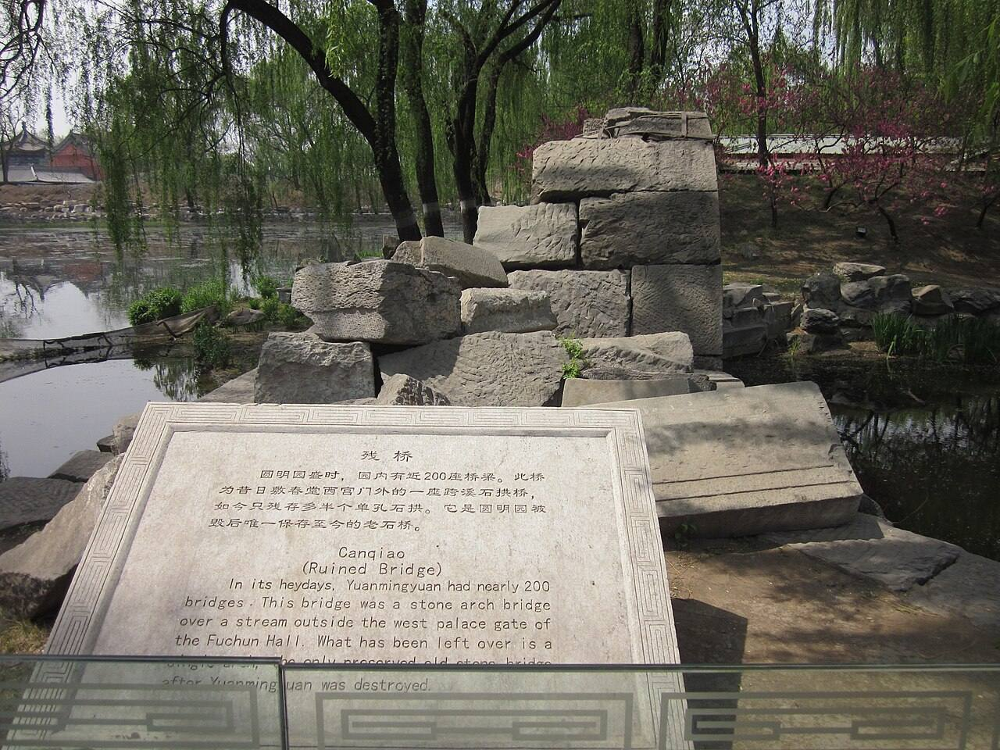
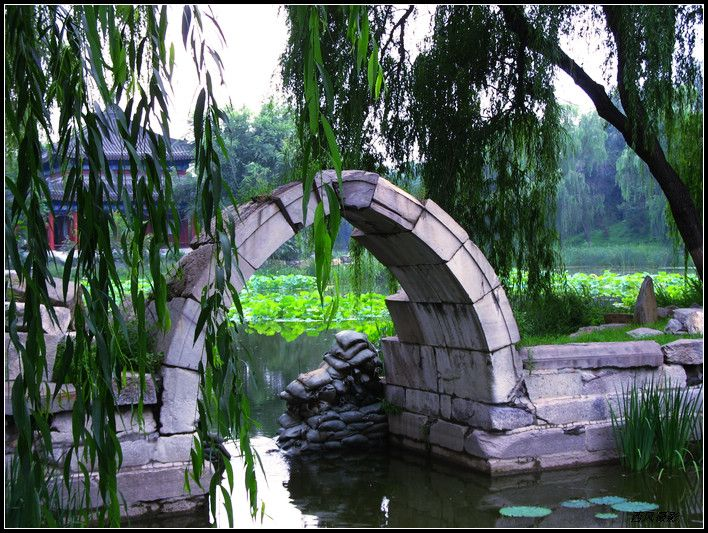
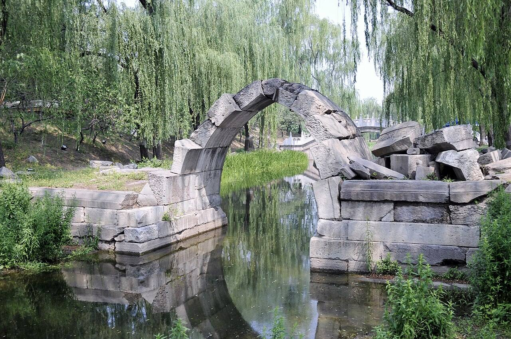
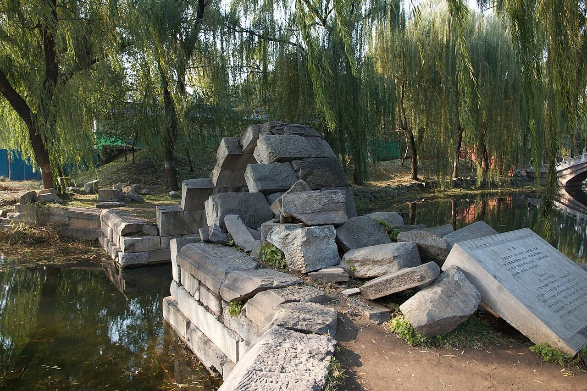

<!-- generated:start (scripts/building_pages.py): do not edit between these markers -->

# QC04: 敷春堂 Fuchun Tang

Qichun Yuan

**3D object:** 23 boxes. Open it: `/reconstruction/3d.html?b=QC04`

## What we know

- **Name:** 敷春堂 Fuchun Tang (S06, S43, S49, S01, S220, S224, S361, S310 · confidence B)
- **Garden:** Qichun Yuan (S06, S43, S49, S01, S220, S224, S361, S310)
- **Type:** compound (S06, S43, S49, S01, S220, S224, S361, S310 · confidence B)
- **Built:** 嘉庆初年 (S43); 1801 (S06, S43, S49, S01, S220, S224, S361, S310)
- **Changed:** 道光元年 1821 大规模改建增饰; 戏台改盖成殿宇 (S43;S49); 同治十二年 1873 renamed 天地一家春 (never finished; S220); S224: renamed 永春堂 under Daoguang for the dowager. But S220 (1852) and an 1838 drawing title still use 敷春堂, and the 1873 edict renames 敷春堂; 1821 stage made into a hall; 1873 renamed 天地一家春 in the unfinished repair; 敷春堂 front hall: 响堂炕 (heated bed-platform) added 道光十八年正月 (1838), 地炕 in the west end bay 咸丰五年九月 (1855); the Empress Dowager 孝和 lived here 1823-1849 (S06, S43, S49, S01, S220, S224, S361, S310)
- **Destroyed:** some buildings outlasted 1860; lost around 1900 (S06, S43, S49, S01, S220, S224, S361, S310)
- **Position:** 40.00133, 116.30612. S01 likely (S01 · confidence B)
- **Bays:** 5, 工字 plan in the texts (S06, S43, S49, S01, S220, S224, S361, S310)
- **Where the text puts it:** 中和堂之后 (S06) (S06, S43, S49, S01, S220, S224, S361, S310) *(research copy, not public)*
- **Note:** 绮春园三十景 (Jiaqing poems, list in S06). Empress dowager quarters in Daoguang-Xianfeng (S43; S02 p.174). (S06, S43, S49, S01, S220, S224, S361, S310)
- **Plan reader's note:** NO label 敷春堂 on the plan. S06 order 迎晖殿 中和堂 敷春堂 后殿 问月楼 puts it in this block, which the plan labels 集禧堂 永春堂 问月楼. Centre = largest hall, unlabelled. See notes.md. (S01) *(research copy, not public)*
- **How it was read:** likely (S01) *(research copy, not public)*
- **Plan pixels:** 9596, 6775 (S01) *(research copy, not public)*

## Our model now

23 boxes stand in this compound, 23 on blocks drawn on the plan, 0 assumed. Its halls are listed below.

## Inside it (23)

- QC04-01 后殿
- QC04-02 问月楼
- QC04-AQ007
- QC04-B1263
- QC04-B1264
- QC04-B1265
- QC04-B1274
- QC04-B1275
- QC04-B1297
- QC04-B1304
- QC04-B1315
- QC04-B1316
- QC04-B1317
- QC04-B1329
- QC04-B1330
- QC04-B1334
- QC04-N01 集禧堂
- QC04-N02 永春堂
- QC04-N03 宫门
- QC04-N04
- QC30 翠合轩
- QC32 协性斋
- QC36 藹芳圃

## Pictures (4)

- **P0460** (likely): Ruined Bridge, Old Summer Palace.jpg (2011-04-21 23:47:28 (Commons DateTimeOriginal)). https://commons.wikimedia.org/wiki/File:Ruined_Bridge,_Old_Summer_Palace.jpg

  

- **P0461** (likely): 绮春园残桥.jpg (). https://commons.wikimedia.org/wiki/File:%E7%BB%AE%E6%98%A5%E5%9B%AD%E6%AE%8B%E6%A1%A5.jpg

  

- **P0462** (likely): 残毁的石拱桥 - panoramio.jpg (Taken on 27 May 2011 (Commons DateTimeOriginal)). https://commons.wikimedia.org/wiki/File:%E6%AE%8B%E6%AF%81%E7%9A%84%E7%9F%B3%E6%8B%B1%E6%A1%A5_-_panoramio.jpg

  

- **P0463** (likely): Beijing 2012 (8209726034).jpg (2012-11-06 14:21 (Commons DateTimeOriginal)). https://commons.wikimedia.org/wiki/File:Beijing_2012_(8209726034).jpg

  

## Texts and drawings (56)

- **E0566** (text, sure): 嘉庆十三年 谕旨 to 苏楞额 on the new palace block (as quoted in S220). 嘉庆十三年七月 1808 · S220 section 三; archive not seen · S220. http://iqh.ruc.edu.cn/old/qdhjylyjzx/xszl/ylfj/00baad8cc3da4c6a901378da7919d9a8.htm
  > 该园墙北，敷春堂之南，开随墙门一座。……并着苏楞额、常福将此园第何处可以建盖大殿，何处可以不必更张，建立坐落处所，即为查明。再，园内不拘定原有园门方向，酌量东西宽阔处所，可建立南向宫门、朝房、照壁、鹿角，均从缓查明贴签具奏，仿照长春园宫门前式样。
  After Prince Qing (永璘) forfeits his garden, the emperor orders a wall gate north of it, south of 敷春堂, a survey for a main hall, and a south-facing gate with offices, screen wall and barriers on the model of the Changchun Yuan gate. So the palace front QC01-QC03 stands on the prince's former garden, south of an existing 敷春堂.
- **E0381** (text, sure): 玉明 侍游御園記: the gates on his route, 1856. 咸豐六年七月二十一日 1856 · 蕉軒隨錄, 御園侍游 · S210. https://github.com/garychowcmu/daizhigev20/blob/master/史藏/志存记录/蕉轩随录.txt
  > 午初一刻进西南门……过蕊珠宫门，至黄花磴进茶毕……由宝相寺、法慧寺、谐奇趣过明春门，至雷峰夕照马头……进丽春门骑马，由旧园东墙根过敷春堂，游西大堤汉城关，至含辉楼下马
  A guard officer's route: in by 西南门, past 蕊珠宫门 to the European palaces, back by 明春门 to 福海, in by 丽春门, along the old wall past 敷春堂. Shows the name 敷春堂 in use in 1856, and 丽春门 (not yet tied to a plan label). The rest of this passage has its own entry.
- **E0434** (text, sure): 同治十二年 上谕: renaming (as quoted in S220). 同治十二年十月初一 1873 · S220 section 五; archive not seen · S220. http://iqh.ruc.edu.cn/old/qdhjylyjzx/xszl/ylfj/00baad8cc3da4c6a901378da7919d9a8.htm
  > 绮春园改名万春园，敷春堂改名天地一家春，悦心园改名和春园，清夏斋改名清夏堂，圆明园九州清晏同道堂改名福寿仁恩，基福堂改名思顺堂，天地一家春改名承恩堂。清夏堂西宫门改名南宫门。
  The 1873 edict renames the garden 万春园 Wanchun Yuan, 敷春堂 as 天地一家春 Tiandi Yijia Chun, 清夏斋 as 清夏堂 Qingxia Tang. All after the target state of 1860: names only.
- **E0769** (text, sure): 圆明园戏场探微: theatres in Qichun Yuan. 2021 · section 3.1-3.3 · S43. https://www.yuanmingyuanpark.cn/xs/yjbg/202108/t20210831_4483509.html
  展诗应律, built by 1801 on the south shore of the back lake: south-facing five-bay hall, facing stage 庆乐升平 with glazed sides and a five-bay dressing room south of it; the dowager's main theatre from 1823. 生冬室: seven-bay hall 17.28 m deep with an indoor heated stage 4.45 m high, 5.02 m square, in its south-west. 敷春堂 had a stage or a temporary one, used in cold weather in 1838.
- **E0448** (text, sure): 《養吉齋叢錄》 on 綺春園 and the Thirty Scenes. Qing; text states events up to 文宗 · 卷十八 leaf 4 (archive.org 02096508.cn image n52-n53) · S223. https://archive.org/details/02096508.cn/page/n52
  > 綺春園在圓明園東，有複道相屬。舊為大學士傅恆及其子大學士福康安賜園，歿後繳進，嘉慶間始加繕葺。仁宗御製綺春園三十景詩，有宣宗恭跋：先是，園西南以繚垣別界一區，名含暉園，莊敬和碩公主釐降時，賜居於此。公主薨逝，額駙索特那木多布齋以園繳進。舊又橫界一區，名西爽村，有聯暉樓，為成邸寓園。嘉慶間成邸別賜園宅，西爽、含暉皆併入為一園，而規模宏遠矣。舊有數楹名鳳麐洲，後易名清夏齋；問月樓在洲之南，鏡綠亭在洲之北。道光時為尊養孝和皇太后之所，正殿曰迎暉殿。文宗登極，奉康慈太后亦居此，問安視膳，皆如道光間禮。三十景者：敷春堂　鑑德書屋　翠合軒　凌虛閣　協性齋　澄光榭　問月樓　我見室　蔚藻堂　藹芳圃　鏡綠亭　淙玉軒　舒卉軒　竹林院　夕霏榭　清夏齋　鏡虹館　春雨山房　含光樓（即舊時聯暉樓）　涵清館　華滋庭　苔香室　虛明鏡　含淳堂　春澤齋　水心榭　四宜書屋　茗柯精舍　來薰室　般若觀
  The earliest list of the Thirty Scenes we can see, and the history before it seems to come from Daoguang's colophon to Jiaqing's poem set (有宣宗恭跋). It places 問月樓 south of 洲 and 鏡綠亭 north of it, names 迎暉殿 as the main hall of the dowager's residence, and equates 含光樓 with the old 聯暉樓. Punctuation is ours; the print has none. Transcribed by eye.
- **E0585** (text, sure): 宣宗實錄: 敷春堂 in 1832. 道光十二年八月 · 宣宗實錄 卷 of 道光十二年八月 (corpus copy, no juan seen) · S208. https://github.com/garychowcmu/daizhigev20/blob/master/史藏/别史/清实录道光朝实录.txt
  > 非奉旨差往、或皇后等位阿哥公主差往者。概不准到寿康宫敷春堂去。
  An order of 1832 bars eunuchs from going to the Dowager's residences, naming 寿康宫 in the palace and 敷春堂 in the garden: the name stands 11 years after the supposed rename.
- **E0426** (text, likely): 道光元年 上谕: dowager moved to 绮春园 (as quoted in S220). 道光元年五月 1821 · S220 section 五; archive not seen · S220. http://iqh.ruc.edu.cn/old/qdhjylyjzx/xszl/ylfj/00baad8cc3da4c6a901378da7919d9a8.htm
  > 畅春园自丁酉年（康熙五十六年）扃护以后，迄今又阅数十年，殿宇墙垣多就倾敧，池沼亦皆湮塞。此时重加修葺，地界恢阔，断非一二年所能竣工。明年释服后，圣母皇太后临幸御园，不可无养志颐和之所。朕再四酌度，绮春园在圆明园之左，相距咫尺，视膳问安，较之畅春园更为密迩，且系皇太后夙昔临莅之区，居处游览，罄无不宜。于此尊养承欢，当于近奉东朝之旨，尤相契合也。着管理圆明园大臣，即将绮春园相度修整，敬奉慈愉。
  Daoguang decides not to repair 畅春园 but to prepare Qichun Yuan for the dowager. S220 adds that a dividing wall was finished in Nov 1822, along the west and north walls of 四宜书屋 to 秀清村门, and south to the 正觉寺 west wall: east of it was the dowager's garden. Useful for a wall in the model.
- **E1135** (text, likely): 同治十二年 上谕: 九洲清晏 halls renamed (as quoted in S220). 同治十二年十月初一 1873 · S220 section 五; archive not seen · S220. http://iqh.ruc.edu.cn/old/qdhjylyjzx/xszl/ylfj/00baad8cc3da4c6a901378da7919d9a8.htm
  > 绮春园改名万春园，敷春堂改名天地一家春，悦心园改名和春园，清夏斋改名清夏堂，圆明园九州清晏同道堂改名福寿仁恩，基福堂改名思顺堂，天地一家春改名承恩堂。清夏堂西宫门改名南宫门。
  The decree of 1873 gives the new names of Tongzhi's repair: 同道堂 becomes 福寿仁恩, 基福堂 becomes 思顺堂, the old 天地一家春 becomes 承恩堂. All three new names are written on the plan S01 at 九洲清晏, where its older names are not. So those labels cannot be earlier than this decree, and they are not names of the target state of 1860.
- **E0600** (poem, sure): 问月楼. 嘉庆六年 (1801) · v4 p.201, under 敷春堂; source ref 2-73 · S361. https://www.yuanmingyuanpark.cn/xs/yjbg/202008/P020200803382796786124.pdf#page=204
  > 层楼临渌沼，俯鉴浪花涟。问月遐心结，披云灏景延。观文搜典籍，察理悟鱼鸢。凭槛舒遥目，佳音盼陕川。
  Poem 问月楼 by the Jiaqing Emperor, 1801, filed by the editors under 敷春堂.
- **E0819** (poem, sure): 翠合轩. 嘉庆六年 (1801) · v4 p.201, under 敷春堂; source ref 2-82 · S361. https://www.yuanmingyuanpark.cn/xs/yjbg/202008/P020200803382796786124.pdf#page=204
  > 四围多古干，苍翠合阶前。一径清风满，千章绿荫连。幽芬披旧籍，逸韵送鸣蝉。又过炎蒸候，官军何日旋。
  Poem 翠合轩 by the Jiaqing Emperor, 1801, filed by the editors under 敷春堂.
- **E0601** (poem, sure): 问月楼晴眺. 嘉庆七年 (1802) · v4 p.204, under 敷春堂; source ref 2-114 · S361. https://www.yuanmingyuanpark.cn/xs/yjbg/202008/P020200803382796786124.pdf#page=207
  > 连日凝阴未蒙泽，凭栏晴景漾芳津。月圆月缺恒终古，花谢花开总在春。尚待新膏通宿润，渐看广陌扬轻尘。惭无善政救饥馑，虔望时和旸雨匀。
  Poem 问月楼晴眺 by the Jiaqing Emperor, 1802, filed by the editors under 敷春堂.
- **E0820** (poem, sure): 翠合轩. 嘉庆七年 (1802) · v4 p.204, under 敷春堂; source ref 2-113 · S361. https://www.yuanmingyuanpark.cn/xs/yjbg/202008/P020200803382796786124.pdf#page=207
  > 翠黛四时合，春深林愈浓。千章森古栢，百尺挺乔松。鸟乐枝蒙密，人寻径叠重。爱庐玩陶句，五柳忆高踪。
  Poem 翠合轩 by the Jiaqing Emperor, 1802, filed by the editors under 敷春堂.
- **E0821** (poem, sure): 翠合轩. 嘉庆七年 (1802) · v4 p.205, under 敷春堂; source ref 2-118 · S361. https://www.yuanmingyuanpark.cn/xs/yjbg/202008/P020200803382796786124.pdf#page=208
  > 轩临平甸枕方塘，风度纱棂满座凉。唱和笙簧禽百啭，萧森帘幙树千章。愁思军信时殷盼，苦念民艰难暂忘。佳境偶来心不惬，仰希高宇惠神浆。
  Poem 翠合轩 by the Jiaqing Emperor, 1802, filed by the editors under 敷春堂.
- **E0822** (poem, sure): 翠合轩. 嘉庆七年 (1802) · v4 p.205, under 敷春堂; source ref 2-120 · S361. https://www.yuanmingyuanpark.cn/xs/yjbg/202008/P020200803382796786124.pdf#page=208
  > 一雨生众绿，千章荫益清。繁林欣透足，密幄倍舒荣。掩映凝朝雾，玲珑合午晴。几闲聊习静，润景满帘楹。
  Poem 翠合轩 by the Jiaqing Emperor, 1802, filed by the editors under 敷春堂.
- **E0823** (poem, sure): 翠合轩. 嘉庆七年 (1802) · v4 p.206, under 敷春堂; source ref 2-122 · S361. https://www.yuanmingyuanpark.cn/xs/yjbg/202008/P020200803382796786124.pdf#page=209
  > 雨足林倍清，萧森合深翠。全消炎暍侵，纱棂映幽邃。赏心岂在兹，所欣在农事。禾黍助滋荣，奢望丰年瑞。尤取协阴晴，缱念积潦地。岁登民获安，庶几起憔悴。
  Poem 翠合轩 by the Jiaqing Emperor, 1802, filed by the editors under 敷春堂.
- **E0581** (poem, sure): 敷春堂. 嘉庆八年 (1803) · v4 p.212, under 敷春堂; source ref 2-238 · S361. https://www.yuanmingyuanpark.cn/xs/yjbg/202008/P020200803382796786124.pdf#page=215
  > 高堂寒暑无不宜，轩窗敞豁延凉飔。长松修竹绕石砌，青蒲翠荇浮曲池。朱栏畧彴达洞口，阴廊层叠通溪湄。几闲偶莅怀民瘼，春仁心愿皆敷施。一人图治九有广，风化疲敝难转移。题额大旨实在此，岂耽佳丽阳和时。
  Poem 敷春堂 by the Jiaqing Emperor, 1803, filed by the editors under 敷春堂.
- **E0831** (poem, sure): 协性斋. 嘉庆八年 (1803) · v4 p.209, under 敷春堂; source ref 2-215 · S361. https://www.yuanmingyuanpark.cn/xs/yjbg/202008/P020200803382796786124.pdf#page=212
  > 鸢鱼活泼总天机，物我相忘析理微。水逝云行不沾滞，朗然心镜湛清辉。
  Poem 协性斋 by the Jiaqing Emperor, 1803, filed by the editors under 敷春堂.
- **E0846** (poem, sure): 蔼芳圃. 嘉庆八年 (1803) · v4 p.211, under 敷春堂; source ref 2-229 · S361. https://www.yuanmingyuanpark.cn/xs/yjbg/202008/P020200803382796786124.pdf#page=214
  > 春和敷品汇，瑶圃百花开。几度光风拂，数番甘雨培。芬芳满庭院，艳丽遍楼台。尤愿麦田茂，来牟生意恢。
  Poem 蔼芳圃 by the Jiaqing Emperor, 1803, filed by the editors under 敷春堂.
- **E0602** (poem, sure): 问月楼. 嘉庆九年 (1804) · v4 p.217, under 敷春堂; source ref 3-53 · S361. https://www.yuanmingyuanpark.cn/xs/yjbg/202008/P020200803382796786124.pdf#page=220
  > 佳境四时宜，小春调律琯。层楼豁吟眸，庭院旭光满。平阪草知寒，曲栏菊趁暖。白云漾疏林，渐觉密叶短。雁字写遥峰，霞天觅侣伴。黄绵乐和融，心神自安坦。
  Poem 问月楼 by the Jiaqing Emperor, 1804, filed by the editors under 敷春堂.
- **E0847** (poem, sure): 蔼芳圃. 嘉庆九年 (1804) · v4 p.214, under 敷春堂; source ref 3-6 · S361. https://www.yuanmingyuanpark.cn/xs/yjbg/202008/P020200803382796786124.pdf#page=217
  > 清和风雨时，品汇乐长养。暖旭景冲融，玉虚澄万象。方沼漾波光，小舠摇短桨。荇藻泛沦涟，鸢鱼契俯仰。尤愿继甘霖，庶可兆丰穰。
  Poem 蔼芳圃 by the Jiaqing Emperor, 1804, filed by the editors under 敷春堂.
- **E0584** (poem, sure): 敷春堂 (绮春园三十景). 嘉庆十年 (1805) · v4 p.175, under 绮春园 · S361. https://www.yuanmingyuanpark.cn/xs/yjbg/202008/P020200803382796786124.pdf#page=178
  > 春冠四时董岁功，敷宣善政厪深衷。高堂题额堂开北，佳境拈吟境辟东。松茂竹苞屏画梠，俭崇奢黜去雕栊。卑宫敕政法先圣，攸芋符占叶栋隆。
  One of the Thirty Scenes of 绮春园 by the Jiaqing Emperor, 1805 (S58): the poem 敷春堂.
- **E0603** (poem, sure): 问月楼 (绮春园三十景). 嘉庆十年 (1805) · v4 p.177, under 绮春园 · S361. https://www.yuanmingyuanpark.cn/xs/yjbg/202008/P020200803382796786124.pdf#page=180
  > 冰轮万古丽天衢，圆缺阴晴景各殊。若使清光常遍满，自然昏夜不模糊。如恒漫拟银蟾窟，有象争攀仙桂株。凭槛拈题舒逸兴，岂同诗客劝提壶。
  One of the Thirty Scenes of 绮春园 by the Jiaqing Emperor, 1805 (S58): the poem 问月楼.
- **E0824** (poem, sure): 翠合轩 (绮春园三十景). 嘉庆十年 (1805) · v4 p.176, under 绮春园 · S361. https://www.yuanmingyuanpark.cn/xs/yjbg/202008/P020200803382796786124.pdf#page=179
  > 绿荫浓敷欣昼静，坐忘尘虑道心降。扶疎旭印层层槛，飒爽风来面面窗。曲阁花香绕几馥，芳池鱼影跃波淙。合成翠幄舒吟眺，雁齿回栏放小艭。
  One of the Thirty Scenes of 绮春园 by the Jiaqing Emperor, 1805 (S58): the poem 翠合轩.
- **E0832** (poem, sure): 协性斋 (绮春园三十景). 嘉庆十年 (1805) · v4 p.176, under 绮春园 · S361. https://www.yuanmingyuanpark.cn/xs/yjbg/202008/P020200803382796786124.pdf#page=179
  > 培养天和理万机，观民鉴我勉知微。芸编玩味先言守，载籍探寻古圣希。性海圆明无障碍，心田充实有光辉。协时化俗遵王路，克己力勤式九围。
  One of the Thirty Scenes of 绮春园 by the Jiaqing Emperor, 1805 (S58): the poem 协性斋.
- **E0848** (poem, sure): 蔼芳圃. 嘉庆十年 (1805) · v4 p.218, under 敷春堂; source ref 3-117 · S361. https://www.yuanmingyuanpark.cn/xs/yjbg/202008/P020200803382796786124.pdf#page=221
  > 庶植发三春，纷敷盛长夏。雨露润陈根，滋培感生化。芳圃汇众香，秾华蔼虚榭。曲池漾微波，奁影涵藤架。对育畅素襟，来游趁几暇。泉石漫娱心，系衷在多稼。
  Poem 蔼芳圃 by the Jiaqing Emperor, 1805, filed by the editors under 敷春堂.
- **E0849** (poem, sure): 蔼芳圃 (绮春园三十景). 嘉庆十年 (1805) · v4 p.178, under 绮春园 · S361. https://www.yuanmingyuanpark.cn/xs/yjbg/202008/P020200803382796786124.pdf#page=181
  > 遍植群芳老圃开，和风吹万茁陈荄。扬蕤四照芬菲彻，敷润三春雨露培。渐觉秾华纷众卉，欣看清荫布高槐。应时品汇舒生意，延赏何须羯鼓催。
  One of the Thirty Scenes of 绮春园 by the Jiaqing Emperor, 1805 (S58): the poem 蔼芳圃.
- **E0604** (poem, sure): 登问月楼即目. 嘉庆十一年 (1806) · v4 p.221, under 敷春堂; source ref 3-230 · S361. https://www.yuanmingyuanpark.cn/xs/yjbg/202008/P020200803382796786124.pdf#page=224
  > 拾级登楼舒远目，风来极浦畅披襟。田田翠盖清芬细，缕缕绿杨密幄深。浴鹭闲窥荷岸侧，游鳞戏跃苇洲浔。旷观咸若皆生趣，长养静孚造化心。
  Poem 登问月楼即目 by the Jiaqing Emperor, 1806, filed by the editors under 敷春堂.
- **E0605** (poem, sure): 问月楼. 嘉庆十二年 (1807) · v4 p.223, under 敷春堂; source ref 3-346 · S361. https://www.yuanmingyuanpark.cn/xs/yjbg/202008/P020200803382796786124.pdf#page=226
  > 即境额楼檐，高出苍松表。虚窗度南薰，静影摇丛筱。平湖府碧漪，汎汎波光㵿。浚淤遍洁清，大圆印心皎。乃进知修功，有为能息扰。超然物外游，放眼溪山小。
  Poem 问月楼 by the Jiaqing Emperor, 1807, filed by the editors under 敷春堂.
- **E0424** (text, sure): 绮春园记 (Jiaqing). 嘉庆十四年以后 (after 1809), per the editors · v4 p.191, 二集 · S361. https://www.yuanmingyuanpark.cn/xs/yjbg/202008/P020200803382796786124.pdf#page=194
  > 圆明、长春二园之东南，即绮春园。名虽三而实则一，中有门墙之隔耳。斯园先名交辉，为怡贤亲王赐邸，又改赐傅恒。及福隆安呈进后，蒙皇考定名绮春。遂开通门径，西达秀清村，东接蒨园，豁然贯通矣。顾年久荒废，殿宇间有倾圮，湖泊亦多淤垫，丹雘剥落，基址湫湿。爰自嘉庆六年驻跸御园之后，暇时临莅，弗适于怀。每岁修理一二处，屏绝藻绘，惟尚朴淳。花木遂其地产之茂蕃，溪山趁其天成之幽秀。园境较圆明园仅十分之三，而别有结构自然之妙趣。虽荆关大手笔，未能窥其津涯。而云林小景，亦颇有可观之道也。盖地灵境胜，必有时而显晦。萍水相逢，何莫非因缘所感召乎。正觉寺东，建立园门。殿额“勤政”，承皇考敬勤庶政之大法。作奕叶云，仍之继绍，触目警心，慎终始怀，永图之至理也。东偏为心镜轩，澄濬心源，镜辉朗徹，不以浮尘掩本性之真常。渐瑧充实而有光辉之境，固所愿也。北即敷春堂，春者，仁也，物之生也。上天敷春而生庶物，人君敷仁而育万民，德至大也。西为清夏斋，殿宇宏敞，池水澄洁，有修竹数竿，苍松百尺，薰风南来，悠然自得，何时能使官民浃洽，中夏澄清，阜财解愠，熙皞康和，庶酬考眷于万一焉。后湖东偏即涵秋馆，万宝告成，百昌蕃茂。生于春，长于夏，成于秋，宰制庶物，涵育群生，实天地之常经，古今之通义也。别有虚榭回廊、板桥曲沼，可达生冬室。敬绎圣制生冬诗题奥旨，因以名室。夫贞下起元，一阳来复，万物始生，皆基于冬也。予半枢机，葭灰黍谷，循环不息，资始资生，德至矣哉。人君调元赞化，和燮四时，肃乂符而百谷实，阴阳序而两仪顺，建极中和，体天育物。故堂斋馆室，以春夏秋冬命名之意，念兹在兹，不敢怠忽。岂玩日愒时，只图四时佳致，水木清华乎。西偏为四宜书屋，四序咸宜，八方永泰，庶几感召和甘，岁稔民安可望矣。北有小岛，结构层楼，远仿嘉兴，近规塞苑，额题“烟雨”。叶时若之休征，窗对峰峦，览周原之胜概。几暇登临，抒怀抱而寄吟思，信可乐也。园北平湖百顷，碧浪涵空，远印西山，近连太液，洲屿掩映，花木回环。殿宇五楹，高深明达，楣梠额曰“凤麟洲”，予别有会心焉。人君御极，抚绥区夏，养心图治，无欲为本，远屏声色货利之邪径，绝无好大喜功之妄念，鄙求仙之荒诞，斥长生之瞽说。惟一念守成，兢兢业业，不敢暇逸，强勉敬勤，庶几臻于小康之治。宋儒云：“无欲则静虚动直”，诚嘉言也。在上位者，果能无欲，天下亿兆之福也。予修葺斯园，皆因地建造。物给价，工给值，穷黎赖以谋食，所费皆出内帑，毫不取诸外库，诚一举而两得矣。敬读圣制《知过论》，心有所萦系，必有所疏忽，曷敢不恪守先言。萦系于小，转疏忽于大乎。凛然自勉，实自箴也。况已臻伯玉知非之年，唯益求久安长治之理，何暇燕游林泉佳境，稍懈勤政爱民之要道哉。是为记。
  Jiaqing's essay on the garden, 1809 or later. It tells the garden's history, and walks it: the gate east of 正觉寺, 心镜轩, 敷春堂, 清夏斋, 涵秋馆, 生冬室, 四宜书屋, the tower 烟雨楼 on an islet, 凤麟洲. He stresses plain work paid from the privy purse.
- **E0579** (poem, likely): 题敷春堂. 嘉庆六年 (1801) · v4 p.200, under 敷春堂; source ref 2-73 · S361. https://www.yuanmingyuanpark.cn/xs/yjbg/202008/P020200803382796786124.pdf#page=203
  > 春生万类庆昭苏，天地絪缊品汇敷。造物仁心全浃洽，大君惠泽遍涵濡。堂开轩敞诗情印，林绕山环画法符。深愿西南咸乐业，亟归正道去迷途。
  Poem 题敷春堂 by the Jiaqing Emperor, 1801, filed by the editors under 敷春堂.
- **E0580** (poem, likely): 新春敷春堂. 嘉庆七年 (1802) · v4 p.202, under 敷春堂; source ref 2-100 · S361. https://www.yuanmingyuanpark.cn/xs/yjbg/202008/P020200803382796786124.pdf#page=205
  > 畅达三阳品物敷，春生万汇庆昭苏。亭台积玉清辉皎，涧壑装绵润景濡。可兆新田茂嘉谷，更筹余孽凈迷途。勾萌遂性皆蕃育，佳气茏葱遍帝都。
  Poem 新春敷春堂 by the Jiaqing Emperor, 1802, filed by the editors under 敷春堂.
- **E0582** (poem, likely): 题敷春堂. 嘉庆八年 (1803) · v4 p.208, under 敷春堂; source ref 2-207 · S361. https://www.yuanmingyuanpark.cn/xs/yjbg/202008/P020200803382796786124.pdf#page=211
  > 律转青阳品物恢，高堂轩敞早春开。华灯映户光风漾，仙荚盈阶瑞雪培。馥郁炉烟袅几案，瞳昽旭影布楼台。新韶畅发群生洽，遍沐天恩达九垓。
  Poem 题敷春堂 by the Jiaqing Emperor, 1803, filed by the editors under 敷春堂.
- **E0583** (poem, likely): 首夏敷春堂. 嘉庆八年 (1803) · v4 p.211, under 敷春堂; source ref 2-231 · S361. https://www.yuanmingyuanpark.cn/xs/yjbg/202008/P020200803382796786124.pdf#page=214
  > 春光百廿候已过，序届首夏犹清和。四时冠春长于夏，群植蕃衍滋培多。花明柳媚晴光煦，轻盈弱絮临风舞。轩窗延览乐观生，愿普绥丰遍率土。
  Poem 首夏敷春堂 by the Jiaqing Emperor, 1803, filed by the editors under 敷春堂.
- **E1524** (description, sure): 玉明 侍游御園記 (in 蕉軒隨錄). 1856 (咸豐六年七月二十一日) · 蕉軒隨錄, 御園侍游 (line 336 of the corpus file) · S210. https://github.com/garychowcmu/daizhigev20/blob/master/史藏/志存记录/蕉轩随录.txt
  > ◎御园侍游玉将军（明）有《侍游御园记》，成竹坪同年（林）曾属予代作跋语，恭书于后。按，《记》云：“咸丰六年秋七月二十一日，奉旨：本日散朝后，著玉明、肃顺自备鞍马，午初一刻进西南门，在山高水长伺候。有顷，上从内乘船，至山高水长后阁扇下船，出前门，谕玉明、肃顺暨珠勒亨、西拉布、托云、德勒格尔、伊勒东阿等脱去外褂。上乘马，命七臣随行。自山高水长游藻园，至厂地，过汇芳书院，复由紫碧山房至鱼跃鸢飞少坐。过蕊珠宫门，至黄花磴进茶毕，往西洋楼海宴堂，至转马台，过小角门，至狮子林清淑斋赏饭。左右四卓，命七臣坐，并奉温谕可饱食，非外边筵宴比也。上命膳房先给七臣面各一器，上进面，复进饭，颁赏御用菜蔬，七臣叩头谢。上进粥，复赏粥毕。随驾起行，由宝相寺、法慧寺、谐奇趣过明春门，至雷峰夕照马头，坐如在天上船，游福海。上命笔砚作诗毕，至渊氵亭镜澈马头下船。进丽春门骑马，由旧园东墙根过敷春堂，游西大堤汉城关，至含辉楼下马，命七臣散归。玉明自道光十一年由侍卫擢厕御前二十余年，仰邀优渥，得遍瞻御园盛景。欣感之余，谨作记以纪荣遇。”
  A rare first-hand record of a day in the garden four years before its destruction. The emperor takes seven officials by a named route from 山高水長 through 藻園, 彚芳書院, 紫碧山房 and 魚躍鳶飛, past 蕊珠宫門, on to 海宴堂 in the 西洋樓, a meal at 清淑齋 in 獅子林, 寳相寺, 法慧寺, 諧奇趣, by boat on 福海, then 敷春堂 and 含暉楼. All were standing then.
- **E0493** (description, guess): 绮春园 as residence of the Empress Dowager under Daoguang. 1934 · p.174 · S02. https://archive.org/details/historyofpekings00malo
  > The Ch'i Ch'un Yuan, the southern garden at the Yuan Ming Yuan, which had been an imperial garden in the reign of Ch'ien Lung was the residence of the Empress Dowager in Tao Kuang's reign.
  Residence of the Empress Dowager under Daoguang, per 清朝野史大观 and Jung Hua. Which compound is not stated; 敷春堂 is my guess.
- **E1011** (description, sure): Site status table, about 2011: nothing visible, or built over. c. 2011 · 系列06 repost, status table · S356. https://blog.sina.com.cn/s/blog_c27029650101itzz.html
  Same table. In it the first group shows no visible remains; 得全阁, 流香渚, 凤麟洲, 涵秋馆, 蔚藻堂, 中和堂, 敷春堂 and 心镜轩 have service buildings on them, and 含晖楼, 澄心堂, 延寿寺, 清夏堂 and 喜雨山房 are occupied by other institutions. 澹泊宁静 and several others have been dug since, so this is out of date for them.
- **E0587** (description, sure): 张宝章: 敷春堂 renamed 永春堂 under Daoguang. 2015 post · section 四 · S224. https://www.yuanmingyuanpark.cn/ymyyj/yj032/201504/t20150420_693218.html
  After the repair of 1821-22, Daoguang is said to have renamed 敷春堂 to 永春堂 as the Empress Dowager's bedroom hall. No document cited.: 1832, 1856 and 1873 still write 敷春堂.
- **E0589** (description, sure): 绮春园 宫廷区 in the plan of Tongzhi. 2020 web article, lead only · text near the start · S380. https://news.qq.com/rain/a/20200407A0NJ1F00
  A popular article says Tongzhi planned to turn the old sites of 集禧堂 and 敷春堂 into 天地一家春. It is the one place on disk that names 集禧堂, and it gives no source: a lead.
- **E0625** (description, sure): Late use of the western half: residences of consorts. 2020 · S220 section 五 · S220. http://iqh.ruc.edu.cn/old/qdhjylyjzx/xszl/ylfj/00baad8cc3da4c6a901378da7919d9a8.htm
  敷春堂 housed the dowager 康慈 from 1852; the coffin of 康慈 lay in 迎晖殿 in 1855. 清夏斋 was the residence of 如皇贵太妃 from 1855 until her death in spring 1860. In 1855 a stone wall and corner gate were added at 四宜书屋 for Daoguang's widows.
- **E0524** (description, sure): 张宝章: Qichun Yuan under Jiaqing and Daoguang. 《圆明园研究》第32期 · sections 三, 四 · S224. https://www.yuanmingyuanpark.cn/ymyyj/yj032/201504/t20150420_693218.html
  Axis from the great gate in the south-east: 勤政殿, 中和堂, 敷春堂, up to 问月楼 on the lake shore. In the north a large water split by a causeway, with 凤麟洲 on an island in the east part; south of the small western lake 展诗应律, 庄严法界, 生冬室, 春泽斋, 四宜书屋. On two southern islands 畅和堂 and 绿满轩, with 澄心堂 between 畅和堂 and 正觉寺. This also gives QC09 庄严法界 a rough position (Q11).
- **E0506** (description, sure): 圆明园五朝御制诗文集注 v4, editors' note on 绮春园. 2020 edition · v4 p.170 · S361. https://www.yuanmingyuanpark.cn/xs/yjbg/202008/P020200803382796786124.pdf#page=173
  Formed from princes' and ministers' gardens, about 54.3 ha. Taken back from Fuheng's heirs and renamed in 1769; gate, tiger-stone wall and 正觉寺 added by 1773, rebuilt in 1795. Jiaqing's growth came in three stages: the western and central groups of the Thirty Scenes first, then the new gate and eastern scenes, finally the south-west (招凉榭, 湛清轩, 畅和堂, 澄心堂, the shrines), gathered as a New Twenty Scenes.
- **E0588** (description, sure): 圆明园五朝御制诗文集注 v4, editors' note on 敷春堂. 2020 edition · v4 p.200 · S361. https://www.yuanmingyuanpark.cn/xs/yjbg/202008/P020200803382796786124.pdf#page=203
  Begun 1801 north of 迎晖殿: a five-bay 工字 hall, with 集禧堂 before it and the five-bay, two-storey 问月楼 behind. The note sets out the rest: 凌虚阁 east of the rear hall, 翠合轩 a small chapel behind it, 澄光榭 south-east of 问月楼, 蔚藻堂 in a court to the south-west, 镜绿亭 south of that, 蔼芳圃 the west gate, 淙玉轩 and 舒卉轩 further south. Some buildings outlasted 1860 and the 1873 repair plan, then were lost around 1900, say the editors.
- **E0586** (description, sure, search index only): 敷春堂: centre of the palace block. 2011 post · t20110105_231485 (search summary) · S227. https://www.yuanmingyuanpark.cn/cgll/zyjd/qcy/201101/t20110105_231485.html
  Centre of the block inside the gate, the dowager's residence in Daoguang and Xianfeng reigns, rear part garden. In 1860 only 18 bays of duty rooms, tea and meal kitchens and a pharmacy survived. That supports reading 药房 for the third label of QC71.
- **E0590** (description, sure, search index only): 敷春堂; 澄心堂; 迎晖殿 and 中和堂 labels; 绮春 四宜书屋 (search-index text). n.d. · mhymy ysltd 12232, 7496, 13985 · S340. https://www.mhymy.com/dasl/ysltd/7496.html
  敷春堂: the dowagers' residence from Daoguang, inside the south gate, with a stage per the archives. 澄心堂: island, five-bay hall with side halls. A plan labels 中和堂新宫门 and 迎辉殿. 四宜书屋 built 1805, west of 生冬室.
- **E0591** (drawing, sure): 敷春堂殿平面图. 道光十八年 (1838) 正月二十一日 · 国家图书馆善本部 样084-7-1号 · S310. https://www.mhymy.com/dasl/ysltd/12232.html
  Plan of the Fuchun Tang hall dated early 1838, tied to heated floors added that year. No image here; the site may ask a small payment for the full record.
- **E0578** (drawing, sure): 绮春园寝宫区总平面图. 道光三十年 (1850) 八月二十四日 · 清华大学建筑学院 PpXXI11-7号 · S310. https://www.mhymy.com/dasl/ysltd/7521.html
  Plan of Qichun Yuan's residential quarter dated 24th of the 8th month, Daoguang 30 (1850), with Yishou Xuan, Fuchun Tang, the east and west ranges and kitchens. No image here; the site may ask a small payment for the full record.
- **E0595** (drawing, sure): 敷春堂东南所平面图. 咸丰九年十二月至咸丰十年二月 (record prints 1859-1800) · 国家图书馆善本部 样088-6-1号 · S310. https://www.mhymy.com/dasl/ysltd/9879.html
  Plan of the south-east range at Fuchun Tang of winter 1859-60, the months before the destruction; the record misprints the end year. No image here; the site may ask a small payment for the full record.
- **E0599** (drawing, sure): 敷春堂前殿平面图. 国家图书馆善本部 样086-1号 · S310. https://www.mhymy.com/dasl/ysltd/12836.html
  Record titled as a plan of the front hall of 敷春堂 Fuchun Tang, whose list card places it at the centre of Qichun behind the palace gate; the sheet's date and state were not seen because the record page refused this server.
- **E0596** (drawing, likely): 天地一家春殿平面图 (糙底). 同治十二至十三年 (1873-74) · 国家图书馆善本部 样016-15-8号 · S310. https://www.mhymy.com/dasl/ysltd/13527.html
  Rough base plan of the Tiandi Yijia Chun hall of Tongzhi's repair project, begun October 1873 and stopped late 1874, so after the target state; the site puts it on the former Fuchun Tang site. No image here; the site may ask a small payment for the full record.
- **E2471** (drawing, likely): 天地一家春 烫样. 同治十三年 (1874) per the article · holder not named (故宫博物院 likely) · S921. https://www.thepaper.cn/newsDetail_forward_30767629
  Card model of 天地一家春 for the 1874 repair, painted in several colours with the interior fittings and outer walls. The Tongzhi 天地一家春 was the Empress Dowager's new sleeping palace on the 敷春堂 site of 绮春园 (mhymy 13527), not the 九洲清晏 hall of that name; a model of 1873-74, not of 1860.
- **E0592** (drawing, sure, search index only): 敷春堂殿平面图, inscribed 十八年新正月二十一日搭响堂炕准底. 道光十八年正月二十一日 1838 · 国家图书馆善本部, 样084-7-1号; 底样, 507×365 mm · S42. https://www.mhymy.com/dasl/ysltd/12232.html
  Interior of the hall when heated beds were added. Catalogue data via search only.
- **E0593** (drawing, sure, search index only): 绮春园寝宫区总平面图, inscribed 三十年八月二十四日对准中和堂样. 道光三十年八月二十四日 1850 · 清华大学建筑学院资料室, 排架 PpXXI11-7; ink, light colour, yellow slips, 底样 · S42. https://www.mhymy.com/dasl/ysltd/7521.html
  The palace block in late Daoguang: 颐寿轩, 敷春堂, east and west 所, imperial kitchen and pharmacy. The entry says 敷春堂, 鉴德书屋, 翠合轩, 凌虚阁 of the 1805 poems stand on the big island of this group. Catalogue data seen via search only.
- **E0594** (drawing, sure, search index only): 敷春堂东南所平面图. 咸丰九年十二月 to 十年二月 (site prints 1859-1800, a slip) · 国家图书馆善本部, 样088-6-1号; 底样, 619×428 mm · S42. https://www.mhymy.com/dasl/ysltd/9879.html
  South-east court of the block in the last winter before the destruction. Catalogue data via search only.
- **E0598** (drawing, sure, search index only): 敷春堂前殿平面图. S310. https://www.mhymy.com/special/yslt
  Plan of the front hall at Fuchun Tang, listed in the site's index; own page URL, shelf number and date not seen. No image here; the site may ask a small payment for the full record.
- **E0597** (drawing, likely, search index only): 天地一家春殿平面图. 同治十二至十三年, after the target state · 国家图书馆善本部, 样016-15-8号; 糙底, red and ink, 1280×1186 mm · S42. https://www.mhymy.com/dasl/ysltd/13527.html
  The 1873 plan on the old 敷春堂 site, begun Oct 1873, stopped 1874. Evidence for the site, not for the 1860 state.
- **E1086** (plan, sure, search index only): Yangshi Lei plan cards on 梦回圆明园: 勤政殿平面图, 西峰秀色总平面图, 安佑宫室内布置图, 映清斋平面图, 绮春园宫门区平面图, 敷春堂殿平面图, 敷春堂东南所平面图, 涵秋馆地盘图, 四宜书屋(绮春园)平面图, 河道泊岸总平面图, 长春园样式雷河道图, 西洋楼水法图, 御制廓然大公八景诗图. Qing · dasl/ysltd: 11009, 11099, 7659, 9716, 7496, 12232, 9879, 7704, 13985, 9509, 6902, 7643; dasl 11675 · S340. https://www.mhymy.com/dasl/ysltd/11009.html
  Titles seen in the index, drawings not opened. Pattern: https://www.mhymy.com/dasl/ysltd/<id>.html.

**On the plan:** Its place is drawn on the plan of the gardens (S01), with no name written. https://artmuseum.princeton.edu/collections/objects/138657

## Reconstructions by others (2)

Modern interpretation, not evidence.
- **R0310** (paper figure, likely): 《“样式雷”图与圆明园》: survey of about 1700 Yangshi Lei plans, naming scenes changed after 1744. assumed: the author of 《圆明园变迁史探微》. http://iqh.ruc.edu.cn/old/qdhjylyjzx/xszl/ylfj/7c89633b1d0247b7bd91da2ff25c61f8.htm Research-only: link card.
- **R0326** (drawing, likely, search index only): 绮春园寝宫区总平面图, Tsinghua-held plan of 道光三十年, covering 敷春堂 and aligned to 中和堂. . https://www.mhymy.com/dasl/ysltd/7521.html Research-only: link card.

## Evidence for the set of buildings

- Reconstructions and comparables for the whole garden, 绮春园 Qichun Yuan: see GARDEN-QC

## Open questions

- Q1: Target state
- Q3: Which state does S01 draw?
- Q11: Qichun Yuan's thirty scenes
- Q12: 敷春堂
- Q36: S01 at 九洲清晏 carries names of 1873. For the next modelling round
- Q44: Places in Qichun Yuan
- Q47: How much burned, and when
- Q113: Do not tie the Yangshi Lei sheet 样016-15-8 天地一家春殿糙底 (NLC, mhymy ysltd 13527) to YM03-04 天地

<!-- generated:end -->

## Notes

<!-- Yours: regeneration never touches this part. It goes on the public site; what you write below a line holding only %% private %% stays in the research copy. -->
