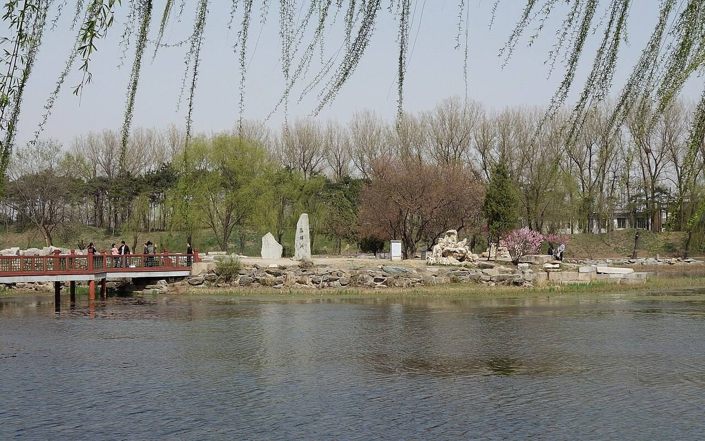
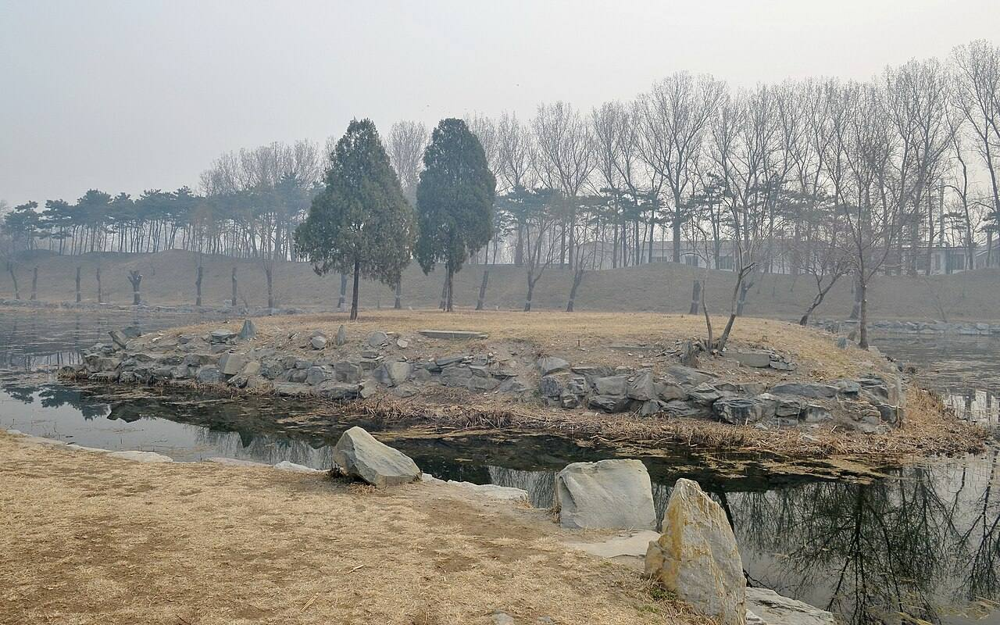
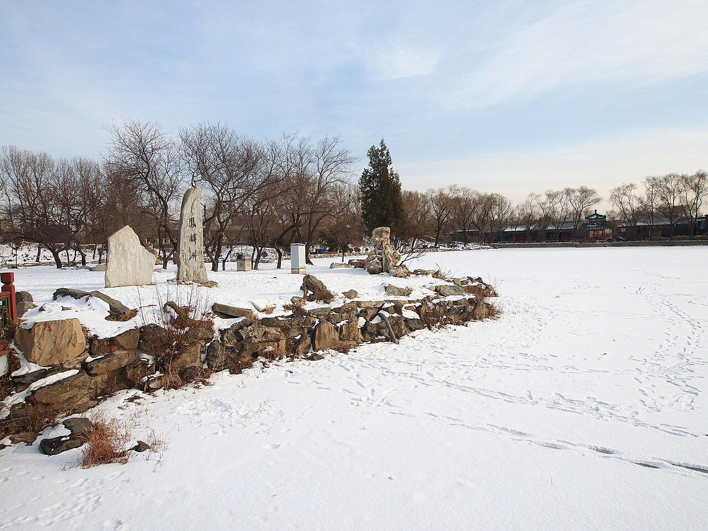
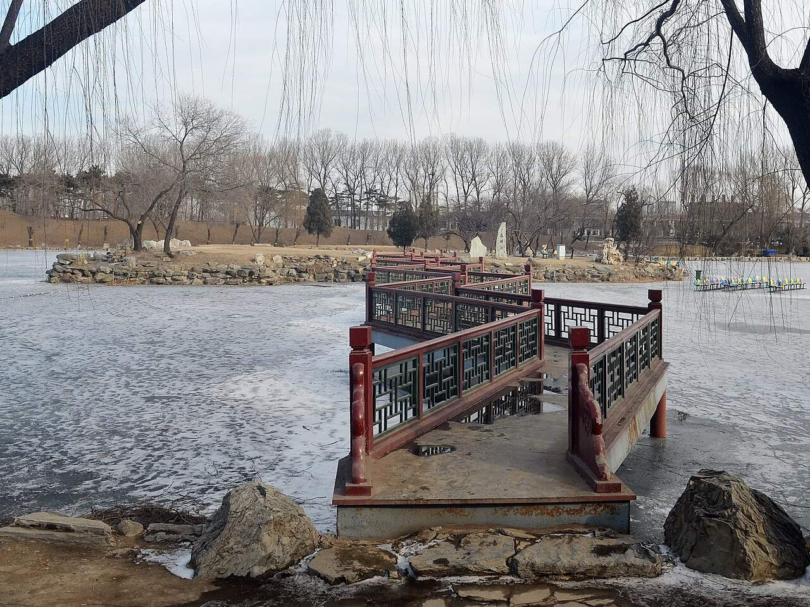

<!-- generated:start (scripts/building_pages.py): do not edit between these markers -->

# QC06: 凤麟洲 Fenglin Zhou

Qichun Yuan

**3D object:** 1 box. Open it: `/reconstruction/3d.html?b=QC06`

## What we know

- **Name:** 凤麟洲 Fenglin Zhou (S06, S42, S49, S01, S220, S339, S361 · confidence B)
- **Garden:** Qichun Yuan (S06, S42, S49, S01, S220, S339, S361)
- **Type:** compound (S06, S42, S49, S01, S220, S339, S361 · confidence B)
- **Built:** 嘉庆十二年三月 1807; 1807 (rebuilt) (S06, S42, S49, S01, S220, S339, S361)
- **Destroyed:** 1860 (S06, S42, S49, S01, S220, S339, S361)
- **Position:** 40.00364, 116.30600. S01 sure (S01 · confidence B)
- **Bays:** main hall 7 in two rolls, 5-bay front annex in the texts / 5x1 on the plan (S06, S42, S49, S01, S220, S339, S361)
- **Size in the inventory:** 35.4 × 19.0 m. S01 plan px / hall scale (S01)
- **Where the text puts it:** 仙人承露台东侧 四面环水 (S42 11467) (S06, S42, S49, S01, S220, S339, S361) *(research copy, not public)*
- **Note:** 宫廷区北 (S06). S42 survey A 区 50 x 26-48 m, B 区 24 x 22 m (modern survey extents). bays: 7 in two rolls, 5-bay annex (S361, v4 p.239). (S06, S42, S49, S01, S220, S339, S361)
- **Plan reader's note:** Island. East islet is NEW-qc-14. | plan: Label in the court south of the hall. (S01) *(research copy, not public)*
- **How it was read:** sure (S01) *(research copy, not public)*
- **Plan pixels:** 9743, 5480 (S01) *(research copy, not public)*

## Our model now

On the block drawn on the Qing plan S01: position and frontage from the plan, heights and roof from the typology of its hall class, its form drawn by the hall kit. It will be updated as the research goes on.

- **Box:** 32.37 × 16.36 m, grand hall
- **Heights:** platform 0.59 m, eave 4.76 m, ridge 10.54 m above the ground
- **Roof:** hip-and-gable 歇山, rolled ridge 卷棚, grey tile
- **Faces:** 171.2° from north
- **Fit:** reduced towards the size drawn on the plan, to stand clear of its neighbours or the water
- **Drawn:** by the hall kit: 5 bays, the middle widest, a porch all round, steps on the front, right, 歇山 hip-and-gable with a rolled ridge 卷棚, grey tile, bracket sets 斗拱 as a painted band. Drawn from the typology of its hall class, not from a picture of this hall (assumed, C).
- **Confidence:** B

## Inside it (2)

- QC06-N01
- QC06-N02

## Pictures (4)

- **P0436** (sure): Fenglin Islet 20130414.JPG (2013-04-14 14:27:11 (Commons DateTimeOriginal)). https://commons.wikimedia.org/wiki/File:Fenglin_Islet_20130414.JPG

  

- **P0437** (sure): Ruins of Fenglin East Islet 20130317.JPG (2013-03-17 09:18:59 (Commons DateTimeOriginal)). https://commons.wikimedia.org/wiki/File:Ruins_of_Fenglin_East_Islet_20130317.JPG

  

- **P0454** (sure): 凤麟洲 - Fenglin Islet - 2012.12 - panoramio.jpg (Taken on 21 December 2012 (Commons DateTimeOriginal)). https://commons.wikimedia.org/wiki/File:%E5%87%A4%E9%BA%9F%E6%B4%B2_-_Fenglin_Islet_-_2012.12_-_panoramio.jpg

  

- **P0502** (sure): Ruins of Fenglin Islet 20130201.JPG (2013-02-01 14:28:32 (Commons DateTimeOriginal)). https://commons.wikimedia.org/wiki/File:Ruins_of_Fenglin_Islet_20130201.JPG

  

## Texts and drawings (31)

- **E0606** (poem, likely): 嘉庆 《题清夏斋》 自注 (as quoted in S220). 嘉庆九年 1804 (S220) · S220 section 一; primary not seen · S220. http://iqh.ruc.edu.cn/old/qdhjylyjzx/xszl/ylfj/00baad8cc3da4c6a901378da7919d9a8.htm
  > 是斋在西爽村，原额‘凤麟洲’本非宸翰所题，曾经皇考赐成亲王居此。
  Jiaqing's note: the studio stands in 西爽村; its old plaque read 凤麟洲, not in an imperial hand, and the Qianlong emperor had given it to Prince Cheng. So the name 凤麟洲 first belonged here, before the later island QC06 of 1807.
- **E0448** (text, likely): 《養吉齋叢錄》 on 綺春園 and the Thirty Scenes. Qing; text states events up to 文宗 · 卷十八 leaf 4 (archive.org 02096508.cn image n52-n53) · S223. https://archive.org/details/02096508.cn/page/n52
  > 綺春園在圓明園東，有複道相屬。舊為大學士傅恆及其子大學士福康安賜園，歿後繳進，嘉慶間始加繕葺。仁宗御製綺春園三十景詩，有宣宗恭跋：先是，園西南以繚垣別界一區，名含暉園，莊敬和碩公主釐降時，賜居於此。公主薨逝，額駙索特那木多布齋以園繳進。舊又橫界一區，名西爽村，有聯暉樓，為成邸寓園。嘉慶間成邸別賜園宅，西爽、含暉皆併入為一園，而規模宏遠矣。舊有數楹名鳳麐洲，後易名清夏齋；問月樓在洲之南，鏡綠亭在洲之北。道光時為尊養孝和皇太后之所，正殿曰迎暉殿。文宗登極，奉康慈太后亦居此，問安視膳，皆如道光間禮。三十景者：敷春堂　鑑德書屋　翠合軒　凌虛閣　協性齋　澄光榭　問月樓　我見室　蔚藻堂　藹芳圃　鏡綠亭　淙玉軒　舒卉軒　竹林院　夕霏榭　清夏齋　鏡虹館　春雨山房　含光樓（即舊時聯暉樓）　涵清館　華滋庭　苔香室　虛明鏡　含淳堂　春澤齋　水心榭　四宜書屋　茗柯精舍　來薰室　般若觀
  The earliest list of the Thirty Scenes we can see, and the history before it seems to come from Daoguang's colophon to Jiaqing's poem set (有宣宗恭跋). It places 問月樓 south of 洲 and 鏡綠亭 north of it, names 迎暉殿 as the main hall of the dowager's residence, and equates 含光樓 with the old 聯暉樓. Punctuation is ours; the print has none. Transcribed by eye.
- **E0630** (poem, sure): 凤麟洲: 嘉庆十一年 poem of the Jiaqing Emperor. 嘉庆十一年 (1806), date from the compilation · p.302 item (1), under 凤麟洲 · S360. https://www.yuanmingyuanpark.cn/xs/yjbg/202007/P020200730387572832602.pdf#page=302
  > 导堙开旧沼，秋水漾清池。轩榭额仍昔，凤麟景擅奇。虚明百顷挹，凉燠四时宜。层叠浮青嶂，周围印碧漪。枫屏绘崖壁，雁字写川湄。一目天光迥，半窗旭影移。拈题有所得，即境独含思。秦汉求无已，蓬瀛孰见之。诞词真刺谬，妄念动愚痴。漫植三株树，谁餐九叶芝。迷途去不反，正道见难期。图治祛邪诡，荡平臻皞熙。
  Poem of 1806 on the newly finished island: an old pool re-dug, old plaque names kept, maple cliffs and hills reflected.
- **E0631** (poem, sure): 凤麟洲. 嘉庆十二年 (1807) · v4 p.241, under 凤麟洲; source ref 3-349 · S361. https://www.yuanmingyuanpark.cn/xs/yjbg/202008/P020200803382796786124.pdf#page=244
  > 平湖扬清风，纱疏纳新爽。锦漪漾轻纹，霞光印晃朗。远汀茂林围，鸣蝉送繁响。静觉烦暑消，心神乐安养。古书默探寻，稍助知识广。学问总无停，加益善日长。
  Poem 凤麟洲 by the Jiaqing Emperor, 1807, filed by the editors under 凤麟洲.
- **E0632** (poem, sure): 凤麟洲. 嘉庆十二年 (1807) · v4 p.241, under 凤麟洲; source ref 3-350 · S361. https://www.yuanmingyuanpark.cn/xs/yjbg/202008/P020200803382796786124.pdf#page=244
  > 避暑无踰此，芳洲舟可通。回廊环曲折，虚牖启玲珑。庭印一奁镜，窗含四面风。远峰清影蘸，茂树碧阴充。月问南楼上，亭开北渚崇。虹桥连岸右，松嶂峙池东。胜境诚难绘，游心兴岂穷。建新仍旧境，尚俭念卑宫。问月楼，在洲之南。镜绿亭，在洲之北。
  Poem 凤麟洲 by the Jiaqing Emperor, 1807, filed by the editors under 凤麟洲.
- **E0633** (poem, sure): 凤麟洲. 嘉庆十二年 (1807) · v4 p.242, under 凤麟洲; source ref 3-357 · S361. https://www.yuanmingyuanpark.cn/xs/yjbg/202008/P020200803382796786124.pdf#page=245
  > 南园避暑最佳处，境届秋初景益清。湖影澄青浮岛屿，林光澹碧荫轩楹。荷汀掩映云霞绕，苇岸微茫鸥鹭盟。爽籁披襟庭院迥，漪澜溶漾印空明。
  Poem 凤麟洲 by the Jiaqing Emperor, 1807, filed by the editors under 凤麟洲.
- **E0634** (poem, sure): 凤麟洲: 嘉庆十二年 poem of the Jiaqing Emperor. 嘉庆十二年 (1807), date from the compilation · p.302 item (2), under 凤麟洲 · S360. https://www.yuanmingyuanpark.cn/xs/yjbg/202007/P020200730387572832602.pdf#page=302
  > 达士能安常，哲人贵知止。御极抚万方，宅心凛顾諟。莫为天下先，妄念不可起。静待事几来，澄中观至理。平易近众情，大道无奇诡。题额屏痴愚，三山隔弱水。
  Poem of the Jiaqing Emperor at 凤麟洲, 1807, on the view. Year as given by the compilation.
- **E0635** (poem, sure): 凤麟洲: 嘉庆十二年 poem of the Jiaqing Emperor. 嘉庆十二年 (1807), date from the compilation · p.302 item (3), under 凤麟洲 · S360. https://www.yuanmingyuanpark.cn/xs/yjbg/202007/P020200730387572832602.pdf#page=302
  > 平湖飏清风，纱疏纳新爽。锦漪漾轻纹，霞光印晃朗。远汀茂林围，鸣蝉送繁响。静觉烦暑消，心神乐安养。古书默探寻，稍助知识广。学问总无停，加益善日长。
  Poem of the Jiaqing Emperor at 凤麟洲, 1807, on escaping the heat. Year as given by the compilation.
- **E0636** (poem, sure): 凤麟洲: 嘉庆十二年 poem of the Jiaqing Emperor. 嘉庆十二年 (1807), date from the compilation · p.302 item (4), under 凤麟洲 · S360. https://www.yuanmingyuanpark.cn/xs/yjbg/202007/P020200730387572832602.pdf#page=302
  > 避暑无逾此，芳洲舟可通。回廊环曲折，虚牖启玲珑。庭印一奁镜，窗含四面风。远峰清影蘸，茂树碧阴充。月问南楼上，亭开比渚崇（问月楼在洲之南，镜绿亭在洲之北）。虹桥连岸右， 松嶂峙池东。胜境诚难绘，游心兴岂穷。建新仍旧境，尚俭念卑宫。
  Jiaqing describes the island in 1807: reachable by boat, winding galleries, a court pool, a rainbow bridge, a pine crag east; his note puts 问月楼 south and 镜绿亭 north of the island, which fits the 敷春堂 group lying south of it. Built new on the old site, and frugally, he says.
- **E0638** (poem, sure): 凤麟洲: 嘉庆十三年 poem of the Jiaqing Emperor. 嘉庆十三年 (1808), date from the compilation · p.303 item (5), under 凤麟洲 · S360. https://www.yuanmingyuanpark.cn/xs/yjbg/202007/P020200730387572832602.pdf#page=303
  > 玉结南湖暎空碧，光凝洲屿渺无迹。氷床试放饮绿亭，宛如行车乘石陌。琉璃世界仙馆开，窗明几净澄纎埃。旭暎松崖荫满砌，雪含春泽香盈梅。蓬莱何有原寓意，一停念旰图郅治。翔凤游麟漫征祥，稔岁安民诚上瑞。
  Jiaqing, 1808, on the frozen lake: an ice sled at the pavilion 饮绿亭 and pine cliffs, with a plain moral about the name.
- **E0424** (text, sure): 绮春园记 (Jiaqing). 嘉庆十四年以后 (after 1809), per the editors · v4 p.191, 二集 · S361. https://www.yuanmingyuanpark.cn/xs/yjbg/202008/P020200803382796786124.pdf#page=194
  > 圆明、长春二园之东南，即绮春园。名虽三而实则一，中有门墙之隔耳。斯园先名交辉，为怡贤亲王赐邸，又改赐傅恒。及福隆安呈进后，蒙皇考定名绮春。遂开通门径，西达秀清村，东接蒨园，豁然贯通矣。顾年久荒废，殿宇间有倾圮，湖泊亦多淤垫，丹雘剥落，基址湫湿。爰自嘉庆六年驻跸御园之后，暇时临莅，弗适于怀。每岁修理一二处，屏绝藻绘，惟尚朴淳。花木遂其地产之茂蕃，溪山趁其天成之幽秀。园境较圆明园仅十分之三，而别有结构自然之妙趣。虽荆关大手笔，未能窥其津涯。而云林小景，亦颇有可观之道也。盖地灵境胜，必有时而显晦。萍水相逢，何莫非因缘所感召乎。正觉寺东，建立园门。殿额“勤政”，承皇考敬勤庶政之大法。作奕叶云，仍之继绍，触目警心，慎终始怀，永图之至理也。东偏为心镜轩，澄濬心源，镜辉朗徹，不以浮尘掩本性之真常。渐瑧充实而有光辉之境，固所愿也。北即敷春堂，春者，仁也，物之生也。上天敷春而生庶物，人君敷仁而育万民，德至大也。西为清夏斋，殿宇宏敞，池水澄洁，有修竹数竿，苍松百尺，薰风南来，悠然自得，何时能使官民浃洽，中夏澄清，阜财解愠，熙皞康和，庶酬考眷于万一焉。后湖东偏即涵秋馆，万宝告成，百昌蕃茂。生于春，长于夏，成于秋，宰制庶物，涵育群生，实天地之常经，古今之通义也。别有虚榭回廊、板桥曲沼，可达生冬室。敬绎圣制生冬诗题奥旨，因以名室。夫贞下起元，一阳来复，万物始生，皆基于冬也。予半枢机，葭灰黍谷，循环不息，资始资生，德至矣哉。人君调元赞化，和燮四时，肃乂符而百谷实，阴阳序而两仪顺，建极中和，体天育物。故堂斋馆室，以春夏秋冬命名之意，念兹在兹，不敢怠忽。岂玩日愒时，只图四时佳致，水木清华乎。西偏为四宜书屋，四序咸宜，八方永泰，庶几感召和甘，岁稔民安可望矣。北有小岛，结构层楼，远仿嘉兴，近规塞苑，额题“烟雨”。叶时若之休征，窗对峰峦，览周原之胜概。几暇登临，抒怀抱而寄吟思，信可乐也。园北平湖百顷，碧浪涵空，远印西山，近连太液，洲屿掩映，花木回环。殿宇五楹，高深明达，楣梠额曰“凤麟洲”，予别有会心焉。人君御极，抚绥区夏，养心图治，无欲为本，远屏声色货利之邪径，绝无好大喜功之妄念，鄙求仙之荒诞，斥长生之瞽说。惟一念守成，兢兢业业，不敢暇逸，强勉敬勤，庶几臻于小康之治。宋儒云：“无欲则静虚动直”，诚嘉言也。在上位者，果能无欲，天下亿兆之福也。予修葺斯园，皆因地建造。物给价，工给值，穷黎赖以谋食，所费皆出内帑，毫不取诸外库，诚一举而两得矣。敬读圣制《知过论》，心有所萦系，必有所疏忽，曷敢不恪守先言。萦系于小，转疏忽于大乎。凛然自勉，实自箴也。况已臻伯玉知非之年，唯益求久安长治之理，何暇燕游林泉佳境，稍懈勤政爱民之要道哉。是为记。
  Jiaqing's essay on the garden, 1809 or later. It tells the garden's history, and walks it: the gate east of 正觉寺, 心镜轩, 敷春堂, 清夏斋, 涵秋馆, 生冬室, 四宜书屋, the tower 烟雨楼 on an islet, 凤麟洲. He stresses plain work paid from the privy purse.
- **E0640** (poem, sure): 凤麟洲: 嘉庆十四年 poem of the Jiaqing Emperor. 嘉庆十四年 (1809), date from the compilation · p.303 item (6), under 凤麟洲 · S360. https://www.yuanmingyuanpark.cn/xs/yjbg/202007/P020200730387572832602.pdf#page=303
  > 和蔼晴波印碧流，南湖放棹溯芳洲。东崖幽秀平林接，西渚嵯峨远岭浮。心赏岂耽宫室美，德修庶冀凤麟游。卷阿胜境娱清睱，知命观生不妄求。
  Poem of the Jiaqing Emperor at 凤麟洲, 1809, on boating. Year as given by the compilation.
- **E0641** (poem, sure): 凤麟洲: 嘉庆十四年 poem of the Jiaqing Emperor. 嘉庆十四年 (1809), date from the compilation · p.303 item (7), under 凤麟洲 · S360. https://www.yuanmingyuanpark.cn/xs/yjbg/202007/P020200730387572832602.pdf#page=303
  > 甘雨透滋亩亩充，麦登禾长近天中。授时沐泽占逢稔，怀古临风漫吊忠。节度例陈九龙泛，心期乐与万方同。君舟民水臣操檝，共济感酬考眷隆。
  Jiaqing, 1809: princes, Grand Secretaries and Hanlin officials rowed round 福海 and 凤麟洲 at the wheat harvest.
- **E0642** (poem, sure): 凤麟洲: 嘉庆十五年 poem of the Jiaqing Emperor. 嘉庆十五年 (1810), date from the compilation · p.303 item (8), under 凤麟洲 · S360. https://www.yuanmingyuanpark.cn/xs/yjbg/202007/P020200730387572832602.pdf#page=303
  > 漪澜四面绕芳洲，杨柳堤边试放舟。芬漾荷汀盖遥立，风来桐院叶初浮。气清绿野全无暑，云凈青霄已报秋。自愧治民才德薄，奚能感召凤麟游。
  Poem of the Jiaqing Emperor at 凤麟洲, 1810, on the view. Year as given by the compilation.
- **E0643** (poem, sure): 凤麟洲: 嘉庆十九年 poem of the Jiaqing Emperor. 嘉庆十九年 (1814), date from the compilation · p.303 item (9), under 凤麟洲 · S360. https://www.yuanmingyuanpark.cn/xs/yjbg/202007/P020200730387572832602.pdf#page=303
  > 一湖新水漾清涟，缓放兰桡芳渚前。目极山延楼外绘，坐游身在镜中天。柔苞红坼桃舒颊，弱缕青梳柳起眠。弭棹仙洲探静赏，绮春胜㮣付吟笺。
  Poem of the Jiaqing Emperor at 凤麟洲, 1814, on boating. Year as given by the compilation.
- **E0644** (poem, sure): 凤麟洲: 嘉庆二十一年 poem of the Jiaqing Emperor. 嘉庆二十一年 (1816), date from the compilation · p.303 item (10), under 凤麟洲 · S360. https://www.yuanmingyuanpark.cn/xs/yjbg/202007/P020200730387572832602.pdf#page=303
  > 年丰俗正瑞方真，德薄奚能致凤麟。念典无为先寡欲，守成有本在依仁。宅心端谨永刚健，妄合刀圭鄙汉秦。能者养之理精粹，自求多勉修身。
  Poem of the Jiaqing Emperor at 凤麟洲, 1816, on the view. Year as given by the compilation.
- **E0645** (poem, sure): 凤麟洲: 嘉庆二十三年 poem of the Jiaqing Emperor. 嘉庆二十三年 (1818), date from the compilation · p.303 item (11), under 凤麟洲 · S360. https://www.yuanmingyuanpark.cn/xs/yjbg/202007/P020200730387572832602.pdf#page=303
  > 石矶缓放木兰舟，系缆桥东泊碧洲。日印波光叠鳞灿，风摇柳影漾丝柔。窗中列岫云容薄，槛外方亭松荫幽。题额凤麟勉修德，爱民养福自心求。
  Poem of the Jiaqing Emperor at 凤麟洲, 1818, on boating. Year as given by the compilation.
- **E0646** (poem, sure): 凤麟洲: 道光三年 poem of the Daoguang Emperor. 道光三年 (1823), date from the compilation · p.303 item (12), under 凤麟洲 · S360. https://www.yuanmingyuanpark.cn/xs/yjbg/202007/P020200730387572832602.pdf#page=303
  > 非尚来游凤与麟，湖光山色景斯真。阴阴绿荫藏黄鸟，淼淼清波跃锦鳞。坐爱虚窗生爽籁，行看静境屏嚣尘。抚时念切农功急，伫望甘霖远近均。
  Poem of the Daoguang Emperor at 凤麟洲, 1823, on the view. Year as given by the compilation.
- **E0647** (poem, sure): 凤麟洲: 咸丰六年 poem of the Xianfeng Emperor. 咸丰六年 (1856), date from the compilation · p.303 item (13), under 凤麟洲 · S360. https://www.yuanmingyuanpark.cn/xs/yjbg/202007/P020200730387572832602.pdf#page=303
  > 对时育物匪求仙，面面清流足旷然。郊棷祥微符圣德，丕基敬绍宝惟贤。
  Poem of the Xianfeng Emperor at 凤麟洲, 1856, on the view. Year as given by the compilation.
- **E0637** (poem, likely): 凤麟洲对雨. 嘉庆十二年 (1807) · v4 p.241, under 凤麟洲; source ref 3-354 · S361. https://www.yuanmingyuanpark.cn/xs/yjbg/202008/P020200803382796786124.pdf#page=244
  > 时行应律除炎暵，酝酿高空沛泽饶。雨注云浓风荐爽，窗虚庭敞暑全消。檐端银箭千条挂，水面骊珠百斛跳。嘉澍霏甘乐酣畅，郊原遥识溉禾苗。
  Poem 凤麟洲对雨 by the Jiaqing Emperor, 1807, filed by the editors under 凤麟洲.
- **E0639** (poem, likely): 游凤麟洲即景. 嘉庆十三年 (1808) · v4 p.242, under 凤麟洲; source ref 4-4 · S361. https://www.yuanmingyuanpark.cn/xs/yjbg/202008/P020200803382796786124.pdf#page=245
  > 玉结南湖映空碧，光凝洲屿渺无迹。冰床试放饮绿亭，宛如行车乘石陌。琉璃世界仙馆开，窗明几净澄纤埃。旭映松崖荫满砌，雪含春泽香盈梅。蓬莱何有原寓意，一念宵旰图郅治。翔凤游麟漫徵祥，稔岁安民诚上瑞。
  Poem 游凤麟洲即景 by the Jiaqing Emperor, 1808, filed by the editors under 凤麟洲.
- **E1011** (description, sure): Site status table, about 2011: nothing visible, or built over. c. 2011 · 系列06 repost, status table · S356. https://blog.sina.com.cn/s/blog_c27029650101itzz.html
  Same table. In it the first group shows no visible remains; 得全阁, 流香渚, 凤麟洲, 涵秋馆, 蔚藻堂, 中和堂, 敷春堂 and 心镜轩 have service buildings on them, and 含晖楼, 澄心堂, 延寿寺, 清夏堂 and 喜雨山房 are occupied by other institutions. 澹泊宁静 and several others have been dug since, so this is out of date for them.
- **E0524** (description, sure): 张宝章: Qichun Yuan under Jiaqing and Daoguang. 《圆明园研究》第32期 · sections 三, 四 · S224. https://www.yuanmingyuanpark.cn/ymyyj/yj032/201504/t20150420_693218.html
  Axis from the great gate in the south-east: 勤政殿, 中和堂, 敷春堂, up to 问月楼 on the lake shore. In the north a large water split by a causeway, with 凤麟洲 on an island in the east part; south of the small western lake 展诗应律, 庄严法界, 生冬室, 春泽斋, 四宜书屋. On two southern islands 畅和堂 and 绿满轩, with 澄心堂 between 畅和堂 and 正觉寺. This also gives QC09 庄严法界 a rough position (Q11).
- **E0650** (description, sure): 圆明园凤麟洲形象的多重书写. post n.d. · lswh · S337. http://iqh.ruc.edu.cn/old/qdhjylyjzx/xszl/jzys/fb6feabf3f58483d83d7ca68c0303b5b.htm
  Through imperial poems, 凤麟洲 as a summer retreat, an immortals' isle and a place of omens, with the emperor's concern for farming.
- **E0651** (description, sure): 老北京的记忆(90): 绮春园凤麟洲遗址, quoting 百景图志 and 何重义, 曾昭奋. blog · post 90 · S339. https://blog.sina.com.cn/s/blog_88741e0d0102wgse.html
  Two islands, 3,800 m2 and 1,150 m2 of buildings; main hall on the west island, seven bays in two rolls with a five-bay front annex, facing 绣漪轩; service court on the east. Rebuilt 1807. Dowagers' summer rooms. Also a dated note of 1860: on 18 October officials could not reach the site because the garden was being set on fire. The only access was by water.
- **E0660** (description, likely): 涵秋馆 and 仙人承露台: park page. 2011 post · t20110105_231481 · S227. https://www.yuanmingyuanpark.cn/cgll/zyjd/qcy/201101/t20110105_231481.html
  A north-south island, lake east and north, facing 凤麟洲 to the east, planted for autumn colour. The hall stands in the north: south-facing double 工-plan, front and rear halls of seven bays with galleries, rockwork fountain between, fed by a raised tank east of the wall. A five-bay covered bridge to the west. East of the hill, 仙人承露台: bronze figure with a dew plate on a rock terrace, figure lost; round stone base now in 中山公园; 1989 stone copy. Site bars reuse: facts only.
- **E0648** (description, sure): 圆明园百景史事分景汇编: 凤麟洲. 1806-1856 · from p.302, under 凤麟洲 · S360. https://www.yuanmingyuanpark.cn/xs/yjbg/202007/P020200730387572832602.pdf#page=302
  Island reached by boat. Jiaqing's poems (1806 on) describe an old pool re-dug with the old plaque names kept, winding galleries, a court pool, a pine crag to the east and a rainbow bridge; a note of 1807 names 问月楼 and 镜绿亭 as its neighbours across the water. Princes and Hanlin officials were rowed here in 1809. 凤麟洲: 13 dated items, 1806-1856, of which 13 poems (Jiaqing, Daoguang, Xianfeng); recurring themes: the view, boating, escaping the heat. First dated 1806, last dated 1856.
- **E0506** (description, sure): 圆明园五朝御制诗文集注 v4, editors' note on 绮春园. 2020 edition · v4 p.170 · S361. https://www.yuanmingyuanpark.cn/xs/yjbg/202008/P020200803382796786124.pdf#page=173
  Formed from princes' and ministers' gardens, about 54.3 ha. Taken back from Fuheng's heirs and renamed in 1769; gate, tiger-stone wall and 正觉寺 added by 1773, rebuilt in 1795. Jiaqing's growth came in three stages: the western and central groups of the Thirty Scenes first, then the new gate and eastern scenes, finally the south-west (招凉榭, 湛清轩, 畅和堂, 澄心堂, the shrines), gathered as a New Twenty Scenes.
- **E0649** (description, sure): 圆明园五朝御制诗文集注 v4, editors' note on 凤麟洲. 2020 edition · v4 p.239 · S361. https://www.yuanmingyuanpark.cn/xs/yjbg/202008/P020200803382796786124.pdf#page=242
  Two islands joined by a winding bridge, begun 1807. Main hall seven bays in two rolls with a five-bay annex, an open hall 绣漪轩 before it, a side court east, a service court on the small east island. On another island to the north is the double-eaved square 浩然亭, and beyond it the gate to 长春园.
- **E0652** (archaeology, sure): 圆明园凤麟洲保护工程考古勘探报告. survey 2007 · mhymy dasl/11467, free part only · S155. https://www.mhymy.com/dasl/11467.html
  Survey by 北京市文物研究所, June-July 2007. East of 仙人承露台, water on all sides, stone-edged. Area A about 50 by 26-48 m, 1690 m2; area B 24 by 22 m, 445 m2. Later layers are paywalled.
- **E0653** (archaeology, sure): 圆明园凤麟洲保护工程考古勘探报告, 北京市文物研究所. 2007-06 to 07 · mhymy 11467, free part · S155. https://www.mhymy.com/dasl/11467.html
  Survey in advance of a conservation project at the island site 凤麟洲 Fenglin Zhou, all water around and stone-lined: area A about 1,690 m2 (50 m long, 26-48 m wide), area B about 445 m2 (24 x 22 m). Results paywalled.

**On the plan:** Drawn on the plan of the gardens (S01), labelled 凤麟洲, 5x1 cells. https://artmuseum.princeton.edu/collections/objects/138657

## Reconstructions by others (2)

Modern interpretation, not evidence.
- **R0024** (render, sure, search index only): [清华]凤麟洲. 清华大学建筑学院 郭黛姮 team (site tag "[清华]"), 清华大学 (as tagged "[清华]" on mhymy; the site does not state more in what was seen). https://www.mhymy.com/szfy/13421.html Research-only: link card.
- **R0266** (video, guess): 爆肝20亿 token，只想带你走进一次圆明园. 策殊丶, 2026. https://www.bilibili.com/video/BV1xQYc6AEao Research-only: link card.

## Evidence for the set of buildings

- Reconstructions and comparables for the whole garden, 绮春园 Qichun Yuan: see GARDEN-QC

## Open questions

- Q12: 敷春堂

<!-- generated:end -->

## Notes

<!-- Yours: regeneration never touches this part. It goes on the public site; what you write below a line holding only %% private %% stays in the research copy. -->
