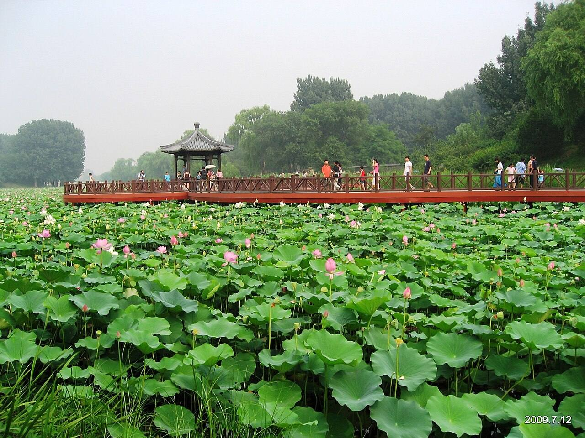
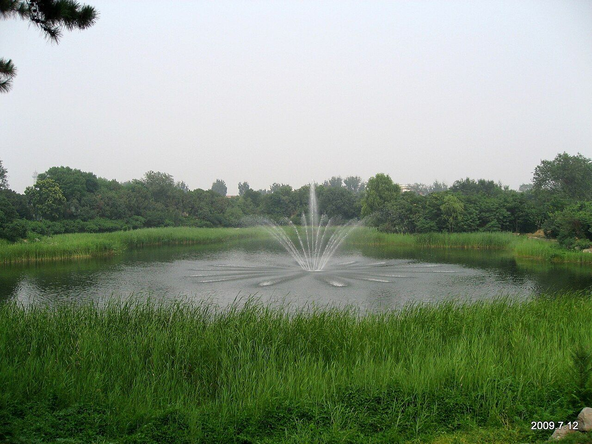

<!-- generated:start (scripts/building_pages.py): do not edit between these markers -->

# QC07: 涵秋馆 Hanqiu Guan

Qichun Yuan

**3D object:** 1 box. Open it: `/reconstruction/3d.html?b=QC07`

## What we know

- **Name:** 涵秋馆 Hanqiu Guan (S06, S42, S52, S01, S220, S227, S339, S361 · confidence B)
- **Garden:** Qichun Yuan (S06, S42, S52, S01, S220, S227, S339, S361)
- **Type:** compound (S06, S42, S52, S01, S220, S227, S339, S361 · confidence B)
- **Built:** 嘉庆十年七月 1805; added to 1809; about 1805, added 1810; early Jiaqing (S06, S42, S52, S01, S220, S227, S339, S361)
- **Destroyed:** 1860 (S06, S42, S52, S01, S220, S227, S339, S361)
- **Position:** 40.00321, 116.30456. S01 sure (S01 · confidence B)
- **Bays:** 7, double 工 plan: front and rear halls of seven bays with galleries in the texts (S06, S42, S52, S01, S220, S227, S339, S361)
- **Size in the inventory:** 31.1 × 21.1 m. S01 plan px / hall scale (S01)
- **Where the text puts it:** 仙人承露台西侧 (S42 11446) (S06, S42, S52, S01, S220, S227, S339, S361) *(research copy, not public)*
- **Note:** 四序之一. Survey 55-74 x 26-48 m (S42). bays: 7, double 工字 plan (S339, post 79). bays: 7, double 工字 (S361, v4 p.250). (S06, S42, S52, S01, S220, S227, S339, S361)
- **Plan reader's note:** Long island with hill strips to the south. S42 11446 says west of 仙人承露台: matches. | plan: South hall of the pair; label south of it. See blocks_fix. (S01) *(research copy, not public)*
- **How it was read:** sure (S01) *(research copy, not public)*
- **Plan pixels:** 9155, 5665 (S01) *(research copy, not public)*

## Our model now

On the block drawn on the Qing plan S01: position and frontage from the plan, heights and roof from the typology of its hall class, its form drawn by the hall kit. It will be updated as the research goes on.

- **Box:** 31.1 × 21.1 m, grand hall
- **Heights:** platform 0.59 m, eave 4.76 m, ridge 12.22 m above the ground
- **Roof:** hip-and-gable 歇山, rolled ridge 卷棚, grey tile
- **Faces:** 170.4° from north
- **Drawn:** by the hall kit: 7 bays, the middle widest, a porch all round, steps on the back, front, right, 歇山 hip-and-gable with a rolled ridge 卷棚, grey tile, bracket sets 斗拱 as a painted band. Drawn from the typology of its hall class, not from a picture of this hall (assumed, C).
- **Confidence:** B

## Inside it (2)

- QC07-B1146
- QC07-N01

## Pictures (2)

- **P0481** (guess): 圆明园 - panoramio (4).jpg (Taken on 12 July 2009 (Commons DateTimeOriginal)). https://commons.wikimedia.org/wiki/File:%E5%9C%86%E6%98%8E%E5%9B%AD_-_panoramio_(4).jpg

  

- **P0482** (guess): 圆明园 - panoramio (7).jpg (Taken on 12 July 2009 (Commons DateTimeOriginal)). https://commons.wikimedia.org/wiki/File:%E5%9C%86%E6%98%8E%E5%9B%AD_-_panoramio_(7).jpg

  

## Texts and drawings (17)

- **E0567** (text, sure): 奉派查工 内务府 呈堂稿 (as quoted in S220). 嘉庆十五年五月二十七日 1810 · S220 section 三; archive not seen · S220. http://iqh.ruc.edu.cn/old/qdhjylyjzx/xszl/ylfj/00baad8cc3da4c6a901378da7919d9a8.htm
  > 绮春园添建宫门、勤政殿、烟雨楼、涵秋馆、茂悦精舍
  Works of 1809-10. 勤政殿 is the hall later called 迎晖殿 (S224). 烟雨楼 and 茂悦精舍 have no object: a search summary of 《圆明园研究》96 places 烟雨楼 in the 喜雨山房 area (not seen).
- **E0655** (poem, sure): 涵秋馆 (绮春园三十景). 嘉庆十年 (1805) · v4 p.181, under 绮春园 · S361. https://www.yuanmingyuanpark.cn/xs/yjbg/202008/P020200803382796786124.pdf#page=184
  > 春生夏长秋成熟，旷览甫田稼穑多。别馆初开辟堂隩，卷阿新构始游歌。泬寥佳日层霄迥，澄澈云衢灏景和。浦净林疏境高朗，霞翻雁影远峰过。
  One of the Thirty Scenes of 绮春园 by the Jiaqing Emperor, 1805 (S58): the poem 涵秋馆.
- **E0657** (poem, sure): 涵秋馆. 嘉庆十一年 (1806) · v4 p.250, under 涵秋馆; source ref 3-197 · S361. https://www.yuanmingyuanpark.cn/xs/yjbg/202008/P020200803382796786124.pdf#page=253
  > 芳春敷绮甸，山馆坐佳辰。栁拓摇金线，冰开跃锦鳞。始青麦抽颖，嫩碧草铺茵。旷览阳和溥，授时东作新。趁暇寻佳胜，西窗纳远岚。山容忆秋净，花事到春酣。一室天光印，四时妙景涵。君临有致理，册府细寻探。
  Poem 涵秋馆 by the Jiaqing Emperor, 1806, filed by the editors under 涵秋馆.
- **E0658** (poem, sure): 涵秋馆. 嘉庆十一年 (1806) · v4 p.251, under 涵秋馆; source ref 3-218 · S361. https://www.yuanmingyuanpark.cn/xs/yjbg/202008/P020200803382796786124.pdf#page=254
  > 文馆新开万景涵，溪山佳妙静中探。湖光潋灔连遥渚，林影葱茏带远岚。悦性细寻芸简奥，清心试煮玉泉甘。轩楹洞达除遮蔽，欲使淳风薄海覃。
  Poem 涵秋馆 by the Jiaqing Emperor, 1806, filed by the editors under 涵秋馆.
- **E0659** (poem, sure): 涵秋馆. 嘉庆十一年 (1806) · v4 p.251, under 涵秋馆; source ref 3-223 · S361. https://www.yuanmingyuanpark.cn/xs/yjbg/202008/P020200803382796786124.pdf#page=254
  > 窗中列岫排千笏，翠霭微茫接远天。日绚彩霞辉绝壁，风翻锦縠叠长川。花芬细细来轩外，林影徐徐过槛前。静坐观生涵众妙，我心如镜物如烟。
  Poem 涵秋馆 by the Jiaqing Emperor, 1806, filed by the editors under 涵秋馆.
- **E0424** (text, sure): 绮春园记 (Jiaqing). 嘉庆十四年以后 (after 1809), per the editors · v4 p.191, 二集 · S361. https://www.yuanmingyuanpark.cn/xs/yjbg/202008/P020200803382796786124.pdf#page=194
  > 圆明、长春二园之东南，即绮春园。名虽三而实则一，中有门墙之隔耳。斯园先名交辉，为怡贤亲王赐邸，又改赐傅恒。及福隆安呈进后，蒙皇考定名绮春。遂开通门径，西达秀清村，东接蒨园，豁然贯通矣。顾年久荒废，殿宇间有倾圮，湖泊亦多淤垫，丹雘剥落，基址湫湿。爰自嘉庆六年驻跸御园之后，暇时临莅，弗适于怀。每岁修理一二处，屏绝藻绘，惟尚朴淳。花木遂其地产之茂蕃，溪山趁其天成之幽秀。园境较圆明园仅十分之三，而别有结构自然之妙趣。虽荆关大手笔，未能窥其津涯。而云林小景，亦颇有可观之道也。盖地灵境胜，必有时而显晦。萍水相逢，何莫非因缘所感召乎。正觉寺东，建立园门。殿额“勤政”，承皇考敬勤庶政之大法。作奕叶云，仍之继绍，触目警心，慎终始怀，永图之至理也。东偏为心镜轩，澄濬心源，镜辉朗徹，不以浮尘掩本性之真常。渐瑧充实而有光辉之境，固所愿也。北即敷春堂，春者，仁也，物之生也。上天敷春而生庶物，人君敷仁而育万民，德至大也。西为清夏斋，殿宇宏敞，池水澄洁，有修竹数竿，苍松百尺，薰风南来，悠然自得，何时能使官民浃洽，中夏澄清，阜财解愠，熙皞康和，庶酬考眷于万一焉。后湖东偏即涵秋馆，万宝告成，百昌蕃茂。生于春，长于夏，成于秋，宰制庶物，涵育群生，实天地之常经，古今之通义也。别有虚榭回廊、板桥曲沼，可达生冬室。敬绎圣制生冬诗题奥旨，因以名室。夫贞下起元，一阳来复，万物始生，皆基于冬也。予半枢机，葭灰黍谷，循环不息，资始资生，德至矣哉。人君调元赞化，和燮四时，肃乂符而百谷实，阴阳序而两仪顺，建极中和，体天育物。故堂斋馆室，以春夏秋冬命名之意，念兹在兹，不敢怠忽。岂玩日愒时，只图四时佳致，水木清华乎。西偏为四宜书屋，四序咸宜，八方永泰，庶几感召和甘，岁稔民安可望矣。北有小岛，结构层楼，远仿嘉兴，近规塞苑，额题“烟雨”。叶时若之休征，窗对峰峦，览周原之胜概。几暇登临，抒怀抱而寄吟思，信可乐也。园北平湖百顷，碧浪涵空，远印西山，近连太液，洲屿掩映，花木回环。殿宇五楹，高深明达，楣梠额曰“凤麟洲”，予别有会心焉。人君御极，抚绥区夏，养心图治，无欲为本，远屏声色货利之邪径，绝无好大喜功之妄念，鄙求仙之荒诞，斥长生之瞽说。惟一念守成，兢兢业业，不敢暇逸，强勉敬勤，庶几臻于小康之治。宋儒云：“无欲则静虚动直”，诚嘉言也。在上位者，果能无欲，天下亿兆之福也。予修葺斯园，皆因地建造。物给价，工给值，穷黎赖以谋食，所费皆出内帑，毫不取诸外库，诚一举而两得矣。敬读圣制《知过论》，心有所萦系，必有所疏忽，曷敢不恪守先言。萦系于小，转疏忽于大乎。凛然自勉，实自箴也。况已臻伯玉知非之年，唯益求久安长治之理，何暇燕游林泉佳境，稍懈勤政爱民之要道哉。是为记。
  Jiaqing's essay on the garden, 1809 or later. It tells the garden's history, and walks it: the gate east of 正觉寺, 心镜轩, 敷春堂, 清夏斋, 涵秋馆, 生冬室, 四宜书屋, the tower 烟雨楼 on an islet, 凤麟洲. He stresses plain work paid from the privy purse.
- **E0654** (poem, likely): 初冬涵秋馆. 嘉庆十年 (1805) · v4 p.250, under 涵秋馆; source ref 3-164 · S361. https://www.yuanmingyuanpark.cn/xs/yjbg/202008/P020200803382796786124.pdf#page=253
  > 旧里言归息六骖，恰成新馆景初探。檐楣高朗窗开八，汀屿回环径启三。霜点遥峰林滴绛，旭辉极浦水拖蓝。闾阎又届于茅候，广厦身居心实惭。
  Poem 初冬涵秋馆 by the Jiaqing Emperor, 1805, filed by the editors under 涵秋馆.
- **E0656** (poem, likely): 初秋涵秋馆. 嘉庆十一年 (1806) · v4 p.251, under 涵秋馆; source ref 3-232 · S361. https://www.yuanmingyuanpark.cn/xs/yjbg/202008/P020200803382796786124.pdf#page=254
  > 馆启芳园灏景涵，新秋延爽静因探。庭间梧叶影微飏，林际蝉鸣韵正酣。澄澈清波连极浦，泬寥高宇印遥岚。授时敬感雨旸协，万宝西成稼穑甘。
  Poem 初秋涵秋馆 by the Jiaqing Emperor, 1806, filed by the editors under 涵秋馆.
- **E0660** (description, sure): 涵秋馆 and 仙人承露台: park page. 2011 post · t20110105_231481 · S227. https://www.yuanmingyuanpark.cn/cgll/zyjd/qcy/201101/t20110105_231481.html
  A north-south island, lake east and north, facing 凤麟洲 to the east, planted for autumn colour. The hall stands in the north: south-facing double 工-plan, front and rear halls of seven bays with galleries, rockwork fountain between, fed by a raised tank east of the wall. A five-bay covered bridge to the west. East of the hill, 仙人承露台: bronze figure with a dew plate on a rock terrace, figure lost; round stone base now in 中山公园; 1989 stone copy. Site bars reuse: facts only.
- **E1011** (description, sure): Site status table, about 2011: nothing visible, or built over. c. 2011 · 系列06 repost, status table · S356. https://blog.sina.com.cn/s/blog_c27029650101itzz.html
  Same table. In it the first group shows no visible remains; 得全阁, 流香渚, 凤麟洲, 涵秋馆, 蔚藻堂, 中和堂, 敷春堂 and 心镜轩 have service buildings on them, and 含晖楼, 澄心堂, 延寿寺, 清夏堂 and 喜雨山房 are occupied by other institutions. 澹泊宁静 and several others have been dug since, so this is out of date for them.
- **E0662** (description, sure): 老北京的记忆(79): 绮春园涵秋馆与生冬室, quoting 百景图志. blog · post 79 · S339. https://blog.sina.com.cn/s/blog_88741e0d0102w3pm.html
  涵秋馆 about 1805, added 1810: a seven-bay double 工字 hall with a rockwork fountain between the halls, fed by a raised tank east. 仙人承露台 Xianren Chenglu Tai, a bronze immortal on a high platform, stands near; its base now sits in 中山公园. 生冬室 was 明善堂, then 含淳堂: seven bays with an indoor stage. Today's platform hides 涵秋馆's base.
- **E0506** (description, sure): 圆明园五朝御制诗文集注 v4, editors' note on 绮春园. 2020 edition · v4 p.170 · S361. https://www.yuanmingyuanpark.cn/xs/yjbg/202008/P020200803382796786124.pdf#page=173
  Formed from princes' and ministers' gardens, about 54.3 ha. Taken back from Fuheng's heirs and renamed in 1769; gate, tiger-stone wall and 正觉寺 added by 1773, rebuilt in 1795. Jiaqing's growth came in three stages: the western and central groups of the Thirty Scenes first, then the new gate and eastern scenes, finally the south-west (招凉榭, 湛清轩, 畅和堂, 澄心堂, the shrines), gathered as a New Twenty Scenes.
- **E0661** (description, sure): 圆明园五朝御制诗文集注 v4, editors' note on 涵秋馆. 2020 edition · v4 p.250 · S361. https://www.yuanmingyuanpark.cn/xs/yjbg/202008/P020200803382796786124.pdf#page=253
  On a long north-south island, begun early in Jiaqing's reign: a seven-bay double 工字 hall with a rock fountain between the halls and a raised tank east of the wall to feed it. It is the 'autumn' of the four season halls, with 敷春堂, 清夏斋 and 生冬室.
- **E0663** (drawing, sure, search index only): 涵秋馆地盘图. entry cites 1805 and 1810; drawing date not seen · holder not seen · S42. https://www.mhymy.com/dasl/ysltd/7704.html
  A long north-south island, about 200 by 60 m, about 1 ha, north-west of 敷春堂, lake to the east and north, with the hall in the north part.
- **E1086** (plan, sure, search index only): Yangshi Lei plan cards on 梦回圆明园: 勤政殿平面图, 西峰秀色总平面图, 安佑宫室内布置图, 映清斋平面图, 绮春园宫门区平面图, 敷春堂殿平面图, 敷春堂东南所平面图, 涵秋馆地盘图, 四宜书屋(绮春园)平面图, 河道泊岸总平面图, 长春园样式雷河道图, 西洋楼水法图, 御制廓然大公八景诗图. Qing · dasl/ysltd: 11009, 11099, 7659, 9716, 7496, 12232, 9879, 7704, 13985, 9509, 6902, 7643; dasl 11675 · S340. https://www.mhymy.com/dasl/ysltd/11009.html
  Titles seen in the index, drawings not opened. Pattern: https://www.mhymy.com/dasl/ysltd/<id>.html.
- **E0664** (archaeology, sure): 圆明园涵秋馆保护工程考古勘探报告. survey 2007 · mhymy dasl/11446, free part only · S155. https://www.mhymy.com/dasl/11446.html
  Survey 2007, west of 仙人承露台: about 55-74 by 26-48 m, 2586 m2. The intro of the free part names 曲苑风荷 by a slip; title and tags give 涵秋馆.
- **E0665** (archaeology, sure): 圆明园涵秋馆保护工程考古勘探报告. 2007-06 to 07 · mhymy 11446, free part · S155. https://www.mhymy.com/dasl/11446.html
  Survey of about 2,586 m2 at 涵秋馆 Hanqiu Guan, west of 仙人承露台, with two stone stairs in the north and west. Results paywalled. The report's introduction repeats the wording of the 曲院风荷 report, so its opening names that site in error.

**On the plan:** Drawn on the plan of the gardens (S01), labelled 涵秋馆. https://artmuseum.princeton.edu/collections/objects/138657

## Evidence for the set of buildings

- Reconstructions and comparables for the whole garden, 绮春园 Qichun Yuan: see GARDEN-QC

## Open questions

None that name it.

<!-- generated:end -->

## Notes

<!-- Yours: regeneration never touches this part. It goes on the public site; what you write below a line holding only %% private %% stays in the research copy. -->
