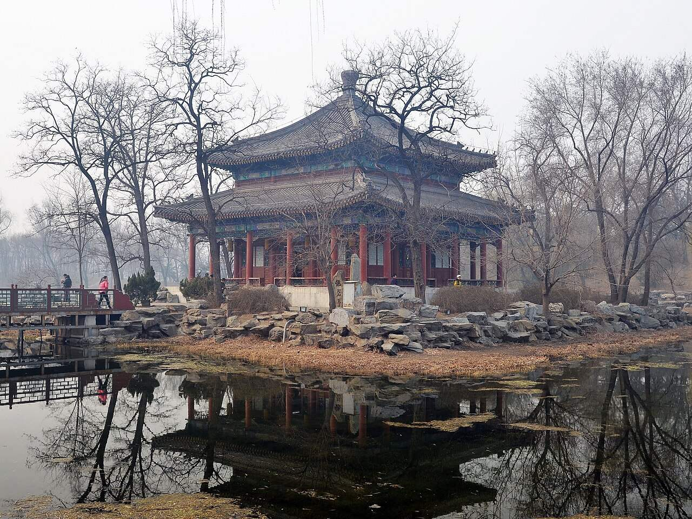
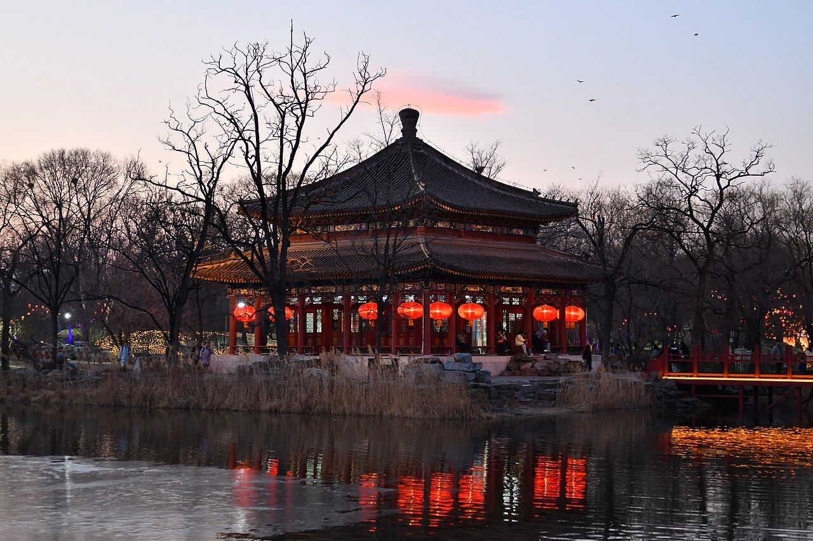
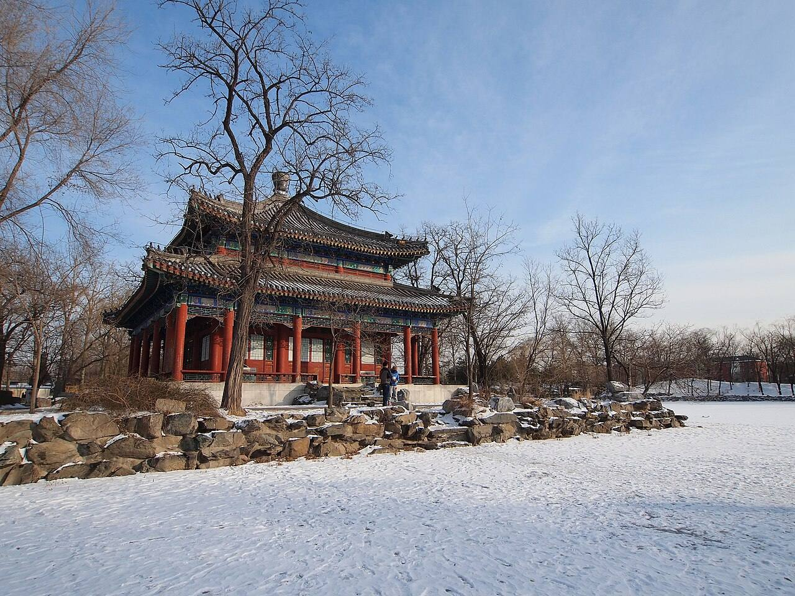
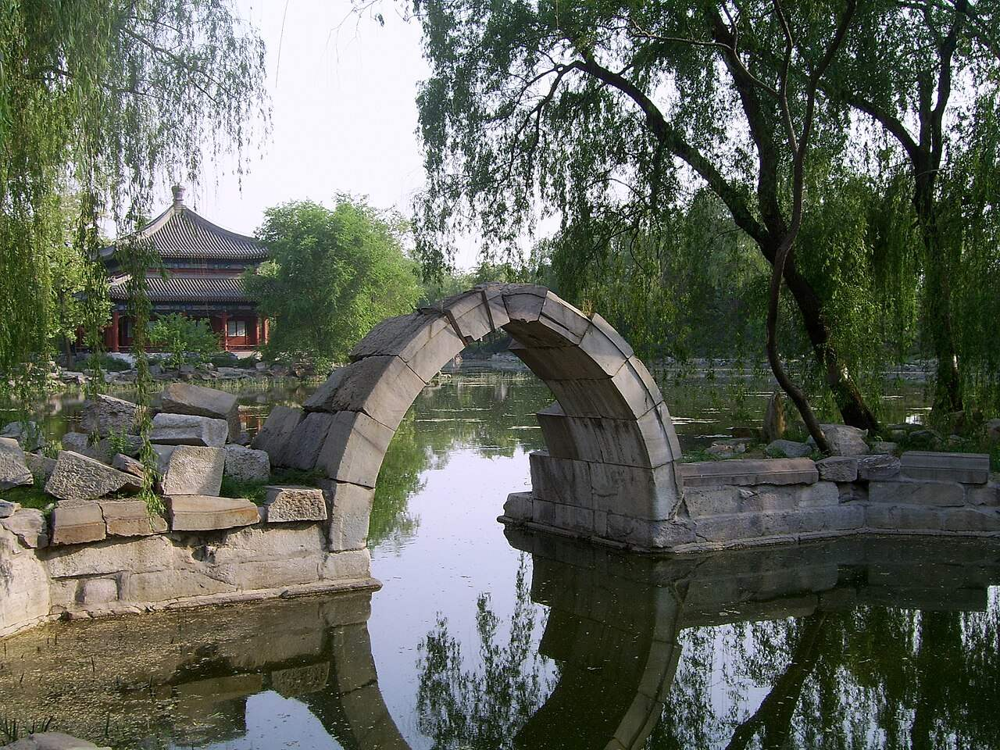

<!-- generated:start (scripts/building_pages.py): do not edit between these markers -->

# QC08: 鉴碧亭 Jianbi Ting

Qichun Yuan

**3D object:** 1 box. Open it: `/reconstruction/3d.html?b=QC08`

## What we know

- **Name:** 鉴碧亭 Jianbi Ting (S06, S49, S01, S360, S361 · confidence B)
- **Garden:** Qichun Yuan (S06, S49, S01, S360, S361)
- **Type:** pavilion (S06, S49, S01, S360, S361 · confidence B)
- **Built:** by 1811 (first dated item); mid-Jiaqing (S06, S49, S01, S360, S361)
- **Destroyed:** 1860; rebuilt modern (S06;S49) (S06, S49, S01, S360, S361)
- **Position:** 40.00005, 116.30475. S01 sure (S01 · confidence B)
- **Bays:** 4x4 on the plan (S06, S49, S01, S360, S361)
- **Size in the inventory:** 22.2 × 27.2 m. S01 plan px / hall scale (S01)
- **Where the text puts it:** 宫廷区西 (S06) (S06, S49, S01, S360, S361) *(research copy, not public)*
- **Note:** Single-arch stone bridge remains (S06). double-eaved square pavilion, three bays a side, gallery (S361, v4 p.236). (S06, S49, S01, S360, S361)
- **Plan reader's note:** Round islet, rockwork at the cardinal points, square pavilion. | plan: I count 3×3, block says 4×4. (S01) *(research copy, not public)*
- **How it was read:** sure (S01) *(research copy, not public)*
- **Plan pixels:** 9036, 7333 (S01) *(research copy, not public)*

## Our model now

On the block drawn on the Qing plan S01: position and frontage from the plan, heights and roof from the typology of its hall class, its form drawn by the hall kit. It will be updated as the research goes on.

- **Box:** 22.2 × 27.2 m, pavilion square
- **Heights:** platform 0.48 m, eave 3.68 m, ridge 8.04 m above the ground
- **Roof:** pyramid 攒尖, double eaves 重檐, grey tile
- **Faces:** 173° from north
- **Drawn:** by the hall kit: 3 bays, the middle widest, steps on the front, 攒尖 pyramid, double eaves 重檐, grey tile, a painted beam under the eave. From its own figures and readings where the dossier gives them (roof read: halls.csv S361 B), the rest from the typology of its hall class.
- **Confidence:** B

## Pictures (6)

- **P0421** (sure): Jianbi Pavilion 20130317.JPG (2013-03-17 09:37:37 (Commons DateTimeOriginal)). https://commons.wikimedia.org/wiki/File:Jianbi_Pavilion_20130317.JPG

  

- **P0422** (sure): Jianbi Pavilion 20260217.jpg (2026-02-17 18:08:48 (Commons DateTimeOriginal)). https://commons.wikimedia.org/wiki/File:Jianbi_Pavilion_20260217.jpg

  

- **P0423** (sure): 鉴碧亭 - Jianbi Pavilion - 2012.12 - panoramio.jpg (Taken on 21 December 2012 (Commons DateTimeOriginal)). https://commons.wikimedia.org/wiki/File:%E9%89%B4%E7%A2%A7%E4%BA%AD_-_Jianbi_Pavilion_-_2012.12_-_panoramio.jpg

  

- **P0424** (sure): Stone Arch Bridge in Yuanmingyuan.jpg (2007 (Commons DateTimeOriginal)). https://commons.wikimedia.org/wiki/File:Stone_Arch_Bridge_in_Yuanmingyuan.jpg

  

- **P0806** (sure): Old Summer Palace, Jianbi Pavilion 20130201.JPG (2013-02-01 14:11:19 (Commons file page)). https://commons.wikimedia.org/wiki/File:Old_Summer_Palace,_Jianbi_Pavilion_20130201.JPG
- **P0807** (sure): 鉴碧亭 - panoramio.jpg (Taken on 27 May 2011 (Commons file page)). https://commons.wikimedia.org/wiki/File:%E9%89%B4%E7%A2%A7%E4%BA%AD_-_panoramio.jpg

## Texts and drawings (17)

- **E0666** (poem, sure): 鉴碧亭: 嘉庆十六年 poem of the Jiaqing Emperor. 嘉庆十六年 (1811), date from the compilation · p.304 item (1), under 鉴碧亭 · S360. https://www.yuanmingyuanpark.cn/xs/yjbg/202007/P020200730387572832602.pdf#page=304
  > 百顷漪澜漾锦塘，方亭宛在水中央。碧莶四面环阶净，翠柳千株绕岸芳。绮縠含飔澄鉴影，金鳞映日灿霞光。除淤辟垢清波汇，疏治淮黄引兴长。
  Jiaqing, 1811: a square pavilion in the middle of a lake of a hundred qing, willows round it; mentions dredging.
- **E0667** (poem, sure): 鉴碧亭. 嘉庆十七年 (1812) · v4 p.236, under 鉴碧亭; source ref 5-143 · S361. https://www.yuanmingyuanpark.cn/xs/yjbg/202008/P020200803382796786124.pdf#page=239
  > 圆沼空明接碧浔，方亭虚敞峙湖心。松涛几阵含风爽，柳线四垂铺荫深。静对清晖叠波縠，遥传逸响奏泉琴。雅宜长夏时停楫，不受街衢炎暑侵。
  Poem 鉴碧亭 by the Jiaqing Emperor, 1812, filed by the editors under 鉴碧亭.
- **E0668** (poem, sure): 鉴碧亭: 嘉庆十八年 poem of the Jiaqing Emperor. 嘉庆十八年 (1813), date from the compilation · p.304 item (2), under 鉴碧亭 · S360. https://www.yuanmingyuanpark.cn/xs/yjbg/202007/P020200730387572832602.pdf#page=304
  > 南湖放棹漾波纹，横界石桥内外分。碧縠翻风光晃朗，金鳞叠日影纷纭。绿摇渚藻鱼时跃，翠滴堤杨蜩 巳鸣。日盼甘霖聊遣闷，赫炎旱气漫含熏。
  Poem of the Jiaqing Emperor at 鉴碧亭, 1813, on boating. Year as given by the compilation.
- **E0670** (poem, sure): 鉴碧亭: 嘉庆二十一年 poem of the Jiaqing Emperor. 嘉庆二十一年 (1816), date from the compilation · p.305 item (3), under 鉴碧亭 · S360. https://www.yuanmingyuanpark.cn/xs/yjbg/202007/P020200730387572832602.pdf#page=305
  > 佳日冲融韶序深，溯洄放棹碧溪浔。环亭澄澈开明镜，绕岸扶疎荫茂林。午旭含辉徐度砌，惠风送爽畅披襟。恬怀定志勤为政，因付自求鉴素心。
  Poem of the Jiaqing Emperor at 鉴碧亭, 1816, on escaping the heat. Year as given by the compilation.
- **E0671** (poem, sure): 鉴碧亭: 嘉庆二十二年 poem of the Jiaqing Emperor. 嘉庆二十二年 (1817), date from the compilation · p.305 item (4), under 鉴碧亭 · S360. https://www.yuanmingyuanpark.cn/xs/yjbg/202007/P020200730387572832602.pdf#page=305
  > 南湖岛屿相环抱，中峙方亭水四围。碧绕莎汀柔毯展，翠连柳岸细烟霏。泊舟揽胜逢佳日，憩榻观书映午晖。寻绎圣贤功效速，勉图鉴古有凭依。
  Jiaqing, 1817: a square pavilion among islets, water on all sides, a boat moored.
- **E0672** (poem, sure): 鉴碧亭: 嘉庆二十三年 poem of the Jiaqing Emperor. 嘉庆二十三年 (1818), date from the compilation · p.305 item (5), under 鉴碧亭 · S360. https://www.yuanmingyuanpark.cn/xs/yjbg/202007/P020200730387572832602.pdf#page=305
  > 一叶扁舟泛碧塘，虚亭宛在水中央。波纹印日金鳞叠，柳线梳风翠缕飏。远渚苍茫漾霞影，平湖潋滟接天光。芳园纳景增新润，可种黍禾候正长。
  Poem of the Jiaqing Emperor at 鉴碧亭, 1818, on the view. Year as given by the compilation.
- **E0673** (poem, sure): 鉴碧亭: 嘉庆二十四年 poem of the Jiaqing Emperor. 嘉庆二十四年 (1819), date from the compilation · p.305 item (6), under 鉴碧亭 · S360. https://www.yuanmingyuanpark.cn/xs/yjbg/202007/P020200730387572832602.pdf#page=305
  > 方亭高敞碧湖中，放棹石桥四岸通。煮茗甘芳瀹竹鼎，披襟飒爽对花宫。（亭在正觉寺东）一奁朗鉴环清溆，几叠晴霞绘远空。长夏延和莲漏永，扁舟又溯赤栏东。
  Jiaqing, 1819: boat from the stone bridge to the high square pavilion; his note places it east of 正觉寺.
- **E0674** (poem, sure): 鉴碧亭: 嘉庆二十五年 poem of the Jiaqing Emperor. 嘉庆二十五年 (1820), date from the compilation · p.305 item (7), under 鉴碧亭 · S360. https://www.yuanmingyuanpark.cn/xs/yjbg/202007/P020200730387572832602.pdf#page=305
  > 平湖环渚漾春波，弭棹方亭纳景和。绕砌新英开烂漫，拂堤嫩柳舞婆娑。柔莎映水拖青縠，远岭萦霞印翠螺。倚槛须眉清可鉴，源澄流洁会心多。
  Poem of the Jiaqing Emperor at 鉴碧亭, 1820, on the view. Year as given by the compilation.
- **E0669** (poem, likely): 南湖初秋午泛至鉴碧亭. 嘉庆二十年 (1815) · v4 p.237, under 鉴碧亭; source ref 6-142 · S361. https://www.yuanmingyuanpark.cn/xs/yjbg/202008/P020200803382796786124.pdf#page=240
  > 长天秋水澈晴空，试放兰舟碧鉴中。荷沼蒸霞红灼烁，柳汀漾绮翠玲珑。光悬远浦九霄旭，爽挹虚亭四面风。坐揽澄辉延灏景，心欣处处兆登丰。
  Poem 南湖初秋午泛至鉴碧亭 by the Jiaqing Emperor, 1815, filed by the editors under 鉴碧亭.
- **E0569** (description, sure): Site status table, about 2011: rebuilt. c. 2011 · 系列06 repost, status table · S356. https://blog.sina.com.cn/s/blog_c27029650101itzz.html
  绮春园 gate, 迎晖殿 and 鉴碧亭 rebuilt on their sites; 正觉寺 under repair at that time.
- **E0675** (description, sure): 圆明园百景史事分景汇编: 鉴碧亭. 1811-1820 · from p.304, under 鉴碧亭 · S360. https://www.yuanmingyuanpark.cn/xs/yjbg/202007/P020200730387572832602.pdf#page=304
  A square pavilion in the middle of the lake, reached by boat, with a stone bridge dividing inner and outer water (1813). A note of 1819 places it east of 正觉寺. The 1811 poem mentions dredging. 鉴碧亭: 7 dated items, 1811-1820, of which 7 poems (Jiaqing); recurring themes: the view, boating, escaping the heat. First dated 1811, last dated 1820.
- **E0506** (description, sure): 圆明园五朝御制诗文集注 v4, editors' note on 绮春园. 2020 edition · v4 p.170 · S361. https://www.yuanmingyuanpark.cn/xs/yjbg/202008/P020200803382796786124.pdf#page=173
  Formed from princes' and ministers' gardens, about 54.3 ha. Taken back from Fuheng's heirs and renamed in 1769; gate, tiger-stone wall and 正觉寺 added by 1773, rebuilt in 1795. Jiaqing's growth came in three stages: the western and central groups of the Thirty Scenes first, then the new gate and eastern scenes, finally the south-west (招凉榭, 湛清轩, 畅和堂, 澄心堂, the shrines), gathered as a New Twenty Scenes.
- **E0676** (description, sure): 圆明园五朝御制诗文集注 v4, editors' note on 鉴碧亭. 2020 edition · v4 p.236 · S361. https://www.yuanmingyuanpark.cn/xs/yjbg/202008/P020200803382796786124.pdf#page=239
  Begun in mid-Jiaqing on an islet in the lake west of 迎晖殿, with 正觉寺 to its west: a double-eaved square pavilion, three bays a side, gallery round. On the north of the islet is the five-bay 天心水面 with annexes, and a pavilion 玩鹤. A single-arch stone bridge to the north-east still stands.
- **E2137** (description, likely, search index only): 圆明园水利文物遗迹研究. n.d. · mhymy xsjl 6277, search-index text · S349. https://www.mhymy.com/xsjl/6277.html
  Inventory of water works: the 藻园 one-arch inlet, main source, now buried under the wall and undug; 黄花阵 inlet with good piers; 鉴碧亭 sluice, abandoned 2007; 狮子林 七孔闸, chief outlet, buried in the 2000s behind a new weir with only a stub showing; west water tower fed from a three-arch inlet.
- **E0791** (archaeology, likely): 圆明园天心水面保护工程考古勘探报告. survey 2007 · mhymy dasl/11480, free part only · S155. https://www.mhymy.com/dasl/11480.html
  Survey 2007, north of 鉴碧亭, water on all sides, edged with stone, three rock piles: 43-86 by 12-81 m, 5872 m2.
- **E0686** (archaeology, likely): 圆明园正觉寺北湖遗址考古勘探报告. survey 2009 · mhymy dasl/11669, free part only · S155. https://www.mhymy.com/dasl/11669.html
  Survey May 2009: the old lake north of the temple wall, east to the west shore of the 鉴碧亭 lake, west to the east shore of 湛清轩. Its tags name an old bridge and a channel. It places QC11, QC08 and QC16 around one water.
- **E0687** (archaeology, likely): 圆明园正觉寺北湖遗址考古勘探报告. 2009-05-02 to 09 · mhymy 11669, free part · S155. https://www.mhymy.com/dasl/11669.html
  Survey of a lake north of 正觉寺 Zhengjue Si, bounded by the temple's north wall, the west shore of 鉴碧亭's lake and the east shore of 湛清轩. Results paywalled.

**On the plan:** Drawn on the plan of the gardens (S01), labelled 鉴碧亭, 4x4 cells. https://artmuseum.princeton.edu/collections/objects/138657

## Reconstructions by others (3)

Modern interpretation, not evidence.
- **R0303** (paper figure, sure): Fig. 4, rehabilitation of "Jian bi" Pavilion 鉴碧亭. Xiaoqi J., Tsinghua Heritage Institute For Digitization, 2015. https://isprs-annals.copernicus.org/articles/II-5-W3/351/2015/
- **R0124** (drawing, sure): Abb. 34, 鉴碧亭 Jianbi Ting (Szene 308), Lage und Grundriss; Abb. 35, today's rebuilding. Shuang Zhang, TU Berlin, 2004. https://doi.org/10.14279/depositonce-566 Research-only: link card.
- **R0022** (render, sure, search index only): [清华]鉴碧亭. 清华大学建筑学院 郭黛姮 team (site tag "[清华]"), 清华大学 (as tagged "[清华]" on mhymy; the site does not state more in what was seen). https://www.mhymy.com/szfy/13405.html Research-only: link card.

## Evidence for the set of buildings

- Reconstructions and comparables for the whole garden, 绮春园 Qichun Yuan: see GARDEN-QC

## Open questions

- Q8: Known errors of S01
- Q44: Places in Qichun Yuan
- Q161: Shizhao's Flickr photo 200707 圆明园 038 (754223912, CC BY 2.0) shows a rock carved 展詩應律

<!-- generated:end -->

## Notes

<!-- Yours: regeneration never touches this part. It goes on the public site; what you write below a line holding only %% private %% stays in the research copy. -->
