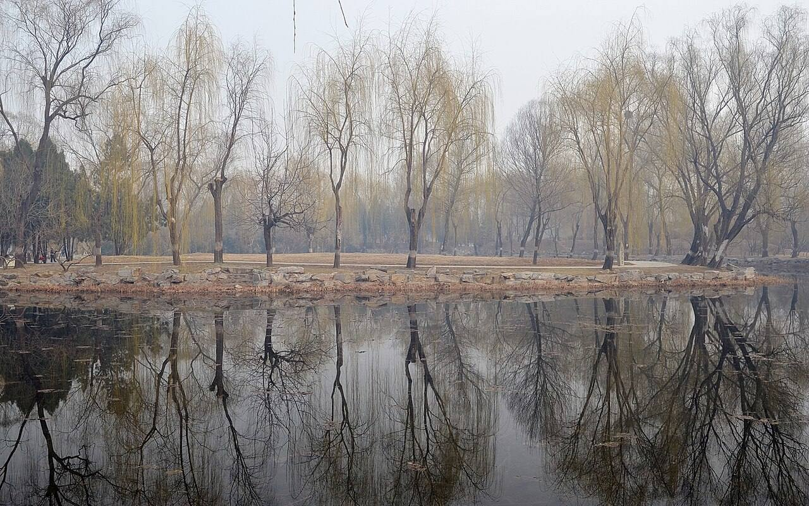
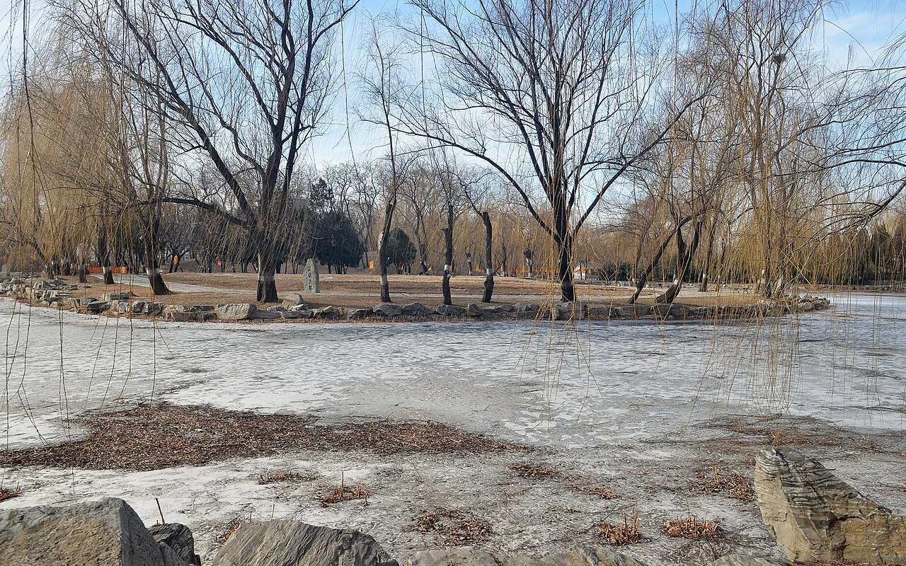

<!-- generated:start (scripts/building_pages.py): do not edit between these markers -->

# QC09: 庄严法界 Zhuangyan Fajie

Qichun Yuan

**3D object:** none yet.

## What we know

- **Name:** 庄严法界 Zhuangyan Fajie (S06, S47, S49, S339 · confidence B)
- **Garden:** Qichun Yuan (S06, S47, S49, S339)
- **Type:** temple (S06, S47, S49, S339 · confidence B)
- **Destroyed:** survived 1860 per the 1873 survey (S06;S49); 1900, not 1860 (S06, S47, S49, S339)
- **Position:** Not placed: the name was not found on the plan.
- **Bays:** front and rear halls 5 each in the texts (S06, S47, S49, S339)
- **Note:** Buddhist (S47). Position: plan readers. (S06, S47, S49, S339)
- **Plan reader's note:** Unlabelled on S01. Read every label in x 5300-10600, y 4650-8700 on 1x tiles and zoomed crops; this name does not appear. Text gives no position. Weak candidate only: walled court B1135 B1163, see NEW-qc-13. S49 lead says it survived 1860. (S01) *(research copy, not public)*
- **How it was read:** not_found (S01) *(research copy, not public)*

## Our model now

No box in the 3D view: the plan shows no building here, or a plot, water, a hill or a name only.

## Pictures (2)

- **P0425** (sure): Ruins of Zhuangyan fajie 20130317.JPG (2013-03-17 08:51:09 (Commons DateTimeOriginal)). https://commons.wikimedia.org/wiki/File:Ruins_of_Zhuangyan_fajie_20130317.JPG

  

- **P0504** (sure): Ruins of Zhuangyan fajie 20130201.JPG (2013-02-01 14:20:15 (Commons DateTimeOriginal)). https://commons.wikimedia.org/wiki/File:Ruins_of_Zhuangyan_fajie_20130201.JPG

  

## Texts and drawings (6)

- **E0677** (text, sure): 内务府 repair list 乾隆五十五年 (as quoted in S220). 乾隆五十五年 1790 · S220 section 三; archive not seen · S220. http://iqh.ruc.edu.cn/old/qdhjylyjzx/xszl/ylfj/00baad8cc3da4c6a901378da7919d9a8.htm
  > 课花所后照房一座三间，庄严界圆亭一座
  庄严界 had a round pavilion. Reads as an early form of 庄严法界 QC09. Round plan is a form hint for the model.
- **E0451** (text, sure): 圆明园遗址的遗产价值与申遗构想: the buildings left after 1860, citing 刘敦桢 1933. post n.d. · ylfj, note 34: 刘敦桢, 同治重修圆明园史料, 营造学社汇刊 1933(2) · S337. http://iqh.ruc.edu.cn/old/qdhjylyjzx/xszl/ylfj/9a322b5384ab4c17af0dd577d4f96ca6.htm
  Lists 17 buildings left after the burning of 1860, after 刘敦桢: 紫碧山房, 顺木天, 鱼跃鸢飞, 课农轩, 藏舟坞, 慎修思永, 知过堂, 双鹤斋, 蓬岛瑶台, 魁星楼, 文昌阁, 林渊锦镜, 春雨轩; 海岳开襟; 庄严法界, 正觉寺 and a 大宫门 in 万春园. The paper's aim is to hold any new display to this 1860 state.
- **E0497** (description, sure): 绮春园 after 1860, yaffin 系列15. c. 2011 · blog, lead only · S356. https://blog.sina.com.cn/s/blog_65fec3ab0100sxa7.html
  Lead: says the gate district, 庄严法界, 惠济祠, 湛清轩 and 绿满轩 survived in 1860, the garden was renamed 万春园 under Tongzhi, and was destroyed in 1900, with only 正觉寺 standing. The south gate dates from 1809 and 新宫门 is its later name. Unverified compilation.
- **E1011** (description, sure): Site status table, about 2011: nothing visible, or built over. c. 2011 · 系列06 repost, status table · S356. https://blog.sina.com.cn/s/blog_c27029650101itzz.html
  Same table. In it the first group shows no visible remains; 得全阁, 流香渚, 凤麟洲, 涵秋馆, 蔚藻堂, 中和堂, 敷春堂 and 心镜轩 have service buildings on them, and 含晖楼, 澄心堂, 延寿寺, 清夏堂 and 喜雨山房 are occupied by other institutions. 澹泊宁静 and several others have been dug since, so this is out of date for them.
- **E0524** (description, sure): 张宝章: Qichun Yuan under Jiaqing and Daoguang. 《圆明园研究》第32期 · sections 三, 四 · S224. https://www.yuanmingyuanpark.cn/ymyyj/yj032/201504/t20150420_693218.html
  Axis from the great gate in the south-east: 勤政殿, 中和堂, 敷春堂, up to 问月楼 on the lake shore. In the north a large water split by a causeway, with 凤麟洲 on an island in the east part; south of the small western lake 展诗应律, 庄严法界, 生冬室, 春泽斋, 四宜书屋. On two southern islands 畅和堂 and 绿满轩, with 澄心堂 between 畅和堂 and 正觉寺. This also gives QC09 庄严法界 a rough position (Q11).
- **E0771** (description, sure): 老北京的记忆(78): 绮春园展诗应律与庄严法界, quoting 百景图志. blog · post 78 · S339. https://blog.sina.com.cn/s/blog_88741e0d0102w3l2.html
  展诗应律 Zhanshi Yinglü, by 1801, a five-bay theatre hall facing a stage for the dowager, first used so in 1823; island farmland in the 1950s, then a stable. 庄严法界 Zhuangyan Fajie, a small temple, also labelled 慈慧禅林, survived 1860 under guard and was destroyed in 1900; site cleared 1992.

## Reconstructions by others (1)

Modern interpretation, not evidence.
- **R0311** (paper figure, guess): 从《春和园纪游诗》论绮春园的早期历史风貌: plan 样101-7 《清夏斋》 read as the early 春和园. . http://iqh.ruc.edu.cn/old/qdhjylyjzx/xszl/ylfj/143ef8cac193488089ad8d164e2ec3d5.htm Research-only: link card.

## Evidence for the set of buildings

- Reconstructions and comparables for the whole garden, 绮春园 Qichun Yuan: see GARDEN-QC

## Open questions

- Q11: Qichun Yuan's thirty scenes

<!-- generated:end -->

## Notes

<!-- Yours: regeneration never touches this part. It goes on the public site; what you write below a line holding only %% private %% stays in the research copy. -->
