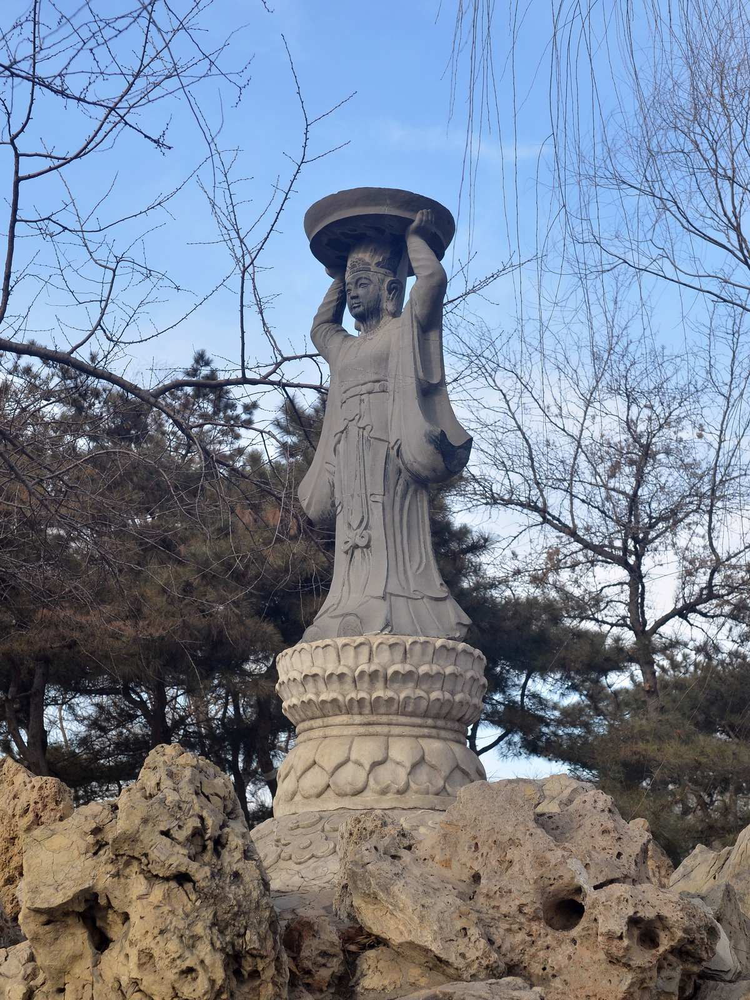

<!-- generated:start (scripts/building_pages.py): do not edit between these markers -->

# QC10: 仙人承露台 Xianren Chenglu Tai

Qichun Yuan

**3D object:** 1 box. Open it: `/reconstruction/3d.html?b=QC10`

## What we know

- **Name:** 仙人承露台 Xianren Chenglu Tai (S42, S49, S01, S227 · confidence B)
- **Garden:** Qichun Yuan (S42, S49, S01, S227)
- **Type:** other (S42, S49, S01, S227 · confidence B)
- **Changed:** Round carved stone 须弥座 moved to 中山公园, still there; bronze figure lost; 1989 black stone copy on the terrace (S42, S49, S01, S227)
- **Destroyed:** modern 重制 (S49) (S42, S49, S01, S227)
- **Position:** 40.00330, 116.30484. S01 likely (S01 · confidence B)
- **Bays:** 1x1 on the plan (S42, S49, S01, S227)
- **Size in the inventory:** 16.7 × 9.1 m. S01 plan px / hall scale (S01)
- **Where the text puts it:** 涵秋馆东 凤麟洲西 (S42) (S42, S49, S01, S227) *(research copy, not public)*
- **Note:** Rixia silent; no pre-1860 text found. Present statue modern. Unverified for 1860. (S42, S49, S01, S227)
- **Plan reader's note:** No label. A rectangular stepped platform ringed with rockwork at (9268,5615), east of 涵秋馆 and west of 凤麟洲 as S42 says. Polygon = east tip of the island, with a rock mound and hexagonal pavilion at (9385,5490). | plan: rect=30,70,0. Stepped rectangular platform inside rockwork. No label. (S01) *(research copy, not public)*
- **How it was read:** likely (S01) *(research copy, not public)*
- **Plan pixels:** 9268, 5615 (S01) *(research copy, not public)*

## Our model now

On the block drawn on the Qing plan S01: position and frontage from the plan, heights and roof from the typology of its hall class, its form drawn by the hall kit. It will be updated as the research goes on.

- **Box:** 16.7 × 9.1 m, main hall
- **Heights:** platform 0.7 m, eave 4.4 m, ridge 7.52 m above the ground
- **Roof:** hip-and-gable 歇山, rolled ridge 卷棚, grey tile
- **Faces:** 89° from north
- **Drawn:** by the hall kit: 5 bays, the middle widest, a porch front and back, steps on the front, left, 歇山 hip-and-gable with a rolled ridge 卷棚, grey tile, a painted beam under the eave. Drawn from the typology of its hall class, not from a picture of this hall (assumed, C).
- **Confidence:** B

## Inside it (1)

- QC10-N01

## Pictures (1)

- **P0426** (sure): Xianren Chenglu 20130201.JPG (2013-02-01 14:27:38 (Commons DateTimeOriginal)). https://commons.wikimedia.org/wiki/File:Xianren_Chenglu_20130201.JPG

  

## Texts and drawings (5)

- **E0660** (description, sure): 涵秋馆 and 仙人承露台: park page. 2011 post · t20110105_231481 · S227. https://www.yuanmingyuanpark.cn/cgll/zyjd/qcy/201101/t20110105_231481.html
  A north-south island, lake east and north, facing 凤麟洲 to the east, planted for autumn colour. The hall stands in the north: south-facing double 工-plan, front and rear halls of seven bays with galleries, rockwork fountain between, fed by a raised tank east of the wall. A five-bay covered bridge to the west. East of the hill, 仙人承露台: bronze figure with a dew plate on a rock terrace, figure lost; round stone base now in 中山公园; 1989 stone copy. Site bars reuse: facts only.
- **E0662** (description, sure): 老北京的记忆(79): 绮春园涵秋馆与生冬室, quoting 百景图志. blog · post 79 · S339. https://blog.sina.com.cn/s/blog_88741e0d0102w3pm.html
  涵秋馆 about 1805, added 1810: a seven-bay double 工字 hall with a rockwork fountain between the halls, fed by a raised tank east. 仙人承露台 Xianren Chenglu Tai, a bronze immortal on a high platform, stands near; its base now sits in 中山公园. 生冬室 was 明善堂, then 含淳堂: seven bays with an indoor stage. Today's platform hides 涵秋馆's base.
- **E0678** (description, sure, search index only): 仙人承露台须弥座. not seen · mhymy ymss/jcww/14583 · S42. https://www.mhymy.com/ymss/jcww/14583.html
  Built under Jiaqing, east of the rockery of 涵秋馆, on the west shore of the 凤麟洲 lake. The bronze figure is lost; the park made a black stone copy in 1989. Do not model the copy as period form.
- **E0652** (archaeology, likely): 圆明园凤麟洲保护工程考古勘探报告. survey 2007 · mhymy dasl/11467, free part only · S155. https://www.mhymy.com/dasl/11467.html
  Survey by 北京市文物研究所, June-July 2007. East of 仙人承露台, water on all sides, stone-edged. Area A about 50 by 26-48 m, 1690 m2; area B 24 by 22 m, 445 m2. Later layers are paywalled.
- **E0664** (archaeology, likely): 圆明园涵秋馆保护工程考古勘探报告. survey 2007 · mhymy dasl/11446, free part only · S155. https://www.mhymy.com/dasl/11446.html
  Survey 2007, west of 仙人承露台: about 55-74 by 26-48 m, 2586 m2. The intro of the free part names 曲苑风荷 by a slip; title and tags give 涵秋馆.

**On the plan:** Its place is drawn on the plan of the gardens (S01), with no name written. https://artmuseum.princeton.edu/collections/objects/138657

## Surviving comparable buildings, not this building (1)

- **T099** 铜仙承露盘 Bronze Immortal holding a dew plate, 琼华岛 北海 Beihai. Comparable: same court, era or type, confidence B, standing: yes. Form of the figure and plinth Basis: Search summary: the plate on Qionghua Island stands among its immortal-island features. S409: bases of the 仙人承露台 from Yuanming Yuan were among stones bought in 1925 for 中央公园. https://news.bjd.com.cn/2025/12/17/11470368.shtml

## Evidence for the set of buildings

- Reconstructions and comparables for the whole garden, 绮春园 Qichun Yuan: see GARDEN-QC

## Open questions

None that name it.

<!-- generated:end -->

## Notes

<!-- Yours: regeneration never touches this part. It goes on the public site; what you write below a line holding only %% private %% stays in the research copy. -->
