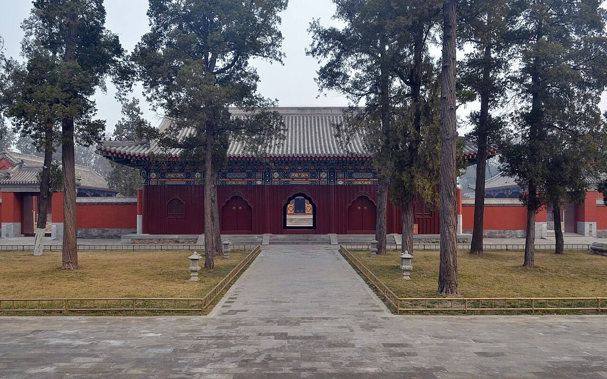

<!-- generated:start (scripts/building_pages.py): do not edit between these markers -->

# QC11-02: 天王殿 Tianwang Dian

Qichun Yuan

**3D object:** 1 box. Open it: `/reconstruction/3d.html?b=QC11-02`

**Part of:** QC11 正觉寺

## What we know

- **Name:** 天王殿 Tianwang Dian (S49, S01, S221, S228 · confidence B)
- **Garden:** Qichun Yuan (S49, S01, S221, S228)
- **Type:** temple (S49, S01, S221, S228 · confidence B)
- **Destroyed:** not burnt 1860 (S49) (S49, S01, S221, S228)
- **Position:** 39.99880, 116.30351. S01 likely (S01 · confidence B)
- **Bays:** 5 in the texts / 4x2 on the plan (S49, S01, S221, S228)
- **Size in the inventory:** 14.8 × 8.5 m. S01 plan px / hall scale (S01)
- **Note:** after1860: survived 1860 and 1900; wholly or partly destroyed in the 20th century; rebuilt 2009-11 (S228, section 长期被占损毁严重 and 专家论证绘图复原). (S49, S01, S221, S228)
- **Plan reader's note:** No label; next hall on the axis. (S01) *(research copy, not public)*
- **How it was read:** likely (S01) *(research copy, not public)*
- **Plan pixels:** 8477, 7780 (S01) *(research copy, not public)*

## Our model now

A plain box on the block drawn on the Qing plan S01: position and frontage from the plan, heights and roof from the typology of its hall class. It will be updated as the research goes on.

- **Box:** 14.8 × 8.5 m, side hall
- **Heights:** platform 0.54 m, eave 3.64 m, ridge 6.82 m above the ground
- **Roof:** gable 硬山 or 悬山, rolled ridge 卷棚, grey tile
- **Faces:** 171° from north
- **Confidence:** B

## Pictures (1)

- **P0429** (sure): 正觉寺天王殿 20130317.JPG (2013-03-17 08:24:42 (Commons DateTimeOriginal)). https://commons.wikimedia.org/wiki/File:%E6%AD%A3%E8%A7%89%E5%AF%BA%E5%A4%A9%E7%8E%8B%E6%AE%BF_20130317.JPG

  

## Texts and drawings (2)

- **E0681** (description, sure): 正觉寺: plan, halls and furnishing. reprint 2021; 《圆明园研究》第5期 · section 四 · S221. http://iqh.ruc.edu.cn/old/qdhjylyjzx/xszl/lswh/f8d06436b9d444f98d64cdd88753acef.htm
  Faces south, five halls on the axis: gate of three bays with Qianlong's four-language plaque, bell and drum towers, five-bay 天王殿, seven-bay 三圣殿 on a stone terrace, 文殊亭, seven-bay 最上楼; a monks' yard of 8 buildings and 22 bays on the east. The only temple in the three gardens run by lamas. Furnishing comes mostly from 金勋's unpublished 成府村志.
- **E0683** (description, sure): 藏传佛教与圆明园正觉寺. post n.d. · lswh · S337. http://iqh.ruc.edu.cn/old/qdhjylyjzx/xszl/lswh/f8d06436b9d444f98d64cdd88753acef.htm
  正觉寺 Zhengjue Si, built 1773-74 as a Tibetan Buddhist temple with a 达喇嘛 and 40 lamas sent from 宝谛寺. Walks through its halls with 金勋's account of the five colours of Buddhas in 最上楼.

**On the plan:** Drawn on the plan of the gardens (S01) with no label, 4x2 cells: a building stood here, its name unknown. https://artmuseum.princeton.edu/collections/objects/138657

## Evidence for the set of buildings

- Evidence for the whole compound 正觉寺: see QC11
- Reconstructions and comparables for the whole garden, 绮春园 Qichun Yuan: see GARDEN-QC
- Standing buildings comparable to a side hall (not this building): see CLASS-side_hall

## Open questions

None that name it.

<!-- generated:end -->

## Notes

<!-- Yours: regeneration never touches this part. It goes on the public site; what you write below a line holding only %% private %% stays in the research copy. -->
