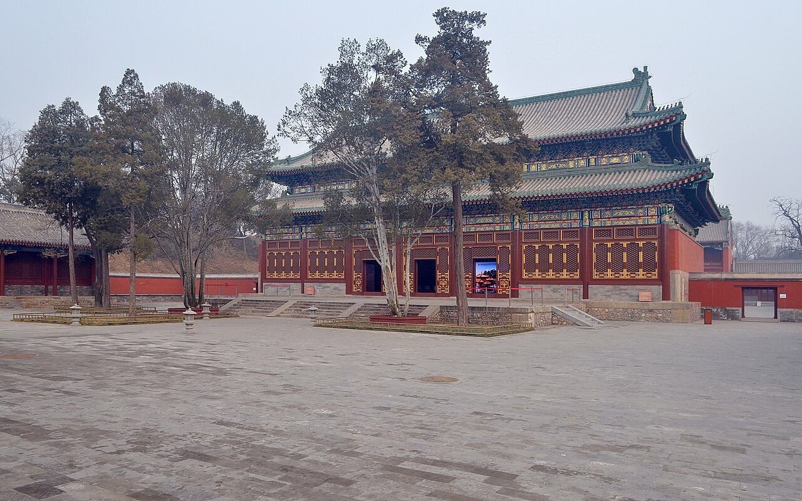

<!-- generated:start (scripts/building_pages.py): do not edit between these markers -->

# QC11-03: 三圣殿 Sansheng Dian

Qichun Yuan

**3D object:** 1 box. Open it: `/reconstruction/3d.html?b=QC11-03`

**Part of:** QC11 正觉寺

## What we know

- **Name:** 三圣殿 Sansheng Dian (S49, S01, S221, S228 · confidence B)
- **Garden:** Qichun Yuan (S49, S01, S221, S228)
- **Type:** temple (S49, S01, S221, S228 · confidence B)
- **Destroyed:** not burnt 1860 (S49) (S49, S01, S221, S228)
- **Position:** 39.99924, 116.30340. S01 likely (S01 · confidence B)
- **Bays:** 7, three deep, galleries front and back, three-bay rear annex in the texts / 6x4 on the plan (S49, S01, S221, S228)
- **Size in the inventory:** 22.0 × 33.2 m. S01 plan px / hall scale (S01)
- **Note:** after1860: gone by 1933; rebuilt 2009-11 on its Qing column bases, Sumeru base and lower walls (S228, sections 长期被占损毁严重, 复建从何而起). (S49, S01, S221, S228)
- **Plan reader's note:** No label. Label 正觉寺 south of it. (S01) *(research copy, not public)*
- **How it was read:** likely (S01) *(research copy, not public)*
- **Plan pixels:** 8480, 7598 (S01) *(research copy, not public)*

## Our model now

A plain box on the block drawn on the Qing plan S01: position and frontage from the plan, heights and roof from the typology of its hall class. It will be updated as the research goes on.

- **Box:** 22 × 33.2 m, temple hall
- **Heights:** platform 1.4 m, eave 7 m, ridge 15.5 m above the ground
- **Roof:** hip-and-gable 歇山, double eaves 重檐, grey tile
- **Faces:** 172.6° from north
- **Confidence:** B

## Pictures (1)

- **P0428** (sure): 正觉寺三圣殿 20130317.jpg (2013-03-17 08:27:06 (Commons DateTimeOriginal)). https://commons.wikimedia.org/wiki/File:%E6%AD%A3%E8%A7%89%E5%AF%BA%E4%B8%89%E5%9C%A3%E6%AE%BF_20130317.jpg

  

## Texts and drawings (3)

- **E0679** (description, sure): 正觉寺 after 1860 and its repair. 2011 · whole article · S228. https://www.chinanews.com/cul/2011/07-07/3163991.shtml
  14,300 m2 site, 3,649 m2 of buildings. It survived 1860 and 1900; later a private villa, staff housing of Tsinghua, then factories. 三圣殿 and others were lost. Repair and rebuilding began 2002, trial opening 6 July 2011. So the 三圣殿 standing today is a rebuild, not period fabric.
- **E0681** (description, sure): 正觉寺: plan, halls and furnishing. reprint 2021; 《圆明园研究》第5期 · section 四 · S221. http://iqh.ruc.edu.cn/old/qdhjylyjzx/xszl/lswh/f8d06436b9d444f98d64cdd88753acef.htm
  Faces south, five halls on the axis: gate of three bays with Qianlong's four-language plaque, bell and drum towers, five-bay 天王殿, seven-bay 三圣殿 on a stone terrace, 文殊亭, seven-bay 最上楼; a monks' yard of 8 buildings and 22 bays on the east. The only temple in the three gardens run by lamas. Furnishing comes mostly from 金勋's unpublished 成府村志.
- **E0684** (drawing, likely, search index only): 正觉寺正觉殿装修尺寸图样. not seen · not seen · S42. https://www.mhymy.com/dasl/ysltd/7355.html
  Interior-fitting dimensions of the main hall. The page calls it 正觉殿; S221 and the plan call it 三圣殿.

**On the plan:** Drawn on the plan of the gardens (S01) with no label, 6x4 cells: a building stood here, its name unknown. https://artmuseum.princeton.edu/collections/objects/138657

## Evidence for the set of buildings

- Evidence for the whole compound 正觉寺: see QC11
- Reconstructions and comparables for the whole garden, 绮春园 Qichun Yuan: see GARDEN-QC
- Standing buildings comparable to a temple hall (not this building): see CLASS-temple_hall

## Open questions

None that name it.

<!-- generated:end -->

## Notes

<!-- Yours: regeneration never touches this part. It goes on the public site; what you write below a line holding only %% private %% stays in the research copy. -->
