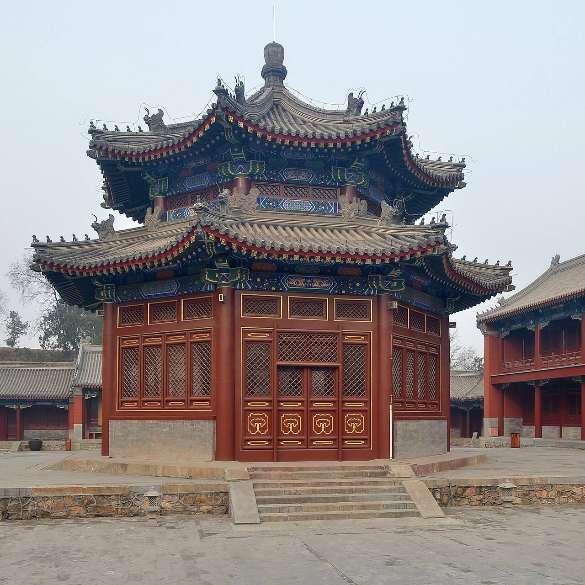

<!-- generated:start (scripts/building_pages.py): do not edit between these markers -->

# QC11-04: 文殊亭 Wenshu Ting

Qichun Yuan

**3D object:** 1 box. Open it: `/reconstruction/3d.html?b=QC11-04`

**Part of:** QC11 正觉寺

## What we know

- **Name:** 文殊亭 Wenshu Ting (S49, S01, S221 · confidence B)
- **Garden:** Qichun Yuan (S49, S01, S221)
- **Type:** temple (S49, S01, S221 · confidence B)
- **Destroyed:** not burnt 1860 (S49) (S49, S01, S221)
- **Position:** 39.99950, 116.30332. S01 likely (S01 · confidence B)
- **Bays:** 1x1 on the plan (S49, S01, S221)
- **Size in the inventory:** 7.2 × 9.1 m. S01 plan px / hall scale (S01)
- **Note:** 八方重檐 (S49); 文殊 statue over 2 zhang. octagonal; double eaves in Qianlong's time, single eaves on the survivor (S221) (S221, section 四). (S49, S01, S221)
- **Plan reader's note:** rect=30,30,0. Octagon drawn, matches 八方重檐亭 in lead 5910f5. (S01) *(research copy, not public)*
- **How it was read:** likely (S01) *(research copy, not public)*
- **Plan pixels:** 8468, 7477 (S01) *(research copy, not public)*

## Our model now

A plain box on the block drawn on the Qing plan S01: position and frontage from the plan, heights and roof from the typology of its hall class. It will be updated as the research goes on.

- **Box:** 7.2 × 9.1 m, pavilion square
- **Heights:** platform 0.48 m, eave 3.68 m, ridge 7.03 m above the ground
- **Roof:** pyramid 攒尖, grey tile
- **Faces:** 172.9° from north
- **Confidence:** B

## Pictures (2)

- **P0231** (sure): 正觉寺文殊亭内文殊菩萨全身照片 (1920 and 1920年代, both on S229). https://www.yuanmingyuanpark.cn/xw/202102/t20210225_4454127.html Research-only: link card.
- **P0430** (sure): Eight-sided Pavillion of Manjusri 20130317.jpg (2013-03-17 08:37:44 (Commons DateTimeOriginal)). https://commons.wikimedia.org/wiki/File:Eight-sided_Pavillion_of_Manjusri_20130317.jpg

  

## Texts and drawings (2)

- **E0681** (description, sure): 正觉寺: plan, halls and furnishing. reprint 2021; 《圆明园研究》第5期 · section 四 · S221. http://iqh.ruc.edu.cn/old/qdhjylyjzx/xszl/lswh/f8d06436b9d444f98d64cdd88753acef.htm
  Faces south, five halls on the axis: gate of three bays with Qianlong's four-language plaque, bell and drum towers, five-bay 天王殿, seven-bay 三圣殿 on a stone terrace, 文殊亭, seven-bay 最上楼; a monks' yard of 8 buildings and 22 bays on the east. The only temple in the three gardens run by lamas. Furnishing comes mostly from 金勋's unpublished 成府村志.
- **E0683** (description, sure): 藏传佛教与圆明园正觉寺. post n.d. · lswh · S337. http://iqh.ruc.edu.cn/old/qdhjylyjzx/xszl/lswh/f8d06436b9d444f98d64cdd88753acef.htm
  正觉寺 Zhengjue Si, built 1773-74 as a Tibetan Buddhist temple with a 达喇嘛 and 40 lamas sent from 宝谛寺. Walks through its halls with 金勋's account of the five colours of Buddhas in 最上楼.

**On the plan:** Drawn on the plan of the gardens (S01) with no label, 1x1 cells: a building stood here, its name unknown. https://artmuseum.princeton.edu/collections/objects/138657

## Evidence for the set of buildings

- Evidence for the whole compound 正觉寺: see QC11
- Reconstructions and comparables for the whole garden, 绮春园 Qichun Yuan: see GARDEN-QC
- Standing buildings comparable to a square pavilion (not this building): see CLASS-pavilion_square

## Open questions

None that name it.

<!-- generated:end -->

## Notes

<!-- Yours: regeneration never touches this part. It goes on the public site; what you write below a line holding only %% private %% stays in the research copy. -->
