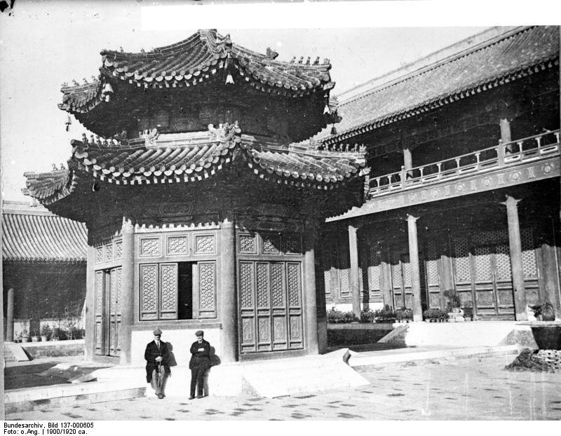
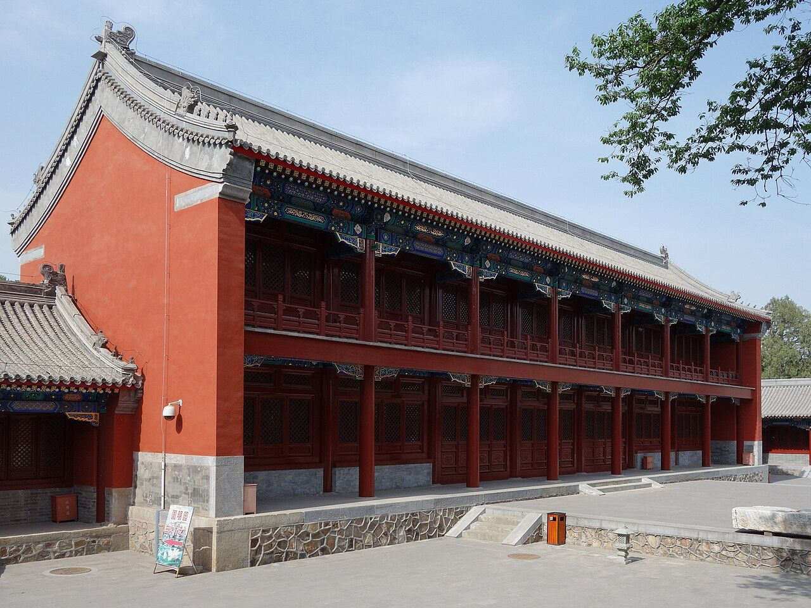

<!-- generated:start (scripts/building_pages.py): do not edit between these markers -->

# QC11-05: 最上楼 Zuishang Lou

Qichun Yuan

**3D object:** 1 box. Open it: `/reconstruction/3d.html?b=QC11-05`

**Part of:** QC11 正觉寺

## What we know

- **Name:** 最上楼 Zuishang Lou (S49, S01, S221 · confidence B)
- **Garden:** Qichun Yuan (S49, S01, S221)
- **Type:** tower (S49, S01, S221 · confidence B)
- **Destroyed:** not burnt 1860 (S49) (S49, S01, S221)
- **Position:** 39.99975, 116.30329. S01 likely (S01 · confidence B)
- **Bays:** 7, with three-bay side halls east and west in the texts / 12x1 on the plan (S49, S01, S221)
- **Size in the inventory:** 51.9 × 15.7 m. S01 plan px / hall scale (S01)
- **Note:** 后楼七间 (S49). (S49, S01, S221)
- **Plan reader's note:** Central 7 bays match 后楼七间 in lead 5910f5. Side parts = 顺山殿. (S01) *(research copy, not public)*
- **How it was read:** likely (S01) *(research copy, not public)*
- **Plan pixels:** 8470, 7368 (S01) *(research copy, not public)*

## Our model now

On the block drawn on the Qing plan S01: position and frontage from the plan, heights and roof from the typology of its hall class, its form drawn by the hall kit. It will be updated as the research goes on.

- **Box:** 51.9 × 15.08 m, storeyed hall
- **Heights:** platform 0.45 m, eave 5.95 m, ridge 9.17 m above the ground
- **Roof:** hip-and-gable 歇山, rolled ridge 卷棚, grey tile
- **Faces:** 172.4° from north
- **Fit:** reduced towards the size drawn on the plan, to stand clear of its neighbours or the water; moved 0.9 m
- **Drawn:** by the hall kit: 7 bays, the middle widest, a porch front and back, steps on the back, front, 歇山 hip-and-gable with a rolled ridge 卷棚, grey tile, a painted beam under the eave. Drawn from the typology of its hall class, not from a picture of this hall (assumed, C).
- **Confidence:** B

## Pictures (2)

- **P0173** (likely): China, Peking, Tempel (Bundesarchiv caption: Chinesischer Tempel ...) (1900 (Commons)). https://commons.wikimedia.org/wiki/File%3ABundesarchiv_Bild_137-000605%2C_China%2C_Peking%2C_Tempel.jpg

  

- **P0431** (sure): 正觉寺最上樓 20130512.jpg (2013-05-12 15:15:02 (Commons DateTimeOriginal)). https://commons.wikimedia.org/wiki/File:%E6%AD%A3%E8%A7%89%E5%AF%BA%E6%9C%80%E4%B8%8A%E6%A8%93_20130512.jpg

  

## Texts and drawings (2)

- **E0681** (description, sure): 正觉寺: plan, halls and furnishing. reprint 2021; 《圆明园研究》第5期 · section 四 · S221. http://iqh.ruc.edu.cn/old/qdhjylyjzx/xszl/lswh/f8d06436b9d444f98d64cdd88753acef.htm
  Faces south, five halls on the axis: gate of three bays with Qianlong's four-language plaque, bell and drum towers, five-bay 天王殿, seven-bay 三圣殿 on a stone terrace, 文殊亭, seven-bay 最上楼; a monks' yard of 8 buildings and 22 bays on the east. The only temple in the three gardens run by lamas. Furnishing comes mostly from 金勋's unpublished 成府村志.
- **E0683** (description, sure): 藏传佛教与圆明园正觉寺. post n.d. · lswh · S337. http://iqh.ruc.edu.cn/old/qdhjylyjzx/xszl/lswh/f8d06436b9d444f98d64cdd88753acef.htm
  正觉寺 Zhengjue Si, built 1773-74 as a Tibetan Buddhist temple with a 达喇嘛 and 40 lamas sent from 宝谛寺. Walks through its halls with 金勋's account of the five colours of Buddhas in 最上楼.

**On the plan:** Drawn on the plan of the gardens (S01) with no label, 12x1 cells: a building stood here, its name unknown. https://artmuseum.princeton.edu/collections/objects/138657

## Evidence for the set of buildings

- Evidence for the whole compound 正觉寺: see QC11
- Reconstructions and comparables for the whole garden, 绮春园 Qichun Yuan: see GARDEN-QC
- Standing buildings comparable to a storeyed hall (not this building): see CLASS-storeyed_hall

## Open questions

None that name it.

<!-- generated:end -->

## Notes

<!-- Yours: regeneration never touches this part. It goes on the public site; what you write below a line holding only %% private %% stays in the research copy. -->
