<!-- generated:start (scripts/building_pages.py): do not edit between these markers -->

# QC11: 正觉寺 Zhengjue Si

Qichun Yuan

**3D object:** 11 boxes. Open it: `/reconstruction/3d.html?b=QC11`

## What we know

- **Name:** 正觉寺 Zhengjue Si (S49, S42, S47, S06, S01, S220, S221, S228 · confidence B)
- **Garden:** Qichun Yuan (S49, S42, S47, S06, S01, S220, S221, S228)
- **Type:** temple (S49, S42, S47, S06, S01, S220, S221, S228 · confidence B)
- **Built:** 乾隆三十八年 1773 (S49 lead) (S49, S42, S47, S06, S01, S220, S221, S228)
- **Changed:** Later a villa, Tsinghua housing and factories; 三圣殿 lost; repaired and rebuilt 2002-2011 (S49, S42, S47, S06, S01, S220, S221, S228)
- **Destroyed:** Outside the wall, escaped 1860 and 1900 (S49); survives in part; repaired 2002-11 (S49, S42, S47, S06, S01, S220, S221, S228)
- **Position:** 39.99924, 116.30340. S01 sure (S01 · confidence B)
- **Where the text puts it:** 绮春园正宫门之西 (S49) (S49, S42, S47, S06, S01, S220, S221, S228) *(research copy, not public)*
- **Note:** Lama temple. 占地12660 m2, 建筑近3000 m2 (S49). Remaining: 山门, 文殊亭, 配殿. No fire loss: treat as standing in 1860. (S49, S42, S47, S06, S01, S220, S221, S228)
- **Plan reader's note:** Walled, own south gate B1409. The scroll gap x 8630-8670 cuts it. East strip x 8675-8710 holds a row of small halls (monks?). Label south of B1376. | plan: Compound label. (S01) *(research copy, not public)*
- **How it was read:** sure (S01) *(research copy, not public)*
- **Plan pixels:** 8480, 7598 (S01) *(research copy, not public)*

## Our model now

11 boxes stand in this compound, 11 on blocks drawn on the plan, 0 assumed. Its halls are listed below.

## Inside it (11)

- QC11-01 山门
- QC11-02 天王殿
- QC11-03 三圣殿
- QC11-04 文殊亭
- QC11-05 最上楼
- QC11-B1357
- QC11-B1367
- QC11-B1368
- QC11-B1369
- QC11-B1387
- QC11-B1395

## Pictures (12)

- **P0177** (sure): Zhengjue temple in Yuanmingyuan Park, a temple hall, 'three saints' (between 1918 and 1935 (Commons)). http://kulturarvsdata.se/SMVK-OM/Bildarkiv/10714275

  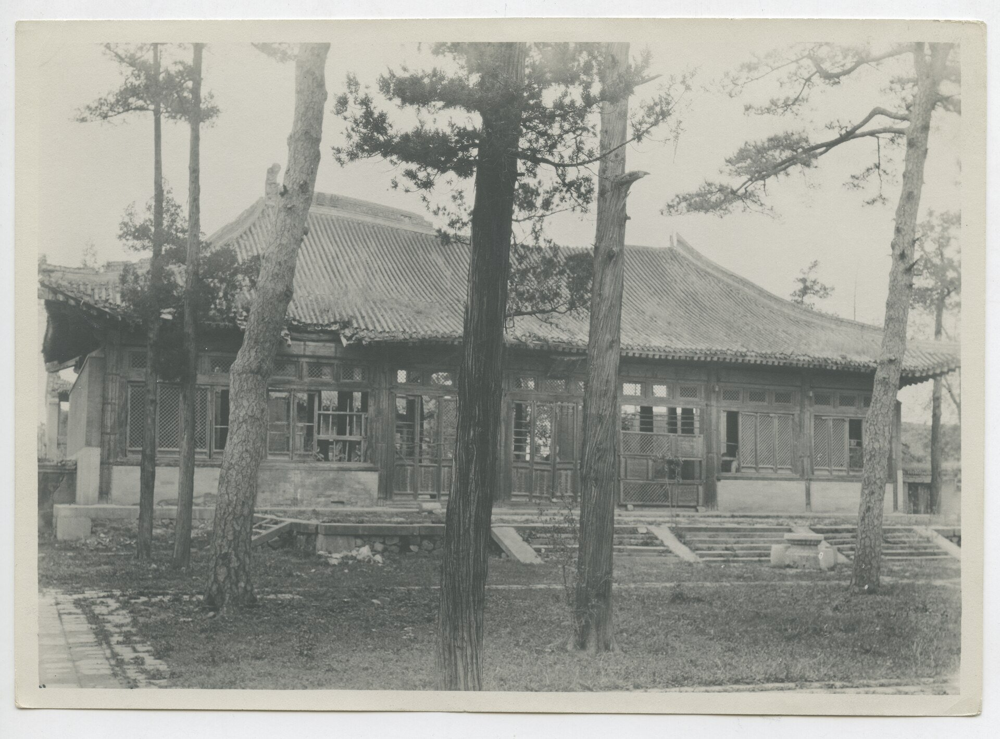

- **P0173** (likely): China, Peking, Tempel (Bundesarchiv caption: Chinesischer Tempel ...) (1900 (Commons)). https://commons.wikimedia.org/wiki/File%3ABundesarchiv_Bild_137-000605%2C_China%2C_Peking%2C_Tempel.jpg

  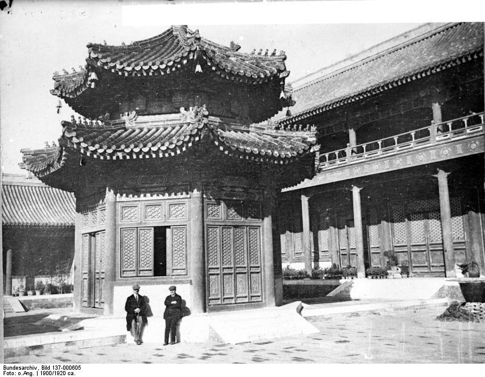

- **P0231** (sure): 正觉寺文殊亭内文殊菩萨全身照片 (1920 and 1920年代, both on S229). https://www.yuanmingyuanpark.cn/xw/202102/t20210225_4454127.html Research-only: link card.
- **P0427** (sure): Gate of Zhengjue Temple, Old Summer Palace 20130317.JPG (2013-03-17 08:23:22 (Commons DateTimeOriginal)). https://commons.wikimedia.org/wiki/File:Gate_of_Zhengjue_Temple,_Old_Summer_Palace_20130317.JPG

  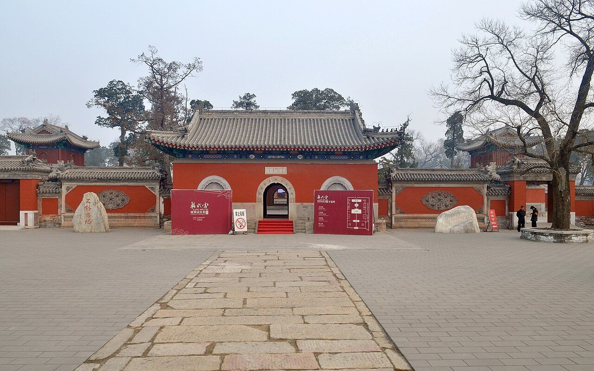

- **P0428** (sure): 正觉寺三圣殿 20130317.jpg (2013-03-17 08:27:06 (Commons DateTimeOriginal)). https://commons.wikimedia.org/wiki/File:%E6%AD%A3%E8%A7%89%E5%AF%BA%E4%B8%89%E5%9C%A3%E6%AE%BF_20130317.jpg

  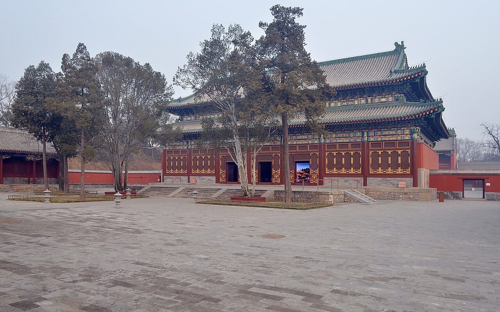

- **P0429** (sure): 正觉寺天王殿 20130317.JPG (2013-03-17 08:24:42 (Commons DateTimeOriginal)). https://commons.wikimedia.org/wiki/File:%E6%AD%A3%E8%A7%89%E5%AF%BA%E5%A4%A9%E7%8E%8B%E6%AE%BF_20130317.JPG

  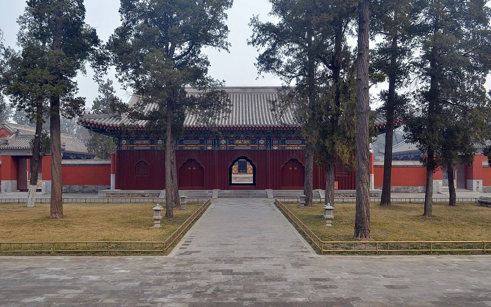

- **P0430** (sure): Eight-sided Pavillion of Manjusri 20130317.jpg (2013-03-17 08:37:44 (Commons DateTimeOriginal)). https://commons.wikimedia.org/wiki/File:Eight-sided_Pavillion_of_Manjusri_20130317.jpg

  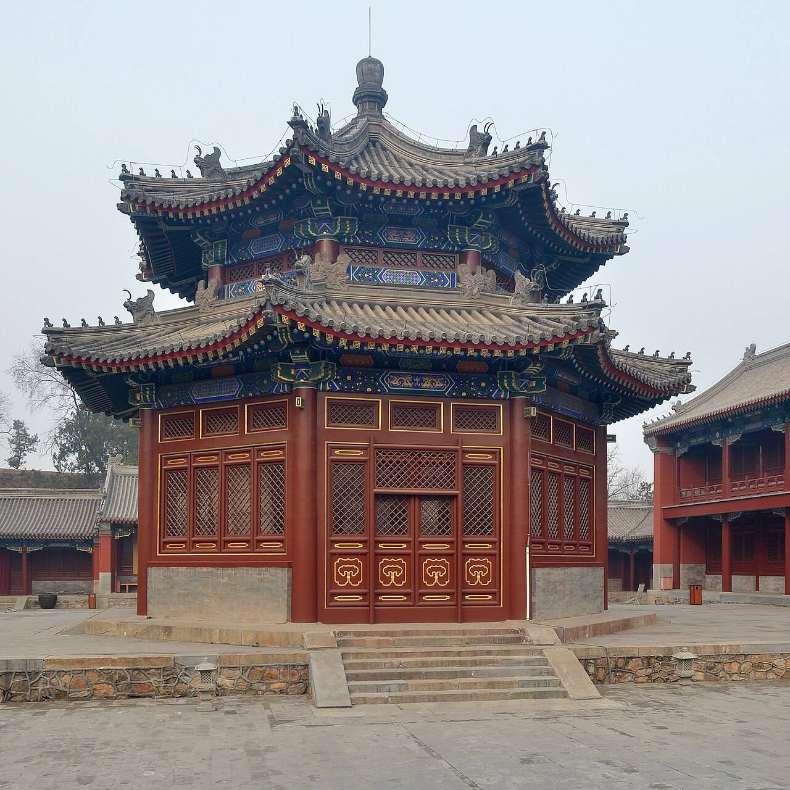

- **P0431** (sure): 正觉寺最上樓 20130512.jpg (2013-05-12 15:15:02 (Commons DateTimeOriginal)). https://commons.wikimedia.org/wiki/File:%E6%AD%A3%E8%A7%89%E5%AF%BA%E6%9C%80%E4%B8%8A%E6%A8%93_20130512.jpg

  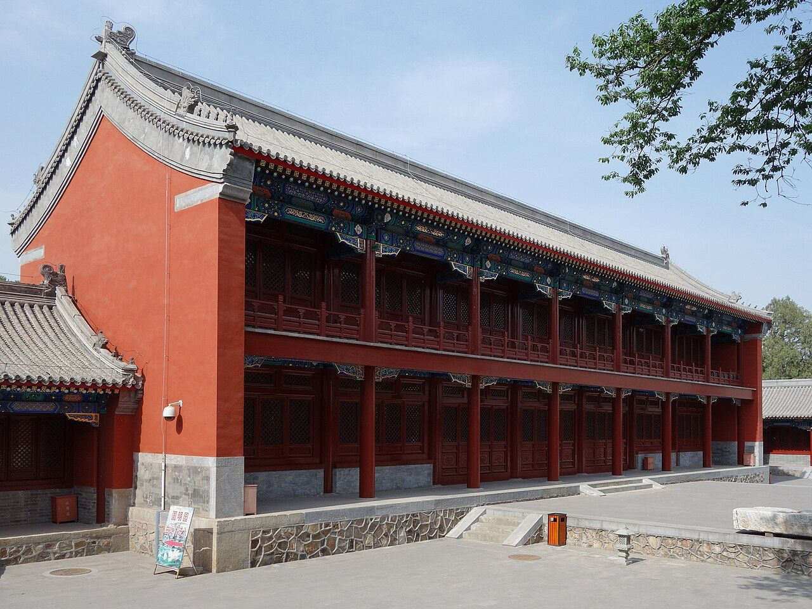

- **P0452** (sure): Ruins of Bridge of Zhengjue Temple back gate 20130317.JPG (2013-03-17 08:45:28 (Commons DateTimeOriginal)). https://commons.wikimedia.org/wiki/File:Ruins_of_Bridge_of_Zhengjue_Temple_back_gate_20130317.JPG

  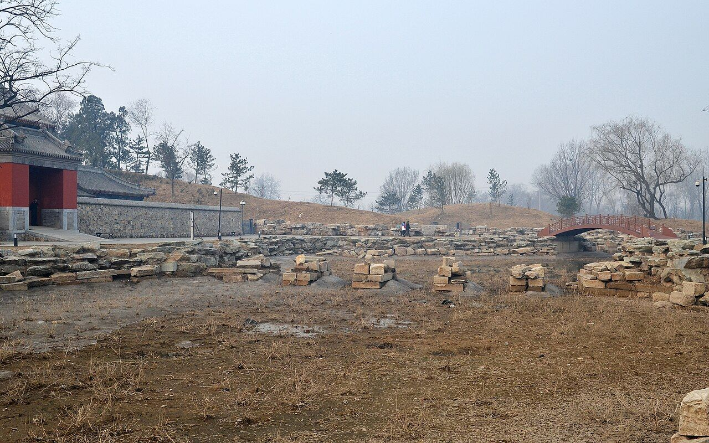

- **P0453** (sure): Zhengjue Temple North 20130512.JPG (2013-05-12 15:18:32 (Commons DateTimeOriginal)). https://commons.wikimedia.org/wiki/File:Zhengjue_Temple_North_20130512.JPG

  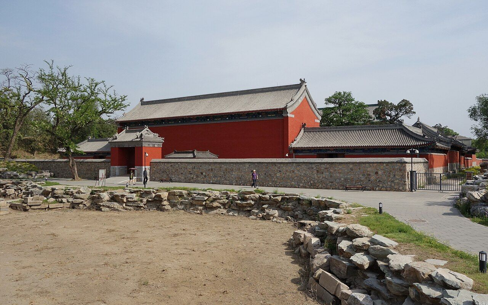

- **P0495** (sure): 正觉寺后门 - Backdoor of Zhengjue Temple - 2012.12 - panoramio.jpg (Taken on 21 December 2012 (Commons DateTimeOriginal)). https://commons.wikimedia.org/wiki/File:%E6%AD%A3%E8%A7%89%E5%AF%BA%E5%90%8E%E9%97%A8_-_Backdoor_of_Zhengjue_Temple_-_2012.12_-_panoramio.jpg

  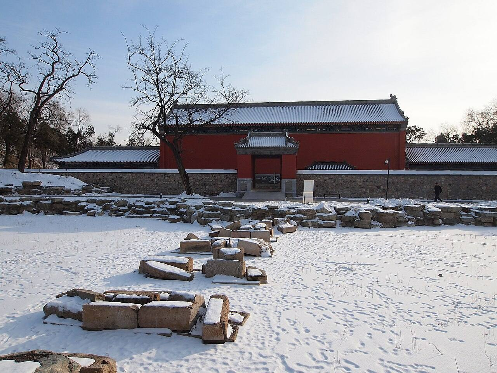

- **P0639** (sure): The rebuilt Wen Shu Pavillion of Zheng Jue Temple of Old Summer Palace (2009-08-29 (Commons)). https://commons.wikimedia.org/wiki/File:The_rebuilt_Wen_Shu_Pavillion_of_Zheng_Jue_Temple_of_Old_Summer_Palace.jpg

  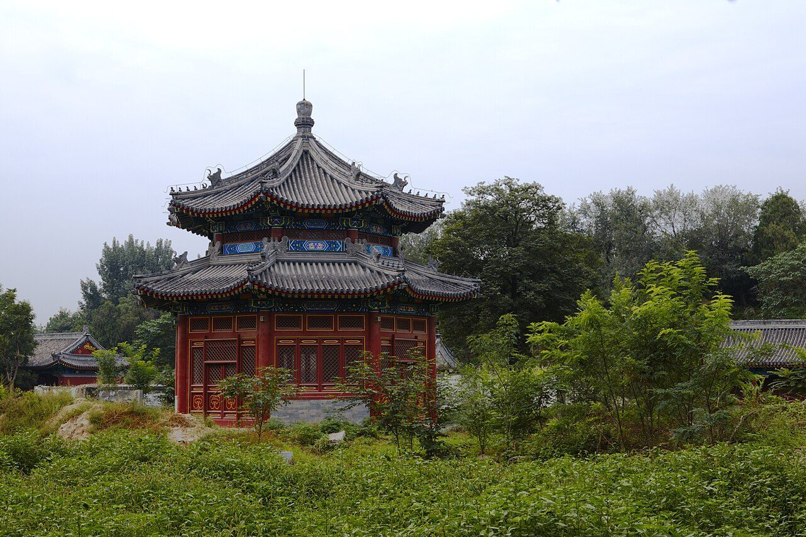

## Texts and drawings (16)

- **E0451** (text, sure): 圆明园遗址的遗产价值与申遗构想: the buildings left after 1860, citing 刘敦桢 1933. post n.d. · ylfj, note 34: 刘敦桢, 同治重修圆明园史料, 营造学社汇刊 1933(2) · S337. http://iqh.ruc.edu.cn/old/qdhjylyjzx/xszl/ylfj/9a322b5384ab4c17af0dd577d4f96ca6.htm
  Lists 17 buildings left after the burning of 1860, after 刘敦桢: 紫碧山房, 顺木天, 鱼跃鸢飞, 课农轩, 藏舟坞, 慎修思永, 知过堂, 双鹤斋, 蓬岛瑶台, 魁星楼, 文昌阁, 林渊锦镜, 春雨轩; 海岳开襟; 庄严法界, 正觉寺 and a 大宫门 in 万春园. The paper's aim is to hold any new display to this 1860 state.
- **E0424** (text, sure): 绮春园记 (Jiaqing). 嘉庆十四年以后 (after 1809), per the editors · v4 p.191, 二集 · S361. https://www.yuanmingyuanpark.cn/xs/yjbg/202008/P020200803382796786124.pdf#page=194
  > 圆明、长春二园之东南，即绮春园。名虽三而实则一，中有门墙之隔耳。斯园先名交辉，为怡贤亲王赐邸，又改赐傅恒。及福隆安呈进后，蒙皇考定名绮春。遂开通门径，西达秀清村，东接蒨园，豁然贯通矣。顾年久荒废，殿宇间有倾圮，湖泊亦多淤垫，丹雘剥落，基址湫湿。爰自嘉庆六年驻跸御园之后，暇时临莅，弗适于怀。每岁修理一二处，屏绝藻绘，惟尚朴淳。花木遂其地产之茂蕃，溪山趁其天成之幽秀。园境较圆明园仅十分之三，而别有结构自然之妙趣。虽荆关大手笔，未能窥其津涯。而云林小景，亦颇有可观之道也。盖地灵境胜，必有时而显晦。萍水相逢，何莫非因缘所感召乎。正觉寺东，建立园门。殿额“勤政”，承皇考敬勤庶政之大法。作奕叶云，仍之继绍，触目警心，慎终始怀，永图之至理也。东偏为心镜轩，澄濬心源，镜辉朗徹，不以浮尘掩本性之真常。渐瑧充实而有光辉之境，固所愿也。北即敷春堂，春者，仁也，物之生也。上天敷春而生庶物，人君敷仁而育万民，德至大也。西为清夏斋，殿宇宏敞，池水澄洁，有修竹数竿，苍松百尺，薰风南来，悠然自得，何时能使官民浃洽，中夏澄清，阜财解愠，熙皞康和，庶酬考眷于万一焉。后湖东偏即涵秋馆，万宝告成，百昌蕃茂。生于春，长于夏，成于秋，宰制庶物，涵育群生，实天地之常经，古今之通义也。别有虚榭回廊、板桥曲沼，可达生冬室。敬绎圣制生冬诗题奥旨，因以名室。夫贞下起元，一阳来复，万物始生，皆基于冬也。予半枢机，葭灰黍谷，循环不息，资始资生，德至矣哉。人君调元赞化，和燮四时，肃乂符而百谷实，阴阳序而两仪顺，建极中和，体天育物。故堂斋馆室，以春夏秋冬命名之意，念兹在兹，不敢怠忽。岂玩日愒时，只图四时佳致，水木清华乎。西偏为四宜书屋，四序咸宜，八方永泰，庶几感召和甘，岁稔民安可望矣。北有小岛，结构层楼，远仿嘉兴，近规塞苑，额题“烟雨”。叶时若之休征，窗对峰峦，览周原之胜概。几暇登临，抒怀抱而寄吟思，信可乐也。园北平湖百顷，碧浪涵空，远印西山，近连太液，洲屿掩映，花木回环。殿宇五楹，高深明达，楣梠额曰“凤麟洲”，予别有会心焉。人君御极，抚绥区夏，养心图治，无欲为本，远屏声色货利之邪径，绝无好大喜功之妄念，鄙求仙之荒诞，斥长生之瞽说。惟一念守成，兢兢业业，不敢暇逸，强勉敬勤，庶几臻于小康之治。宋儒云：“无欲则静虚动直”，诚嘉言也。在上位者，果能无欲，天下亿兆之福也。予修葺斯园，皆因地建造。物给价，工给值，穷黎赖以谋食，所费皆出内帑，毫不取诸外库，诚一举而两得矣。敬读圣制《知过论》，心有所萦系，必有所疏忽，曷敢不恪守先言。萦系于小，转疏忽于大乎。凛然自勉，实自箴也。况已臻伯玉知非之年，唯益求久安长治之理，何暇燕游林泉佳境，稍懈勤政爱民之要道哉。是为记。
  Jiaqing's essay on the garden, 1809 or later. It tells the garden's history, and walks it: the gate east of 正觉寺, 心镜轩, 敷春堂, 清夏斋, 涵秋馆, 生冬室, 四宜书屋, the tower 烟雨楼 on an islet, 凤麟洲. He stresses plain work paid from the privy purse.
- **E0673** (poem, sure): 鉴碧亭: 嘉庆二十四年 poem of the Jiaqing Emperor. 嘉庆二十四年 (1819), date from the compilation · p.305 item (6), under 鉴碧亭 · S360. https://www.yuanmingyuanpark.cn/xs/yjbg/202007/P020200730387572832602.pdf#page=305
  > 方亭高敞碧湖中，放棹石桥四岸通。煮茗甘芳瀹竹鼎，披襟飒爽对花宫。（亭在正觉寺东）一奁朗鉴环清溆，几叠晴霞绘远空。长夏延和莲漏永，扁舟又溯赤栏东。
  Jiaqing, 1819: boat from the stone bridge to the high square pavilion; his note places it east of 正觉寺.
- **E0497** (description, sure): 绮春园 after 1860, yaffin 系列15. c. 2011 · blog, lead only · S356. https://blog.sina.com.cn/s/blog_65fec3ab0100sxa7.html
  Lead: says the gate district, 庄严法界, 惠济祠, 湛清轩 and 绿满轩 survived in 1860, the garden was renamed 万春园 under Tongzhi, and was destroyed in 1900, with only 正觉寺 standing. The south gate dates from 1809 and 新宫门 is its later name. Unverified compilation.
- **E0569** (description, sure): Site status table, about 2011: rebuilt. c. 2011 · 系列06 repost, status table · S356. https://blog.sina.com.cn/s/blog_c27029650101itzz.html
  绮春园 gate, 迎晖殿 and 鉴碧亭 rebuilt on their sites; 正觉寺 under repair at that time.
- **E0679** (description, sure): 正觉寺 after 1860 and its repair. 2011 · whole article · S228. https://www.chinanews.com/cul/2011/07-07/3163991.shtml
  14,300 m2 site, 3,649 m2 of buildings. It survived 1860 and 1900; later a private villa, staff housing of Tsinghua, then factories. 三圣殿 and others were lost. Repair and rebuilding began 2002, trial opening 6 July 2011. So the 三圣殿 standing today is a rebuild, not period fabric.
- **E0680** (description, sure): 绮春园 at the end of 1860. 2020 · S220 section 五 · S220. http://iqh.ruc.edu.cn/old/qdhjylyjzx/xszl/ylfj/00baad8cc3da4c6a901378da7919d9a8.htm
  Per S220 the garden was burned on the 5th day of the 9th lunar month of 1860 (18 October) by British troops, except 正觉寺, 惠济祠 and 河神庙. 常嫔, who stayed behind ill, died of the shock.
- **E0681** (description, sure): 正觉寺: plan, halls and furnishing. reprint 2021; 《圆明园研究》第5期 · section 四 · S221. http://iqh.ruc.edu.cn/old/qdhjylyjzx/xszl/lswh/f8d06436b9d444f98d64cdd88753acef.htm
  Faces south, five halls on the axis: gate of three bays with Qianlong's four-language plaque, bell and drum towers, five-bay 天王殿, seven-bay 三圣殿 on a stone terrace, 文殊亭, seven-bay 最上楼; a monks' yard of 8 buildings and 22 bays on the east. The only temple in the three gardens run by lamas. Furnishing comes mostly from 金勋's unpublished 成府村志.
- **E0683** (description, sure): 藏传佛教与圆明园正觉寺. post n.d. · lswh · S337. http://iqh.ruc.edu.cn/old/qdhjylyjzx/xszl/lswh/f8d06436b9d444f98d64cdd88753acef.htm
  正觉寺 Zhengjue Si, built 1773-74 as a Tibetan Buddhist temple with a 达喇嘛 and 40 lamas sent from 宝谛寺. Walks through its halls with 金勋's account of the five colours of Buddhas in 最上楼.
- **E0506** (description, sure): 圆明园五朝御制诗文集注 v4, editors' note on 绮春园. 2020 edition · v4 p.170 · S361. https://www.yuanmingyuanpark.cn/xs/yjbg/202008/P020200803382796786124.pdf#page=173
  Formed from princes' and ministers' gardens, about 54.3 ha. Taken back from Fuheng's heirs and renamed in 1769; gate, tiger-stone wall and 正觉寺 added by 1773, rebuilt in 1795. Jiaqing's growth came in three stages: the western and central groups of the Thirty Scenes first, then the new gate and eastern scenes, finally the south-west (招凉榭, 湛清轩, 畅和堂, 澄心堂, the shrines), gathered as a New Twenty Scenes.
- **E0682** (description, sure, search index only): 圆明园正觉寺建筑研究. not seen · mhymy xsjl/10588 · S42. https://www.mhymy.com/xsjl/10588.html
  Completed 1773. Axis given as gate, 天王殿, 正觉殿, 殊像阁, 最上楼: other names for 三圣殿 and 文殊亭 than in S221.
- **E0684** (drawing, sure, search index only): 正觉寺正觉殿装修尺寸图样. not seen · not seen · S42. https://www.mhymy.com/dasl/ysltd/7355.html
  Interior-fitting dimensions of the main hall. The page calls it 正觉殿; S221 and the plan call it 三圣殿.
- **E0685** (archaeology, sure): 地铁4号线圆明园站考古发掘报告. 2005-06-10 to 21 · mhymy 11390, free part · S155. https://www.mhymy.com/dasl/11390.html
  Salvage dig for Metro Line 4 in front of the 正觉寺 gate, north bank of 万泉河: about 300 m2 with a road base, carriageway and house remains, plus modern channels. Results paywalled.
- **E0686** (archaeology, sure): 圆明园正觉寺北湖遗址考古勘探报告. survey 2009 · mhymy dasl/11669, free part only · S155. https://www.mhymy.com/dasl/11669.html
  Survey May 2009: the old lake north of the temple wall, east to the west shore of the 鉴碧亭 lake, west to the east shore of 湛清轩. Its tags name an old bridge and a channel. It places QC11, QC08 and QC16 around one water.
- **E0687** (archaeology, sure): 圆明园正觉寺北湖遗址考古勘探报告. 2009-05-02 to 09 · mhymy 11669, free part · S155. https://www.mhymy.com/dasl/11669.html
  Survey of a lake north of 正觉寺 Zhengjue Si, bounded by the temple's north wall, the west shore of 鉴碧亭's lake and the east shore of 湛清轩. Results paywalled.
- **E0688** (archaeology, sure, search index only): 《圆明园正觉寺天王殿考古发掘报告》. S315. https://www.mhymy.com/dasl/11258.html
  Excavation report on the gate hall of Zhengjue Si; title seen, text not read.

**On the plan:** Drawn on the plan of the gardens (S01), labelled 正觉寺. https://artmuseum.princeton.edu/collections/objects/138657

## Reconstructions by others (4)

Modern interpretation, not evidence.
- **R0064** (render, sure): 圆明园·正觉寺·文殊像复原设计研究. posted by 圆明园管理处, posted 2020. https://www.yuanmingyuanpark.cn/xs/yjbg/202007/t20200729_4416686.html Research-only: link card.
- **R0065** (render, sure): 圆明园正觉寺文殊像复原研究报告. posted by 圆明园管理处, posted 2020. https://www.yuanmingyuanpark.cn/xs/yjbg/202007/t20200729_4416671.html Research-only: link card.
- **R0005** (paper figure, sure, search index only): 《圆明园正觉寺建筑研究》. . https://www.mhymy.com/xsjl/10588.html Research-only: link card.
- **R0045** (video, guess): 18-minute digital restoration video shown in the main hall of 正觉寺. 郭黛姮 team, 清华大学建筑学院 (as the report states), 2017. https://www.tsinghua.edu.cn/info/1182/46145.htm Research-only: link card.

## Surviving comparable buildings, not this building (2)

- **T100** 宝相阁 (殊像寺) Baoxiang Ge, Shuxiang Si, 承德 Chengde. Comparable: same court, era or type, confidence C, standing: yes. How a large lion-riding Manjusri fits a pavilion Basis: S425 (snippet): 正觉寺 文殊亭 held a Manjusri on a blue lion, three zhang high, seen in a 1920 photograph. Search summary: 宝相阁 holds an 11.6 m wooden Manjusri on a lion. https://www.visitbeijing.com.cn/article/4EPwqfDbPqp
  - P0706: 亜東印画輯 07 082 "殊像寺の寶香閣（熱河省承德）". https://commons.wikimedia.org/wiki/File:%E4%BA%9C%E6%9D%B1%E5%8D%B0%E7%94%BB%E8%BC%AF_07_082_%22%E6%AE%8A%E5%83%8F%E5%AF%BA%E3%81%AE%E5%AF%B6%E9%A6%99%E9%96%A3%EF%BC%88%E7%86%B1%E6%B2%B3%E7%9C%81%E6%89%BF%E5%BE%B7%EF%BC%89%22.jpg
- **T101** 殊像寺 (承德) Shuxiang Si, Chengde, 承德 Chengde. Comparable: same court, era or type, confidence C, standing: yes. A court temple of Manjusri of the same years Basis: S424: 正觉寺 is the only surviving group, with a 文殊亭. S428 (snippet): Chengde's temple of 1774, after Wutai and the Xiangshan form, Qianlong says. Shared Manjusri cult; date of ours not confirmed by this search. https://news.sina.com.cn/c/2002-08-29/1734697305.html
  - P0707: 亜細亜大観 10 119 "殊像寺 （熱河 承德）". https://commons.wikimedia.org/wiki/File:%E4%BA%9C%E7%B4%B0%E4%BA%9C%E5%A4%A7%E8%A6%B3_10_119_%22%E6%AE%8A%E5%83%8F%E5%AF%BA_%EF%BC%88%E7%86%B1%E6%B2%B3_%E6%89%BF%E5%BE%B7%EF%BC%89%22.jpg
  - P0708: 亜東印画輯 07 081 "森蔭の殊像寺（熱河省承德）". https://commons.wikimedia.org/wiki/File:%E4%BA%9C%E6%9D%B1%E5%8D%B0%E7%94%BB%E8%BC%AF_07_081_%22%E6%A3%AE%E8%94%AD%E3%81%AE%E6%AE%8A%E5%83%8F%E5%AF%BA%EF%BC%88%E7%86%B1%E6%B2%B3%E7%9C%81%E6%89%BF%E5%BE%B7%EF%BC%89%22.jpg

## Evidence for the set of buildings

- Reconstructions and comparables for the whole garden, 绮春园 Qichun Yuan: see GARDEN-QC

## Open questions

- Q8: Known errors of S01
- Q52: Smaller conflicts

<!-- generated:end -->

## Notes

<!-- Yours: regeneration never touches this part. It goes on the public site; what you write below a line holding only %% private %% stays in the research copy. -->
