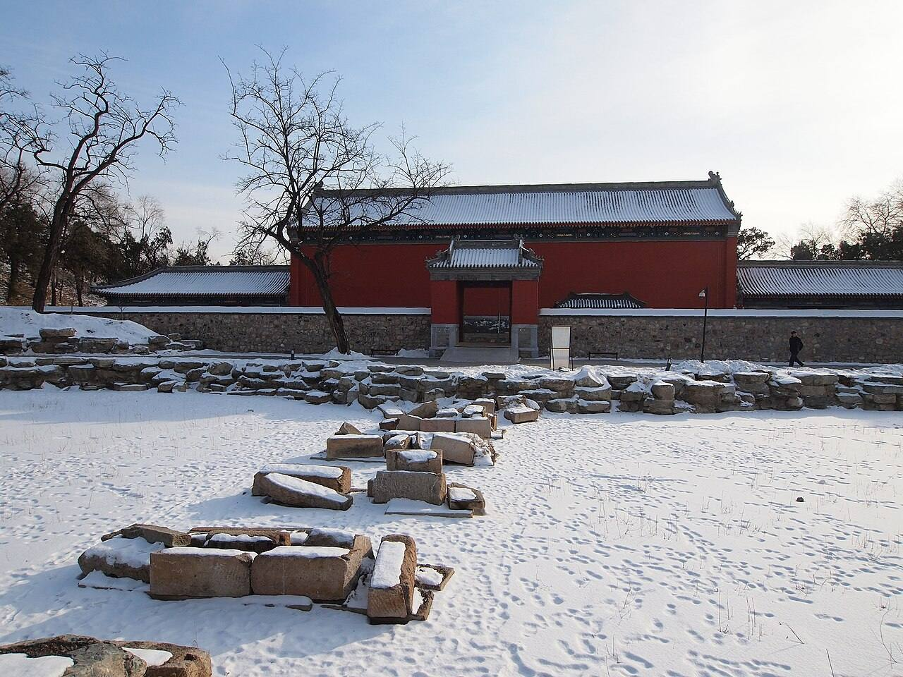

<!-- generated:start (scripts/building_pages.py): do not edit between these markers -->

# QC16: 湛清轩 Zhanqing Xuan

Qichun Yuan

**3D object:** 1 box. Open it: `/reconstruction/3d.html?b=QC16`

## What we know

- **Name:** 湛清轩 Zhanqing Xuan (S06, S42, S49, S01, S220, S361 · confidence B)
- **Garden:** Qichun Yuan (S06, S42, S49, S01, S220, S361)
- **Type:** compound (S06, S42, S49, S01, S220, S361 · confidence B)
- **Built:** 嘉庆十九年 1814 (S06, S42, S49, S01, S220, S361)
- **Destroyed:** survived 1860 (S49 lead) (S06, S42, S49, S01, S220, S361)
- **Position:** 40.00033, 116.30199. S01 guess (S01 · confidence C)
- **Bays:** 3, open hall in the texts (S06, S42, S49, S01, S220, S361)
- **Where the text puts it:** 西南部 (S06); 四宜书屋南 (S42 11559) (S06, S42, S49, S01, S220, S361) *(research copy, not public)*
- **Note:** S06 湛清斋. S44 has 湛静斋 for an 1840 death: probably another name; open. (S06, S42, S49, S01, S220, S361)
- **Plan reader's note:** No label. S42 11559: 四宜书屋 south = 湛清轩 north bank. S42 11669: 正觉寺北湖 west = 湛清轩 east bank. This rock-set islet hall is the nearest fit. The other candidate is the strip with B1345 at (8202,7292). (S01) *(research copy, not public)*
- **How it was read:** guess (S01) *(research copy, not public)*
- **Plan pixels:** 8039, 7031 (S01) *(research copy, not public)*

## Our model now

1 boxes stand in this compound, 1 on blocks drawn on the plan, 0 assumed. Its halls are listed below.

## Inside it (1)

- QC16-B1310

## Pictures (1)

- **P0495** (guess): 正觉寺后门 - Backdoor of Zhengjue Temple - 2012.12 - panoramio.jpg (Taken on 21 December 2012 (Commons DateTimeOriginal)). https://commons.wikimedia.org/wiki/File:%E6%AD%A3%E8%A7%89%E5%AF%BA%E5%90%8E%E9%97%A8_-_Backdoor_of_Zhengjue_Temple_-_2012.12_-_panoramio.jpg

  

## Texts and drawings (8)

- **E0734** (poem, sure): 湛清轩. 嘉庆二十年 (1815) · v4 p.337, under 澄心堂; source ref 6-143 · S361. https://www.yuanmingyuanpark.cn/xs/yjbg/202008/P020200803382796786124.pdf#page=340
  > 挹爽轩庭灏景赊，四围水木湛清华。芰荷香远汀前漾，杨柳阴浓堤畔遮。波静槛边印明镜，山连楼角写余霞。南湖佳境天然具，试放轻舟溯岸涯。
  Poem 湛清轩 by the Jiaqing Emperor, 1815, filed by the editors under 澄心堂.
- **E0497** (description, sure): 绮春园 after 1860, yaffin 系列15. c. 2011 · blog, lead only · S356. https://blog.sina.com.cn/s/blog_65fec3ab0100sxa7.html
  Lead: says the gate district, 庄严法界, 惠济祠, 湛清轩 and 绿满轩 survived in 1860, the garden was renamed 万春园 under Tongzhi, and was destroyed in 1900, with only 正觉寺 standing. The south gate dates from 1809 and 新宫门 is its later name. Unverified compilation.
- **E0506** (description, sure): 圆明园五朝御制诗文集注 v4, editors' note on 绮春园. 2020 edition · v4 p.170 · S361. https://www.yuanmingyuanpark.cn/xs/yjbg/202008/P020200803382796786124.pdf#page=173
  Formed from princes' and ministers' gardens, about 54.3 ha. Taken back from Fuheng's heirs and renamed in 1769; gate, tiger-stone wall and 正觉寺 added by 1773, rebuilt in 1795. Jiaqing's growth came in three stages: the western and central groups of the Thirty Scenes first, then the new gate and eastern scenes, finally the south-west (招凉榭, 湛清轩, 畅和堂, 澄心堂, the shrines), gathered as a New Twenty Scenes.
- **E0698** (description, sure): 圆明园五朝御制诗文集注 v4, editors' note on 澄心堂. 2020 edition · v4 p.337 · S361. https://www.yuanmingyuanpark.cn/xs/yjbg/202008/P020200803382796786124.pdf#page=340
  On an island in the south lake of the western group, once 竹园, rebuilt 1815: a five-bay hall in two rolls with a hip-gable annex and side wings, plaques 垂虹榭 and 绮旭轩 on them. 湛清轩 stands on an islet north-east; a three-bay open hall 凌虚亭 stands on the hill across the lake.
- **E0686** (archaeology, likely): 圆明园正觉寺北湖遗址考古勘探报告. survey 2009 · mhymy dasl/11669, free part only · S155. https://www.mhymy.com/dasl/11669.html
  Survey May 2009: the old lake north of the temple wall, east to the west shore of the 鉴碧亭 lake, west to the east shore of 湛清轩. Its tags name an old bridge and a channel. It places QC11, QC08 and QC16 around one water.
- **E0687** (archaeology, likely): 圆明园正觉寺北湖遗址考古勘探报告. 2009-05-02 to 09 · mhymy 11669, free part · S155. https://www.mhymy.com/dasl/11669.html
  Survey of a lake north of 正觉寺 Zhengjue Si, bounded by the temple's north wall, the west shore of 鉴碧亭's lake and the east shore of 湛清轩. Results paywalled.
- **E0767** (archaeology, likely): 圆明园四宜书屋遗址考古勘探报告. survey 2009 · mhymy dasl/11559, free part only · S155. https://www.mhymy.com/dasl/11559.html
  Survey May 2009: south of the garden, on the north bank of 湛清轩. Three layers down to 1.6 m: rubble, brown soil, yellow-brown soil with sand.
- **E0768** (archaeology, likely): 圆明园四宜书屋遗址考古勘探报告. 2009-05-02 to 09 · mhymy 11559, free part · S155. https://www.mhymy.com/dasl/11559.html
  Survey around 正觉寺 finds, at the 绮春园 四宜书屋 site, on the north shore of 湛清轩 area: rubble fill to 0.6 m, brown soil with brick scraps to 1.1 m, a harder yellow-brown layer to 1.6 m, then natural ground. Rest paywalled.

**On the plan:** Its place is drawn on the plan of the gardens (S01), with no name written. https://artmuseum.princeton.edu/collections/objects/138657

## Evidence for the set of buildings

- Reconstructions and comparables for the whole garden, 绮春园 Qichun Yuan: see GARDEN-QC

## Open questions

- Q13: Weak identifications
- Q20: Name variants

<!-- generated:end -->

## Notes

<!-- Yours: regeneration never touches this part. It goes on the public site; what you write below a line holding only %% private %% stays in the research copy. -->
