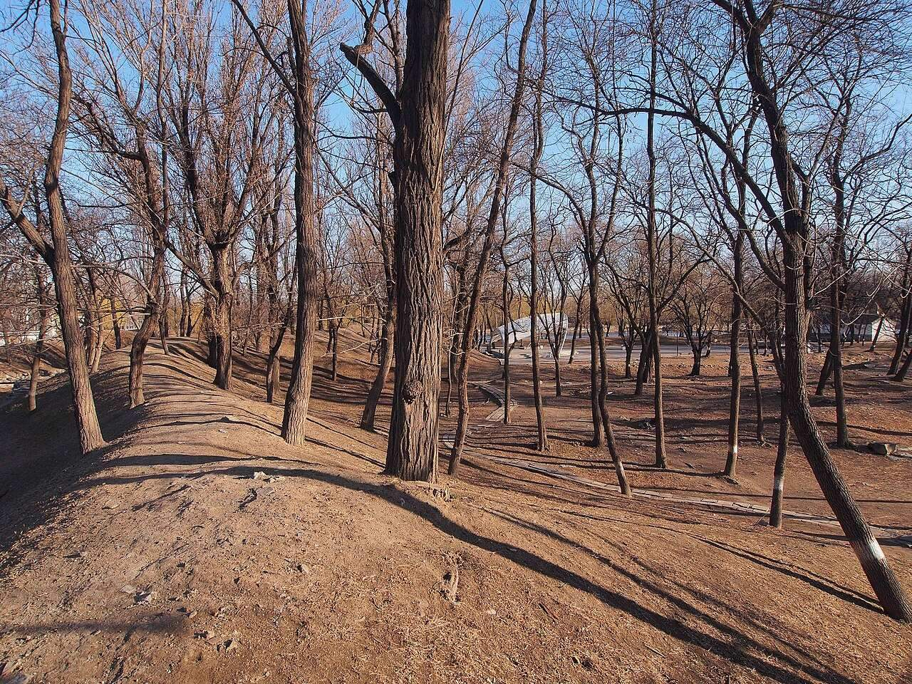

<!-- generated:start (scripts/building_pages.py): do not edit between these markers -->

# QC19: 四宜书屋 (绮春) Siyi Shuwu (Qichun)

Qichun Yuan

**3D object:** 1 box. Open it: `/reconstruction/3d.html?b=QC19`

## What we know

- **Name:** 四宜书屋 (绮春) Siyi Shuwu (Qichun) (S06, S42, S01, S220, S361 · confidence B)
- **Written on the plan:** 四宜书屋 (S01 · confidence B)
- **Garden:** Qichun Yuan (S06, S42, S01, S220, S361)
- **Type:** compound (S06, S42, S01, S220, S361 · confidence B)
- **Built:** 嘉庆十年七月 1805 (S06, S42, S01, S220, S361)
- **Destroyed:** 1860 (S06, S42, S01, S220, S361)
- **Position:** 40.00243, 116.30085. S01 sure (S01 · confidence B)
- **Bays:** gate 3, two halls of 5 in the texts / 3x1 on the plan (S06, S42, S01, S220, S361)
- **Size in the inventory:** 10.8 × 10.3 m. S01 plan px / hall scale (S01)
- **Where the text puts it:** 中部 (S06); 湛清轩北 (S42 11559) (S06, S42, S01, S220, S361) *(research copy, not public)*
- **Note:** 绮春园三十景 (Jiaqing poems, list in S06). Not YM28. (S06, S42, S01, S220, S361)
- **Plan reader's note:** Walled block. Label inside the central court. Not the YM28 四宜书屋. | plan: Label in the court south of it. (S01) *(research copy, not public)*
- **How it was read:** sure (S01) *(research copy, not public)*
- **Plan pixels:** 7676, 5969 (S01) *(research copy, not public)*

## Our model now

A plain box on the block drawn on the Qing plan S01: position and frontage from the plan, heights and roof from the typology of its hall class. It will be updated as the research goes on.

- **Box:** 10.8 × 10.3 m, small house
- **Heights:** platform 0.45 m, eave 3.2 m, ridge 6.41 m above the ground
- **Roof:** gable 硬山 or 悬山, rolled ridge 卷棚, grey tile
- **Faces:** 177.1° from north
- **Confidence:** B

## Inside it (15)

- QC19-B1191
- QC19-B1192
- QC19-B1195
- QC19-B1211
- QC19-B1213
- QC19-B1223
- QC19-B1224
- QC19-B1225
- QC19-B1226
- QC19-B1227
- QC19-B1241
- QC19-B1242
- QC19-B1243
- QC19-B1244
- QC19-N01

## Pictures (1)

- **P0485** (guess): 琦春园遗址 - Site of Qichun Garden - 2013.03 - panoramio.jpg (Taken on 13 March 2013 (Commons DateTimeOriginal)). https://commons.wikimedia.org/wiki/File:%E7%90%A6%E6%98%A5%E5%9B%AD%E9%81%97%E5%9D%80_-_Site_of_Qichun_Garden_-_2013.03_-_panoramio.jpg

  

## Texts and drawings (17)

- **E0448** (text, sure): 《養吉齋叢錄》 on 綺春園 and the Thirty Scenes. Qing; text states events up to 文宗 · 卷十八 leaf 4 (archive.org 02096508.cn image n52-n53) · S223. https://archive.org/details/02096508.cn/page/n52
  > 綺春園在圓明園東，有複道相屬。舊為大學士傅恆及其子大學士福康安賜園，歿後繳進，嘉慶間始加繕葺。仁宗御製綺春園三十景詩，有宣宗恭跋：先是，園西南以繚垣別界一區，名含暉園，莊敬和碩公主釐降時，賜居於此。公主薨逝，額駙索特那木多布齋以園繳進。舊又橫界一區，名西爽村，有聯暉樓，為成邸寓園。嘉慶間成邸別賜園宅，西爽、含暉皆併入為一園，而規模宏遠矣。舊有數楹名鳳麐洲，後易名清夏齋；問月樓在洲之南，鏡綠亭在洲之北。道光時為尊養孝和皇太后之所，正殿曰迎暉殿。文宗登極，奉康慈太后亦居此，問安視膳，皆如道光間禮。三十景者：敷春堂　鑑德書屋　翠合軒　凌虛閣　協性齋　澄光榭　問月樓　我見室　蔚藻堂　藹芳圃　鏡綠亭　淙玉軒　舒卉軒　竹林院　夕霏榭　清夏齋　鏡虹館　春雨山房　含光樓（即舊時聯暉樓）　涵清館　華滋庭　苔香室　虛明鏡　含淳堂　春澤齋　水心榭　四宜書屋　茗柯精舍　來薰室　般若觀
  The earliest list of the Thirty Scenes we can see, and the history before it seems to come from Daoguang's colophon to Jiaqing's poem set (有宣宗恭跋). It places 問月樓 south of 洲 and 鏡綠亭 north of it, names 迎暉殿 as the main hall of the dowager's residence, and equates 含光樓 with the old 聯暉樓. Punctuation is ours; the print has none. Transcribed by eye.
- **E0760** (poem, sure): 四宜书屋 (绮春园三十景). 嘉庆十年 (1805) · v4 p.183, under 绮春园 · S361. https://www.yuanmingyuanpark.cn/xs/yjbg/202008/P020200803382796786124.pdf#page=186
  > 平皋书屋延清赏，游兴政闲足惬心。春夏秋冬无暇豫，山溪泉石偶探寻。绿波几曲澄辉印，碧树千章密荫深。浏览四时调六气，民艰念切勉君临。
  One of the Thirty Scenes of 绮春园 by the Jiaqing Emperor, 1805 (S58): the poem 四宜书屋.
- **E0761** (poem, sure): 四宜书屋. 嘉庆十一年 (1806) · v4 p.293, under 四宜书屋; source ref 3-219 · S361. https://www.yuanmingyuanpark.cn/xs/yjbg/202008/P020200803382796786124.pdf#page=296
  > 兰皋启书室，凉燠喜相宜。牗敞竹筛旭，窗虚松漾飔。时和花木茂，雨浃物华滋。延览集清景，天然妙绘披。
  Poem 四宜书屋 by the Jiaqing Emperor, 1806, filed by the editors under 四宜书屋.
- **E0762** (poem, sure): 四宜书屋. 嘉庆十三年 (1808) · v4 p.294, under 四宜书屋; source ref 4-4 · S361. https://www.yuanmingyuanpark.cn/xs/yjbg/202008/P020200803382796786124.pdf#page=297
  > 蜃窗向暖面清池，冰镜凝辉漾午曦。径复廊环众景备，室深庭厰四时宜。韶华静领盆梅缬，春色先舒岸柳枝。茂对芳园农事近，嘉生品汇待敷滋。
  Poem 四宜书屋 by the Jiaqing Emperor, 1808, filed by the editors under 四宜书屋.
- **E0763** (poem, sure): 四宜书屋. 嘉庆十三年 (1808) · v4 p.294, under 四宜书屋; source ref 4-41 · S361. https://www.yuanmingyuanpark.cn/xs/yjbg/202008/P020200803382796786124.pdf#page=297
  > 书室面清池，四时无不宜。乔松涛响渚，高柳荫敷墀。纳爽闲庭敞，延薰疏牖披。静观庶汇茂，嘉澍畅优施。
  Poem 四宜书屋 by the Jiaqing Emperor, 1808, filed by the editors under 四宜书屋.
- **E0764** (poem, sure): 四宜书屋. 嘉庆十三年 (1808) · v4 p.294, under 四宜书屋; source ref 4-77 · S361. https://www.yuanmingyuanpark.cn/xs/yjbg/202008/P020200803382796786124.pdf#page=297
  > 清溪净如练，澄澈远空含。黄菊色方淡，赤枫态益酣。庭虚延暖旭，窗小纳遥岚。始肃咸成实，化机静讨探。
  Poem 四宜书屋 by the Jiaqing Emperor, 1808, filed by the editors under 四宜书屋.
- **E0765** (poem, sure): 四宜书屋. 嘉庆十三年 (1808) · v4 p.295, under 四宜书屋; source ref 4-78 · S361. https://www.yuanmingyuanpark.cn/xs/yjbg/202008/P020200803382796786124.pdf#page=298
  > 赤栏文石绕清涯，面沼依楼结构佳。灿壁丹枫多画趣，傍篱黄菊引诗怀。图书静会千秋贯，凉燠咸宜四序谐。北指璿杓届良月，冲融暖旭上闲阶。
  Poem 四宜书屋 by the Jiaqing Emperor, 1808, filed by the editors under 四宜书屋.
- **E0424** (text, sure): 绮春园记 (Jiaqing). 嘉庆十四年以后 (after 1809), per the editors · v4 p.191, 二集 · S361. https://www.yuanmingyuanpark.cn/xs/yjbg/202008/P020200803382796786124.pdf#page=194
  > 圆明、长春二园之东南，即绮春园。名虽三而实则一，中有门墙之隔耳。斯园先名交辉，为怡贤亲王赐邸，又改赐傅恒。及福隆安呈进后，蒙皇考定名绮春。遂开通门径，西达秀清村，东接蒨园，豁然贯通矣。顾年久荒废，殿宇间有倾圮，湖泊亦多淤垫，丹雘剥落，基址湫湿。爰自嘉庆六年驻跸御园之后，暇时临莅，弗适于怀。每岁修理一二处，屏绝藻绘，惟尚朴淳。花木遂其地产之茂蕃，溪山趁其天成之幽秀。园境较圆明园仅十分之三，而别有结构自然之妙趣。虽荆关大手笔，未能窥其津涯。而云林小景，亦颇有可观之道也。盖地灵境胜，必有时而显晦。萍水相逢，何莫非因缘所感召乎。正觉寺东，建立园门。殿额“勤政”，承皇考敬勤庶政之大法。作奕叶云，仍之继绍，触目警心，慎终始怀，永图之至理也。东偏为心镜轩，澄濬心源，镜辉朗徹，不以浮尘掩本性之真常。渐瑧充实而有光辉之境，固所愿也。北即敷春堂，春者，仁也，物之生也。上天敷春而生庶物，人君敷仁而育万民，德至大也。西为清夏斋，殿宇宏敞，池水澄洁，有修竹数竿，苍松百尺，薰风南来，悠然自得，何时能使官民浃洽，中夏澄清，阜财解愠，熙皞康和，庶酬考眷于万一焉。后湖东偏即涵秋馆，万宝告成，百昌蕃茂。生于春，长于夏，成于秋，宰制庶物，涵育群生，实天地之常经，古今之通义也。别有虚榭回廊、板桥曲沼，可达生冬室。敬绎圣制生冬诗题奥旨，因以名室。夫贞下起元，一阳来复，万物始生，皆基于冬也。予半枢机，葭灰黍谷，循环不息，资始资生，德至矣哉。人君调元赞化，和燮四时，肃乂符而百谷实，阴阳序而两仪顺，建极中和，体天育物。故堂斋馆室，以春夏秋冬命名之意，念兹在兹，不敢怠忽。岂玩日愒时，只图四时佳致，水木清华乎。西偏为四宜书屋，四序咸宜，八方永泰，庶几感召和甘，岁稔民安可望矣。北有小岛，结构层楼，远仿嘉兴，近规塞苑，额题“烟雨”。叶时若之休征，窗对峰峦，览周原之胜概。几暇登临，抒怀抱而寄吟思，信可乐也。园北平湖百顷，碧浪涵空，远印西山，近连太液，洲屿掩映，花木回环。殿宇五楹，高深明达，楣梠额曰“凤麟洲”，予别有会心焉。人君御极，抚绥区夏，养心图治，无欲为本，远屏声色货利之邪径，绝无好大喜功之妄念，鄙求仙之荒诞，斥长生之瞽说。惟一念守成，兢兢业业，不敢暇逸，强勉敬勤，庶几臻于小康之治。宋儒云：“无欲则静虚动直”，诚嘉言也。在上位者，果能无欲，天下亿兆之福也。予修葺斯园，皆因地建造。物给价，工给值，穷黎赖以谋食，所费皆出内帑，毫不取诸外库，诚一举而两得矣。敬读圣制《知过论》，心有所萦系，必有所疏忽，曷敢不恪守先言。萦系于小，转疏忽于大乎。凛然自勉，实自箴也。况已臻伯玉知非之年，唯益求久安长治之理，何暇燕游林泉佳境，稍懈勤政爱民之要道哉。是为记。
  Jiaqing's essay on the garden, 1809 or later. It tells the garden's history, and walks it: the gate east of 正觉寺, 心镜轩, 敷春堂, 清夏斋, 涵秋馆, 生冬室, 四宜书屋, the tower 烟雨楼 on an islet, 凤麟洲. He stresses plain work paid from the privy purse.
- **E1011** (description, sure): Site status table, about 2011: nothing visible, or built over. c. 2011 · 系列06 repost, status table · S356. https://blog.sina.com.cn/s/blog_c27029650101itzz.html
  Same table. In it the first group shows no visible remains; 得全阁, 流香渚, 凤麟洲, 涵秋馆, 蔚藻堂, 中和堂, 敷春堂 and 心镜轩 have service buildings on them, and 含晖楼, 澄心堂, 延寿寺, 清夏堂 and 喜雨山房 are occupied by other institutions. 澹泊宁静 and several others have been dug since, so this is out of date for them.
- **E0625** (description, sure): Late use of the western half: residences of consorts. 2020 · S220 section 五 · S220. http://iqh.ruc.edu.cn/old/qdhjylyjzx/xszl/ylfj/00baad8cc3da4c6a901378da7919d9a8.htm
  敷春堂 housed the dowager 康慈 from 1852; the coffin of 康慈 lay in 迎晖殿 in 1855. 清夏斋 was the residence of 如皇贵太妃 from 1855 until her death in spring 1860. In 1855 a stone wall and corner gate were added at 四宜书屋 for Daoguang's widows.
- **E0524** (description, sure): 张宝章: Qichun Yuan under Jiaqing and Daoguang. 《圆明园研究》第32期 · sections 三, 四 · S224. https://www.yuanmingyuanpark.cn/ymyyj/yj032/201504/t20150420_693218.html
  Axis from the great gate in the south-east: 勤政殿, 中和堂, 敷春堂, up to 问月楼 on the lake shore. In the north a large water split by a causeway, with 凤麟洲 on an island in the east part; south of the small western lake 展诗应律, 庄严法界, 生冬室, 春泽斋, 四宜书屋. On two southern islands 畅和堂 and 绿满轩, with 澄心堂 between 畅和堂 and 正觉寺. This also gives QC09 庄严法界 a rough position (Q11).
- **E0506** (description, sure): 圆明园五朝御制诗文集注 v4, editors' note on 绮春园. 2020 edition · v4 p.170 · S361. https://www.yuanmingyuanpark.cn/xs/yjbg/202008/P020200803382796786124.pdf#page=173
  Formed from princes' and ministers' gardens, about 54.3 ha. Taken back from Fuheng's heirs and renamed in 1769; gate, tiger-stone wall and 正觉寺 added by 1773, rebuilt in 1795. Jiaqing's growth came in three stages: the western and central groups of the Thirty Scenes first, then the new gate and eastern scenes, finally the south-west (招凉榭, 湛清轩, 畅和堂, 澄心堂, the shrines), gathered as a New Twenty Scenes.
- **E0590** (description, sure, search index only): 敷春堂; 澄心堂; 迎晖殿 and 中和堂 labels; 绮春 四宜书屋 (search-index text). n.d. · mhymy ysltd 12232, 7496, 13985 · S340. https://www.mhymy.com/dasl/ysltd/7496.html
  敷春堂: the dowagers' residence from Daoguang, inside the south gate, with a stage per the archives. 澄心堂: island, five-bay hall with side halls. A plan labels 中和堂新宫门 and 迎辉殿. 四宜书屋 built 1805, west of 生冬室.
- **E0766** (drawing, sure, search index only): 四宜书屋（绮春园）平面图. 道光三十年二月 1850 · 国家图书馆; survey of an old 呈样 · S42. https://www.mhymy.com/dasl/ysltd/13985.html
  The entry says it stands west of 生冬室 across the long river. A second page, 四宜书屋样式雷图, is at /dasl/ysltd/4275.html.
- **E1086** (plan, sure, search index only): Yangshi Lei plan cards on 梦回圆明园: 勤政殿平面图, 西峰秀色总平面图, 安佑宫室内布置图, 映清斋平面图, 绮春园宫门区平面图, 敷春堂殿平面图, 敷春堂东南所平面图, 涵秋馆地盘图, 四宜书屋(绮春园)平面图, 河道泊岸总平面图, 长春园样式雷河道图, 西洋楼水法图, 御制廓然大公八景诗图. Qing · dasl/ysltd: 11009, 11099, 7659, 9716, 7496, 12232, 9879, 7704, 13985, 9509, 6902, 7643; dasl 11675 · S340. https://www.mhymy.com/dasl/ysltd/11009.html
  Titles seen in the index, drawings not opened. Pattern: https://www.mhymy.com/dasl/ysltd/<id>.html.
- **E0767** (archaeology, sure): 圆明园四宜书屋遗址考古勘探报告. survey 2009 · mhymy dasl/11559, free part only · S155. https://www.mhymy.com/dasl/11559.html
  Survey May 2009: south of the garden, on the north bank of 湛清轩. Three layers down to 1.6 m: rubble, brown soil, yellow-brown soil with sand.
- **E0768** (archaeology, sure): 圆明园四宜书屋遗址考古勘探报告. 2009-05-02 to 09 · mhymy 11559, free part · S155. https://www.mhymy.com/dasl/11559.html
  Survey around 正觉寺 finds, at the 绮春园 四宜书屋 site, on the north shore of 湛清轩 area: rubble fill to 0.6 m, brown soil with brick scraps to 1.1 m, a harder yellow-brown layer to 1.6 m, then natural ground. Rest paywalled.

**On the plan:** Drawn on the plan of the gardens (S01), labelled 四宜书屋, 3x1 cells. https://artmuseum.princeton.edu/collections/objects/138657

## Open questions

None that name it.

<!-- generated:end -->

## Notes

<!-- Yours: regeneration never touches this part. It goes on the public site; what you write below a line holding only %% private %% stays in the research copy. -->
