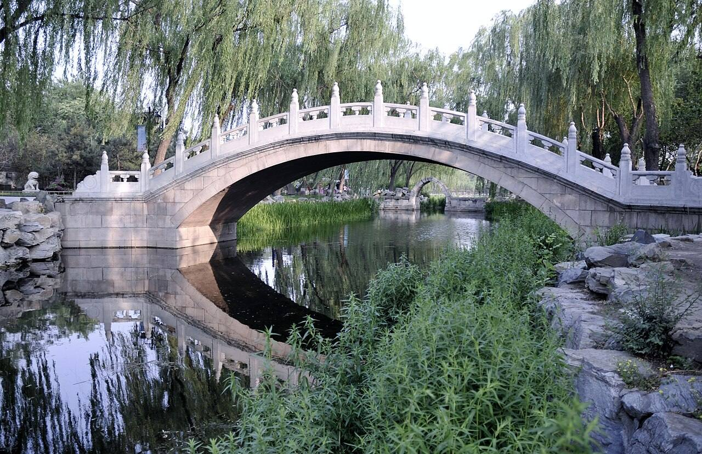
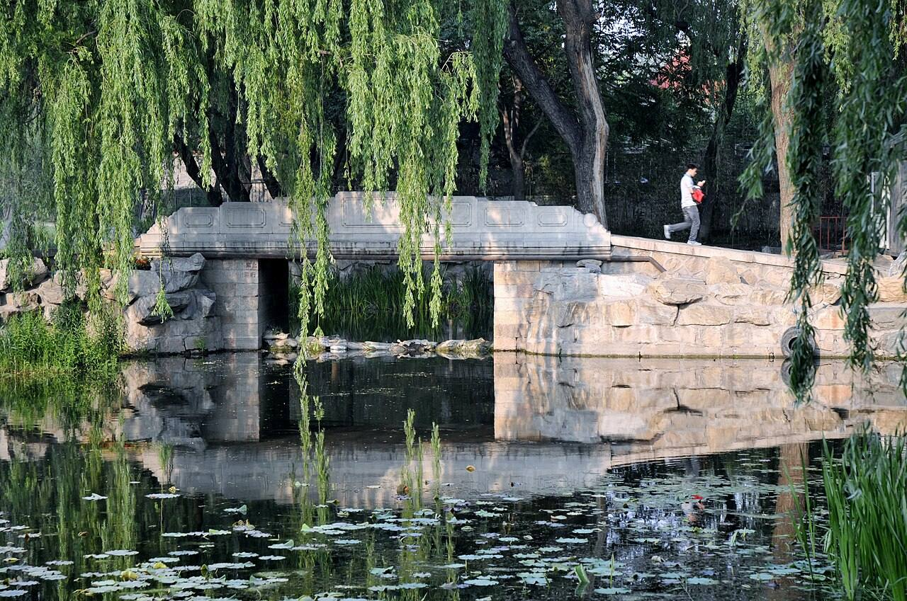

<!-- generated:start (scripts/building_pages.py): do not edit between these markers -->

# QC20: 展诗应律 Zhanshi Yinglü

Qichun Yuan

**3D object:** 4 boxes. Open it: `/reconstruction/3d.html?b=QC20`

## What we know

- **Name:** 展诗应律 Zhanshi Yinglü (S06, S43, S01, S220, S339, S361 · confidence B)
- **Garden:** Qichun Yuan (S06, S43, S01, S220, S339, S361)
- **Type:** compound (S06, S43, S01, S220, S339, S361 · confidence B)
- **Built:** 嘉庆六年 1801 已建成 (S43); by 嘉庆六年 1801; by 1801 (S06, S43, S01, S220, S339, S361)
- **Destroyed:** 1860 (S06, S43, S01, S220, S339, S361)
- **Position:** 40.00188, 116.30322. S01 guess (S01 · confidence C)
- **Bays:** 5 in the texts (S06, S43, S01, S220, S339, S361)
- **Where the text puts it:** 居绮春园后湖南岸 (S43) (S06, S43, S01, S220, S339, S361) *(research copy, not public)*
- **Note:** 南向正殿五间, 戏台 对面, 匾 庆乐升平; 扮戏房五间 (S43). bays: main hall 5, south-facing (S43, section 3.2). bays: 5, galleried, with a stage south (S361, v4 p.259). (S06, S43, S01, S220, S339, S361)
- **Plan reader's note:** No label. Walled yard with a hall north and a 5-bay hall south, opposite each other, as a hall and stage (S43: 正殿五间, 戏台对面). Only the bay count and the facing pair support it. (S01) *(research copy, not public)*
- **How it was read:** guess (S01) *(research copy, not public)*
- **Plan pixels:** 8552, 6350 (S01) *(research copy, not public)*

## Our model now

4 boxes stand in this compound, 4 on blocks drawn on the plan, 0 assumed. Its halls are listed below.

## Inside it (4)

- QC20-AQ011
- QC20-AQ012
- QC20-B1245
- QC20-B1259

## Pictures (2)

- **P0464** (guess): 残桥北侧的石拱桥 - panoramio.jpg (Taken on 27 May 2011 (Commons DateTimeOriginal)). https://commons.wikimedia.org/wiki/File:%E6%AE%8B%E6%A1%A5%E5%8C%97%E4%BE%A7%E7%9A%84%E7%9F%B3%E6%8B%B1%E6%A1%A5_-_panoramio.jpg

  

- **P0465** (guess): 绮春园 石桥 - panoramio.jpg (Taken on 27 May 2011 (Commons DateTimeOriginal)). https://commons.wikimedia.org/wiki/File:%E7%BB%AE%E6%98%A5%E5%9B%AD_%E7%9F%B3%E6%A1%A5_-_panoramio.jpg

  

## Texts and drawings (9)

- **E0769** (text, sure): 圆明园戏场探微: theatres in Qichun Yuan. 2021 · section 3.1-3.3 · S43. https://www.yuanmingyuanpark.cn/xs/yjbg/202108/t20210831_4483509.html
  展诗应律, built by 1801 on the south shore of the back lake: south-facing five-bay hall, facing stage 庆乐升平 with glazed sides and a five-bay dressing room south of it; the dowager's main theatre from 1823. 生冬室: seven-bay hall 17.28 m deep with an indoor heated stage 4.45 m high, 5.02 m square, in its south-west. 敷春堂 had a stage or a temporary one, used in cold weather in 1838.
- **E1011** (description, sure): Site status table, about 2011: nothing visible, or built over. c. 2011 · 系列06 repost, status table · S356. https://blog.sina.com.cn/s/blog_c27029650101itzz.html
  Same table. In it the first group shows no visible remains; 得全阁, 流香渚, 凤麟洲, 涵秋馆, 蔚藻堂, 中和堂, 敷春堂 and 心镜轩 have service buildings on them, and 含晖楼, 澄心堂, 延寿寺, 清夏堂 and 喜雨山房 are occupied by other institutions. 澹泊宁静 and several others have been dug since, so this is out of date for them.
- **E0524** (description, sure): 张宝章: Qichun Yuan under Jiaqing and Daoguang. 《圆明园研究》第32期 · sections 三, 四 · S224. https://www.yuanmingyuanpark.cn/ymyyj/yj032/201504/t20150420_693218.html
  Axis from the great gate in the south-east: 勤政殿, 中和堂, 敷春堂, up to 问月楼 on the lake shore. In the north a large water split by a causeway, with 凤麟洲 on an island in the east part; south of the small western lake 展诗应律, 庄严法界, 生冬室, 春泽斋, 四宜书屋. On two southern islands 畅和堂 and 绿满轩, with 澄心堂 between 畅和堂 and 正觉寺. This also gives QC09 庄严法界 a rough position (Q11).
- **E0771** (description, sure): 老北京的记忆(78): 绮春园展诗应律与庄严法界, quoting 百景图志. blog · post 78 · S339. https://blog.sina.com.cn/s/blog_88741e0d0102w3l2.html
  展诗应律 Zhanshi Yinglü, by 1801, a five-bay theatre hall facing a stage for the dowager, first used so in 1823; island farmland in the 1950s, then a stable. 庄严法界 Zhuangyan Fajie, a small temple, also labelled 慈慧禅林, survived 1860 under guard and was destroyed in 1900; site cleared 1992.
- **E0506** (description, sure): 圆明园五朝御制诗文集注 v4, editors' note on 绮春园. 2020 edition · v4 p.170 · S361. https://www.yuanmingyuanpark.cn/xs/yjbg/202008/P020200803382796786124.pdf#page=173
  Formed from princes' and ministers' gardens, about 54.3 ha. Taken back from Fuheng's heirs and renamed in 1769; gate, tiger-stone wall and 正觉寺 added by 1773, rebuilt in 1795. Jiaqing's growth came in three stages: the western and central groups of the Thirty Scenes first, then the new gate and eastern scenes, finally the south-west (招凉榭, 湛清轩, 畅和堂, 澄心堂, the shrines), gathered as a New Twenty Scenes.
- **E0770** (description, sure): 圆明园五朝御制诗文集注 v4, editors' note on 展诗应律. 2020 edition · v4 p.259 · S361. https://www.yuanmingyuanpark.cn/xs/yjbg/202008/P020200803382796786124.pdf#page=262
  On the south shore of the rear lake, built 1801: a five-bay theatre hall with galleries and a stage to the south, dressing rooms behind, a landing on the north. 吟玉轩 is the east side hall, 栖云阁, 云溪亭 and 翠幄 lie to the south-west. The editors do not know where the plaques 虚明镜, 华滋庭 and 苔香室 hung.
- **E0772** (drawing, sure, search index only): 展诗应律地盘图. not seen · mhymy tag 621 · S42. https://www.mhymy.com/tag/621
  Title only, seen in a listing.
- **E0773** (drawing, sure, search index only): 展诗应律殿平面图. S310. https://www.mhymy.com/special/yslt
  Plan of the Zhanshi Yinglü hall, listed in the site's index; own page URL, shelf number and date not seen. No image here; the site may ask a small payment for the full record.
- **E0774** (drawing, sure, search index only): 展诗应律殿平面图. ysltd/13762 (topic list card only; 排架 not seen) · S310. https://www.mhymy.com/dasl/ysltd/13762.html
  Record titled as a plan of the 展诗应律 Zhanshi Yinglü hall, whose list card introduces the scene on the south shore of Qichun's back lake; the sheet's date and state were not seen because the record page refused this server.

**On the plan:** Its place is drawn on the plan of the gardens (S01), with no name written. https://artmuseum.princeton.edu/collections/objects/138657

## Open questions

- Q13: Weak identifications

<!-- generated:end -->

## Notes

<!-- Yours: regeneration never touches this part. It goes on the public site; what you write below a line holding only %% private %% stays in the research copy. -->
