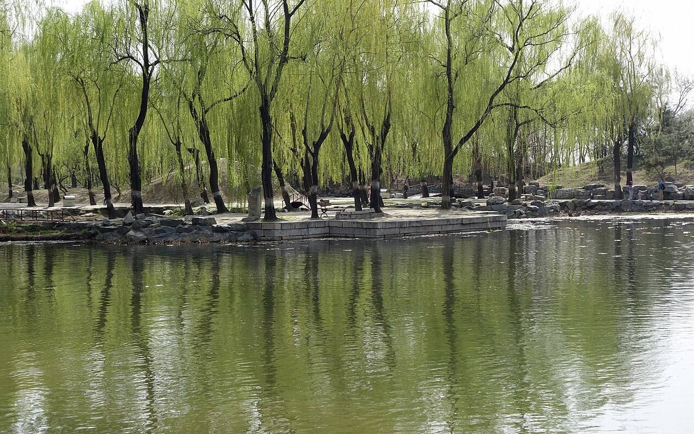
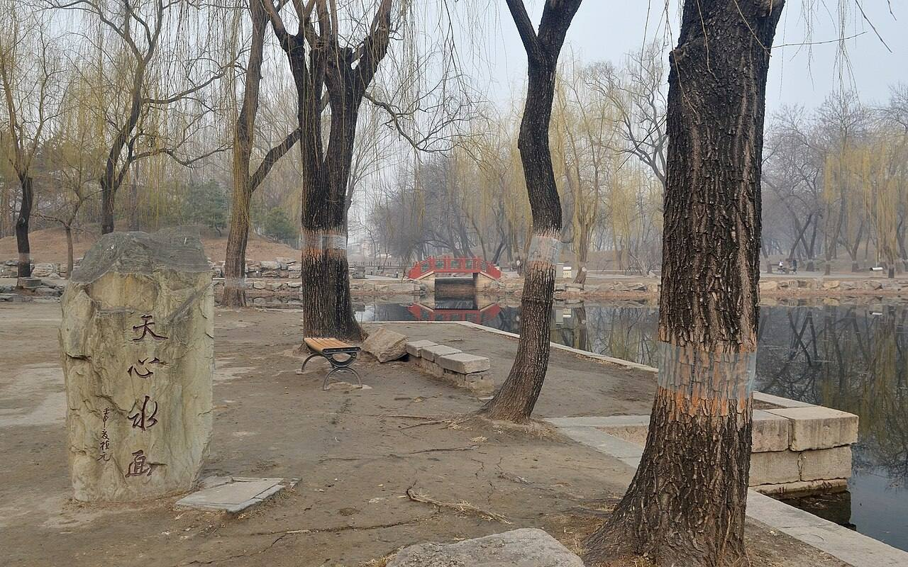

<!-- generated:start (scripts/building_pages.py): do not edit between these markers -->

# QC26: 天心水面 Tianxin Shuimian

Qichun Yuan

**3D object:** 1 box. Open it: `/reconstruction/3d.html?b=QC26`

## What we know

- **Name:** 天心水面 Tianxin Shuimian (S42, S01, S220, S361 · confidence B)
- **Garden:** Qichun Yuan (S42, S01, S220, S361)
- **Type:** compound (S42, S01, S220, S361 · confidence B)
- **Changed:** Outer plaque 玩鹤亭, facing a square pool on the south (S42, S01, S220, S361)
- **Destroyed:** 1860 (S42, S01, S220, S361)
- **Position:** 40.00182, 116.30399. S01 likely (S01 · confidence B)
- **Bays:** 5, with three-bay annexes front and back in the texts / 4x2 on the plan (S42, S01, S220, S361)
- **Size in the inventory:** 13.6 × 10.0 m. S01 plan px / hall scale (S01)
- **Where the text puts it:** 鉴碧亭北部 四面环水 (S42 11480) (S42, S01, S220, S361) *(research copy, not public)*
- **Note:** Modern survey 43-86 x 12-81 m. Same name as the 得全阁 plaque in CC05: unrelated? (S42, S01, S220, S361)
- **Plan reader's note:** No label. S42 11480: north of 鉴碧亭, 四面环水, hills NE, SW, SE. This island fits exactly and has three hill outlines in those corners. Only hall B1260, at its north tip. (S01) *(research copy, not public)*
- **How it was read:** likely (S01) *(research copy, not public)*
- **Plan pixels:** 8841, 6409 (S01) *(research copy, not public)*

## Our model now

A plain box on the block drawn on the Qing plan S01: position and frontage from the plan, heights and roof from the typology of its hall class. It will be updated as the research goes on.

- **Box:** 13.6 × 10 m, side hall
- **Heights:** platform 0.54 m, eave 3.64 m, ridge 7.38 m above the ground
- **Roof:** gable 硬山 or 悬山, rolled ridge 卷棚, grey tile
- **Faces:** 173.7° from north
- **Confidence:** B

## Pictures (2)

- **P0433** (sure): 天心水面遗址 20130414.JPG (2013-04-14 14:34:14 (Commons DateTimeOriginal)). https://commons.wikimedia.org/wiki/File:%E5%A4%A9%E5%BF%83%E6%B0%B4%E9%9D%A2%E9%81%97%E5%9D%80_20130414.JPG

  

- **P0501** (sure): 天心水面遗址 20130317.JPG (2013-03-17 08:49:56 (Commons DateTimeOriginal)). https://commons.wikimedia.org/wiki/File:%E5%A4%A9%E5%BF%83%E6%B0%B4%E9%9D%A2%E9%81%97%E5%9D%80_20130317.JPG

  

## Texts and drawings (6)

- **E0755** (poem, likely): 毕沅 《春和园纪游》 明善堂 诗序 (as quoted in S220). 乾隆; S220 gives no year. Describes Fuheng's garden, so before he gave it up · S220 section 一; primary not seen · S220. http://iqh.ruc.edu.cn/old/qdhjylyjzx/xszl/ylfj/00baad8cc3da4c6a901378da7919d9a8.htm
  > 坐玩鹤亭西望，有石门，如雉堞，东曰归云，西曰舞雪。相羊而入，前跨飞梁，中有曲榭，曰浣香艇。后为清吟书屋，庭列秋槐二株，宵炕昼聂，外有船坞。因命舟师理楫，至锦香亭。白沙如雪，清流玉环，达于明善堂，堂敞七楹，露除霜阙，奎画荧煌。
  A walk through the garden of Fuheng, before Jiaqing rebuilt it. 明善堂 has seven bays, which matches the seven bays of the later 生冬室 on the same site (S43). An older state, not 1860.
- **E1011** (description, sure): Site status table, about 2011: nothing visible, or built over. c. 2011 · 系列06 repost, status table · S356. https://blog.sina.com.cn/s/blog_c27029650101itzz.html
  Same table. In it the first group shows no visible remains; 得全阁, 流香渚, 凤麟洲, 涵秋馆, 蔚藻堂, 中和堂, 敷春堂 and 心镜轩 have service buildings on them, and 含晖楼, 澄心堂, 延寿寺, 清夏堂 and 喜雨山房 are occupied by other institutions. 澹泊宁静 and several others have been dug since, so this is out of date for them.
- **E0676** (description, sure): 圆明园五朝御制诗文集注 v4, editors' note on 鉴碧亭. 2020 edition · v4 p.236 · S361. https://www.yuanmingyuanpark.cn/xs/yjbg/202008/P020200803382796786124.pdf#page=239
  Begun in mid-Jiaqing on an islet in the lake west of 迎晖殿, with 正觉寺 to its west: a double-eaved square pavilion, three bays a side, gallery round. On the north of the islet is the five-bay 天心水面 with annexes, and a pavilion 玩鹤. A single-arch stone bridge to the north-east still stands.
- **E0146** (description, guess): 圆明园五朝御制诗文集注 v3, editors' note on 得全阁. 2020 edition · v3 p.340 · S361. https://www.yuanmingyuanpark.cn/xs/yjbg/202008/P020200803382569071850.pdf#page=343
  Finished 1747 in the south-west: three waterside towers facing east, the main one double-eaved of three bays, plaque 天心水面, with two nine-arch bent wooden bridges; 宝云楼 south and 远风楼 north. Note the same plaque name as the 绮春园 hall QC26.
- **E0791** (archaeology, sure): 圆明园天心水面保护工程考古勘探报告. survey 2007 · mhymy dasl/11480, free part only · S155. https://www.mhymy.com/dasl/11480.html
  Survey 2007, north of 鉴碧亭, water on all sides, edged with stone, three rock piles: 43-86 by 12-81 m, 5872 m2.
- **E0792** (archaeology, sure): 圆明园天心水面保护工程考古勘探报告. 2007-06 to 07 · mhymy 11480, free part · S155. https://www.mhymy.com/dasl/11480.html
  Survey of about 5,872 m2 at 天心水面 Tianxin Shuimian, north of 鉴碧亭, again a waterside site with stone-lined edges, 43-86 m north-south and 12-81 m east-west. Results paywalled.

**On the plan:** Its place is drawn on the plan of the gardens (S01), with no name written. https://artmuseum.princeton.edu/collections/objects/138657

## Evidence for the set of buildings

- Reconstructions and comparables for the whole garden, 绮春园 Qichun Yuan: see GARDEN-QC

## Open questions

- Q44: Places in Qichun Yuan

<!-- generated:end -->

## Notes

<!-- Yours: regeneration never touches this part. It goes on the public site; what you write below a line holding only %% private %% stays in the research copy. -->
