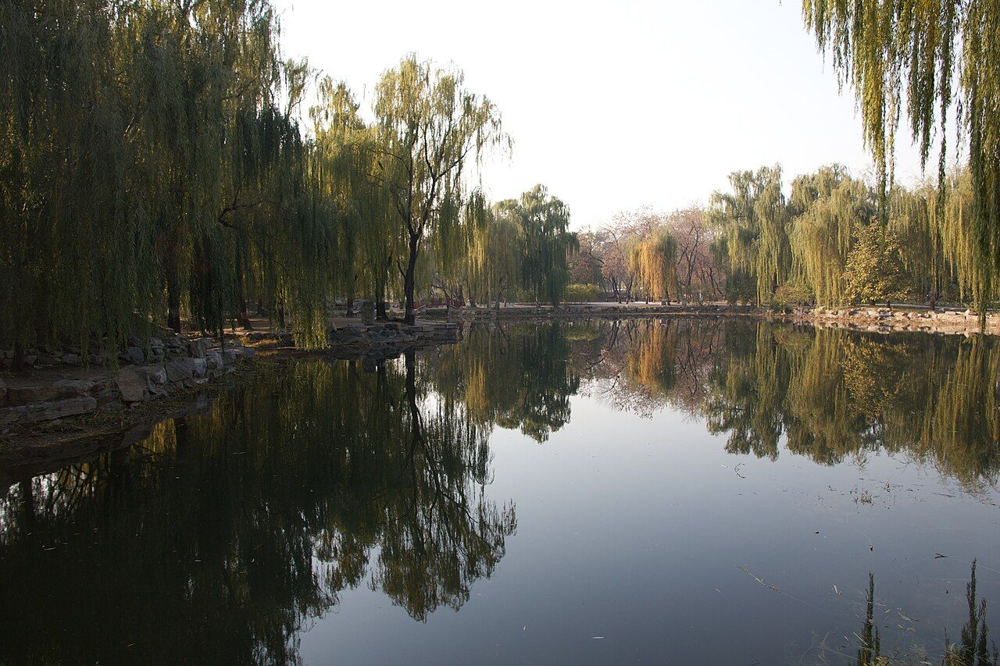

<!-- generated:start (scripts/building_pages.py): do not edit between these markers -->

# QC35: 蔚藻堂 Weizao Tang

Qichun Yuan

**3D object:** 1 box. Open it: `/reconstruction/3d.html?b=QC35`

## What we know

- **Name:** 蔚藻堂 Weizao Tang (S06, S01, S361 · confidence B)
- **Garden:** Qichun Yuan (S06, S01, S361)
- **Type:** scene (S06, S01, S361 · confidence B)
- **Destroyed:** 1860 (S06, S01, S361)
- **Position:** 40.00147, 116.30565. S01 sure (S01 · confidence B)
- **Bays:** 3, on a high terrace in the texts / 3x1 on the plan (S06, S01, S361)
- **Size in the inventory:** 13.4 × 6.3 m. S01 plan px / hall scale (S01)
- **Note:** 绮春园三十景 (Jiaqing poems, list in S06). Position not in text. Plan readers. (S06, S01, S361)
- **Plan reader's note:** West side of the palace block. Label south of B1281. (S01) *(research copy, not public)*
- **How it was read:** sure (S01) *(research copy, not public)*
- **Plan pixels:** 9431, 6675 (S01) *(research copy, not public)*

## Our model now

A plain box on the block drawn on the Qing plan S01: position and frontage from the plan, heights and roof from the typology of its hall class. It will be updated as the research goes on.

- **Box:** 13.4 × 6.3 m, side hall
- **Heights:** platform 0.54 m, eave 3.64 m, ridge 6 m above the ground
- **Roof:** gable 硬山 or 悬山, rolled ridge 卷棚, grey tile
- **Faces:** 175° from north
- **Confidence:** B

## Inside it (8)

- QC35-B1278
- QC35-B1279
- QC35-B1280
- QC35-B1292
- QC35-B1294
- QC35-B1295
- QC35-B1296
- QC35-N01 ?黛亭

## Pictures (1)

- **P0497** (guess): Beijing 2012 (8209728860).jpg (2012-11-06 14:22 (Commons DateTimeOriginal)). https://commons.wikimedia.org/wiki/File:Beijing_2012_(8209728860).jpg

  

## Texts and drawings (8)

- **E0448** (text, sure): 《養吉齋叢錄》 on 綺春園 and the Thirty Scenes. Qing; text states events up to 文宗 · 卷十八 leaf 4 (archive.org 02096508.cn image n52-n53) · S223. https://archive.org/details/02096508.cn/page/n52
  > 綺春園在圓明園東，有複道相屬。舊為大學士傅恆及其子大學士福康安賜園，歿後繳進，嘉慶間始加繕葺。仁宗御製綺春園三十景詩，有宣宗恭跋：先是，園西南以繚垣別界一區，名含暉園，莊敬和碩公主釐降時，賜居於此。公主薨逝，額駙索特那木多布齋以園繳進。舊又橫界一區，名西爽村，有聯暉樓，為成邸寓園。嘉慶間成邸別賜園宅，西爽、含暉皆併入為一園，而規模宏遠矣。舊有數楹名鳳麐洲，後易名清夏齋；問月樓在洲之南，鏡綠亭在洲之北。道光時為尊養孝和皇太后之所，正殿曰迎暉殿。文宗登極，奉康慈太后亦居此，問安視膳，皆如道光間禮。三十景者：敷春堂　鑑德書屋　翠合軒　凌虛閣　協性齋　澄光榭　問月樓　我見室　蔚藻堂　藹芳圃　鏡綠亭　淙玉軒　舒卉軒　竹林院　夕霏榭　清夏齋　鏡虹館　春雨山房　含光樓（即舊時聯暉樓）　涵清館　華滋庭　苔香室　虛明鏡　含淳堂　春澤齋　水心榭　四宜書屋　茗柯精舍　來薰室　般若觀
  The earliest list of the Thirty Scenes we can see, and the history before it seems to come from Daoguang's colophon to Jiaqing's poem set (有宣宗恭跋). It places 問月樓 south of 洲 and 鏡綠亭 north of it, names 迎暉殿 as the main hall of the dowager's residence, and equates 含光樓 with the old 聯暉樓. Punctuation is ours; the print has none. Transcribed by eye.
- **E0841** (poem, sure): 蔚藻堂. 嘉庆七年 (1802) · v4 p.203, under 敷春堂; source ref 2-107 · S361. https://www.yuanmingyuanpark.cn/xs/yjbg/202008/P020200803382796786124.pdf#page=206
  > 天工蔚藻畅三春，大地含生品汇新。愿协雨旸茂百谷，更祈陜蜀息征尘。
  Poem 蔚藻堂 by the Jiaqing Emperor, 1802, filed by the editors under 敷春堂.
- **E0842** (poem, sure): 蔚藻堂. 嘉庆八年 (1803) · v4 p.210, under 敷春堂; source ref 2-226 · S361. https://www.yuanmingyuanpark.cn/xs/yjbg/202008/P020200803382796786124.pdf#page=213
  > 天工蔚新藻，佳丽荟三春。柳岸宜停缆，桃源试问津。仁风敷禹甸，化雨畅鸿钧。百谷全滋浃，还希暄润匀。
  Poem 蔚藻堂 by the Jiaqing Emperor, 1803, filed by the editors under 敷春堂.
- **E0843** (poem, sure): 蔚藻堂. 嘉庆九年 (1804) · v4 p.215, under 敷春堂; source ref 3-15 · S361. https://www.yuanmingyuanpark.cn/xs/yjbg/202008/P020200803382796786124.pdf#page=218
  > 日月丽乎天，山川载于地。人为万物灵，三才定位置。经史蔚精微，参考施政事。文海蕴藻华，本立斯图治。居敬更存诚，发仁必止义。词章勿深求，涉猎兴偶寄。德行为本，文学为末。实政为先，虚词为后。人君日理万几，游艺寄兴，所以养心而适情也。若沾沾于此，与文人争胜，则失其本务矣。辄摅其志于兹堂，以自警云。
  Poem 蔚藻堂 by the Jiaqing Emperor, 1804, filed by the editors under 敷春堂.
- **E0844** (poem, sure): 蔚藻堂 (绮春园三十景). 嘉庆十年 (1805) · v4 p.177, under 绮春园 · S361. https://www.yuanmingyuanpark.cn/xs/yjbg/202008/P020200803382796786124.pdf#page=180
  > 观乎人文化天下，蔚成华藻畅吟怀。山光水黛有真趣，鸟语花香乐静佳。言志孚情六义备，拈题咏物四声谐。几余遣兴非饶舌，岂慕词坛李杜侪。
  One of the Thirty Scenes of 绮春园 by the Jiaqing Emperor, 1805 (S58): the poem 蔚藻堂.
- **E0845** (poem, sure): 蔚藻堂. 嘉庆十一年 (1806) · v4 p.222, under 敷春堂; source ref 3-255 · S361. https://www.yuanmingyuanpark.cn/xs/yjbg/202008/P020200803382796786124.pdf#page=225
  > 日月星辰丽乎天，山川草木著于地。三才定位人最灵，经史文章用不匮。光腾奎壁万丈长，华藻渊微聚精粹。圣贤奥旨澈古今，大本既端该政治。
  Poem 蔚藻堂 by the Jiaqing Emperor, 1806, filed by the editors under 敷春堂.
- **E1011** (description, sure): Site status table, about 2011: nothing visible, or built over. c. 2011 · 系列06 repost, status table · S356. https://blog.sina.com.cn/s/blog_c27029650101itzz.html
  Same table. In it the first group shows no visible remains; 得全阁, 流香渚, 凤麟洲, 涵秋馆, 蔚藻堂, 中和堂, 敷春堂 and 心镜轩 have service buildings on them, and 含晖楼, 澄心堂, 延寿寺, 清夏堂 and 喜雨山房 are occupied by other institutions. 澹泊宁静 and several others have been dug since, so this is out of date for them.
- **E0588** (description, sure): 圆明园五朝御制诗文集注 v4, editors' note on 敷春堂. 2020 edition · v4 p.200 · S361. https://www.yuanmingyuanpark.cn/xs/yjbg/202008/P020200803382796786124.pdf#page=203
  Begun 1801 north of 迎晖殿: a five-bay 工字 hall, with 集禧堂 before it and the five-bay, two-storey 问月楼 behind. The note sets out the rest: 凌虚阁 east of the rear hall, 翠合轩 a small chapel behind it, 澄光榭 south-east of 问月楼, 蔚藻堂 in a court to the south-west, 镜绿亭 south of that, 蔼芳圃 the west gate, 淙玉轩 and 舒卉轩 further south. Some buildings outlasted 1860 and the 1873 repair plan, then were lost around 1900, say the editors.

**On the plan:** Drawn on the plan of the gardens (S01), labelled 蔚藻堂, 3x1 cells. https://artmuseum.princeton.edu/collections/objects/138657

## Evidence for the set of buildings

- Reconstructions and comparables for the whole garden, 绮春园 Qichun Yuan: see GARDEN-QC

## Open questions

- Q11: Qichun Yuan's thirty scenes

<!-- generated:end -->

## Notes

<!-- Yours: regeneration never touches this part. It goes on the public site; what you write below a line holding only %% private %% stays in the research copy. -->
