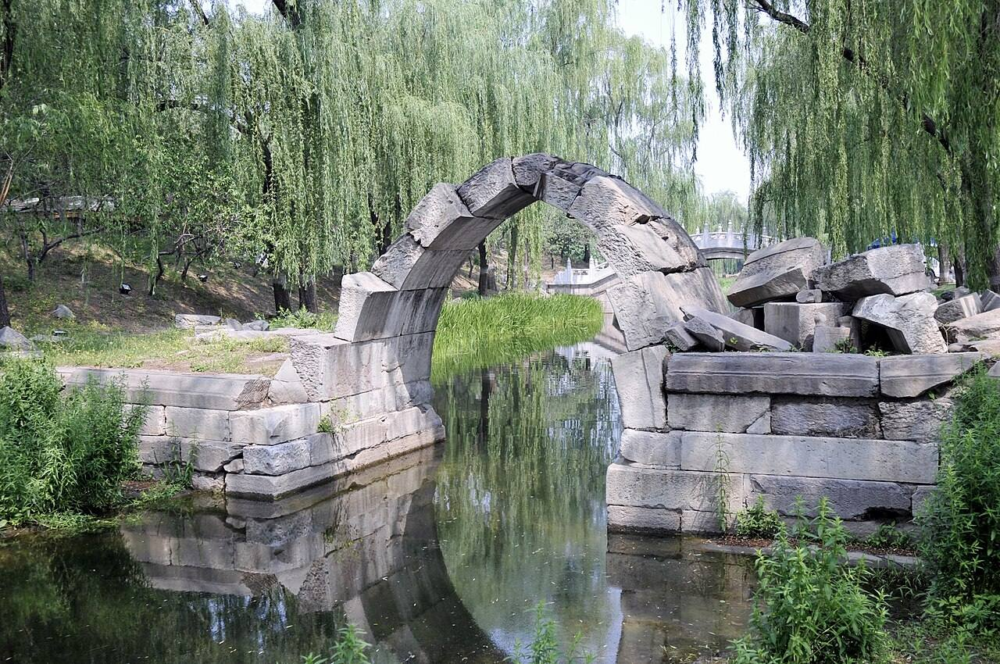
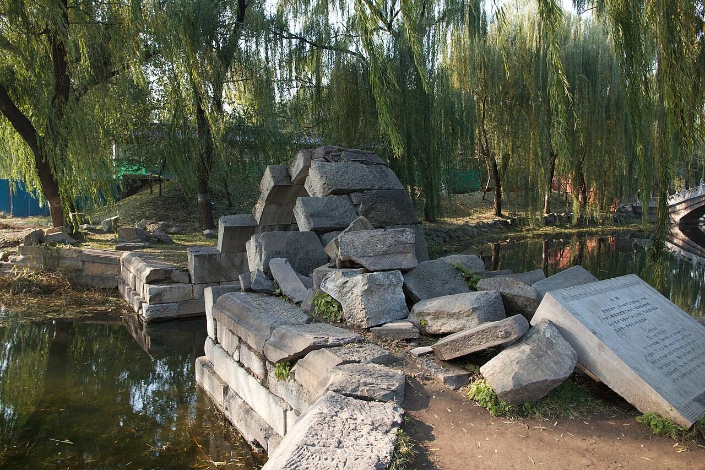

<!-- generated:start (scripts/building_pages.py): do not edit between these markers -->

# QC38: 淙玉轩 Congyu Xuan

Qichun Yuan

**3D object:** 1 box. Open it: `/reconstruction/3d.html?b=QC38`

## What we know

- **Name:** 淙玉轩 Congyu Xuan (S06, S01 · confidence B)
- **Written on the plan:** ?玉轩 (S01 · confidence B)
- **Garden:** Qichun Yuan (S06, S01)
- **Type:** scene (S06, S01 · confidence B)
- **Destroyed:** 1860 (S06, S01)
- **Position:** 40.00097, 116.30567. S01 likely (S01 · confidence B)
- **Size in the inventory:** 7.9 × 8.5 m. S01 plan px / hall scale (S01)
- **Note:** 绮春园三十景 (Jiaqing poems, list in S06). Position not in text. Plan readers. (S06, S01)
- **Plan reader's note:** First char 涼 or 淙; top stroke unclear. Hall at (9418,6920) north of the label; hexagonal pavilion left of the label. | plan: rect=33,28,0. See compounds. (S01) *(research copy, not public)*
- **How it was read:** likely (S01) *(research copy, not public)*
- **Plan pixels:** 9418, 6920 (S01) *(research copy, not public)*

## Our model now

A plain box on the block drawn on the Qing plan S01: position and frontage from the plan, heights and roof from the typology of its hall class. It will be updated as the research goes on.

- **Box:** 7.9 × 8.5 m, small house
- **Heights:** platform 0.45 m, eave 3.2 m, ridge 6.11 m above the ground
- **Roof:** gable 硬山 or 悬山, rolled ridge 卷棚, grey tile
- **Faces:** 174.3° from north
- **Confidence:** B

## Inside it (4)

- QC38-B1301
- QC38-B1311
- QC38-B1312
- QC38-N01

## Pictures (2)

- **P0462** (guess): 残毁的石拱桥 - panoramio.jpg (Taken on 27 May 2011 (Commons DateTimeOriginal)). https://commons.wikimedia.org/wiki/File:%E6%AE%8B%E6%AF%81%E7%9A%84%E7%9F%B3%E6%8B%B1%E6%A1%A5_-_panoramio.jpg

  

- **P0463** (guess): Beijing 2012 (8209726034).jpg (2012-11-06 14:21 (Commons DateTimeOriginal)). https://commons.wikimedia.org/wiki/File:Beijing_2012_(8209726034).jpg

  

## Texts and drawings (5)

- **E0448** (text, sure): 《養吉齋叢錄》 on 綺春園 and the Thirty Scenes. Qing; text states events up to 文宗 · 卷十八 leaf 4 (archive.org 02096508.cn image n52-n53) · S223. https://archive.org/details/02096508.cn/page/n52
  > 綺春園在圓明園東，有複道相屬。舊為大學士傅恆及其子大學士福康安賜園，歿後繳進，嘉慶間始加繕葺。仁宗御製綺春園三十景詩，有宣宗恭跋：先是，園西南以繚垣別界一區，名含暉園，莊敬和碩公主釐降時，賜居於此。公主薨逝，額駙索特那木多布齋以園繳進。舊又橫界一區，名西爽村，有聯暉樓，為成邸寓園。嘉慶間成邸別賜園宅，西爽、含暉皆併入為一園，而規模宏遠矣。舊有數楹名鳳麐洲，後易名清夏齋；問月樓在洲之南，鏡綠亭在洲之北。道光時為尊養孝和皇太后之所，正殿曰迎暉殿。文宗登極，奉康慈太后亦居此，問安視膳，皆如道光間禮。三十景者：敷春堂　鑑德書屋　翠合軒　凌虛閣　協性齋　澄光榭　問月樓　我見室　蔚藻堂　藹芳圃　鏡綠亭　淙玉軒　舒卉軒　竹林院　夕霏榭　清夏齋　鏡虹館　春雨山房　含光樓（即舊時聯暉樓）　涵清館　華滋庭　苔香室　虛明鏡　含淳堂　春澤齋　水心榭　四宜書屋　茗柯精舍　來薰室　般若觀
  The earliest list of the Thirty Scenes we can see, and the history before it seems to come from Daoguang's colophon to Jiaqing's poem set (有宣宗恭跋). It places 問月樓 south of 洲 and 鏡綠亭 north of it, names 迎暉殿 as the main hall of the dowager's residence, and equates 含光樓 with the old 聯暉樓. Punctuation is ours; the print has none. Transcribed by eye.
- **E0857** (poem, sure): 淙玉轩. 嘉庆六年 (1801) · v4 p.201, under 敷春堂; source ref 2-82 · S361. https://www.yuanmingyuanpark.cn/xs/yjbg/202008/P020200803382796786124.pdf#page=204
  > 轩庭跨渌水，坐对觉心清。漾日金波叠，翻风碧縠生。泉渟如玉戛，石激若琴鸣。倾耳聆幽韵，伯牙空外赓。
  Poem 淙玉轩 by the Jiaqing Emperor, 1801, filed by the editors under 敷春堂.
- **E0858** (poem, sure): 淙玉轩. 嘉庆八年 (1803) · v4 p.211, under 敷春堂; source ref 2-229 · S361. https://www.yuanmingyuanpark.cn/xs/yjbg/202008/P020200803382796786124.pdf#page=214
  > 不尽溪声绕槛流，锵金淙玉韵清幽。世尊自具青莲眼，芥子须弥总一沤。
  Poem 淙玉轩 by the Jiaqing Emperor, 1803, filed by the editors under 敷春堂.
- **E0859** (poem, sure): 淙玉轩 (绮春园三十景). 嘉庆十年 (1805) · v4 p.178, under 绮春园 · S361. https://www.yuanmingyuanpark.cn/xs/yjbg/202008/P020200803382796786124.pdf#page=181
  > 回廊相接轩中起，平跨芳溪内外分。薄縠翻波流活活，清音淙玉转沄沄。低含柳荫拖长缕，虚挹荷香漾锦纹。凭槛观澜心静契，真空性水不闻闻。
  One of the Thirty Scenes of 绮春园 by the Jiaqing Emperor, 1805 (S58): the poem 淙玉轩.
- **E0588** (description, sure): 圆明园五朝御制诗文集注 v4, editors' note on 敷春堂. 2020 edition · v4 p.200 · S361. https://www.yuanmingyuanpark.cn/xs/yjbg/202008/P020200803382796786124.pdf#page=203
  Begun 1801 north of 迎晖殿: a five-bay 工字 hall, with 集禧堂 before it and the five-bay, two-storey 问月楼 behind. The note sets out the rest: 凌虚阁 east of the rear hall, 翠合轩 a small chapel behind it, 澄光榭 south-east of 问月楼, 蔚藻堂 in a court to the south-west, 镜绿亭 south of that, 蔼芳圃 the west gate, 淙玉轩 and 舒卉轩 further south. Some buildings outlasted 1860 and the 1873 repair plan, then were lost around 1900, say the editors.

**On the plan:** Drawn on the plan of the gardens (S01), labelled ?玉轩 (? marks an unread character). https://artmuseum.princeton.edu/collections/objects/138657

## Open questions

- Q11: Qichun Yuan's thirty scenes

<!-- generated:end -->

## Notes

<!-- Yours: regeneration never touches this part. It goes on the public site; what you write below a line holding only %% private %% stays in the research copy. -->
