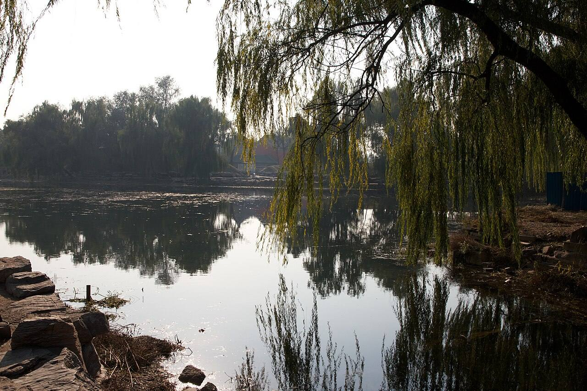

<!-- generated:start (scripts/building_pages.py): do not edit between these markers -->

# QC39: 舒卉轩 Shuhui Xuan

Qichun Yuan

**3D object:** 1 box. Open it: `/reconstruction/3d.html?b=QC39`

## What we know

- **Name:** 舒卉轩 Shuhui Xuan (S06, S01, S361 · confidence B)
- **Written on the plan:** 舒?轩 (S01 · confidence B)
- **Garden:** Qichun Yuan (S06, S01, S361)
- **Type:** scene (S06, S01, S361 · confidence B)
- **Destroyed:** 1860 (S06, S01, S361)
- **Position:** 40.00096, 116.30586. S01 likely (S01 · confidence B)
- **Bays:** 3 in the texts / 2x2 on the plan (S06, S01, S361)
- **Size in the inventory:** 18.4 × 15.4 m. S01 plan px / hall scale (S01)
- **Note:** 绮春园三十景 (Jiaqing poems, list in S06). Position not in text. Plan readers. (S06, S01, S361)
- **Plan reader's note:** Middle char reads 丹/冉, could be cursive 卉. Hall B1302/B1313 above the label. | plan: Overlapping boxes: see blocks_fix. (S01) *(research copy, not public)*
- **How it was read:** likely (S01) *(research copy, not public)*
- **Plan pixels:** 9486, 6950 (S01) *(research copy, not public)*

## Our model now

On the block drawn on the Qing plan S01: position and frontage from the plan, heights and roof from the typology of its hall class, its form drawn by the hall kit. It will be updated as the research goes on.

- **Box:** 18.4 × 15.4 m, main hall
- **Heights:** platform 0.7 m, eave 4.4 m, ridge 9.54 m above the ground
- **Roof:** hip-and-gable 歇山, rolled ridge 卷棚, grey tile
- **Faces:** 263.9° from north
- **Drawn:** by the hall kit: 3 bays, the middle widest, a porch front, steps on the front, 歇山 hip-and-gable with a rolled ridge 卷棚, grey tile, a painted beam under the eave. Drawn from the typology of its hall class, not from a picture of this hall (assumed, C).
- **Confidence:** B

## Pictures (1)

- **P0496** (guess): Beijing 2012 (8208636043).jpg (2012-11-06 14:21 (Commons DateTimeOriginal)). https://commons.wikimedia.org/wiki/File:Beijing_2012_(8208636043).jpg

  

## Texts and drawings (5)

- **E0448** (text, sure): 《養吉齋叢錄》 on 綺春園 and the Thirty Scenes. Qing; text states events up to 文宗 · 卷十八 leaf 4 (archive.org 02096508.cn image n52-n53) · S223. https://archive.org/details/02096508.cn/page/n52
  > 綺春園在圓明園東，有複道相屬。舊為大學士傅恆及其子大學士福康安賜園，歿後繳進，嘉慶間始加繕葺。仁宗御製綺春園三十景詩，有宣宗恭跋：先是，園西南以繚垣別界一區，名含暉園，莊敬和碩公主釐降時，賜居於此。公主薨逝，額駙索特那木多布齋以園繳進。舊又橫界一區，名西爽村，有聯暉樓，為成邸寓園。嘉慶間成邸別賜園宅，西爽、含暉皆併入為一園，而規模宏遠矣。舊有數楹名鳳麐洲，後易名清夏齋；問月樓在洲之南，鏡綠亭在洲之北。道光時為尊養孝和皇太后之所，正殿曰迎暉殿。文宗登極，奉康慈太后亦居此，問安視膳，皆如道光間禮。三十景者：敷春堂　鑑德書屋　翠合軒　凌虛閣　協性齋　澄光榭　問月樓　我見室　蔚藻堂　藹芳圃　鏡綠亭　淙玉軒　舒卉軒　竹林院　夕霏榭　清夏齋　鏡虹館　春雨山房　含光樓（即舊時聯暉樓）　涵清館　華滋庭　苔香室　虛明鏡　含淳堂　春澤齋　水心榭　四宜書屋　茗柯精舍　來薰室　般若觀
  The earliest list of the Thirty Scenes we can see, and the history before it seems to come from Daoguang's colophon to Jiaqing's poem set (有宣宗恭跋). It places 問月樓 south of 洲 and 鏡綠亭 north of it, names 迎暉殿 as the main hall of the dowager's residence, and equates 含光樓 with the old 聯暉樓. Punctuation is ours; the print has none. Transcribed by eye.
- **E0860** (poem, sure): 舒卉轩. 嘉庆七年 (1802) · v4 p.203, under 敷春堂; source ref 2-107 · S361. https://www.yuanmingyuanpark.cn/xs/yjbg/202008/P020200803382796786124.pdf#page=206
  > 万卉舒芳炫锦绣，轩名恰应好春时。韶华秾艳争施巧，尤愿甘膏二麦滋。
  Poem 舒卉轩 by the Jiaqing Emperor, 1802, filed by the editors under 敷春堂.
- **E0861** (poem, sure): 舒卉轩. 嘉庆八年 (1803) · v4 p.210, under 敷春堂; source ref 2-226 · S361. https://www.yuanmingyuanpark.cn/xs/yjbg/202008/P020200803382796786124.pdf#page=213
  > 春园多绮丽，次第百花舒。叶拂和风细，苞开新雨余。霏香遍亭榭，炫艳布阶除。别有心萦系，田功力作初。
  Poem 舒卉轩 by the Jiaqing Emperor, 1803, filed by the editors under 敷春堂.
- **E0862** (poem, sure): 舒卉轩 (绮春园三十景). 嘉庆十年 (1805) · v4 p.178, under 绮春园 · S361. https://www.yuanmingyuanpark.cn/xs/yjbg/202008/P020200803382796786124.pdf#page=181
  > 披拂春风廿四番，千葩万卉绽芳园。娇姿尽绕连廊砌，艳质偏宜近水轩。濯雨烘晴绚颜色，舒苞落瓣觉纷烦。应知古朴常留馥，松竹能余冰雪痕。
  One of the Thirty Scenes of 绮春园 by the Jiaqing Emperor, 1805 (S58): the poem 舒卉轩.
- **E0588** (description, sure): 圆明园五朝御制诗文集注 v4, editors' note on 敷春堂. 2020 edition · v4 p.200 · S361. https://www.yuanmingyuanpark.cn/xs/yjbg/202008/P020200803382796786124.pdf#page=203
  Begun 1801 north of 迎晖殿: a five-bay 工字 hall, with 集禧堂 before it and the five-bay, two-storey 问月楼 behind. The note sets out the rest: 凌虚阁 east of the rear hall, 翠合轩 a small chapel behind it, 澄光榭 south-east of 问月楼, 蔚藻堂 in a court to the south-west, 镜绿亭 south of that, 蔼芳圃 the west gate, 淙玉轩 and 舒卉轩 further south. Some buildings outlasted 1860 and the 1873 repair plan, then were lost around 1900, say the editors.

**On the plan:** Drawn on the plan of the gardens (S01), labelled 舒?轩 (? marks an unread character), 2x2 cells. https://artmuseum.princeton.edu/collections/objects/138657

## Evidence for the set of buildings

- Reconstructions and comparables for the whole garden, 绮春园 Qichun Yuan: see GARDEN-QC

## Open questions

- Q11: Qichun Yuan's thirty scenes

<!-- generated:end -->

## Notes

<!-- Yours: regeneration never touches this part. It goes on the public site; what you write below a line holding only %% private %% stays in the research copy. -->
