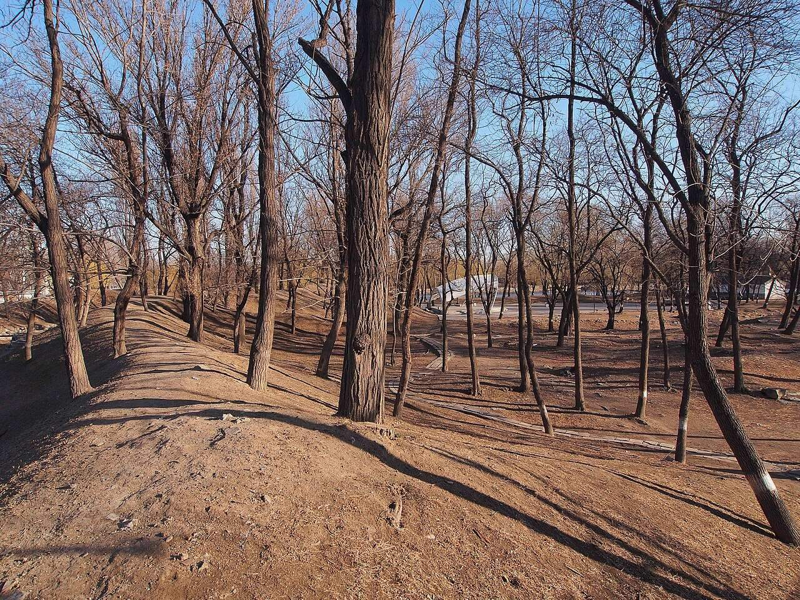

<!-- generated:start (scripts/building_pages.py): do not edit between these markers -->

# QC49: 水心榭 Shuixin Xie

Qichun Yuan

**3D object:** 1 box. Open it: `/reconstruction/3d.html?b=QC49`

## What we know

- **Name:** 水心榭 Shuixin Xie (S06, S01, S361 · confidence B)
- **Garden:** Qichun Yuan (S06, S01, S361)
- **Type:** scene (S06, S01, S361 · confidence B)
- **Destroyed:** 1860 (S06, S01, S361)
- **Position:** 40.00196, 116.30235. S01 guess (S01 · confidence C)
- **Bays:** 3, open hall, galleried in the texts (S06, S01, S361)
- **Note:** 绮春园三十景 (Jiaqing poems, list in S06). Position not in text. Plan readers. (S06, S01, S361)
- **Plan reader's note:** No label. Only a hall on a ring of rockwork in the water, with a hexagonal pavilion. Name is a pure guess from 水心. (S01) *(research copy, not public)*
- **How it was read:** guess (S01) *(research copy, not public)*
- **Plan pixels:** 8225, 6278 (S01) *(research copy, not public)*

## Our model now

1 boxes stand in this compound, 1 on blocks drawn on the plan, 0 assumed. Its halls are listed below.

## Inside it (1)

- QC49-B1253

## Pictures (1)

- **P0485** (guess): 琦春园遗址 - Site of Qichun Garden - 2013.03 - panoramio.jpg (Taken on 13 March 2013 (Commons DateTimeOriginal)). https://commons.wikimedia.org/wiki/File:%E7%90%A6%E6%98%A5%E5%9B%AD%E9%81%97%E5%9D%80_-_Site_of_Qichun_Garden_-_2013.03_-_panoramio.jpg

  

## Texts and drawings (8)

- **E0448** (text, sure): 《養吉齋叢錄》 on 綺春園 and the Thirty Scenes. Qing; text states events up to 文宗 · 卷十八 leaf 4 (archive.org 02096508.cn image n52-n53) · S223. https://archive.org/details/02096508.cn/page/n52
  > 綺春園在圓明園東，有複道相屬。舊為大學士傅恆及其子大學士福康安賜園，歿後繳進，嘉慶間始加繕葺。仁宗御製綺春園三十景詩，有宣宗恭跋：先是，園西南以繚垣別界一區，名含暉園，莊敬和碩公主釐降時，賜居於此。公主薨逝，額駙索特那木多布齋以園繳進。舊又橫界一區，名西爽村，有聯暉樓，為成邸寓園。嘉慶間成邸別賜園宅，西爽、含暉皆併入為一園，而規模宏遠矣。舊有數楹名鳳麐洲，後易名清夏齋；問月樓在洲之南，鏡綠亭在洲之北。道光時為尊養孝和皇太后之所，正殿曰迎暉殿。文宗登極，奉康慈太后亦居此，問安視膳，皆如道光間禮。三十景者：敷春堂　鑑德書屋　翠合軒　凌虛閣　協性齋　澄光榭　問月樓　我見室　蔚藻堂　藹芳圃　鏡綠亭　淙玉軒　舒卉軒　竹林院　夕霏榭　清夏齋　鏡虹館　春雨山房　含光樓（即舊時聯暉樓）　涵清館　華滋庭　苔香室　虛明鏡　含淳堂　春澤齋　水心榭　四宜書屋　茗柯精舍　來薰室　般若觀
  The earliest list of the Thirty Scenes we can see, and the history before it seems to come from Daoguang's colophon to Jiaqing's poem set (有宣宗恭跋). It places 問月樓 south of 洲 and 鏡綠亭 north of it, names 迎暉殿 as the main hall of the dowager's residence, and equates 含光樓 with the old 聯暉樓. Punctuation is ours; the print has none. Transcribed by eye.
- **E0898** (poem, sure): 水心榭. 嘉庆七年 (1802) · v4 p.275, under 春泽斋; source ref 2-123 · S361. https://www.yuanmingyuanpark.cn/xs/yjbg/202008/P020200803382796786124.pdf#page=278
  > 虚榭碧池中，回廊步可通。层波叠轻雾，四面引薰风。鱼影穿疏荇，林阴罨画栊。授时方长养，百谷望全丰。几暇偶习静，悠然在水心。碧奁欣若接，赤伞漫相侵。人寂波弥定，林稠夏渐深。观澜明性海，洞达鉴群忱。
  Poem 水心榭 by the Jiaqing Emperor, 1802, filed by the editors under 春泽斋.
- **E0900** (poem, sure): 水心榭. 嘉庆八年 (1803) · v4 p.276, under 春泽斋; source ref 2-237 · S361. https://www.yuanmingyuanpark.cn/xs/yjbg/202008/P020200803382796786124.pdf#page=279
  > 虚榭纳清景，宛在水中央。畧彴达前渚，雁齿连回廊。倒浸明霞影，荡漾涵云光。游鳞戏锦浪，拨刺唼落芳。静玩有至乐，达观濠濮乡。息机罢垂钓，齐物思蒙庄。代谢漫兴感，四时迭显藏。调御斡元化，天工勤替襄。
  Poem 水心榭 by the Jiaqing Emperor, 1803, filed by the editors under 春泽斋.
- **E0901** (poem, sure): 水心榭. 嘉庆八年 (1803) · v4 p.276, under 春泽斋; source ref 2-245 · S361. https://www.yuanmingyuanpark.cn/xs/yjbg/202008/P020200803382796786124.pdf#page=279
  > 虚榭延薰纳新爽，藤床静坐玩沧浪。绿波叠叠光溶漾，拨刺游鱼叶底藏。四面回廊步可通，赤栏雁齿接西东。抚时解愠消烦热，农事艰难总系衷。
  Poem 水心榭 by the Jiaqing Emperor, 1803, filed by the editors under 春泽斋.
- **E0902** (poem, sure): 水心榭. 嘉庆九年 (1804) · v4 p.277, under 春泽斋; source ref 3-5 · S361. https://www.yuanmingyuanpark.cn/xs/yjbg/202008/P020200803382796786124.pdf#page=280
  > 水榭最宜夏，虚延四面风。回廊互环抱，高柳映葱茏。绮浪层层碧，金鳞叠叠红。来薰吹曲槛，纳爽透轻拢。远岭萦林雾，闲庭绚卉丛。心清畅延眺，验候望年丰。
  Poem 水心榭 by the Jiaqing Emperor, 1804, filed by the editors under 春泽斋.
- **E0903** (poem, sure): 水心榭 (绮春园三十景). 嘉庆十年 (1805) · v4 p.182, under 绮春园 · S361. https://www.yuanmingyuanpark.cn/xs/yjbg/202008/P020200803382796786124.pdf#page=185
  > 曲折回廊四面周，水心虚榭景全收。立汀白鹭浪花溅，穿藻金鳞波影浮。林幄敷阴风飒爽，泉琴戛响韵清幽。霞光倒印澄潭底，岚黛苍茫落远州。
  One of the Thirty Scenes of 绮春园 by the Jiaqing Emperor, 1805 (S58): the poem 水心榭.
- **E0899** (poem, likely): 水心榭对雨 六月初六日. 嘉庆七年 (1802) · v4 p.275, under 春泽斋; source ref 2-128 · S361. https://www.yuanmingyuanpark.cn/xs/yjbg/202008/P020200803382796786124.pdf#page=278
  > 酷暑昼复宵，凌晨布云脚。近午坐水心，欣逢甘雨作。万斛珠跳波，银箭倾错落。繁响溅池荷，飞流悬杰阁。烦暍易清凉，驱炎胜服药。大田普透滋，庶可苏沟壑。去夏实苦霖，今幸沐时若。总荷上天恩，锡丰转歉薄。疏密间滂沱，膏泽庆溥博。更愿兆洗兵，邪靖群黎乐。
  Poem 水心榭对雨 六月初六日 by the Jiaqing Emperor, 1802, filed by the editors under 春泽斋.
- **E0749** (description, sure): 圆明园五朝御制诗文集注 v4, editors' note on 春泽斋. 2020 edition · v4 p.274 · S361. https://www.yuanmingyuanpark.cn/xs/yjbg/202008/P020200803382796786124.pdf#page=277
  Built in mid-Jiaqing west of 展诗应律: a seven-bay hall with front and rear annexes, and 水心榭, a three-bay open hall on the pool. East of it are courts with 畅惠轩, 蘋香沜, 茂悦精舍 and 惠圃; across the pool stands the three-bay 时登楼.

**On the plan:** Its place is drawn on the plan of the gardens (S01), with no name written. https://artmuseum.princeton.edu/collections/objects/138657

## Surviving comparable buildings, not this building (1)

- **T102** 水心榭 Shuixin Xie, 避暑山庄 Chengde. Comparable: same court, era or type, confidence C, standing: yes. Pavilions over water; sluice form from general knowledge, not read Basis: Same name. S422 lists the Chengde 水心榭 as 三亭子, three pavilions. No text pairs them. https://zh.wikipedia.org/wiki/承德避暑山庄及其周围寺庙
  - P0593: 避暑山庄水心榭 3. https://commons.wikimedia.org/wiki/File:%E9%81%BF%E6%9A%91%E5%B1%B1%E5%BA%84%E6%B0%B4%E5%BF%83%E6%A6%AD_3.jpg
  - P0594: 亜東印画輯 07 048 "水心榭（熱河山莊苑）". https://commons.wikimedia.org/wiki/File:%E4%BA%9C%E6%9D%B1%E5%8D%B0%E7%94%BB%E8%BC%AF_07_048_%22%E6%B0%B4%E5%BF%83%E6%A6%AD%EF%BC%88%E7%86%B1%E6%B2%B3%E5%B1%B1%E8%8E%8A%E8%8B%91%EF%BC%89%22.jpg

## Evidence for the set of buildings

- Reconstructions and comparables for the whole garden, 绮春园 Qichun Yuan: see GARDEN-QC

## Open questions

- Q13: Weak identifications

<!-- generated:end -->

## Notes

<!-- Yours: regeneration never touches this part. It goes on the public site; what you write below a line holding only %% private %% stays in the research copy. -->
