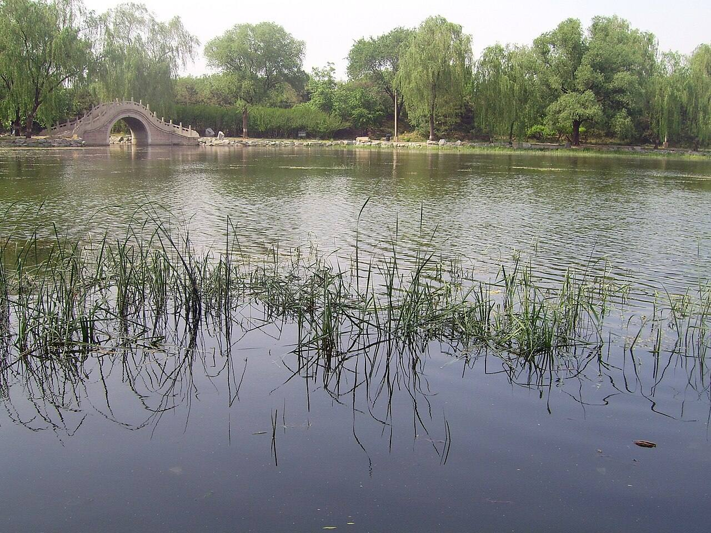

<!-- generated:start (scripts/building_pages.py): do not edit between these markers -->

# QC55: 会心处 Hui Xin Chu

Qichun Yuan

**3D object:** 1 box. Open it: `/reconstruction/3d.html?b=QC55`

## What we know

- **Name:** 会心处 Hui Xin Chu (S01 · confidence B)
- **Garden:** Qichun Yuan (S01)
- **Type:** compound (S01 · confidence B)
- **Destroyed:** 1860 (S01)
- **Position:** 40.00372, 116.30157. S01 sure (S01 · confidence B)
- **Size in the inventory:** 20.3 × 8.5 m. S01 plan px / hall scale (S01)
- **Note:** plan: Label east of a 3-bay hall with no box. (S01)
- **Plan reader's note:** rect=28,85,90. (S01) *(research copy, not public)*
- **How it was read:** sure (S01) *(research copy, not public)*
- **Plan pixels:** 8011, 5343 (S01) *(research copy, not public)*

## Our model now

A plain box on the block drawn on the Qing plan S01: position and frontage from the plan, heights and roof from the typology of its hall class. It will be updated as the research goes on.

- **Box:** 17.9 × 6.22 m, small house
- **Heights:** platform 0.45 m, eave 3.2 m, ridge 5.33 m above the ground
- **Roof:** gable 硬山 or 悬山, rolled ridge 卷棚, grey tile
- **Faces:** 175.4° from north
- **Fit:** reduced towards the size drawn on the plan, to stand clear of its neighbours or the water; moved 4.5 m
- **Water:** stands partly over the water layer: on piers or on a bank too thin for the layer to show
- **Confidence:** B

## Pictures (1)

- **P0435** (likely): Lake of Yuanmingyuan, Huixin Bridge.jpg (2007-05-07 (Commons DateTimeOriginal)). https://commons.wikimedia.org/wiki/File:Lake_of_Yuanmingyuan,_Huixin_Bridge.jpg

  

## Texts and drawings (1)

- **E0676** (description, likely): 圆明园五朝御制诗文集注 v4, editors' note on 鉴碧亭. 2020 edition · v4 p.236 · S361. https://www.yuanmingyuanpark.cn/xs/yjbg/202008/P020200803382796786124.pdf#page=239
  Begun in mid-Jiaqing on an islet in the lake west of 迎晖殿, with 正觉寺 to its west: a double-eaved square pavilion, three bays a side, gallery round. On the north of the islet is the five-bay 天心水面 with annexes, and a pavilion 玩鹤. A single-arch stone bridge to the north-east still stands.

**On the plan:** Drawn on the plan of the gardens (S01), labelled 会心处. https://artmuseum.princeton.edu/collections/objects/138657

## Open questions

None that name it.

<!-- generated:end -->

## Notes

<!-- Yours: regeneration never touches this part. It goes on the public site; what you write below a line holding only %% private %% stays in the research copy. -->
