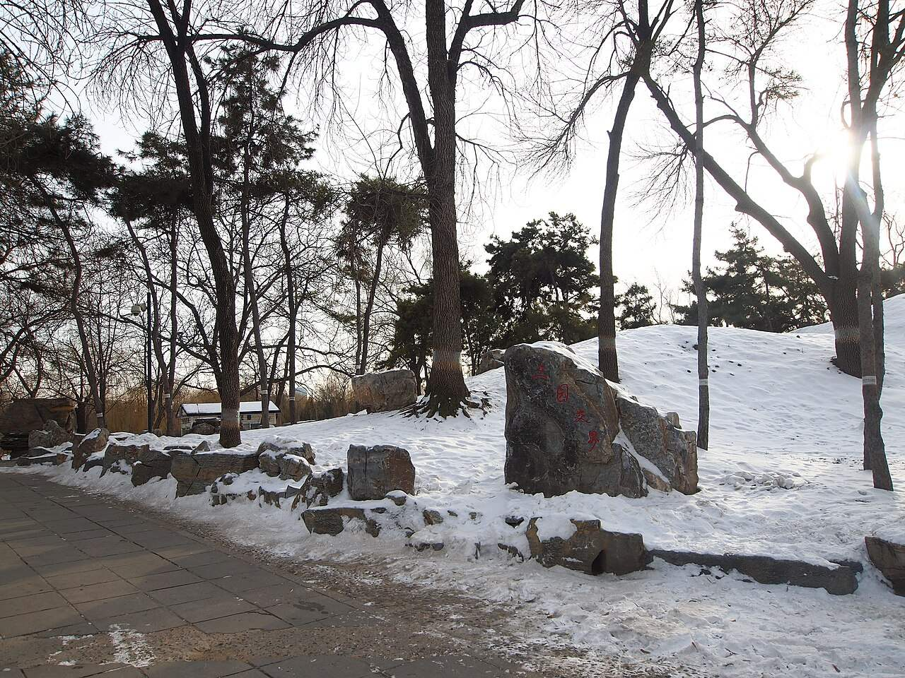
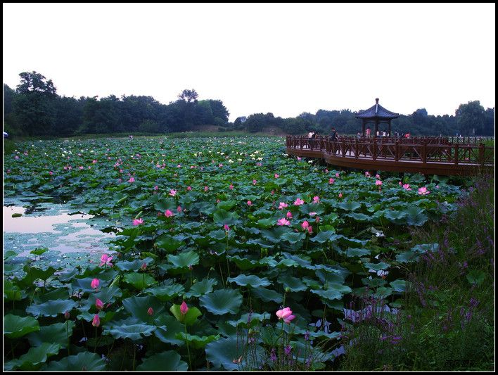

<!-- generated:start (scripts/building_pages.py): do not edit between these markers -->

# QC56: 敞厅 Chang Ting

Qichun Yuan

**3D object:** 1 box. Open it: `/reconstruction/3d.html?b=QC56`

## What we know

- **Name:** 敞厅 Chang Ting (S01 · confidence B)
- **Garden:** Qichun Yuan (S01)
- **Type:** compound (S01 · confidence B)
- **Destroyed:** 1860 (S01)
- **Position:** 40.00463, 116.30437. S01 likely (S01 · confidence B)
- **Bays:** 5x1 on the plan (S01)
- **Size in the inventory:** 17.5 × 8.5 m. S01 plan px / hall scale (S01)
- **Plan reader's note:** North shore of the big lake. Second char unclear. A descriptor, not a scene name. (S01) *(research copy, not public)*
- **How it was read:** likely (S01) *(research copy, not public)*
- **Plan pixels:** 9190, 4954 (S01) *(research copy, not public)*

## Our model now

A plain box on the block drawn on the Qing plan S01: position and frontage from the plan, heights and roof from the typology of its hall class. It will be updated as the research goes on.

- **Box:** 17.5 × 8.5 m, main hall
- **Heights:** platform 0.7 m, eave 4.4 m, ridge 7.32 m above the ground
- **Roof:** hip-and-gable 歇山, rolled ridge 卷棚, grey tile
- **Faces:** 173.5° from north
- **Confidence:** B

## Pictures (2)

- **P0473** (guess): 三园交界 - Intersection of Three Gardens - 2012.12 - panoramio.jpg (Taken on 21 December 2012 (Commons DateTimeOriginal)). https://commons.wikimedia.org/wiki/File:%E4%B8%89%E5%9B%AD%E4%BA%A4%E7%95%8C_-_Intersection_of_Three_Gardens_-_2012.12_-_panoramio.jpg

  

- **P0484** (guess): 荷塘 - panoramio.jpg (24 January 2011 (original upload date) (Commons DateTimeOriginal)). https://commons.wikimedia.org/wiki/File:%E8%8D%B7%E5%A1%98_-_panoramio.jpg

  

## Texts and drawings (0)

None of its own.

**On the plan:** Drawn on the plan of the gardens (S01), labelled 敞厅, 5x1 cells. https://artmuseum.princeton.edu/collections/objects/138657

## Evidence for the set of buildings

- Reconstructions and comparables for the whole garden, 绮春园 Qichun Yuan: see GARDEN-QC

**Searched and not found:** No text or drawing names it in 養吉齋叢錄 j18, modern studies of 绮春园, what search indexes show of the Yangshi Lei drawings; 日下旧闻考 does not cover this garden, and Jiaqing's 三十景 poems could not be reached (wishlist).

## Open questions

None that name it.

<!-- generated:end -->

## Notes

<!-- Yours: regeneration never touches this part. It goes on the public site; what you write below a line holding only %% private %% stays in the research copy. -->
