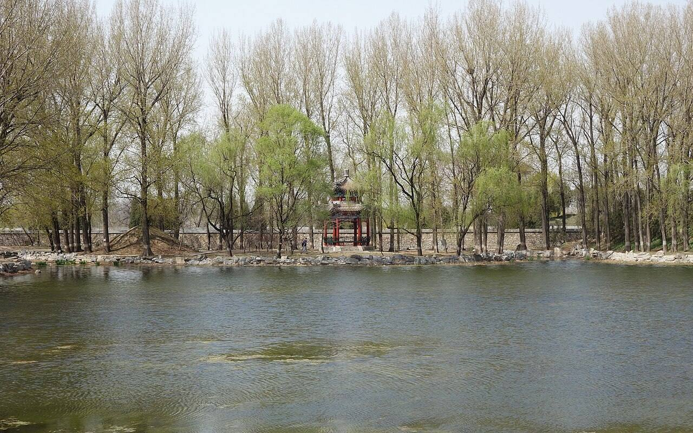

<!-- generated:start (scripts/building_pages.py): do not edit between these markers -->

# QC57: 浩然亭 Hao Ran Ting

Qichun Yuan

**3D object:** 1 box. Open it: `/reconstruction/3d.html?b=QC57`

## What we know

- **Name:** 浩然亭 Hao Ran Ting (S01, S361 · confidence B)
- **Garden:** Qichun Yuan (S01, S361)
- **Type:** compound (S01, S361 · confidence B)
- **Destroyed:** 1860 (S01, S361)
- **Position:** 40.00465, 116.30583. S01 sure (S01 · confidence B)
- **Bays:** 1x1 on the plan (S01, S361)
- **Size in the inventory:** 6.5 × 8.2 m. S01 plan px / hall scale (S01)
- **Note:** double-eaved square pavilion (S361, v4 p.239). (S01, S361)
- **Plan reader's note:** Round island; square pavilion. Lead 5910f5 names 浩然亭 among rebuilt pavilions. (S01) *(research copy, not public)*
- **How it was read:** sure (S01) *(research copy, not public)*
- **Plan pixels:** 9744, 5014 (S01) *(research copy, not public)*

## Our model now

On the block drawn on the Qing plan S01: position and frontage from the plan, heights and roof from the typology of its hall class, its form drawn by the hall kit. It will be updated as the research goes on.

- **Box:** 6.5 × 8.2 m, pavilion square
- **Heights:** platform 0.48 m, eave 3.68 m, ridge 6.71 m above the ground
- **Roof:** pyramid 攒尖, grey tile
- **Faces:** 173.1° from north
- **Drawn:** by the hall kit: 1 bay, steps on the front, 攒尖 pyramid, grey tile, a painted beam under the eave. Drawn from the typology of its hall class, not from a picture of this hall (assumed, C).
- **Confidence:** B

## Pictures (1)

- **P0434** (sure): Haoran Pavilion 20130414.JPG (2013-04-14 14:23:42 (Commons DateTimeOriginal)). https://commons.wikimedia.org/wiki/File:Haoran_Pavilion_20130414.JPG

  

## Texts and drawings (3)

- **E0917** (text, sure): 内务府 repair list 乾隆四十三年 (as quoted in S220). 乾隆四十三年 1778 · S220 section 三; archive not seen · S220. http://iqh.ruc.edu.cn/old/qdhjylyjzx/xszl/ylfj/00baad8cc3da4c6a901378da7919d9a8.htm
  > 明善堂后碧涛书屋、双寿寺、眺吟楼、浩然亭、松风萝月等处捞堆坍塌山石泊岸、码头，勾抿油灰
  Earliest dated mention of these places. Settles the plan readings of QC53 松风萝月 and QC54 眺吟楼, both partly unread on S01.
- **E0918** (poem, sure): 毕沅 《春和园纪游》 荻蒲 诗序 (as quoted in S220). 乾隆; S220 gives no year. Describes Fuheng's garden, so before he gave it up · S220 section 三; primary not seen · S220. http://iqh.ruc.edu.cn/old/qdhjylyjzx/xszl/ylfj/00baad8cc3da4c6a901378da7919d9a8.htm
  > 海于天地为物最巨，谓其受纳广博也。园中西海子南受双寿寺前水，东受北海子水，旷如也，奥如也。南有凝翠轩，沿缘而上，多小石山，山无大林，木皆短松瘦竹……右转而北，崇冈俯仰，最高者为岚翠亭、横翠山房，次之浩然亭、眺吟楼……下瞰湖波，渺弥沦涟，千顷一碧。
  The northern ridge above the back lake with short pines and thin bamboo; 浩然亭 and 眺吟楼 look down on the water. Useful for planting and for terrain at QC54, QC57.
- **E0649** (description, sure): 圆明园五朝御制诗文集注 v4, editors' note on 凤麟洲. 2020 edition · v4 p.239 · S361. https://www.yuanmingyuanpark.cn/xs/yjbg/202008/P020200803382796786124.pdf#page=242
  Two islands joined by a winding bridge, begun 1807. Main hall seven bays in two rolls with a five-bay annex, an open hall 绣漪轩 before it, a side court east, a service court on the small east island. On another island to the north is the double-eaved square 浩然亭, and beyond it the gate to 长春园.

**On the plan:** Drawn on the plan of the gardens (S01), labelled 浩然亭, 1x1 cells. https://artmuseum.princeton.edu/collections/objects/138657

## Evidence for the set of buildings

- Reconstructions and comparables for the whole garden, 绮春园 Qichun Yuan: see GARDEN-QC

## Open questions

None that name it.

<!-- generated:end -->

## Notes

<!-- Yours: regeneration never touches this part. It goes on the public site; what you write below a line holding only %% private %% stays in the research copy. -->
