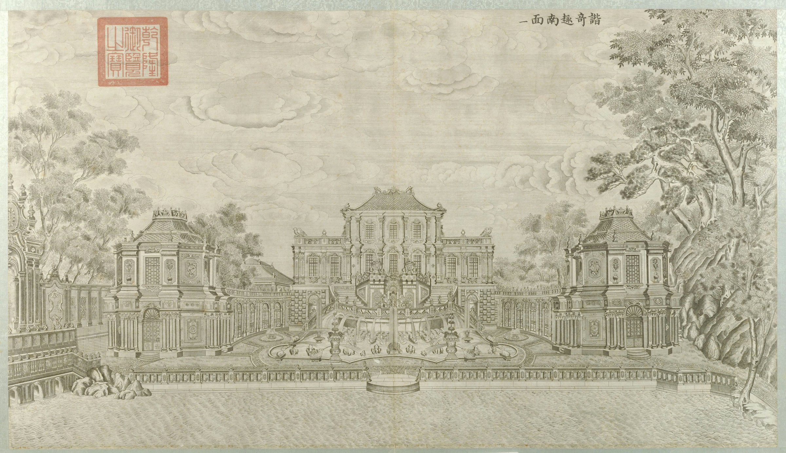
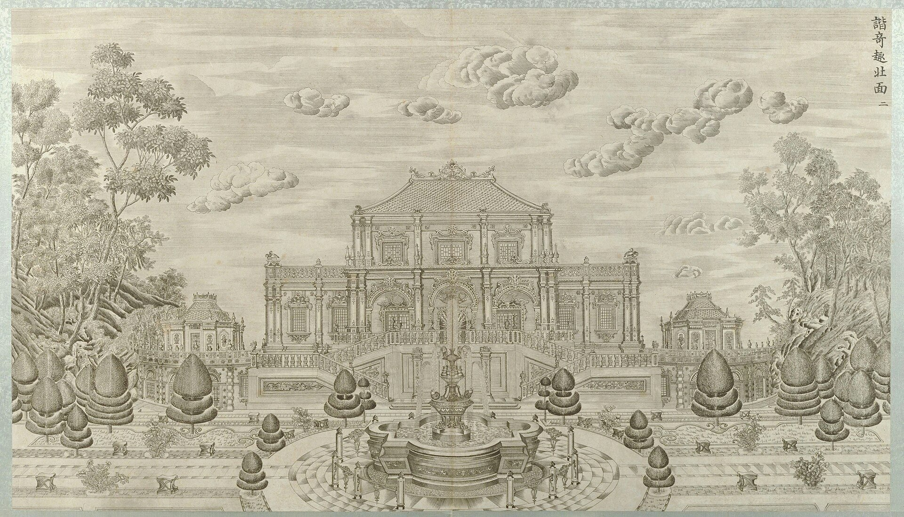
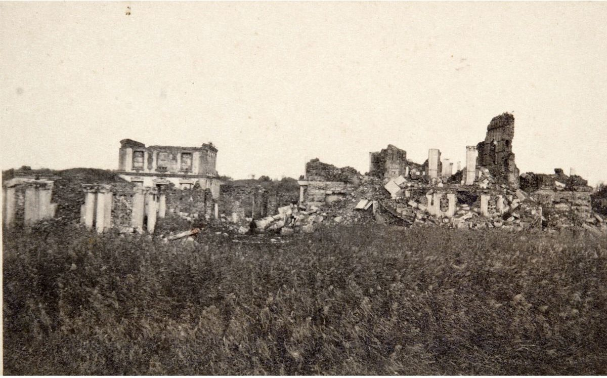
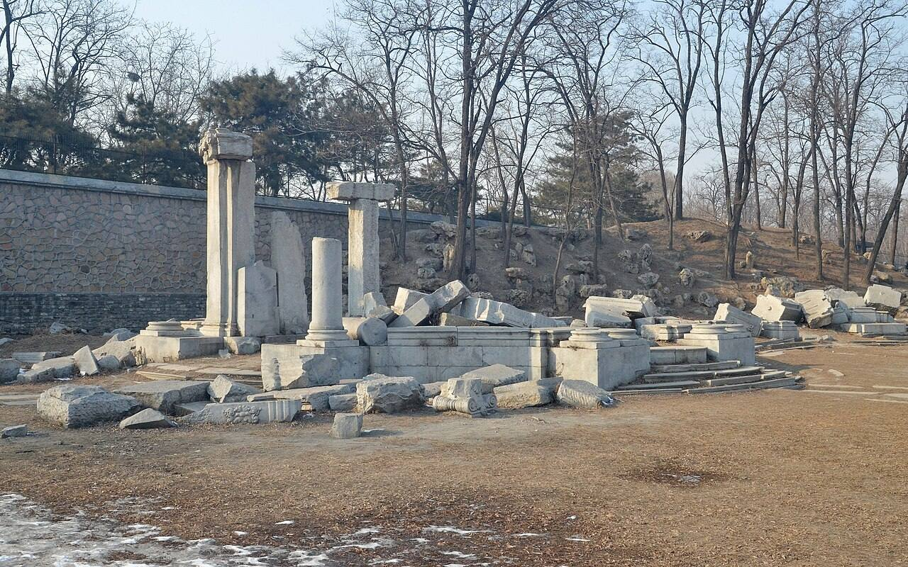

<!-- generated:start (scripts/building_pages.py): do not edit between these markers -->

# XY01-01: 八角奏乐亭 Bajiao Zouyue Ting

west octagonal music pavilion · Xiyang Lou

**3D object:** 2 boxes. Open it: `/reconstruction/3d.html?b=XY01-01`

**Part of:** XY01 谐奇趣

## What we know

- **Name:** 八角奏乐亭 Bajiao Zouyue Ting (S06, S02, S01, S108 · confidence B)
- **English:** west octagonal music pavilion (S06, S02, S01, S108)
- **Garden:** Xiyang Lou (S06, S02, S01, S108)
- **Type:** pavilion (S06, S02, S01, S108 · confidence B)
- **Destroyed:** 1860 (S06, S02, S01, S108)
- **Position:** 40.01096, 116.30210. S850;S01, moved in Round 6: on the ruin, research/xiyanglou/boxes.csv (S01 · confidence B)
- **Size in the inventory:** 8.7 × 8.7 m. stated: S01;S850;S71, research/xiyanglou/boxes.csv (S01)
- **Storeys:** 2 (S06, S02, S01, S108)
- **Tiles:** 五色琉璃 (S06) (S06, S02, S01, S108)
- **Where the text puts it:** 游廊尽头 (S06) (S06, S02, S01, S108) *(research copy, not public)*
- **Note:** Malone: 2-storey towers. Round 6 replaced frontage 9.6 m. Round 6 replaced depth 12.1 m. (S06, S02, S01, S108)
- **Plan reader's note:** rect=40,40,0. Octagon, end of the curved gallery. Gallery runs (8816,1490) (8760,1510) (8735,1560) (8735,1580), width ~15. (S01) *(research copy, not public)*
- **How it was read:** likely (S01) *(research copy, not public)*
- **Plan pixels:** 8686, 1510 (S01) *(research copy, not public)*

## Our model now

Simple massing of a European palace: position and footprint from the ruin, the plan or a survey, heights read from the plates of the 1780s (research/xiyanglou/boxes.csv). Not a detailed model yet; the figures and their methods are in the Dimensions block.

- **1 ×:** octagonal music pavilion, two storeys: 8.7 × 8.7 m, eave 9.3 m, ridge 12.5 m
- **1 ×:** corridor, 9 bays, curved on the plates; a straight run here: 49.3 × 4 m, eave 8.8 m, ridge 9.6 m
- **Confidence:** C, all assumed

## Pictures (4)

- **P0041** (sure): 谐奇趣南面 (圆明园铜版画册 / 西洋楼铜版画, plate 一 of 二十; title and number printed on the plate) (1786 (Commons); Palace Museum: 清). https://commons.wikimedia.org/wiki/File%3A%E5%9C%86%E6%98%8E%E5%9B%AD%E9%93%9C%E7%89%88%E7%94%BB%E5%86%8C-17.jpg

  

- **P0042** (likely): 谐奇趣北面 (圆明园铜版画册 / 西洋楼铜版画, plate 二 of 二十; title and number printed on the plate) (1786 (Commons); Palace Museum: 清). https://commons.wikimedia.org/wiki/File%3A%E5%9C%86%E6%98%8E%E5%9B%AD%E9%93%9C%E7%89%88%E7%94%BB%E5%86%8C.jpg

  

- **P0301** (likely): Fotografija Ruševine gledališča in knjižnice v Stari poletni palači (album: "Yüen-Ming-Yüen: Ruinen des Theaters und Bibliothek") (20th c., album bought 1914-1920 (holder)). https://vazcollections.si/predmeti/fotografija-rusevine-gledalisca-in-knjiznice-v-stari-poletni-palaci/

  

- **P0346** (sure): Ruins of Xieqiqu West Wing 20130126.JPG (2013-01-26 14:35:42 (Commons DateTimeOriginal)). https://commons.wikimedia.org/wiki/File:Ruins_of_Xieqiqu_West_Wing_20130126.JPG

  

## Texts and drawings (2)

- **E0931** (description, likely): Plate II: 谐奇趣 Xieqiqu, south front (by content). 1786-1803 · pp.176-177, Plate II · S258. https://archive.org/details/BIUSante_40644
  > Sur le sol de cette seconde terrasse sont placées à droite et à gauche deux galeries en hémicycle, lesquelles ne s'élèvent que jusqu'au niveau de la première terrasse.
  Round stair with a double ramp and a niche with a throne; a basin with vases and animals, birds and quadrupeds spouting; a dolphin in the centre; octagonal pavilions at the ends of the galleries; on the left a triumphal arch with a European dial; a three-arch bridge. Delatour's Plate II matches Malone's Engraving 1.
- **E0932** (description, likely): Engraving 1: 谐奇趣 Xieqiqu, south front. 1934 · p.141 · S02. https://archive.org/details/historyofpekings00malo
  > A three-story building in the center was joined by curved galleries to two two-storied towers at the southeast and southwest of the main building.
  Curved stairs from the second floor down to a pool with several fountains between galleries and towers; a lake with a balustrade in front. Capitals mix Corinthian and Ionic (p.143).

**On the plan:** Drawn on the plan of the gardens (S01), labelled 八角奏乐亭. https://artmuseum.princeton.edu/collections/objects/138657

## Evidence for the set of buildings

- Evidence for the whole compound 谐奇趣: see XY01
- Reconstructions and comparables for the whole garden, 西洋楼 Xiyang Lou: see GARDEN-XY
- Standing buildings comparable to a square pavilion (not this building): see CLASS-pavilion_square

## Open questions

None that name it.

<!-- generated:end -->

## Notes

<!-- Yours: regeneration never touches this part. It goes on the public site; what you write below a line holding only %% private %% stays in the research copy. -->
