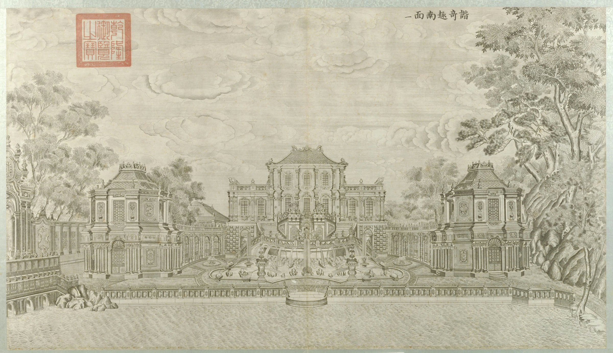

<!-- generated:start (scripts/building_pages.py): do not edit between these markers -->

# XY01-02: 海棠形喷水池 Haitangxing penshui chi

Xiyang Lou

**3D object:** 1 box. Open it: `/reconstruction/3d.html?b=XY01-02`

**Part of:** XY01 谐奇趣

## What we know

- **Name:** 海棠形喷水池 Haitangxing penshui chi (S06, S02, S01 · confidence B)
- **Garden:** Xiyang Lou (S06, S02, S01)
- **Type:** european (S06, S02, S01 · confidence B)
- **Destroyed:** 1860 (S06, S02, S01)
- **Position:** 40.01100, 116.30247. S01 likely (S01 · confidence B)
- **Size in the inventory:** 30.1 × 18.4 m. S01 plan px / hall scale (S01)
- **Where the text puts it:** 楼南 月台下 (S06) (S06, S02, S01) *(research copy, not public)*
- **Note:** Bronze ducks 18, sheep 4 and a stone fish (S06); fish now at 未名湖. (S06, S02, S01)
- **Plan reader's note:** rect=126,61,0. Scalloped pool x 8816-8942, y 1579-1640 with double edge; neck south to the lake x 8860-8902. (S01) *(research copy, not public)*
- **How it was read:** likely (S01) *(research copy, not public)*
- **Plan pixels:** 8824, 1547 (S01) *(research copy, not public)*

## Our model now

Simple massing of a European palace, assumed: sizes from the texts and the ruin polygons, position from the plan or the ruin. Not a reading of the 1786 engravings yet.

- **Box:** 30 × 18 m, european, pool
- **Part:** fountain pool
- **Faces:** 174.8° from north
- **Confidence:** C, assumed

## Pictures (1)

- **P0041** (sure): 谐奇趣南面 (圆明园铜版画册 / 西洋楼铜版画, plate 一 of 二十; title and number printed on the plate) (1786 (Commons); Palace Museum: 清). https://commons.wikimedia.org/wiki/File%3A%E5%9C%86%E6%98%8E%E5%9B%AD%E9%93%9C%E7%89%88%E7%94%BB%E5%86%8C-17.jpg

  

## Texts and drawings (2)

- **E0931** (description, likely): Plate II: 谐奇趣 Xieqiqu, south front (by content). 1786-1803 · pp.176-177, Plate II · S258. https://archive.org/details/BIUSante_40644
  > Sur le sol de cette seconde terrasse sont placées à droite et à gauche deux galeries en hémicycle, lesquelles ne s'élèvent que jusqu'au niveau de la première terrasse.
  Round stair with a double ramp and a niche with a throne; a basin with vases and animals, birds and quadrupeds spouting; a dolphin in the centre; octagonal pavilions at the ends of the galleries; on the left a triumphal arch with a European dial; a three-arch bridge. Delatour's Plate II matches Malone's Engraving 1.
- **E0932** (description, likely): Engraving 1: 谐奇趣 Xieqiqu, south front. 1934 · p.141 · S02. https://archive.org/details/historyofpekings00malo
  > A three-story building in the center was joined by curved galleries to two two-storied towers at the southeast and southwest of the main building.
  Curved stairs from the second floor down to a pool with several fountains between galleries and towers; a lake with a balustrade in front. Capitals mix Corinthian and Ionic (p.143).

**On the plan:** Drawn on the plan of the gardens (S01), labelled 海棠形喷水池. https://artmuseum.princeton.edu/collections/objects/138657

## Evidence for the set of buildings

- Evidence for the whole compound 谐奇趣: see XY01

## Open questions

None that name it.

<!-- generated:end -->

## Notes

<!-- Yours: regeneration never touches this part. It goes on the public site; what you write below a line holding only %% private %% stays in the research copy. -->
